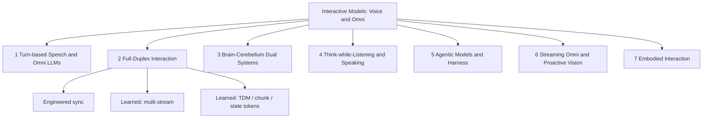

# Awesome Interactive Model

[](https://awesome.re)
[](CONTRIBUTING.md)
[](LICENSE)
[](README_zh.md)

<p align="center">
  
</p>

<p align="center">
A curated map of <b>voice / Omni interactive models</b> organized by <b>how interaction is realized</b>—timing, think/speak scheduling, and effect scope—not by a cascade→E2E→dual-system “evolution ladder”.
</p>

<p align="center"><strong>509 curated entries</strong> (🔓 open weights: 150, 🧩 code / runtime: 141, 🔒 closed API / product: 70, 📄 paper only / unreleased: 148). Verified sources as of 2026-10-06.</p>

---

## 📰 News & Updates

- **2026-10-19** 🎉 **Our work, Jarvis**, gives coordination a brain of its own through a dedicated harness that keeps realtime dialogue and background reasoning in sync for full-duplex Audio/Omni agents. [Paper](https://arxiv.org/abs/2610.23804v1) · [Code](https://github.com/JensenYX/Jarvis) · [Demo](https://amphionteam.github.io/Jarvis-Demo/)
- **2026-10-05** — Amazon **Nova 2.5 Sonic** GA (speech-to-speech realtime).
- **2026-09-10** — OpenAI **GPT-Live** API GA; **gpt-realtime** / **gpt-realtime-mini** announced for deprecation.
- **2026-09** — SeedRealtime, Grok Voice Think Fast, Hibiki-Zero, MiniCPM-o 4.5, PersonaPlex, and many duplex / dual-system papers.
- **2026-10-06** — This list launched (509 curated entries). Long-form survey: [docs/survey.md](docs/survey.md).

---

## 📑 Contents

- 📚 [Surveys & Position Papers](#surveys)
  - [Spoken Language / Speech LLMs](#surveys-spoken)
  - [Full-Duplex & Turn-Taking](#surveys-duplex)
  - [Omni, Streaming & Proactive Agents](#surveys-omni-stream)
  - [Position & Perspective Papers](#positions)
  - [Influential Blogs & Announcements](#blogs)
  - [Tutorials & Primers](#tutorials)
  - [Related Awesome Lists](#related-lists)
- 🎙️ [1. Turn-based Speech & Omni LLMs](#turn-based)
  - [Early Speech–Language Models](#early-speech-lm)
  - [End-to-End Spoken Dialogue Models](#e2e-speech-dialogue)
  - [Omni Models with Speech Generation](#omni-generation)
- 🔄 [2. Full-Duplex Interaction Models](#full-duplex)
  - [2.1 Engineered Sync (Controller / Cascade)](#duplex-engineered)
  - [2.2 Learned Sync: Multi-Stream / Dual-Channel](#duplex-multistream)
  - [2.3 Learned Sync: Time-Division / Chunk / State Tokens](#duplex-tdm)
- 🧠 [3. Brain–Cerebellum Dual Systems](#dual-system)
  - [3.1 Concepts & Frameworks](#dual-concepts)
  - [3.2 Open Dual-System Models](#dual-open)
  - [3.3 Fast–Slow Cascades & Speculative Handoff](#dual-cascade)
  - [3.4 Closed Dual-System Products](#dual-closed)
- 💭 [4. Think-while-Listening / Speaking](#think-while)
- 🛠️ [5. Agentic Interactive Models & Harness](#agentic)
  - [5.1 Native Tool / RAG / Action Channels](#agentic-native)
  - [5.2 Interaction Harness & Runtimes](#agentic-harness)
  - [5.3 Voice Agent Frameworks & SDKs](#agentic-frameworks)
  - [5.4 Memory for Interactive Agents](#agentic-memory)
- 👁️ [6. Streaming Omni & Proactive Vision](#streaming-omni)
  - [6.1 Streaming / Duplex Omni Assistants](#streaming-omni-assistants)
  - [6.2 When-to-Speak Video LLMs](#when-to-speak)
- 🤖 [7. Embodied Interaction](#embodied)
  - [7.1 Full-Duplex Embodied Models](#embodied-duplex)
  - [7.2 Dual-System VLAs with Interjections](#embodied-dual-vla)
- 🔬 [8. Cross-Cutting Technical Themes](#cross-cutting)
  - [8.1 Turn-Taking, Backchannel & Interruption](#turn-taking-methods)
  - [8.2 Interaction Alignment & RL](#duplex-alignment)
  - [8.3 Expressive, Empathetic & Persona Control](#expressive)
  - [8.4 Simultaneous Speech Translation](#simul-s2st)
  - [8.5 Multi-Party Interaction](#multiparty)
  - [8.6 Low-Latency Decoding & Systems](#low-latency)
- 🏢 [Industry Landscape](#industry)
  - [OpenAI](#industry-openai)
  - [Google DeepMind](#industry-google)
  - [Alibaba / Qwen](#industry-alibaba)
  - [ByteDance / Seed](#industry-bytedance)
  - [Other Vendors](#industry-others)
- 📊 [Benchmarks & Evaluation](#benchmarks)
  - [Timing & Floor Management](#bench-timing)
  - [State Update & Recovery](#bench-state)
  - [Multi-Party](#bench-multiparty)
  - [Spoken Content Quality](#bench-content)
  - [Paralinguistics, Empathy & Role-Play](#bench-paraling)
  - [Voice Agents & Tool Use](#bench-agent)
  - [Proactivity](#bench-proactive)
  - [Omni & Streaming Video](#bench-omni)
  - [Arenas & Leaderboards](#bench-leaderboards)
  - [Evaluation Methodology](#bench-method)
- 💾 [Datasets](#datasets)
  - [Real Dialogue Corpora](#data-real)
  - [Synthetic Duplex & S2S Data](#data-synthetic)
  - [Data Pipelines](#data-pipelines)
- 🧱 [Building Blocks (Boundary)](#building-blocks)
  - [Speech Tokenizers & Codecs](#bb-codec)
  - [Streaming TTS](#bb-tts)
  - [Streaming ASR](#bb-asr)
  - [VAD & Turn Detection](#bb-vad)
  - [AEC & Speaker Separation](#bb-aec)
  - [Serving & Transport](#bb-serving)
  - [Audio Understanding (Speech→Text)](#bb-audio-understanding)
  - [Hosted Voice Agent Platforms](#bb-platforms)

---

## 🎯 Aim

This repository is a bilingual, continuously updated **atlas of Interactive Models** for speech and omni (audio–vision) agents.

**Interaction** here means the joint control of:

| Axis | Question |
|------|----------|
| **Content** | *What* to say / act |
| **Timing** | *When* to speak, listen, backchannel, or interrupt |
| **Task state** | *How* the underlying task progresses (tools, memory, embodiment) |

We distinguish this list from related awesome repos by:

1. Explicit coverage of **brain–cerebellum dual systems** and **agentic harness** runtimes.
2. An **openness status** on every entry (🔓 / 🧩 / 🔒 / 📄).
3. **Benchmarks grouped by interaction layer** (timing, state, agents, proactivity, …).
4. An **Industry Landscape** with dates and verified deprecations (as of 2026-10-06).

Related lists and references: [Awesome-Full-Duplex-SDM](https://github.com/Ruiqi-Yan/Awesome-Full-Duplex-SDM), [WavChat](https://github.com/jishengpeng/WavChat), [Speech-Trident](https://github.com/ga642381/speech-trident), [Awesome-Audio-LLM](https://github.com/AudioLLMs/Awesome-Audio-LLM), [Awesome-Streaming-Video-Understanding](https://github.com/sotayang/Awesome-Streaming-Video-Understanding).

> **Not an evolution ladder.** Categories describe *compositional roles* (how timing/sync, think/speak, and effects are arranged). Cascades, end-to-end duplex, dual systems, and harnessed agents can coexist and compose.

---

## 📖 Definitions & Terminology

| Term | Meaning in this list |
|------|----------------------|
| **Streaming** | Incremental I/O (tokens/audio frames). Alone ≠ full duplex. |
| **Realtime** | Low perceived latency; product term—check whether duplex is native. |
| **Barge-in** | User can interrupt the system mid-utterance; system should stop or adapt. |
| **Native full-duplex** | One model (or tightly coupled multi-stream net) jointly models listen+speak timelines. |
| **System full-duplex** | Engineered pipeline (VAD / turn detector / ASR–LLM–TTS) that *behaves* duplex. |
| **Omni** | Multimodal (typically audio+vision±text) with shared interaction timeline. |
| **Proactive** | Model decides *whether/when* to speak without an explicit user query. |
| **Harness** | Runtime around the front-end model: tools, context, permissions, task state, result injection. |
| **Thinker–Talker** | Intra-model split: semantic backbone vs speech decoder. **≠** dual-system. |
| **Brain–Cerebellum / Dual-system** | Concurrent fast front-end + slow back-end with result feedback into the live turn. |

### Three common divisions of labour

```text
(A) Thinker–Talker (intra-model)
  Audio ──► [Thinker / LLM] ──► [Talker / speech decoder] ──► Audio
  Same model family; semantic vs acoustic modules. Not dual-system.

(B) Brain–Cerebellum (dual-system, concurrent)
  Mic ──► [Cerebellum / fast Talker] ──► Speaker
              ▲ result inject / control
              └── [Brain / slow Reasoner / Agent / Tools]

(C) Engineered cascade (system duplex)
  Mic ──► VAD/Turn ──► ASR ──► LLM ──► TTS ──► Speaker
           (external controller decides floor)
```

### Design axes (how we classify)

1. **Who controls timing?** Engineered controller vs learned policy.
2. **How are thinking and speaking scheduled?** Think-then-speak · think-while-listen/speak · async dual-system.
3. **What can the model affect?** Speech only · tools/task state (harness) · physical actions (embodied).
4. **Modality:** speech-only vs audio–visual Omni.



---

## 📊 Evaluation Dimensions

| Interaction layer | What is measured | Example benchmarks | Input setting |
|-------------------|------------------|--------------------|---------------|
| Timing & floor | Barge-in, backchannel, turn latency | Full-Duplex-Bench, Talking Turns, FD-Bench | Real / TTS / streaming |
| State update | Mid-turn correction, recovery | EchoChain, IHBench | Duplex dialogue |
| Multi-party | Addressee, overlap | Duplex-MPE, MP-Bench | Multi-speaker |
| Spoken content | Instruction following, knowledge | VoiceBench, URO-Bench | Often S2T / half-duplex |
| Paralinguistics | Emotion, persona, empathy | SD-Eval, VoxDialogue | Speech |
| Voice agents | Tools, tasks, RAG | τ-Voice, VoiceAgentBench | Agent loops |
| Proactivity | When-to-speak without query | ProVoice-Bench, ProactiveVideoQA | Streaming A/V |
| Omni / video | Continuous video + speech | OmniBench, StreamingBench, OVO-Bench | Video streams |

Always report the **input setting**: real human audio · TTS · half-duplex speech-to-text · true full-duplex streaming.

### Dual-system quick contrast

| System | Front-end (cerebellum) | Back-end (brain) | What flows back | Runtime openness |
|--------|------------------------|------------------|-----------------|------------------|
| GPT-Live + Responses | Live speech front-end | Responses / tools / supervisor | Text / tool results into live turn | 🔒 API contracts |
| Gemini Live Extended Thinking | Live A/V session | Extended thinking / tools | Summaries into session | 🔒 |
| Realtime-Venus / Gander | Open duplex talker | Async reasoner / agent | Inject / cancel / task ledger | 🔓 / 🧩 |
| MoshiRAG / KAME / SALMONN-duo | Duplex speech LM | RAG / dual loop | Retrieved or reasoned context | 📄–🔓 varies |
| Thinker–Talker (contrast) | N/A — *intra-model* semantic vs acoustic split | — | Not dual-system | — |

### Harness capability sketch

| Capability | Native tool channel | External harness | Voice-agent SDK |
|------------|--------------------|------------------|-----------------|
| Tools while speaking | Model emits tool tokens / side channel | Runtime pauses / multiplexes | Framework adapters |
| Task state & permissions | Often implicit | Explicit ledger / ACL | App-defined |
| Result injection | Model-conditioned | Message types into front-end | Callbacks / events |
| Open inspectability | Weights + paper | Code runtime | SDK docs |

---

## 🏷️ Legend

| Icon | Status |
|------|--------|
| 🔓 | Open weights |
| 🧩 | Code / runtime only (or limited weights) |
| 🔒 | Closed API / product |
| 📄 | Paper only / weights not yet released |
| ⭐️ | Especially influential or representative |

Badges:      

Entries are sorted **newest first** within each section. The same entry may appear in multiple sections.

---

<a id="surveys"></a>
## 📚 Surveys & Position Papers

Surveys, taxonomies, and position papers that map spoken dialogue, full-duplex SLMs, omni models, streaming video, and interactive agents.

<a id="surveys-spoken"></a>
### Spoken Language / Speech LLMs

- **[2026-05]** **AudioReasoning** - Audio reasoning with large models: a survey. [](https://arxiv.org/abs/2605.21008) 📄
  - _Survey of reasoning over audio beyond transcription-only QA._
- **[2026-03]** **TiCo Survey** - Spoken dialogue model survey (TiCo / Spoken-Dialogue-Model-Survey). [](https://arxiv.org/abs/2603.22267) [](https://github.com/ga642381/Spoken-Dialogue-Model-Survey) 🧩
  - _Updated spoken-dialogue survey companion to Speech-Trident resources._
- **[2025-04]** **SLM Landscape** - On the landscape of spoken language models: a comprehensive survey. [](https://arxiv.org/abs/2504.08528) 📄
  - _Landscape view of spoken LMs across architectures and interaction modes._
- **[2025-02]** **LLM-Meets-Speech** - When LLMs meet speech: a survey on integration pathways. [](https://arxiv.org/abs/2502.19548) 📄
  - _Survey of how LLMs are integrated with speech understanding and generation._
- [⭐️] **[2024-11]** **WavChat** - A survey of spoken dialogue models. [](https://arxiv.org/abs/2411.13577) [](https://github.com/jishengpeng/WavChat) 🧩
  - _Landmark survey of cascaded vs end-to-end spoken dialogue, streaming/duplex, datasets and benchmarks._
- **[2024-10] [ACL 2025]** **SpeechLM Survey** - Recent advances in speech language models: a survey. [](https://arxiv.org/abs/2410.03751) [](https://github.com/dreamtheater123/Awesome-SpeechLM-Survey) 🧩
  - _ACL 2025 survey of SpeechLMs that take/generate speech end-to-end._
- **[2024-10]** **SpeechLLM Survey** - A survey on speech large language models. [](https://arxiv.org/abs/2410.18908) 📄
  - _Broad SpeechLLM taxonomy spanning understanding and generation._
- **[2024-02]** **AudioLM-Survey** - A survey on neural speech / audio language models. [](https://arxiv.org/abs/2402.13236) 📄
  - _Earlier AudioLM-era survey useful as historical context._
- **[2023-08]** **Sparks-LAM** - Sparks of large audio models: a survey and outlook. [](https://arxiv.org/abs/2308.12792) 📄
  - _Early large-audio-model survey that framed the post-AudioLM era._

<a id="surveys-duplex"></a>
### Full-Duplex & Turn-Taking

- **[2026-09]** **RTVA-Eval** - Evaluating real-time voice agents: methodology and pitfalls. [](https://arxiv.org/abs/2609.30798) 📄
  - _Evaluation methodology paper for real-time / full-duplex voice agents._
- **[2026-06] [EMNLP 2026]** **DuplexSurvey** - Speaking while listening: a survey and empirical audit of full-duplex spoken dialogue systems. [](https://arxiv.org/abs/2606.19453) [](https://github.com/MM-Speech/DuplexSurvey) 🧩
  - _EMNLP 2026 survey with L0–L3 hierarchy, TxIxR ontology, and decision state machine._
- **[2026-04]** **HumDial-FDBench** - HumDial full-duplex benchmark track. [](https://arxiv.org/abs/2604.21406) [](https://huggingface.co/datasets/ASLP-lab/HumDial) 🧩
  - _Human-recorded interruption/rejection track aligned with FDB-style metrics._
- **[2026-01] [ICASSP]** **HumDial** - HumDial: human-recorded dialogue challenge overview. [](https://arxiv.org/abs/2601.05564) [](https://github.com/ASLP-lab/HumDial) 🧩
  - _ICASSP HumDial challenge framing human-recorded interactive dialogue eval._
- [⭐️] **[2025-09] [ICASSP 2026 (under review)]** **FD-SLM Survey** - From turn-taking to synchronous dialogue: a survey of full-duplex spoken language models. [](https://arxiv.org/abs/2509.14515) [](https://github.com/elpsykongloo/FD-SLMs) 🧩
  - _Defines engineered vs learned sync taxonomy for FD-SLMs; living GitHub list._
- **[2025-05] [IWSDS 2025]** **TurnTaking-Survey** - Turn-taking survey for spoken dialogue systems (IWSDS 2025). [](https://aclanthology.org/2025.iwsds-1.27/) 📄
  - _IWSDS 2025 survey focused on turn-taking mechanisms in SDS._
- **[2021-01] [Computer Speech & Language]** **Skantze Review** - Turn-taking in conversational systems and human-robot interaction: a review. [](https://doi.org/10.1016/j.csl.2020.101178) 📄
  - _Classic CSL review of turn-taking cues, EOT, interruptions, and HRI._

<a id="surveys-omni-stream"></a>
### Omni, Streaming & Proactive Agents

- **[2026-06]** **Online-Interactors** - Survey of online / interactive multimodal agents. [](https://github.com/sotayang/Awesome-Streaming-Video-Understanding) 📄
  - _Survey emphasis on online interactors that decide when to speak under streams._
- **[2026-03]** **Streaming-LLM** - From static inference to dynamic interaction: a survey of streaming LLMs. [](https://arxiv.org/abs/2603.04592) [](https://github.com/EIT-NLP/Awesome-Streaming-LLMs) 🧩
  - _Taxonomy of output-streaming, sequential, and concurrent streaming LLMs._
- **[2025-06]** **DATES** - Dialogue and agentic tool-use evaluation survey for speech systems. 📄
  - _Survey connecting dialogue evaluation with tool-use / agentic speech settings. Public source link pending verification._
- **[2025-05]** **UMM Survey** - Unified multimodal models: a survey. [](https://arxiv.org/abs/2505.02567) 📄
  - _Survey of unified multimodal model architectures and training recipes._
- **[2025-05]** **LALM-Eval** - Towards holistic evaluation of large audio-language models. [](https://arxiv.org/abs/2505.15957) [](https://github.com/ckyang1124/LALM-Evaluation-Survey) 🧩
  - _Survey/framework for evaluating large audio-language models holistically._
- **[2025-03]** **Agentic-LLM** - Agentic large language models: a survey. [](https://arxiv.org/abs/2503.23037) 📄
  - _Broader agentic-LLM survey useful for tool-using voice agents._
- **[2025-02]** **SpeechTokens** - Speech tokenization for generative models: a survey. [](https://arxiv.org/abs/2502.06490) 📄
  - _Survey of discrete speech tokens / codecs used by speech LMs._
- **[2025-02]** **S1-to-S2** - From System-1 to System-2 speech agents: a survey (verify arXiv). 📄
  - _Survey of fast interaction vs slow reasoning dual pathways in speech agents._
- **[2025-01] [TOIS]** **ProactiveConvAI** - Proactive conversational AI: a survey (TOIS). [](https://doi.org/10.1145/3715097) 📄
  - _TOIS survey of proactivity in conversational agents (when/what to initiate)._
- **[2024-12]** **Omni-MLLM** - A survey of omni multimodal large language models. [](https://arxiv.org/abs/2412.11694) 📄
  - _Survey of any-to-any / omni MLLMs spanning audio, vision, and text._
- **[2023-12]** **VidLLM Survey** - Video-LLMs: a survey of large multimodal models for video understanding. [](https://arxiv.org/abs/2312.17432) 📄
  - _Foundational survey of video LLMs prior to streaming/proactive waves._

<a id="positions"></a>
### Position & Perspective Papers

- **[2026-07]** **Model-in-the-Middle** - Model-in-the-middle: interaction harness as first-class design. [](https://arxiv.org/abs/2607.25792) 📄
  - _Argues the runtime/harness between users and models is a first-class object._
- **[2026-05]** **TML Interaction Models** - Thinking Machines Lab: interaction models perspective. [](https://thinkingmachines.ai/) 🔒
  - _Influential blog framing interaction models beyond turn-based chat._
- **[2026-01] [ICML 2026]** **Speech-First** - Speech-first interaction models (ICML 2026 position). [](https://icml.cc/virtual/2026/poster/67080) 📄
  - _ICML 2026 position arguing speech-native modeling over text-cascades._
- **[2025-02]** **Thoughtful-AI** - Towards thoughtful AI interaction: a position paper. [](https://arxiv.org/abs/2502.18676) 📄
  - _Position on deliberate, thoughtful interaction rather than reflex replies._
- [⭐️] **[2024-10] [NeurIPS'24 Workshop]** **Talker-Reasoner** - Agents Thinking Fast and Slow: A Talker-Reasoner Architecture. [](https://arxiv.org/abs/2410.08328) [](https://openreview.net/forum?id=xPhcP6rbI4) 📄
  - _Canonical fast Talker + slow Reasoner dual-system for conversational agents._
- **[2024-04]** **HC-ProactiveAgents** - Human-centered proactive agents: a position. [](https://arxiv.org/abs/2404.12670) 📄
  - _Human-centered view of when agents should initiate actions or speech._

<a id="blogs"></a>
### Influential Blogs & Announcements

- **[2026-09]** **Gemini 3.8 Live** - Gemini 3.8 Live / Extended Thinking GA notes. [](https://ai.google.dev/gemini-api/docs/models/gemini-3.8-live) 🔒
  - _GA notes for Gemini 3.8 Live with async tools and extended thinking._
- **[2026-08]** **TurnBench Blog** - TurnBench: measuring the timing of conversation. [](https://arxiv.org/abs/2608.25218) [](https://turnbench.sesame.com/) [](https://www.sesame.com/blog/turnbench) 🧩
  - _Sesame blog introducing TurnBench leaderboard for EOT/interruption timing._
- [⭐️] **[2026-07]** **GPT-Live** - GPT-Live 1: Native Full-Duplex Voice with Backend Delegation. [](https://openai.com/) [](https://developers.openai.com/api/docs/models/gpt-live-1) 🔒
  - _Native duplex voice front-end with Responses/client delegation to agents; audio/text only, no image/video._
- **[2026-05]** **GPT-Realtime-2** - GPT Realtime 2 series update. [](https://developers.openai.com/api/docs/models/gpt-realtime-2) 🔒
  - _Realtime 2 generation with stronger tools/reasoning; migrate path from 1.x._
- **[2026-05]** **TML Interaction Models** - Thinking Machines Lab: interaction models perspective. [](https://thinkingmachines.ai/) 🔒
  - _Influential blog framing interaction models beyond turn-based chat._
- [⭐️] **[2026-04]** **Seeduplex** - Doubao Seeduplex: Native Full-Duplex Speech Interaction Model. [](https://www.volcengine.com/) [](https://research.doubao.com/en/seeduplex) 🔒
  - _ByteDance native full-duplex speech model for continuous bidirectional talk._
- **[2026-04]** **Qwen3.5-Omni** - Qwen3.5-Omni Technical Report. [](https://arxiv.org/abs/2604.15804) [](https://www.alibabacloud.com/help/en/model-studio/) 🔒
  - _Next Qwen omni generation with stronger realtime A/V interaction._
- **[2026-03]** **Gemini 3.1 Flash Live** - Gemini 3.1 Flash Live announcement. [](https://ai.google.dev/gemini-api/docs/models) 🔒
  - _Flash-tier live multimodal model in the Gemini Live lineage._
- [⭐️] **[2026-02]** **PersonaPlex** - PersonaPlex: Controllable Persona and Style for Full-Duplex Speech Dialogue. [](https://arxiv.org/abs/2602.06053) [](https://github.com/NVIDIA/personaplex) [](https://huggingface.co/nvidia/personaplex-7b-v1) 🔓
  - _Moshi-style dual-channel model with controllable persona and conversational style._
- [⭐️] **[2025-09]** **Qwen3-Omni** - Qwen3-Omni Technical Report. [](https://arxiv.org/abs/2509.17765) [](https://github.com/QwenLM/Qwen3-Omni) [](https://huggingface.co/Qwen) 🔓
  - _Strong open omni model with streaming speech and multimodal interaction._
- **[2025-09]** **FireRedChat** - FireRedChat: A Pluggable, Full-Duplex Voice Interaction System. [](https://arxiv.org/abs/2509.06502) [](https://fireredteam.github.io/demos/firered_chat/) [](https://github.com/FireRedTeam/FireRedChat) 🧩
  - _Cascaded/semi-cascaded duplex with turn controller, tools, and LiveKit hosting._
- **[2025-08]** **gpt-realtime** - gpt-realtime GA / model family notes. [](https://developers.openai.com/api/docs/models/gpt-realtime) 🔒
  - _GA notes for first-generation gpt-realtime. The GA family is scheduled for deprecation on 2027-01-20; the older realtime-preview models were retired in 2026-05._
- **[2025-06]** **Doubao Realtime Voice** - Doubao / Volcano realtime voice product notes. [](https://www.volcengine.com/) 🔒
  - _ByteDance Doubao realtime voice product lineage before Seeduplex paper._
- **[2025-04]** **Nova Sonic** - Amazon Nova Sonic speech-to-speech announcement. [](https://aws.amazon.com/ai/generative-ai/nova/) 🔒
  - _AWS Nova Sonic realtime speech model family (check EOL for older SKUs)._
- **[2025-04]** **Gemini 2.5 Native Audio** - Gemini 2.5 Flash native audio / Live API notes. [](https://ai.google.dev/gemini-api/docs/live) 🔒
  - _Native-audio Live API generation before 3.x Flash Live._
- **[2025-03]** **Qwen2.5-Omni** - Qwen2.5-Omni Technical Report. [](https://arxiv.org/abs/2503.20215) [](https://github.com/QwenLM/Qwen2.5-Omni) [](https://huggingface.co/Qwen/Qwen2.5-Omni-7B) [](https://qwenlm.github.io/) 🔓
  - _Omni model with Thinker–Talker streaming speech generation._
- **[2025-02]** **Unmute** - Kyutai Unmute: Low-Latency Modular Speech Interaction Stack. [](https://unmute.sh/) [](https://github.com/kyutai-labs/unmute) [](https://kyutai.org/) 🧩
  - _Composable low-latency voice stack that wraps a text LLM with Kyutai streaming STT/TTS._
- **[2025-02]** **Sesame CSM** - Sesame Conversational Speech Model. [](https://github.com/SesameAILabs/csm) [](https://huggingface.co/sesame/csm-1b) [](https://www.sesame.com/research/crossing_the_uncanny_valley_of_voice) 🔓
  - _Open conversational speech generator (CSM-1B)._
- [⭐️] **[2025-02]** **Hibiki** - Hibiki: High-Fidelity Simultaneous Speech-To-Speech Translation. [](https://arxiv.org/abs/2502.03382) [](https://github.com/kyutai-labs/hibiki) [](https://kyutai.org/) 🔓
  - _High-fidelity simultaneous S2ST built on Moshi-style duplex stacks._
- **[2025-01]** **MiniCPM-o Blog** - MiniCPM-o omni / streaming release notes. [](https://github.com/OpenBMB/MiniCPM-o) 🔓
  - _OpenBMB omni model release notes used widely as open baseline._
- **[2024-12]** **Gemini Live API** - Google Gemini Live API developer blog / docs launch. [](https://ai.google.dev/gemini-api/docs/live) 🔒
  - _Developer-facing Live API notes for Gemini realtime multimodal._
- **[2024-11]** **LiveKit EOU** - LiveKit end-of-utterance / turn detector blog. [](https://github.com/livekit/agents) [](https://blog.livekit.io/) 🧩
  - _Practical EOU/turn-detection guidance in the LiveKit Agents stack._
- **[2024-10]** **Realtime API** - OpenAI Realtime API announcement. [](https://openai.com/index/introducing-the-realtime-api/) [](https://platform.openai.com/docs/guides/realtime) 🔒
  - _Introduced low-latency speech-to-speech over WebSocket for voice agents._
- **[2024-09]** **Advanced Voice Mode** - ChatGPT Advanced Voice Mode announcement. [](https://openai.com/index/chatgpt-can-now-see-hear-and-speak/) 🔒
  - _Consumer Advanced Voice Mode; distinct from Realtime API SKUs._
- [⭐️] **[2024-09] [ICLR'25]** **Moshi** - Moshi: a speech-text foundation model for real-time dialogue. [](https://arxiv.org/abs/2410.00037) [](https://moshi.chat/) [](https://github.com/kyutai-labs/moshi) [](https://huggingface.co/kyutai/moshiko-pytorch-bf16) [](https://kyutai.org/2024/09/17/moshi.html) 🔓
  - _Hierarchical RQ-Transformer with parallel user/system audio streams for native duplex; released as Moshiko (male) and Moshika (female) voice checkpoints._
- **[2024-05]** **Project Astra** - Google Project Astra demo / multimodal agent vision. [](https://deepmind.google/technologies/gemini/project-astra/) 🔒
  - _Google I/O Astra demo shaped expectations for always-on multimodal agents._
- **[2024-05]** **GPT-4o** - Hello GPT-4o — omni multimodal announcement. [](https://openai.com/index/hello-gpt-4o/) 🔒
  - _OpenAI GPT-4o launch post; catalyzed modern speech/omni interaction research._

<a id="tutorials"></a>
### Tutorials & Primers

- **[2026-09]** **GPT-Live Guide** - OpenAI GPT-Live developer guide. [](https://developers.openai.com/api/docs/guides/live) 🔒
  - _Official guide for GPT-Live sessions, delegation, and billing split._
- **[2026-09] [Interspeech 2026]** **IS26 SLM Tutorial** - Interspeech 2026 tutorial on speech / duplex LMs. 📄
  - _IS 2026 tutorial covering duplex and interactive speech LMs._
- **[2026-03]** **RTVoiceAgent Tutorial** - Building real-time voice agents: a tutorial. [](https://arxiv.org/abs/2603.05413) 📄
  - _Paper tutorial walking through realtime voice-agent pipelines and pitfalls._
- **[2025-11] [EMNLP 2025]** **EMNLP25 SCA** - EMNLP 2025 tutorial on spoken conversational agents. 📄
  - _EMNLP tutorial on building and evaluating spoken conversational agents._
- **[2025-02]** **Voice AI Primer** - Practical Voice AI primer for builders. [](https://voiceaiandvoiceagents.com/) 🧩
  - _Practitioner primer covering VAD, turn-taking, STT/TTS, and realtime stacks._
- **[2024-09] [Interspeech 2024]** **IS24 SLM Tutorial** - Interspeech 2024 tutorial on speech language models. 📄
  - _IS 2024 tutorial introducing SLM architectures and training._
- **[2024-05]** **Pipecat Docs** - Pipecat voice-agent builder documentation. [](https://github.com/pipecat-ai/pipecat) [](https://docs.pipecat.ai/) 🧩
  - _Hands-on docs for composing VAD/STT/LLM/TTS pipelines._
- **[2024-01]** **LiveKit Agents Guide** - LiveKit Agents documentation and recipes. [](https://github.com/livekit/agents) [](https://docs.livekit.io/agents/) 🧩
  - _Production-oriented guide for LiveKit voice agents and EOU._

<a id="related-lists"></a>
### Related Awesome Lists

- **[2026-06]** **DuplexSurvey-repo** - Official repo for the DuplexSurvey EMNLP paper. [](https://github.com/MM-Speech/DuplexSurvey) 🧩
  - _Models/datasets/benchmarks collected with the DuplexSurvey audit._
- **[2026-03]** **Spoken-Dialogue-Model-Survey** - Repo for TiCo / spoken dialogue model survey. [](https://github.com/ga642381/Spoken-Dialogue-Model-Survey) 🧩
  - _Living list paired with arXiv 2603.22267._
- **[2026-03]** **Awesome-Streaming-LLMs** - Paper list for streaming LLMs/MLLMs. [](https://github.com/EIT-NLP/Awesome-Streaming-LLMs) 🧩
  - _Companion list to the Streaming-LLM survey (text/audio/video)._
- **[2025-12]** **Awesome-Streaming-Video-Understanding** - Curated streaming / online video understanding papers. [](https://github.com/sotayang/Awesome-Streaming-Video-Understanding) 🧩
  - _Proactive and reactive streaming video-LLM paper list._
- **[2025-11]** **awesome-voice-agents** - Curated voice agent frameworks, VAD, turn detection, STT/TTS. [](https://github.com/yzfly/awesome-voice-agents) 🧩
  - _Builder-oriented list of voice-agent stacks and components._
- **[2025-09]** **FD-SLMs** - Living repository for the FD-SLM survey. [](https://github.com/elpsykongloo/FD-SLMs) 🧩
  - _Engineered vs learned sync catalog from the FD-SLM survey._
- **[2025-07]** **Awesome-Full-Duplex-SDM** - Curated list of full-duplex spoken dialogue models & benchmarks. [](https://github.com/Ruiqi-Yan/Awesome-Full-Duplex-SDM) 🧩
  - _Actively maintained FD-SDM models, datasets, and benchmarks._
- **[2025-05]** **Awesome-Unified-Multimodal-Models** - Awesome list of unified multimodal / omni models. [](https://github.com/aidc-ai/awesome-unified-multimodal-models) 🧩
  - _Navigation list for unified multimodal model papers and releases._
- **[2024-11]** **WavChat-repo** - Companion repository for the WavChat survey. [](https://github.com/jishengpeng/WavChat) 🧩
  - _Living paper list accompanying WavChat._
- **[2024-10]** **Awesome-SpeechLM-Survey** - GitHub list for the SpeechLM survey (ACL 2025). [](https://github.com/dreamtheater123/Awesome-SpeechLM-Survey) 🧩
  - _Paper list for end-to-end SpeechLMs and related LALMs._
- **[2024-06]** **Awesome-Audio-LLM** - Awesome list of audio LLMs, datasets, and benchmarks. [](https://github.com/BinWang28/audio-ai-hub) 🧩
  - _Broad audio-LLM hub spanning papers, datasets, and evals._
- **[2024-04]** **Speech-Trident** - Awesome speech/audio LLMs, codecs, and representation learning. [](https://github.com/ga642381/speech-trident) 🧩
  - _Curated trident list: representation, codec, and speech LM resources._
- **[2023-03]** **Large-Audio-Models** - Curated large audio models paper list. [](https://github.com/liusongxiang/Large-Audio-Models) 🧩
  - _Companion list often cross-linked from Speech-Trident._

<a id="turn-based"></a>
## 🎙️ 1. Turn-based Speech & Omni LLMs

Half-duplex or request–response speech/Omni models that understand audio (and often vision) and generate text and/or speech. Streaming output does not imply listening while speaking.

<a id="early-speech-lm"></a>
### Early Speech–Language Models

- **[2024-02] [TACL'25]** **SpiritLM** - Spirit LM: Interleaved Spoken and Written Language Model. [](https://arxiv.org/abs/2402.05755) [](https://github.com/facebookresearch/spiritlm) 🔓
  - _Interleaved speech–text tokens (Base/Expressive) on Llama-2._
- **[2024-02]** **AnyGPT** - AnyGPT: Unified Multimodal LLM with Discrete Sequence Modeling. [](https://github.com/OpenMOSS/AnyGPT) [](https://huggingface.co/fnlp/AnyGPT-chat) 🔓
  - _Discrete any-to-any multimodal generation including speech._
- **[2023-09]** **NExT-GPT** - NExT-GPT: Any-to-Any Multimodal LLM. [](https://github.com/NExT-GPT/NExT-GPT) 🔓
  - _Modular any-to-any multimodal LLM connecting diffusion experts._
- **[2023-06]** **AudioPaLM** - AudioPaLM: A Large Language Model That Can Speak and Listen. [](https://arxiv.org/abs/2306.12925) [](https://google-research.github.io/seanet/audiopalm/examples/) 🔒
  - _PaLM-based model unifying speech understanding, generation, and translation._
- **[2023-05]** **SpeechGPT** - SpeechGPT: Empowering Large Language Models with Intrinsic Cross-Modal Conversational Abilities. [](https://arxiv.org/abs/2305.11000) [](https://github.com/0nutation/SpeechGPT) 🔓
  - _Early discrete speech–language LLM with cross-modal conversational ability._
- [⭐️] **[2022-03]** **dGSLM** - Dual-tower Generative Spoken Language Model for Full-Duplex Dialogue. [](https://arxiv.org/abs/2203.16502) [](https://github.com/facebookresearch/fairseq/tree/main/examples/textless_nlp/dgslm) 🔓
  - _Foundational dual-stream spoken dialogue LM for overlapping speech._

<a id="e2e-speech-dialogue"></a>
### End-to-End Spoken Dialogue Models

- **[2025-08]** **Step-Audio 2 mini** - Step-Audio 2 mini: Compact Speech Understanding and Streaming Generation. [](https://github.com/stepfun-ai/Step-Audio2) [](https://huggingface.co/stepfun-ai/Step-Audio-2-mini) 🔓
  - _Compact Step-Audio 2 variant for speech understanding and streaming TTS._
- **[2025-08]** **OSUM-EChat** - OSUM-EChat: Enhancing End-to-End Empathetic Spoken Chatbot. [](https://arxiv.org/abs/2508.09600) 🔓
  - _Empathetic end-to-end spoken chatbot with paralinguistic control._
- **[2025-07]** **OpenS2S** - OpenS2S: Fully Open-Source End-to-End Empathetic Speech-to-Speech. [](https://arxiv.org/abs/2507.05177) 🔓
  - _Fully open empathetic speech-to-speech dialogue stack._
- **[2025-07]** **MiMo-Audio** - MiMo-Audio: End-to-End Audio Language Models from Xiaomi. [](https://github.com/XiaomiMiMo/MiMo-Audio) [](https://huggingface.co/XiaomiMiMo/MiMo-Audio-7B-Instruct) 🔓
  - _End-to-end audio LM with in-context audio understanding/generation._
- **[2025-06]** **Fun-Audio-Chat** - Fun-Audio-Chat: End-to-End Speech Chat from FunAudioLLM. [](https://github.com/QwenAudio/Fun-Audio-Chat) [](https://huggingface.co/FunAudioLLM/Fun-Audio-Chat-8B) 🔓
  - _End-to-end speech chat model in the FunAudioLLM / DrVoice line._
- **[2025-05]** **VITA-Audio** - VITA-Audio: Fast Interleaved Cross-Modal Token Generation for Efficient S2S. [](https://arxiv.org/abs/2505.03739) [](https://github.com/VITA-MLLM/VITA-Audio) 🔓
  - _Interleaved cross-modal tokens for fast streaming speech responses._
- **[2025-05]** **Covo-Audio-Chat** - Covo-Audio-Chat: Tencent End-to-End Speech Chat. [](https://github.com/Tencent/Covo-Audio) [](https://huggingface.co/tencent/Covo-Audio-Chat) 🔓
  - _Turn-based/streaming end-to-end speech chat model from Tencent._
- **[2025-04]** **VocalNet** - VocalNet: Speech LLM with Multi-Token Prediction for Faster Inference. [](https://arxiv.org/abs/2504.04060) 🔓
  - _Speech LLM using multi-token prediction to cut speech latency._
- **[2025-04]** **LLaMA-Omni2** - LLaMA-Omni2: Family of Streaming Speech Interaction Models. [](https://github.com/ictnlp/LLaMA-Omni2) 🔓
  - _0.5B–32B streaming speech interaction model family._
- **[2025-04]** **Kimi-Audio** - Kimi-Audio: Audio Foundation Models for Understanding and Generation. [](https://github.com/MoonshotAI/Kimi-Audio) [](https://huggingface.co/moonshotai/Kimi-Audio-7B-Instruct) 🔓
  - _Audio foundation models for speech understanding and generation._
- **[2025-02]** **Step-Audio** - Step-Audio / Step-Audio-Chat: End-to-End Speech Interaction. [](https://github.com/stepfun-ai/Step-Audio) [](https://huggingface.co/stepfun-ai/Step-Audio-Chat) 🔓
  - _Large end-to-end speech chat model preceding Step-Audio 2._
- **[2025-02]** **Baichuan-Audio** - Baichuan-Audio: End-to-End Audio Dialogue Models. [](https://github.com/baichuan-inc) [](https://huggingface.co/baichuan-inc/Baichuan-Audio-Instruct) 🔓
  - _End-to-end audio dialogue models from Baichuan._
- **[2025-01]** **LUCY** - LUCY: Linguistic Understanding and Control Yielding Early Stage Empathy. [](https://arxiv.org/abs/2501.16327) 📄
  - _Early-stage empathetic spoken dialogue with linguistic control._
- **[2024-10]** **GLM-4-Voice** - GLM-4-Voice: Towards Versatile and Efficient End-to-End Speech Interaction. [](https://github.com/THUDM/GLM-4-Voice) [](https://huggingface.co/THUDM/glm-4-voice-9b) 🔓
  - _End-to-end spoken dialogue model with streaming speech generation._
- **[2024-09]** **LLaMA-Omni** - LLaMA-Omni: Seamless Speech Interaction with Large Language Models. [](https://github.com/ictnlp/LLaMA-Omni) [](https://huggingface.co/ICTNLP/Llama-3.1-8B-Omni) 🔓
  - _Speech instruction model with low-latency streaming speech responses._
- **[2024-08]** **Mini-Omni** - Mini-Omni: Language Models Can Hear, Talk While Thinking in Streaming. 🔓
  - _Tiny end-to-end speech LM with streaming talk-while-thinking._

<a id="omni-generation"></a>
### Omni Models with Speech Generation

- **[2026-04]** **Qwen3.5-Omni** - Qwen3.5-Omni Technical Report. [](https://arxiv.org/abs/2604.15804) [](https://www.alibabacloud.com/help/en/model-studio/) 🔒
  - _Next Qwen omni generation with stronger realtime A/V interaction._
- **[2026-02]** **LongCat-Next** - LongCat-Next: Native Discrete Omni Generation. [](https://github.com/meituan-longcat/LongCat-Next) [](https://huggingface.co/meituan-longcat/LongCat-Next) 🔓
  - _Native discrete omni generation follow-up to LongCat-Flash-Omni._
- **[2025-10]** **LongCat-Flash-Omni** - LongCat-Flash-Omni Technical Report. [](https://arxiv.org/abs/2511.00279) [](https://github.com/meituan-longcat/LongCat-Flash-Omni) [](https://huggingface.co/meituan-longcat/LongCat-Flash-Omni) 🔓
  - _Large MoE omni model with realtime speech generation capabilities._
- [⭐️] **[2025-09]** **Qwen3-Omni** - Qwen3-Omni Technical Report. [](https://arxiv.org/abs/2509.17765) [](https://github.com/QwenLM/Qwen3-Omni) [](https://huggingface.co/Qwen) 🔓
  - _Strong open omni model with streaming speech and multimodal interaction._
- **[2025-08]** **Ming-flash-omni** - Ming-Flash-Omni: Large MoE Omni Generation Models. [](https://github.com/inclusionAI/Ming) [](https://huggingface.co/inclusionAI/Ming-flash-omni-2.0) 🔓
  - _Sparse MoE omni models for multimodal generation and interaction._
- **[2025-07]** **MiMo-Audio** - MiMo-Audio: End-to-End Audio Language Models from Xiaomi. [](https://github.com/XiaomiMiMo/MiMo-Audio) [](https://huggingface.co/XiaomiMiMo/MiMo-Audio-7B-Instruct) 🔓
  - _End-to-end audio LM with in-context audio understanding/generation._
- **[2025-06]** **Uni-MoE-2.0-Omni** - Uni-MoE 2.0 Omni: Mixture-of-Experts Omnimodal Generation. [](https://github.com/HITsz-TMG/Uni-MoE/tree/master/Uni-MoE-2) [](https://huggingface.co/HIT-TMG/Uni-MoE-2.0-Omni) 🔓
  - _MoE omnimodal generation model family from HITsz-TMG._
- **[2025-06]** **Stream-Omni** - Stream-Omni: Simultaneous Multimodal Interactions with Large Language Models. [](https://arxiv.org/abs/2506.13642) [](https://github.com/ictnlp/Stream-Omni) [](https://huggingface.co/ICTNLP/stream-omni-8b) 🔓
  - _Text intermediate layer plus streaming speech interaction decoding._
- **[2025-06]** **InteractiveOmni** - InteractiveOmni: Multi-Turn Multimodal Speech Interaction Models. [](https://github.com/OpenSenseNova/InteractiveOmni) [](https://huggingface.co/sensenova/InteractiveOmni-8B) 🔓
  - _Open omni models aimed at multi-turn multimodal speech interaction._
- **[2025-06]** **Fun-Audio-Chat** - Fun-Audio-Chat: End-to-End Speech Chat from FunAudioLLM. [](https://github.com/QwenAudio/Fun-Audio-Chat) [](https://huggingface.co/FunAudioLLM/Fun-Audio-Chat-8B) 🔓
  - _End-to-end speech chat model in the FunAudioLLM / DrVoice line._
- **[2025-05]** **VITA-Audio** - VITA-Audio: Fast Interleaved Cross-Modal Token Generation for Efficient S2S. [](https://arxiv.org/abs/2505.03739) [](https://github.com/VITA-MLLM/VITA-Audio) 🔓
  - _Interleaved cross-modal tokens for fast streaming speech responses._
- **[2025-05]** **Covo-Audio-Chat** - Covo-Audio-Chat: Tencent End-to-End Speech Chat. [](https://github.com/Tencent/Covo-Audio) [](https://huggingface.co/tencent/Covo-Audio-Chat) 🔓
  - _Turn-based/streaming end-to-end speech chat model from Tencent._
- **[2025-04]** **LLaMA-Omni2** - LLaMA-Omni2: Family of Streaming Speech Interaction Models. [](https://github.com/ictnlp/LLaMA-Omni2) 🔓
  - _0.5B–32B streaming speech interaction model family._
- **[2025-04]** **Kimi-Audio** - Kimi-Audio: Audio Foundation Models for Understanding and Generation. [](https://github.com/MoonshotAI/Kimi-Audio) [](https://huggingface.co/moonshotai/Kimi-Audio-7B-Instruct) 🔓
  - _Audio foundation models for speech understanding and generation._
- **[2025-03]** **Qwen2.5-Omni** - Qwen2.5-Omni Technical Report. [](https://arxiv.org/abs/2503.20215) [](https://github.com/QwenLM/Qwen2.5-Omni) [](https://huggingface.co/Qwen/Qwen2.5-Omni-7B) [](https://qwenlm.github.io/) 🔓
  - _Omni model with Thinker–Talker streaming speech generation._
- **[2025-03]** **Ming-Lite-Omni** - Ming-Lite-Omni / v1.5: Sparse Omni Generation. [](https://github.com/inclusionAI/Ming) [](https://huggingface.co/inclusionAI/Ming-Lite-Omni) 🔓
  - _Sparse omni generation models in the Ming family._
- **[2025-02]** **Baichuan-Audio** - Baichuan-Audio: End-to-End Audio Dialogue Models. [](https://github.com/baichuan-inc) [](https://huggingface.co/baichuan-inc/Baichuan-Audio-Instruct) 🔓
  - _End-to-end audio dialogue models from Baichuan._
- **[2025-01]** **VITA-1.5** - VITA-1.5: Towards GPT-4o Level Real-Time Vision and Speech Interaction. [](https://arxiv.org/abs/2501.01957) [](https://github.com/VITA-MLLM/VITA) [](https://huggingface.co/VITA-MLLM/VITA-1.5) 🔓
  - _Upgraded dual-model omni interaction with streaming speech and vision._
- **[2025-01]** **MiniCPM-o 2.6** - MiniCPM-o 2.6. [](https://github.com/OpenBMB/MiniCPM-o) [](https://huggingface.co/openbmb/MiniCPM-o-2_6) 🔓
  - _Do not conflate 2.6 with the native full-duplex capability of 4.5; check the license on the current model card rather than early reposts._
- **[2025-01]** **Baichuan-Omni-1.5** - Baichuan-Omni-1.5: Multimodal Omni Models with Speech Generation. [](https://github.com/baichuan-inc/Baichuan-Omni-1.5) [](https://huggingface.co/baichuan-inc/Baichuan-Omni-1d5) 🔓
  - _Omni multimodal models with speech generation and streaming output._
- **[2024-11]** **Freeze-Omni** - Freeze-Omni: A Smart and Low Computational Cost Speech-to-Speech Dialogue Model. [](https://arxiv.org/abs/2411.00774) [](https://github.com/VITA-MLLM/Freeze-Omni) 🔓
  - _Frozen text backbone plus speech modules and an external duplex controller._
- **[2024-10]** **Mini-Omni2** - Mini-Omni2: Towards Open-source GPT-4o Mini with Vision, Speech and Duplex. [](https://arxiv.org/abs/2410.11190) [](https://github.com/gpt-omni/mini-omni2) 🔓
  - _Small end-to-end omni model with interruption-aware duplex mechanisms._
- **[2024-10]** **GLM-4-Voice** - GLM-4-Voice: Towards Versatile and Efficient End-to-End Speech Interaction. [](https://github.com/THUDM/GLM-4-Voice) [](https://huggingface.co/THUDM/glm-4-voice-9b) 🔓
  - _End-to-end spoken dialogue model with streaming speech generation._
- **[2024-09]** **MIO** - MIO: A Foundation Model on Multimodal Tokens. [](https://github.com/MIO-Team/MIO) [](https://huggingface.co/m-a-p/MIO-7B-Instruct) 🔓
  - _Interleaved multimodal token foundation model including speech._
- **[2024-09]** **LLaMA-Omni** - LLaMA-Omni: Seamless Speech Interaction with Large Language Models. [](https://github.com/ictnlp/LLaMA-Omni) [](https://huggingface.co/ICTNLP/Llama-3.1-8B-Omni) 🔓
  - _Speech instruction model with low-latency streaming speech responses._
- **[2024-09]** **EMOVA** - EMOVA: Empowering Language Models to See, Hear and Speak with Empathy. [](https://arxiv.org/abs/2409.18042) [](https://github.com/emova-ollm/EMOVA) 🔓
  - _Expressive omni models that see, hear, and speak with emotion control._
- **[2024-02] [TACL'25]** **SpiritLM** - Spirit LM: Interleaved Spoken and Written Language Model. [](https://arxiv.org/abs/2402.05755) [](https://github.com/facebookresearch/spiritlm) 🔓
  - _Interleaved speech–text tokens (Base/Expressive) on Llama-2._
- **[2024-02]** **AnyGPT** - AnyGPT: Unified Multimodal LLM with Discrete Sequence Modeling. [](https://github.com/OpenMOSS/AnyGPT) [](https://huggingface.co/fnlp/AnyGPT-chat) 🔓
  - _Discrete any-to-any multimodal generation including speech._
- **[2023-09]** **NExT-GPT** - NExT-GPT: Any-to-Any Multimodal LLM. [](https://github.com/NExT-GPT/NExT-GPT) 🔓
  - _Modular any-to-any multimodal LLM connecting diffusion experts._

<a id="full-duplex"></a>
## 🔄 2. Full-Duplex Interaction Models

Systems whose time axis supports (or explicitly coordinates) listening and speaking concurrently. We follow the engineered vs learned synchronization taxonomy from FD-SLM surveys—not a quality ranking.

<a id="duplex-engineered"></a>
### 2.1 Engineered Sync (Controller / Cascade)

- **[2026-08]** **LPS-TC** - Enabling Proactive Spoken Turns via a Generalized Style-Aware Turn Controller. [](https://arxiv.org/abs/2608.28630) 📄
  - _Style-aware turn controller for proactive spoken turns with stereo data._
- **[2026-03]** **DuplexCascade** - DuplexCascade: VAD-free System Duplex with Micro-Turn Control. [](https://arxiv.org/abs/2603.09180) [](https://github.com/sbintuitions/DuplexCascade) 🧩
  - _VAD-free cascaded duplex system using micro-turn control policies._
- **[2025-12]** **XTalk** - XTalk: A System-Level Full-Duplex Voice Interaction Framework. [](https://arxiv.org/abs/2512.18706) [](https://github.com/xcc-zach/xtalk) 🧩
  - _System-level full-duplex voice interaction with engineered sync layers._
- **[2025-09]** **FireRedChat** - FireRedChat: A Pluggable, Full-Duplex Voice Interaction System. [](https://arxiv.org/abs/2509.06502) [](https://fireredteam.github.io/demos/firered_chat/) [](https://github.com/FireRedTeam/FireRedChat) 🧩
  - _Cascaded/semi-cascaded duplex with turn controller, tools, and LiveKit hosting._
- **[2025-06]** **NAC Endpointer** - Streaming Endpointer for Spoken Dialogue using Neural Audio Codecs. [](https://arxiv.org/abs/2506.07081) 📄
  - _Neural audio codec streaming endpointer cutting cutoff errors ~40%._
- **[2025-06]** **CleanS2S** - CleanS2S: An Open Pipeline for Active Real-Time Speech-to-Speech Agents. [](https://arxiv.org/abs/2506.01268) [](https://github.com/opendilab/CleanS2S) 🧩
  - _Open active/real-time speech-to-speech pipeline with duplex control modules._
- **[2025-05]** **NeMo SpeechLM2 Duplex** - NeMo SpeechLM2: SALM, DuplexS2S, DuplexSTT and EAR TTS Recipes. [](https://github.com/NVIDIA/NeMo) [](https://docs.nvidia.com/nemo/speech/nightly/speechlm2/models.html) 🧩
  - _NeMo recipes for duplex S2S/STT pipelines and speech-language agents._
- **[2025-05]** **EAR-TTS** - EAR TTS Streaming Synthesis for Duplex Pipelines. [](https://github.com/NVIDIA/NeMo) 🧩
  - _Streaming TTS component used inside NeMo duplex speech pipelines._
- **[2025-05]** **DuplexS2S** - NeMo DuplexS2S Recipe for Cascaded Full-Duplex Speech Agents. [](https://github.com/NVIDIA/NeMo) 🧩
  - _NeMo SpeechLM2 recipe for duplex speech-to-speech agent pipelines._
- **[2025-03]** **SpeculativeETD** - Speculative End-Turn Detector for Efficient Speech Chatbot Assistants. [](https://arxiv.org/abs/2503.23439) 📄
  - _Collaborative on-device/server end-turn detection for duplex pipelines._
- **[2025-02]** **Unmute** - Kyutai Unmute: Low-Latency Modular Speech Interaction Stack. [](https://unmute.sh/) [](https://github.com/kyutai-labs/unmute) [](https://kyutai.org/) 🧩
  - _Composable low-latency voice stack that wraps a text LLM with Kyutai streaming STT/TTS._
- **[2025-02]** **LLM-DM** - LLM-Enhanced Dialogue Management for Full-Duplex Spoken Dialogue Systems. [](https://arxiv.org/abs/2502.14145) 📄
  - _0.5B dialogue manager predicts speak/listen tokens for barge-in decisions._
- **[2025-02]** **FlexDuo** - FlexDuo: A Pluggable System for Flexible Full-Duplex Speech Interaction. [](https://arxiv.org/abs/2502.13472) 📄
  - _Pluggable duplex controller decoupled from the underlying dialogue model._
- **[2025-01]** **VITA-1.5** - VITA-1.5: Towards GPT-4o Level Real-Time Vision and Speech Interaction. [](https://arxiv.org/abs/2501.01957) [](https://github.com/VITA-MLLM/VITA) [](https://huggingface.co/VITA-MLLM/VITA-1.5) 🔓
  - _Upgraded dual-model omni interaction with streaming speech and vision._
- **[2025-01]** **Interrupt Handling** - Interruption Handling for Conversational Robots. [](https://arxiv.org/abs/2501.01568) 📄
  - _LLM interruption classifier for engineered duplex robot dialogue._
- **[2024-11]** **Freeze-Omni** - Freeze-Omni: A Smart and Low Computational Cost Speech-to-Speech Dialogue Model. [](https://arxiv.org/abs/2411.00774) [](https://github.com/VITA-MLLM/Freeze-Omni) 🔓
  - _Frozen text backbone plus speech modules and an external duplex controller._
- **[2024-08]** **VITA** - VITA: Towards Open-Source Interactive Omni Assistant. [](https://arxiv.org/abs/2408.05211) [](https://github.com/VITA-MLLM/VITA) 🔓
  - _Dual-model interactive omni assistant with controller-mediated duplex._
- **[2024-05] [NeurIPS'24]** **Neural-FSM** - Full-Duplex Speech Dialogue via Neural Finite-State Machines. [](https://arxiv.org/abs/2405.19487) 📄
  - _Neural FSM controller coordinates speak/listen states over cascaded modules._
- **[2022-05] [KDD'22]** **Duplex Conversation** - Duplex Conversation: Towards Human-like Interaction in Spoken Dialogue Systems. [](https://arxiv.org/abs/2205.15060) 📄
  - _Early industry duplex SDS with barge-in and backchannel engineering._

<a id="duplex-multistream"></a>
### 2.2 Learned Sync: Multi-Stream / Dual-Channel

- **[2026-09]** **VoiceChat** - NemotronLabs VoiceChat: An Open Full-Duplex Spoken Dialogue Model. [](https://arxiv.org/abs/2609.21967) [](https://huggingface.co/nvidia/NVIDIA-NemotronLabs-VoiceChat-11B) [](https://build.nvidia.com/nvidia/nemotron-voicechat/modelcard) 🔓
  - _11B dual-channel duplex SLM with a separate tool-calling output channel._
- **[2026-09]** **SteerDuplex** - SteerDuplex: Controllable Moshi-style Full-Duplex Spoken Dialogue. [](https://arxiv.org/abs/2609.12623) [](https://github.com/Utkarsh4430/SteerDuplex) 📄
  - _Controllable Moshi-family duplex model with steered conversational behaviours._
- [⭐️] **[2026-09]** **Realtime-Venus** - Realtime-Venus: Full-Duplex Interaction with Asynchronous Task Delegation. [](https://arxiv.org/abs/2609.13814) [](https://github.com/inclusionAI/Realtime-Venus) [](https://huggingface.co/inclusionAI/Realtime-Venus) 🔓
  - _MiniCPM-o-based duplex front-end with dual-loop async tool/brain delegation._
- **[2026-09]** **MultiTalk** - MultiTalk: Scaling Full-Duplex Speech Models to Long Multi-Party Dialogue. [](https://arxiv.org/abs/2609.36903) 📄
  - _Scales full-duplex speech models to long multi-party conversations._
- **[2026-08]** **JoyAI-Talker** - JoyAI-Talker: Full-Duplex Speech Interactive Large Model for Empathetic Agents. [](https://arxiv.org/abs/2608.01119) [](https://research.joyai.com/joyai-talker) [](https://github.com/jd-opensource/JoyAI-VL-Interaction) 📄
  - _Modular Thinker–Talker full-duplex speech model for empathetic agents._
- **[2026-07] [ACL'26]** **Lychee-FD** - Lychee-FD: Full-Duplex Spoken Dialogue with Dual-Stream Modeling. [](https://arxiv.org/abs/2607.06540) [](https://github.com/HITsz-TMG/Lychee-FD) [](https://huggingface.co/HIT-TMG/Lychee-FD) 🔓
  - _Open dual-stream full-duplex spoken dialogue model from HITsz-TMG._
- **[2026-06]** **Step-Audio 3 RT** - Step-Audio 3 Realtime: Official Full-Duplex Speech Product. [](https://www.stepfun.com/) [](https://static.stepfun.com/blog/stepaudio3/realtime/) 🔒
  - _Official full-duplex realtime speech product with dual-system service hooks._
- **[2026-06]** **BayLing-Duplex** - BayLing-Duplex: Native Full-Duplex Spoken Dialogue without External Controllers. [](https://arxiv.org/abs/2606.14528) [](https://github.com/BayLing-Models/BayLing-Duplex) [](https://huggingface.co/BayLing-Models/BayLing-Duplex) 🔓
  - _Native full-duplex SLM without independent VAD or turn controller._
- [⭐️] **[2026-04]** **Seeduplex** - Doubao Seeduplex: Native Full-Duplex Speech Interaction Model. [](https://www.volcengine.com/) [](https://research.doubao.com/en/seeduplex) 🔒
  - _ByteDance native full-duplex speech model for continuous bidirectional talk._
- [⭐️] **[2026-02]** **PersonaPlex** - PersonaPlex: Controllable Persona and Style for Full-Duplex Speech Dialogue. [](https://arxiv.org/abs/2602.06053) [](https://github.com/NVIDIA/personaplex) [](https://huggingface.co/nvidia/personaplex-7b-v1) 🔓
  - _Moshi-style dual-channel model with controllable persona and conversational style._
- **[2026-01] [ACL Findings'26]** **F-Actor** - F-Actor: Controllable Conversational Behaviour in Full-Duplex Spoken Dialogue. [](https://arxiv.org/abs/2601.11329) 🔓
  - _Instruction-following duplex model controlling voice and conversational behaviours._
- **[2025-11]** **AV-Dialog** - AV-Dialog: Spoken Dialogue Models with Audio-Visual Input. [](https://arxiv.org/abs/2511.11124) 📄
  - _Audio-visual spoken dialogue extending duplex listening with visual cues._
- **[2025-10]** **KAME** - KAME: Moshi Front-End with Asynchronous Oracle Reasoning. [](https://arxiv.org/abs/2510.02327) [](https://github.com/SakanaAI/kame) [](https://huggingface.co/SakanaAI/kame) 🔓
  - _Moshi duplex front-end paired with an asynchronous oracle reasoner._
- **[2025-09]** **Open FD Data** - Open-Source Full-Duplex Conversational Datasets for Native Duplex Training. [](https://arxiv.org/abs/2509.04093) 📄
  - _Open stereo duplex corpora used to train multi-stream duplex SLMs._
- **[2025-06] [ICML'25]** **NTPP** - Next Token Pair Prediction: Dual-Channel Spoken Dialogue Generation. [](https://arxiv.org/abs/2506.00975) [](https://github.com/Chaos96/NTPP) [](https://huggingface.co/aigc-x/NTPP-0.5B) 🔓
  - _Next-token-pair objective jointly predicts dual-channel speech tokens._
- **[2025-06]** **MoshiRAG** - MoshiRAG: Full-Duplex Front-End with Retrieval Backend. [](https://github.com/kyutai-labs) [](https://github.com/kyutai-labs/moshi-rag) [](https://huggingface.co/kyutai/moshika-rag-pytorch-bf16) 🧩
  - _Moshi duplex talker with asynchronous retrieval/reasoner backend._
- **[2025-06]** **LLM-jp-Moshi** - LLM-jp-Moshi: Japanese Full-Duplex Spoken Dialogue via Moshi Adaptation. [](https://github.com/llm-jp) [](https://huggingface.co/llm-jp/llm-jp-moshi-v1) 🔓
  - _LLM-jp community Moshi adaptation for Japanese duplex dialogue._
- **[2025-05]** **Voila** - Voila: Voice-Language Foundation Models for Real-Time Autonomous Interaction. [](https://arxiv.org/abs/2505.02707) [](https://github.com/maitrix-org/Voila) 🔓
  - _Hierarchical multi-scale Transformer for autonomous listen/speak at ~195ms._
- **[2025-05]** **SALM-Duplex** - SALM-Duplex: Direct Full-Duplex Modeling with Asymmetric Channels. [](https://arxiv.org/abs/2505.15670) [](https://github.com/NVIDIA/NeMo) [](https://docs.nvidia.com/nemo/speech/nightly/speechlm2/models.html) 🧩
  - _Direct duplex SpeechLM with asymmetric user/assistant audio channels._
- **[2025-03]** **J-Moshi** - J-Moshi: Japanese Adaptation of Moshi for Full-Duplex Dialogue. [](https://github.com/nu-dialogue/j-moshi) [](https://huggingface.co/nu-dialogue/j-moshi) 🔓
  - _Japanese Moshi-family dual-stream full-duplex speech dialogue model._
- **[2025-02]** **DuplexMamba** - DuplexMamba: State-Space Modeling for Full-Duplex Spoken Dialogue. [](https://arxiv.org/abs/2502.11123) [](https://github.com/khfs/DuplexMamba) [](https://huggingface.co/Xiangyu1/DuplexMamba) 🔓
  - _State-space duplex speech dialogue with efficient dual-stream processing._
- **[2025-01]** **RTS2S-DG** - Real-Time Textless Dialogue Generation with Dual-Stream Speech Models. [](https://arxiv.org/abs/2501.04877) [](https://github.com/mailong25/rts2s-dg) 🧩
  - _Textless real-time dual-stream speech dialogue generation system._
- **[2024-11]** **Hertz-dev** - Hertz-dev: An Open Full-Duplex Audio Foundation Model. [](https://github.com/Standard-Intelligence/hertz-dev) [](https://github.com/Standard-Intelligence/hertz-dev) [](https://huggingface.co/Standard-Intelligence/hertz-dev) 🔓
  - _Open duplex audio foundation model for continuous bidirectional speech._
- **[2024-10] [NeurIPS 2024 Workshop]** **Parrot** - Parrot: Autoregressive Spoken Dialogue Language Modeling with Decoder-only Transformers. [](https://openreview.net/pdf?id=Ttndg2Jl5F) 📄
  - _Early dual-channel spoken dialogue LM trained with next-token-pair prediction; its later formal version is NTPP (listed separately)._
- **[2024-10]** **IntrinsicVoice** - IntrinsicVoice: Empowering LLMs with Intrinsic Real-time Voice Interaction Abilities. [](https://arxiv.org/abs/2410.08035) [](https://instrinsicvoice.github.io/) 📄
  - _Injects real-time voice interaction ability into LLM decoding timelines._
- [⭐️] **[2024-09] [ICLR'25]** **Moshi** - Moshi: a speech-text foundation model for real-time dialogue. [](https://arxiv.org/abs/2410.00037) [](https://moshi.chat/) [](https://github.com/kyutai-labs/moshi) [](https://huggingface.co/kyutai/moshiko-pytorch-bf16) [](https://kyutai.org/2024/09/17/moshi.html) 🔓
  - _Hierarchical RQ-Transformer with parallel user/system audio streams for native duplex; released as Moshiko (male) and Moshika (female) voice checkpoints._
- [⭐️] **[2022-03]** **dGSLM** - Dual-tower Generative Spoken Language Model for Full-Duplex Dialogue. [](https://arxiv.org/abs/2203.16502) [](https://github.com/facebookresearch/fairseq/tree/main/examples/textless_nlp/dgslm) 🔓
  - _Foundational dual-stream spoken dialogue LM for overlapping speech._

<a id="duplex-tdm"></a>
### 2.3 Learned Sync: Time-Division / Chunk / State Tokens

- **[2026-09]** **SteerDuplex** - SteerDuplex: Controllable Moshi-style Full-Duplex Spoken Dialogue. [](https://arxiv.org/abs/2609.12623) [](https://github.com/Utkarsh4430/SteerDuplex) 📄
  - _Controllable Moshi-family duplex model with steered conversational behaviours._
- **[2026-09]** **AdaptDuplex** - AdaptDuplex: From Static to Adaptive Full-Duplex Spoken Dialogue. [](https://arxiv.org/abs/2609.29217) 📄
  - _Behaviour tokens and adaptive windows on Qwen3-Omni via SFT+GRPO._
- **[2026-08]** **JoyAI-Talker** - JoyAI-Talker: Full-Duplex Speech Interactive Large Model for Empathetic Agents. [](https://arxiv.org/abs/2608.01119) [](https://research.joyai.com/joyai-talker) [](https://github.com/jd-opensource/JoyAI-VL-Interaction) 📄
  - _Modular Thinker–Talker full-duplex speech model for empathetic agents._
- **[2026-06]** **DuplexOmni** - DuplexOmni: Real-Time Listening, Seeing, Thinking, and Speaking. [](https://arxiv.org/abs/2606.09186) [](https://github.com/MuyeHuang/DuplexOmni) [](https://huggingface.co/MuyeHuang/DuplexOmni) 🔓
  - _Duplex omni interaction with a pluggable System-2 reasoner backend._
- **[2026-05]** **DuplexSLA** - DuplexSLA: Chunk-Level Joint Full-Duplex Speech-Language Agents. [](https://arxiv.org/abs/2605.20755) [](https://github.com/hyzhang24/DuplexSLA) 📄
  - _160ms chunk-level joint duplex with native tool/action channels._
- [⭐️] **[2026-04]** **MiniCPM-o 4.5** - MiniCPM-o 4.5: Towards Real-Time Full-Duplex Omni-Modal Interaction. [](https://arxiv.org/abs/2604.27393) [](https://github.com/OpenBMB/MiniCPM-o) [](https://huggingface.co/openbmb/MiniCPM-o-4_5) 🔓
  - _9B omni model with time-multiplexed audio/video/output streams on device._
- **[2025-10]** **NExT-OMNI** - NExT-OMNI. [](https://arxiv.org/abs/2510.13721) [](https://openreview.net/pdf?id=odatOcBi61) 📄
  - _No reliably confirmed official repo or weights were found at last check; the paper is kept without guessing a GitHub URL._
- **[2025-09]** **Llama-Mimi** - Llama-Mimi: Speech LMs with Interleaved Semantic and Acoustic Tokens. [](https://arxiv.org/abs/2509.14882) [](https://github.com/llm-jp/llama-mimi) 🔓
  - _Single Llama decoder over flattened Mimi tokens for duplex-style speech._
- **[2025-09]** **FLM-Audio** - FLM-Audio: Full-Duplex Speech with Intrinsic Monologue. [](https://arxiv.org/abs/2509.02521) [](https://github.com/cofe-ai/flm-audio) [](https://huggingface.co/CofeAI/FLM-Audio) 🔓
  - _Native duplex speech model with intrinsic monologue for planning._
- **[2025-08]** **TurnGuide** - TurnGuide: Enhancing Meaningful Full Duplex Spoken Interaction via Turn-level Guidance. [](https://arxiv.org/abs/2508.07375) 📄
  - _GLM-4-Voice dual-channel model with 400ms chunk interleaving and text guidance._
- **[2025-06]** **Dual-Resolution Duplex** - Parallel Speech-Text Dual-Resolution Modeling for Duplex Streams. [](https://arxiv.org/abs/2506.09349) 📄
  - _Dual-resolution speech–text alignment enabling parallel duplex streams._
- **[2025-06]** **Covo-Audio-Chat-FD** - Covo-Audio-Chat Full-Duplex Variant. [](https://github.com/Tencent/Covo-Audio) 📄
  - _Paper variant of Covo-Audio-Chat extended to full-duplex interaction._
- **[2025-05] [NeurIPS'25]** **SALMONN-omni** - SALMONN-omni: A Standalone Speech LLM without Codec for Full-Duplex Dialogue. [](https://arxiv.org/abs/2505.17060) [](https://github.com/bytedance/SALMONN) 📄
  - _Codec-free speech LLM research for native full-duplex dialogue._
- **[2025-05]** **SALM-Duplex** - SALM-Duplex: Direct Full-Duplex Modeling with Asymmetric Channels. [](https://arxiv.org/abs/2505.15670) [](https://github.com/NVIDIA/NeMo) [](https://docs.nvidia.com/nemo/speech/nightly/speechlm2/models.html) 🧩
  - _Direct duplex SpeechLM with asymmetric user/assistant audio channels._
- **[2025-02]** **DuplexMamba** - DuplexMamba: State-Space Modeling for Full-Duplex Spoken Dialogue. [](https://arxiv.org/abs/2502.11123) [](https://github.com/khfs/DuplexMamba) [](https://huggingface.co/Xiangyu1/DuplexMamba) 🔓
  - _State-space duplex speech dialogue with efficient dual-stream processing._
- **[2025-01]** **MinMo** - MinMo: A Multimodal Large Language Model for Seamless Voice Interaction. [](https://arxiv.org/abs/2501.06282) [](https://qwenaudio.github.io/minmo/) 📄
  - _Multimodal SLM paper exploring full-duplex voice interaction regimes._
- **[2024-10] [ACL'25]** **OmniFlatten** - OmniFlatten: An End-to-end GPT Model for Seamless Voice Conversation. [](https://arxiv.org/abs/2410.17799) [](https://omniflatten.github.io/) 📄
  - _Flattens speech conversation into a single sequence for duplex GPT modeling._
- **[2024-10]** **Mini-Omni2** - Mini-Omni2: Towards Open-source GPT-4o Mini with Vision, Speech and Duplex. [](https://arxiv.org/abs/2410.11190) [](https://github.com/gpt-omni/mini-omni2) 🔓
  - _Small end-to-end omni model with interruption-aware duplex mechanisms._
- **[2024-10]** **IntrinsicVoice** - IntrinsicVoice: Empowering LLMs with Intrinsic Real-time Voice Interaction Abilities. [](https://arxiv.org/abs/2410.08035) [](https://instrinsicvoice.github.io/) 📄
  - _Injects real-time voice interaction ability into LLM decoding timelines._
- **[2024-09] [EMNLP'24]** **SyncLLM** - Beyond Turn-Based Interfaces: Synchronous LLMs as Full-Duplex Dialogue Agents. [](https://arxiv.org/abs/2409.15594) [](https://syncllm.cs.washington.edu/) 📄
  - _Synchronous timeline tokens coordinate listening and speaking jointly._
- **[2024-09]** **MiniCPM-Duo / DUO** - Enabling Real-Time Conversations with Minimal Training Costs. [](https://arxiv.org/abs/2409.11727) [](https://aclanthology.org/2025.ccl-1.85/) 📄
  - _Parallel decoding branches with channel switching via state tokens, at minimal training cost; a text-channel model separate from MiniCPM-Duplex and MiniCPM-o._
- **[2024-08]** **LSLM** - LSLM: Listening-while-Speaking Language Model. [](https://arxiv.org/abs/2408.02622) [](https://ziyang.tech/LSLM/) 📄
  - _Interleaves listen/speak states so the model hears while generating speech._
- **[2024-06] [EMNLP'24]** **MiniCPM-Duplex** - Beyond the Turn-Based Game: Enabling Real-Time Conversations with Duplex Models. [](https://arxiv.org/abs/2406.15718) [](https://github.com/thunlp/duplex-model) [](https://huggingface.co/xinrongzhang2022/MiniCPM-duplex) 🔓
  - _Time-division multiplexing over time slices lets a text LLM take new input while generating; not a complete S2S model with a built-in audio codec._
- **[2023-06]** **AudioPaLM** - AudioPaLM: A Large Language Model That Can Speak and Listen. [](https://arxiv.org/abs/2306.12925) [](https://google-research.github.io/seanet/audiopalm/examples/) 🔒
  - _PaLM-based model unifying speech understanding, generation, and translation._
- [⭐️] **[2022-03]** **dGSLM** - Dual-tower Generative Spoken Language Model for Full-Duplex Dialogue. [](https://arxiv.org/abs/2203.16502) [](https://github.com/facebookresearch/fairseq/tree/main/examples/textless_nlp/dgslm) 🔓
  - _Foundational dual-stream spoken dialogue LM for overlapping speech._

<a id="dual-system"></a>
## 🧠 3. Brain–Cerebellum Dual Systems

Fast front-end interaction (cerebellum / System 1 / Talker) runs concurrently with a slower back-end reasoner or agent (brain / System 2). Results are injected back into the live conversation. Distinct from Thinker–Talker (semantic vs acoustic modules inside one model).

<a id="dual-concepts"></a>
### 3.1 Concepts & Frameworks

- **[2025-10]** **Moshi Oracle Pattern** - Moshi Front-End with Pluggable Oracle/Reasoner Backends. 📄
  - _Conceptual pattern shared by KAME/MoshiRAG: duplex talker + oracle._
- **[2025-02] [ACL'25]** **DPT-Agent** - Leveraging Dual Process Theory in Language Agent Framework for Real-time Human-AI Collaboration. [](https://arxiv.org/abs/2502.11882) 📄
  - _Dual-process theory agent with System-1/System-2 paths for real-time collaboration._
- [⭐️] **[2024-10] [NeurIPS'24 Workshop]** **Talker-Reasoner** - Agents Thinking Fast and Slow: A Talker-Reasoner Architecture. [](https://arxiv.org/abs/2410.08328) [](https://openreview.net/forum?id=xPhcP6rbI4) 📄
  - _Canonical fast Talker + slow Reasoner dual-system for conversational agents._
- **[2024-10]** **Async-Tool FSM** - Asynchronous Tool Usage for Real-Time Agents. [](https://arxiv.org/abs/2410.21620) 📄
  - _Event-driven FSM runtime for non-blocking tools in realtime agents, effectively a System-2 running beside the talker._
- **[2021-10]** **SOFAI** - SOFAI: A Dual-Process Cognitive Architecture for AI Systems. [](https://arxiv.org/abs/2110.01834) [](https://research.ibm.com/) 📄
  - _Cognitive dual-process architecture motivating fast/slow AI system designs._

<a id="dual-open"></a>
### 3.2 Open Dual-System Models

- **[2026-10]** **Jarvis** - Jarvis: Coordination Deserves a Brain of Its Own in Agentic Interactive Models. [](https://arxiv.org/abs/2610.23804v1) [](https://github.com/JensenYX/Jarvis) 🧩
  - _Dual-system coordination harness for Jarvis-Audio/Omni; JEV selects typed, version-bound task operations, while code validates execution and result delivery._
- **[2026-09]** **SALMONN-duo** - SALMONN-duo: Adaptive Dual-System Coordination for Full-Duplex Voice Agents. [](https://arxiv.org/abs/2609.34247) 📄
  - _Adaptive coordination between duplex front-end and slow reasoner agent._
- [⭐️] **[2026-09]** **Realtime-Venus** - Realtime-Venus: Full-Duplex Interaction with Asynchronous Task Delegation. [](https://arxiv.org/abs/2609.13814) [](https://github.com/inclusionAI/Realtime-Venus) [](https://huggingface.co/inclusionAI/Realtime-Venus) 🔓
  - _MiniCPM-o-based duplex front-end with dual-loop async tool/brain delegation._
- **[2026-09]** **NVIDIA FB Tools** - Frontend–Backend Cascaded Voice Agents with Asynchronous Tools. [](https://arxiv.org/abs/2609.19334) 📄
  - _Cascaded speech front-end and text backend with async tool orchestration._
- [⭐️] **[2026-09]** **Gander** - Gander / Omni-Interaction-Agent: Native Duplex with Asynchronous Brain. [](https://arxiv.org/abs/2609.08977) [](https://github.com/Omni-Interaction-Gander/Omni-Interaction-Agent) [](https://huggingface.co/Gander-Omni/Gander) 🔓
  - _Native duplex front-end plus asynchronous Brain agent orchestration runtime._
- **[2026-06]** **JoyAI-VL-Interaction** - JoyAI-VL-Interaction: Proactive Interaction with Background Delegation. [](https://github.com/jd-opensource/JoyAI-VL-Interaction) [](https://huggingface.co/jdopensource/JoyAI-VL-Interaction) 🔓
  - _Proactive VL interaction model with background task delegation harness._
- **[2026-06]** **DuplexOmni** - DuplexOmni: Real-Time Listening, Seeing, Thinking, and Speaking. [](https://arxiv.org/abs/2606.09186) [](https://github.com/MuyeHuang/DuplexOmni) [](https://huggingface.co/MuyeHuang/DuplexOmni) 🔓
  - _Duplex omni interaction with a pluggable System-2 reasoner backend._
- **[2025-10]** **Mind-Paced Speaking** - Mind-Paced Speaking: A Dual-Brain Approach to Real-Time Reasoning in Spoken LMs. [](https://arxiv.org/abs/2510.09592) [](https://huggingface.co/stepfun-ai) 🔓
  - _Dual-brain pacing so slow reasoning guides real-time spoken responses (Step-Audio R1.1)._
- **[2025-10]** **KAME** - KAME: Moshi Front-End with Asynchronous Oracle Reasoning. [](https://arxiv.org/abs/2510.02327) [](https://github.com/SakanaAI/kame) [](https://huggingface.co/SakanaAI/kame) 🔓
  - _Moshi duplex front-end paired with an asynchronous oracle reasoner._
- **[2025-06]** **MoshiRAG** - MoshiRAG: Full-Duplex Front-End with Retrieval Backend. [](https://github.com/kyutai-labs) [](https://github.com/kyutai-labs/moshi-rag) [](https://huggingface.co/kyutai/moshika-rag-pytorch-bf16) 🧩
  - _Moshi duplex talker with asynchronous retrieval/reasoner backend._
- **[2025-06]** **Cartesia Line** - Cartesia Line SDK for Background Reasoning Voice Agents. [](https://github.com/cartesia-ai/line) [](https://docs.cartesia.ai/line/sdk/overview) 🧩
  - _SDK where background tools survive interruptions during speech._

<a id="dual-cascade"></a>
### 3.3 Fast–Slow Cascades & Speculative Handoff

- **[2026-06]** **Endpoint Anticipation** - Endpoint Anticipation for Low-Latency Spoken Dialogue. [](https://arxiv.org/abs/2606.13450) 📄
  - _Predicts end-of-turn early to start backend generation before silence._
- **[2026-03]** **VoiceAgentRAG** - VoiceAgentRAG: Dual-Agent Architectures for RAG Latency in Real-Time Voice. [](https://arxiv.org/abs/2603.02206) 📄
  - _Talker continues while a RAG agent retrieves and injects grounded answers._
- **[2026-03]** **RelayS2S** - RelayS2S: A Dual-Path Speculative Generation for Real-Time Dialogue. [](https://arxiv.org/abs/2603.23346) [](https://github.com/mailong25/relays2s) 🧩
  - _Fast draft path plus slow refine path for speculative real-time dialogue._
- **[2026-02]** **DDTSR** - Discourse-Aware Dual-Track Streaming Response for Low-Latency Spoken Dialogue. [](https://arxiv.org/abs/2602.23266) 📄
  - _Small model emits connective speech while a slow track completes reasoning._
- **[2026-01]** **LTS-VoiceAgent** - LTS-VoiceAgent: Listen-Think-Speak Streaming Voice Interaction. [](https://arxiv.org/abs/2601.19952) 📄
  - _Semantic triggering and incremental reasoning across listen–think–speak stages._
- **[2025-11]** **ConvFill** - Thinking While Speaking: Inference-Time Knowledge Transfer for Conversational Voice Agents. [](https://arxiv.org/abs/2511.07397) 📄
  - _Fills speaking time with backend reasoning transferred into the live reply._
- **[2025-10] [ASRU'25]** **AsyncVoice Agent** - AsyncVoice Agent: Real-Time Explanation for LLM Planning and Reasoning. [](https://arxiv.org/abs/2510.16156) 📄
  - _Streaming explanation voice track over a slower planning/reasoning backend._
- **[2025-09]** **FireRedChat** - FireRedChat: A Pluggable, Full-Duplex Voice Interaction System. [](https://arxiv.org/abs/2509.06502) [](https://fireredteam.github.io/demos/firered_chat/) [](https://github.com/FireRedTeam/FireRedChat) 🧩
  - _Cascaded/semi-cascaded duplex with turn controller, tools, and LiveKit hosting._
- **[2025-08]** **Speech Fillers Dual** - Using Conversational Fillers while Backend Reasoning Completes. 📄
  - _Front-end emits fillers/connectives while slow reasoner finishes._
- **[2025-06]** **PredGen** - PredGen: Input-Time Speculation for Real-Time Speech Interaction. [](https://arxiv.org/abs/2506.15556) 🧩
  - _Speculates LLM computation during user speech to hide end-to-end latency._
- **[2024-09]** **Deepgram Voice Agent** - Deepgram Voice Agent API. [](https://developers.deepgram.com/docs/voice-agent-llm-models) 🔒
  - _Hosted listen–think–speak voice agent: STT-centric realtime stack with an external LLM as the thinking stage._
- **[2024-06]** **LiveMind** - LiveMind: Low-latency Large Language Models with Simultaneous Inference. [](https://arxiv.org/abs/2406.14319) [](https://github.com/ChuangtaoChen-TUM/LiveMind) 🧩
  - _Simultaneous inference during streaming input for low-latency responses._

<a id="dual-closed"></a>
### 3.4 Closed Dual-System Products

- [⭐️] **[2026-09]** **Qwen-Audio 3.1** - Qwen-Audio 3.1 Realtime Plus: Duplex Speech with Dual-System Services. [](https://arxiv.org/abs/2609.25176) [](https://qwenaudio.github.io/qwen-audio-3.1-realtime/) [](https://www.alibabacloud.com/help/en/model-studio/qwen-audio-realtime-model-access) 🔒
  - _Closed realtime duplex speech API with backend reasoning/tool services; not a small version of open Qwen3-Omni-30B._
- [⭐️] **[2026-09]** **Gemini 3.8 Live Extended Thinking** - Gemini 3.8 Live with Extended Thinking. [](https://ai.google.dev/gemini-api/docs/live-api/thinking) 🔒
  - _Keeps interaction while backend extended thinking runs._
- **[2026-08]** **Interaction-Small** - Thinking Machines Lab Interaction-Small Preview. [](https://thinkingmachines.ai/news/introducing-inkling/) [](https://thinkingmachines.ai/blog/interaction-models/) 🔒
  - _Research preview for continuous interaction with background agents._
- [⭐️] **[2026-07]** **GPT-Live** - GPT-Live 1: Native Full-Duplex Voice with Backend Delegation. [](https://openai.com/) [](https://developers.openai.com/api/docs/models/gpt-live-1) 🔒
  - _Native duplex voice front-end with Responses/client delegation to agents; audio/text only, no image/video._
- **[2026-06]** **Step-Audio 3 RT** - Step-Audio 3 Realtime: Official Full-Duplex Speech Product. [](https://www.stepfun.com/) [](https://static.stepfun.com/blog/stepaudio3/realtime/) 🔒
  - _Official full-duplex realtime speech product with dual-system service hooks._
- **[2026-06]** **Grok Voice Think Fast** - Grok Voice Agent with Fast Thinking Modes. [](https://x.ai/) 🔒
  - _Realtime voice agent with configurable fast/slow thinking pathways._
- **[2026-03]** **Gemini Live ET** - Gemini Live with Extended Thinking and Async Tools. [](https://ai.google.dev/gemini-api/docs/live) 🔒
  - _Live bidirectional audio with extended thinking and non-blocking tools._
- **[2025-12]** **Nova 2 Sonic** - Amazon Nova 2 Sonic: Bidirectional Speech with Async Tools. [](https://docs.aws.amazon.com/nova/) 🔒
  - _Bidirectional speech streaming with asynchronous Bedrock tool calling._

<a id="think-while"></a>
## 💭 4. Think-while-Listening / Speaking

Methods that use listening or speaking time for causal reasoning—within one model timeline—without waiting for a full user turn or a separate backend.

- **[2026-09]** **Think-Aloud SLM** - Spoken Language Models that Think Aloud. [](https://arxiv.org/abs/2609.26488) 📄
  - _Asynchronous dual-stream design that verbalizes intermediate reasoning._
- **[2026-07] [ACL Findings'26]** **Dual-Reasoner** - Dual-Reasoner: Bridging Interleaved Atomicity and Streaming Latency via Thinking-while-Talking. [](https://aclanthology.org/) 📄
  - _Thinking-while-talking to balance interleaved reasoning atoms and latency._
- **[2026-06]** **ProactiveLLM** - ProactiveLLM: Learning Active Interaction for Streaming LMs. [](https://arxiv.org/abs/2606.00523) 📄
  - _Learns sufficiency while streaming to decide when to think/act/speak._
- **[2026-05]** **Wait-Think-Answer** - Learning When to Think While Listening in Large Audio-Language Models. [](https://arxiv.org/abs/2605.27190) 📄
  - _Learnable controller decides when to think during listening (Qwen2.5-Omni)._
- **[2026-03]** **FLAIR** - FLAIR: Implicit Think-while-Listening in Full-Duplex Speech Models. [](https://arxiv.org/abs/2603.17837) 📄
  - _Implicit think-while-listening inside a single full-duplex speech timeline._
- **[2025-10] [ICLR'26]** **Think-while-Listening** - Can Speech LLMs Think while Listening?. [](https://arxiv.org/abs/2510.07497) 📄
  - _Adds text chain-of-thought during listening before spoken answers._
- **[2025-10] [ACL'26]** **SHANKS** - SHANKS: Simultaneous Hearing and Thinking for Spoken Language Models. [](https://arxiv.org/abs/2510.06917) [](https://d223302.github.io/SHANKS/) 📄
  - _Thinks while listening to enable timely interruptions and mid-utterance answers._
- **[2025-10] [COLM'25]** **ORISE** - ORISE: Reinforcement Learning Enhanced Full-Duplex Spoken Dialogue LMs. [](https://openreview.net/forum?id=QbLbXz8Idp) 📄
  - _Online RL to improve duplex conversational behaviours (no public arXiv)._
- **[2025-10] [SIGDIAL'26]** **CT-SDLM** - Chronological Thinking in Full-Duplex Spoken Dialogue Language Models. [](https://arxiv.org/abs/2510.05150) 📄
  - _Explicit chronological thinking tokens during full-duplex listening._
- **[2025-08]** **Mini-Omni-Reasoner** - Mini-Omni-Reasoner: Token-Level Thinking-in-Speaking in Large Speech Models. [](https://arxiv.org/abs/2508.15827) [](https://github.com/xzf-thu/Mini-Omni-Reasoner) 🧩
  - _Interleaves silent thinking tokens with spoken tokens during generation._
- **[2025-07] [ICLR'26]** **STITCH** - STITCH: Simultaneous Thinking and Talking with Chunked Reasoning for Spoken LMs. [](https://arxiv.org/abs/2507.15375) [](https://d223302.github.io/STITCH/) 📄
  - _Alternates reasoning and speech chunks to raise accuracy without extra latency._

<a id="agentic"></a>
## 🛠️ 5. Agentic Interactive Models & Harness

Interactive systems that call tools, retrieve knowledge, or run long tasks while conversation continues. A harness is the runtime that organizes context, tools, task state, permissions, and result delivery—outside (or around) the front-end model.

<a id="agentic-native"></a>
### 5.1 Native Tool / RAG / Action Channels

- **[2026-09]** **VoiceChat** - NemotronLabs VoiceChat: An Open Full-Duplex Spoken Dialogue Model. [](https://arxiv.org/abs/2609.21967) [](https://huggingface.co/nvidia/NVIDIA-NemotronLabs-VoiceChat-11B) [](https://build.nvidia.com/nvidia/nemotron-voicechat/modelcard) 🔓
  - _11B dual-channel duplex SLM with a separate tool-calling output channel._
- **[2026-07]** **AnovaX** - AnovaX: Local Multi-Agent Voice Assistant with LLM Planning. [](https://arxiv.org/abs/2607.15367) 📄
  - _Local multi-agent voice assistant with typed executors and adaptive recovery._
- **[2026-05]** **DuplexSLA** - DuplexSLA: Chunk-Level Joint Full-Duplex Speech-Language Agents. [](https://arxiv.org/abs/2605.20755) [](https://github.com/hyzhang24/DuplexSLA) 📄
  - _160ms chunk-level joint duplex with native tool/action channels._
- **[2026-04] [ACL'26]** **VoxMind** - VoxMind: An End-to-End Agentic Spoken Dialogue System. [](https://arxiv.org/abs/2604.15710) [](https://github.com/MM-Speech/VoxMind) [](https://huggingface.co/leungtianle/VoxMind) 🔓
  - _End-to-end agentic spoken dialogue with planning and tool execution._
- **[2025-10]** **Stream RAG** - Stream RAG: Instant Spoken Dialogue with Streaming Tool Usage. [](https://arxiv.org/abs/2510.02044) 📄
  - _Streams tool/RAG usage during speech so answers arrive with low latency._
- **[2025-07]** **Voxtral** - Voxtral: Open Speech Understanding Models with Function Calling. [](https://mistral.ai/news/voxtral) [](https://huggingface.co/mistralai) 🔓
  - _Speech understanding models exposing native function-calling interfaces._
- **[2025-07]** **Step-Audio 2** - Step-Audio 2: Native Tool-Calling End-to-End Speech Agent. [](https://arxiv.org/abs/2507.16632) 🔒
  - _End-to-end speech model with native tool-calling channels during dialogue; the full model is API-only, while the mini variants are open (listed separately)._
- **[2025-06]** **UITron-Speech** - UITron-Speech: Automated GUI Agents Based on Speech Instructions. [](https://arxiv.org/abs/2506.11127) 🔓
  - _Speech-instructed GUI agent that acts on screens while conversation continues._
- **[2025-06]** **AURA** - AURA: Agent for Understanding, Reasoning, and Automated Tool Use in Voice Tasks. [](https://arxiv.org/abs/2506.23049) [](https://github.com/Sentientia/Aura) 🧩
  - _Voice-driven agent framework for reasoning and automated tool use._
- **[2025-03]** **WebNav** - WebNav: An Intelligent Agent for Voice-Controlled Web Navigation. [](https://arxiv.org/abs/2503.13843) 📄
  - _Voice-controlled web agent with planner and executor roles._
- **[2025-02] [ACL'25]** **WavRAG** - WavRAG: Audio-Integrated Retrieval Augmented Generation for Spoken Dialogue. [](https://arxiv.org/abs/2502.14727) 📄
  - _Retrieves over audio-integrated indexes for spoken dialogue agents._
- **[2024-12]** **AsyncLM** - Asynchronous LLM Function Calling. [](https://arxiv.org/abs/2412.07017) 📄
  - _Non-blocking function calls with interrupt tokens when results return._
- **[2023-04]** **AudioGPT** - AudioGPT: Understanding and Generating Speech, Music, Sound and Talking Head. [](https://arxiv.org/abs/2304.12995) [](https://github.com/AIGC-Audio/AudioGPT) 🧩
  - _Early LLM-orchestrated audio tool agent connecting ASR/TTS/music tools._

<a id="agentic-harness"></a>
### 5.2 Interaction Harness & Runtimes

- **[2026-10]** **Jarvis** - Jarvis: Coordination Deserves a Brain of Its Own in Agentic Interactive Models. [](https://arxiv.org/abs/2610.23804v1) [](https://github.com/JensenYX/Jarvis) 🧩
  - _Dual-system coordination harness for Jarvis-Audio/Omni; JEV selects typed, version-bound task operations, while code validates execution and result delivery._
- [⭐️] **[2026-09]** **qwen-audio-agent** - qwen-audio-agent v2: Front-End Dialogue with Persistent Background Tasks. [](https://arxiv.org/abs/2609.25195) [](https://github.com/QwenAudio/qwen-audio-agent) 🧩
  - _Harness for continuous background tasks beside a speech front-end._
- **[2026-09]** **Venus Harness** - Realtime-Venus Harness: Dual-Loop Task Execution and Speech Delivery. [](https://github.com/inclusionAI/Realtime-Venus) 🧩
  - _Runtime organizing Venus task loops, permissions, and speech delivery._
- **[2026-09]** **Gander Runtime** - Gander Agent Orchestration Runtime. [](https://github.com/Omni-Interaction-Gander/Omni-Interaction-Agent) 🧩
  - _Task state machine, permissions, context, and delivery for Gander._
- [⭐️] **[2026-08]** **Qwen-Live-Harness** - Qwen-Live-Harness: Realtime Perception, Watch, and Task Delegation. [](https://github.com/QwenLM/Qwen-Live-Harness) 🧩
  - _Realtime perception + proactive watch + task delegation runtime._
- **[2026-07]** **Qwen-MM-Plugins** - Qwen-MM-Plugins: Multimodal Tools for Existing Agent Harnesses. [](https://github.com/QwenLM/Qwen-MM-Plugins) 🧩
  - _Plugin pack adding multimodal tools into existing agent harnesses._
- **[2026-07]** **Cicero** - Cicero: Self-Hosted Voice Client for Coding Agent Harnesses. [](https://github.com/5uck1ess/cicero) 🧩
  - _Local voice client for Claude Code, Codex, Gemini, or ACP harnesses._
- **[2026-06]** **SGLang-Omni** - SGLang serving for omni / speech models. [](https://github.com/sgl-project/sglang) 🧩
  - _SGLang runtime used for fast omni/speech serving._
- **[2026-03]** **DuplexCascade** - DuplexCascade: VAD-free System Duplex with Micro-Turn Control. [](https://arxiv.org/abs/2603.09180) [](https://github.com/sbintuitions/DuplexCascade) 🧩
  - _VAD-free cascaded duplex system using micro-turn control policies._
- **[2026-02]** **Aiden** - Aiden Foreground/Background Voice Agents. [](https://aidenai.io/docs/agent/foreground-background-agents/) 🔒
  - _Realtime foreground voice agent with background task loop APIs._
- **[2025-12]** **gamechat** - gamechat: Voice Supervisor for Coding Agents. [](https://github.com/zdql/gamechat) 🧩
  - _Realtime voice front-end delegates named tasks to Claude Code/Codex._
- **[2025-12]** **XTalk** - XTalk: A System-Level Full-Duplex Voice Interaction Framework. [](https://arxiv.org/abs/2512.18706) [](https://github.com/xcc-zach/xtalk) 🧩
  - _System-level full-duplex voice interaction with engineered sync layers._
- **[2025-11]** **vLLM-Omni** - vLLM serving extensions for omni / multimodal models. [](https://github.com/vllm-project/vllm) 🧩
  - _High-throughput serving path for omni checkpoints._
- **[2025-10]** **VoiceMode** - VoiceMode: MCP Voice Tools for Coding Agents. [](https://voicemode.dev) [](https://github.com/mbailey/voicemode) 🧩
  - _MCP server/plugin adding voice conversation tools to coding agents._
- **[2025-09]** **Strands BidiAgent** - AWS Strands BidiAgent for Bidirectional Voice Agents. [](https://strandsagents.com/) 🧩
  - _Bidirectional streaming, barge-in, and concurrent tools in Strands._
- **[2025-09]** **Letta Voice** - Letta Stateful Voice Agents with Sleep-Time Memory Compute. [](https://github.com/letta-ai/letta-voice) 🧩
  - _Voice agents with sleep-time background memory/compute loops._
- **[2025-09]** **FireRedChat** - FireRedChat: A Pluggable, Full-Duplex Voice Interaction System. [](https://arxiv.org/abs/2509.06502) [](https://fireredteam.github.io/demos/firered_chat/) [](https://github.com/FireRedTeam/FireRedChat) 🧩
  - _Cascaded/semi-cascaded duplex with turn controller, tools, and LiveKit hosting._
- **[2025-06]** **CleanS2S** - CleanS2S: An Open Pipeline for Active Real-Time Speech-to-Speech Agents. [](https://arxiv.org/abs/2506.01268) [](https://github.com/opendilab/CleanS2S) 🧩
  - _Open active/real-time speech-to-speech pipeline with duplex control modules._
- **[2025-06]** **Cartesia Line** - Cartesia Line SDK for Background Reasoning Voice Agents. [](https://github.com/cartesia-ai/line) [](https://docs.cartesia.ai/line/sdk/overview) 🧩
  - _SDK where background tools survive interruptions during speech._
- **[2025-05]** **Google ADK Live** - Google ADK Live / Streaming Agent Runtime. [](https://google.github.io/adk-docs/) 🧩
  - _Bidirectional streaming agent runtime in Google Agent Development Kit._
- **[2025-05]** **GenAI Processors** - Google GenAI Processors for Live Async Function Calling. [](https://github.com/google-gemini/genai-processors) [](https://google-gemini.github.io/genai-processors/) 🧩
  - _Open library for composing Live API streams with async function calling._
- **[2025-04]** **OpenAI Chat-Supervisor** - OpenAI Realtime Agents: Chat-Supervisor Pattern. [](https://github.com/openai/openai-realtime-agents) 🧩
  - _Realtime model handles talk; text supervisor runs tools/workflows._
- **[2025-03]** **OpenAvatarChat** - OpenAvatarChat: Real-Time Digital Human Interaction System. [](https://github.com/HumanAIGC-Engineering/OpenAvatarChat) 🧩
  - _Open realtime digital-human conversational interaction system._
- **[2025-03]** **OpenAI Agents SDK Voice** - OpenAI Agents SDK Voice Workflows. [](https://openai.github.io/openai-agents-python/) 🧩
  - _Agents SDK patterns for voice sessions, handoffs, and tools._
- **[2025-02]** **Unmute** - Kyutai Unmute: Low-Latency Modular Speech Interaction Stack. [](https://unmute.sh/) [](https://github.com/kyutai-labs/unmute) [](https://kyutai.org/) 🧩
  - _Composable low-latency voice stack that wraps a text LLM with Kyutai streaming STT/TTS._
- **[2025-02]** **FastRTC** - FastRTC: Interactive Audio/Video Transport for Agents. [](https://github.com/gradio-app/fastrtc) 🧩
  - _Interactive audio/video transport and callback layer for voice agents._
- **[2024-10]** **HF speech-to-speech** - Hugging Face speech-to-speech Realtime Pipeline. [](https://github.com/huggingface/speech-to-speech) 🧩
  - _Community modular realtime speech-to-speech pipeline templates._
- **[2024-10]** **Async-Tool FSM** - Asynchronous Tool Usage for Real-Time Agents. [](https://arxiv.org/abs/2410.21620) 📄
  - _Event-driven FSM runtime for non-blocking tools in realtime agents, effectively a System-2 running beside the talker._
- **[2024-08]** **TEN** - TEN Framework / TEN Agent: Realtime Multimodal Agents. [](https://github.com/TEN-framework/ten-framework) 🧩
  - _Composable realtime multimodal agent framework and reference agents._
- **[2024-05]** **Pipecat** - Pipecat: Composable Realtime Voice & Multimodal Agent Framework. [](https://github.com/pipecat-ai/pipecat) [](https://docs.pipecat.ai/) 🧩
  - _Composable pipeline framework for realtime voice and multimodal agents._
- **[2024-01]** **LiveKit Agents** - LiveKit Agents: Realtime Voice Agent Framework. [](https://github.com/livekit/agents) [](https://docs.livekit.io/agents/) 🧩
  - _Framework for realtime voice/video agents with jobs, tools, and RTC._
- **[2023-11]** **Open-LLM-VTuber** - Open-LLM-VTuber. [](https://github.com/Open-LLM-VTuber/Open-LLM-VTuber) 🧩
  - _Useful for studying the product shell; not a new speech foundation model._

<a id="agentic-frameworks"></a>
### 5.3 Voice Agent Frameworks & SDKs

- **[2025-12]** **XTalk** - XTalk: A System-Level Full-Duplex Voice Interaction Framework. [](https://arxiv.org/abs/2512.18706) [](https://github.com/xcc-zach/xtalk) 🧩
  - _System-level full-duplex voice interaction with engineered sync layers._
- **[2025-09]** **Strands BidiAgent** - AWS Strands BidiAgent for Bidirectional Voice Agents. [](https://strandsagents.com/) 🧩
  - _Bidirectional streaming, barge-in, and concurrent tools in Strands._
- **[2025-09]** **FireRedChat** - FireRedChat: A Pluggable, Full-Duplex Voice Interaction System. [](https://arxiv.org/abs/2509.06502) [](https://fireredteam.github.io/demos/firered_chat/) [](https://github.com/FireRedTeam/FireRedChat) 🧩
  - _Cascaded/semi-cascaded duplex with turn controller, tools, and LiveKit hosting._
- **[2025-06]** **CleanS2S** - CleanS2S: An Open Pipeline for Active Real-Time Speech-to-Speech Agents. [](https://arxiv.org/abs/2506.01268) [](https://github.com/opendilab/CleanS2S) 🧩
  - _Open active/real-time speech-to-speech pipeline with duplex control modules._
- **[2025-05]** **Google ADK Live** - Google ADK Live / Streaming Agent Runtime. [](https://google.github.io/adk-docs/) 🧩
  - _Bidirectional streaming agent runtime in Google Agent Development Kit._
- **[2025-03]** **OpenAvatarChat** - OpenAvatarChat: Real-Time Digital Human Interaction System. [](https://github.com/HumanAIGC-Engineering/OpenAvatarChat) 🧩
  - _Open realtime digital-human conversational interaction system._
- **[2025-03]** **OpenAI Agents SDK Voice** - OpenAI Agents SDK Voice Workflows. [](https://openai.github.io/openai-agents-python/) 🧩
  - _Agents SDK patterns for voice sessions, handoffs, and tools._
- **[2025-02]** **Unmute** - Kyutai Unmute: Low-Latency Modular Speech Interaction Stack. [](https://unmute.sh/) [](https://github.com/kyutai-labs/unmute) [](https://kyutai.org/) 🧩
  - _Composable low-latency voice stack that wraps a text LLM with Kyutai streaming STT/TTS._
- **[2025-02]** **FastRTC** - FastRTC: Interactive Audio/Video Transport for Agents. [](https://github.com/gradio-app/fastrtc) 🧩
  - _Interactive audio/video transport and callback layer for voice agents._
- **[2024-10]** **HF speech-to-speech** - Hugging Face speech-to-speech Realtime Pipeline. [](https://github.com/huggingface/speech-to-speech) 🧩
  - _Community modular realtime speech-to-speech pipeline templates._
- **[2024-08]** **TEN** - TEN Framework / TEN Agent: Realtime Multimodal Agents. [](https://github.com/TEN-framework/ten-framework) 🧩
  - _Composable realtime multimodal agent framework and reference agents._
- **[2024-05]** **Pipecat** - Pipecat: Composable Realtime Voice & Multimodal Agent Framework. [](https://github.com/pipecat-ai/pipecat) [](https://docs.pipecat.ai/) 🧩
  - _Composable pipeline framework for realtime voice and multimodal agents._
- **[2024-01]** **LiveKit Agents** - LiveKit Agents: Realtime Voice Agent Framework. [](https://github.com/livekit/agents) [](https://docs.livekit.io/agents/) 🧩
  - _Framework for realtime voice/video agents with jobs, tools, and RTC._
- **[2023-11]** **Open-LLM-VTuber** - Open-LLM-VTuber. [](https://github.com/Open-LLM-VTuber/Open-LLM-VTuber) 🧩
  - _Useful for studying the product shell; not a new speech foundation model._

<a id="agentic-memory"></a>
### 5.4 Memory for Interactive Agents

- **[2026-08]** **VoiceMem** - VoiceMem: Streaming Dual-Brain Memory for Real-Time Interaction. [](https://arxiv.org/abs/2608.26005) 📄
  - _Streaming factual/emotion memory banks within duplex speech latency._
- **[2025-09]** **EgoMem** - EgoMem: Lifelong Memory Agent for Full-duplex Omnimodal Models. [](https://arxiv.org/abs/2509.11914) 📄
  - _Async identity, personalization, and memory updates beside duplex chat._

<a id="streaming-omni"></a>
## 👁️ 6. Streaming Omni & Proactive Vision

Audio–visual assistants that process continuous video, decide when to speak, and optionally generate speech. Includes proactive when-to-speak Video-LLMs.

<a id="streaming-omni-assistants"></a>
### 6.1 Streaming / Duplex Omni Assistants

- [⭐️] **[2026-09]** **Realtime-Venus** - Realtime-Venus: Full-Duplex Interaction with Asynchronous Task Delegation. [](https://arxiv.org/abs/2609.13814) [](https://github.com/inclusionAI/Realtime-Venus) [](https://huggingface.co/inclusionAI/Realtime-Venus) 🔓
  - _MiniCPM-o-based duplex front-end with dual-loop async tool/brain delegation._
- [⭐️] **[2026-09]** **Gander** - Gander / Omni-Interaction-Agent: Native Duplex with Asynchronous Brain. [](https://arxiv.org/abs/2609.08977) [](https://github.com/Omni-Interaction-Gander/Omni-Interaction-Agent) [](https://huggingface.co/Gander-Omni/Gander) 🔓
  - _Native duplex front-end plus asynchronous Brain agent orchestration runtime._
- **[2026-06]** **Wan-Streamer** - Wan-Streamer v0.1: End-to-end Real-time Interactive Omni Streaming. [](https://arxiv.org/abs/2606.25041) 📄
  - _End-to-end realtime interactive omni streaming prototype._
- **[2026-06]** **JoyAI-VL-Interaction** - JoyAI-VL-Interaction: Proactive Interaction with Background Delegation. [](https://github.com/jd-opensource/JoyAI-VL-Interaction) [](https://huggingface.co/jdopensource/JoyAI-VL-Interaction) 🔓
  - _Proactive VL interaction model with background task delegation harness._
- **[2026-06]** **DuplexOmni** - DuplexOmni: Real-Time Listening, Seeing, Thinking, and Speaking. [](https://arxiv.org/abs/2606.09186) [](https://github.com/MuyeHuang/DuplexOmni) [](https://huggingface.co/MuyeHuang/DuplexOmni) 🔓
  - _Duplex omni interaction with a pluggable System-2 reasoner backend._
- **[2026-04]** **Qwen3.5-Omni** - Qwen3.5-Omni Technical Report. [](https://arxiv.org/abs/2604.15804) [](https://www.alibabacloud.com/help/en/model-studio/) 🔒
  - _Next Qwen omni generation with stronger realtime A/V interaction._
- [⭐️] **[2026-04]** **MiniCPM-o 4.5** - MiniCPM-o 4.5: Towards Real-Time Full-Duplex Omni-Modal Interaction. [](https://arxiv.org/abs/2604.27393) [](https://github.com/OpenBMB/MiniCPM-o) [](https://huggingface.co/openbmb/MiniCPM-o-4_5) 🔓
  - _9B omni model with time-multiplexed audio/video/output streams on device._
- **[2026-01]** **ROMA** - ROMA: Real-time Omni-Multimodal Assistant with Interactive Streaming Understanding. [](https://arxiv.org/abs/2601.10323) [](https://github.com/Eureka-Maggie/ROMA) 🧩
  - _Understanding continuous events is distinct from native audio waveform generation; confirm the output modality per deployment pipeline._
- **[2025-10]** **video-SALMONN S** - video-SALMONN S: Memory-Enhanced Streaming Audio-Visual LLM. [](https://arxiv.org/abs/2510.11129) 📄
  - _Memory-enhanced streaming audio-visual LLM for continuous video._
- **[2025-10]** **LongCat-Flash-Omni** - LongCat-Flash-Omni Technical Report. [](https://arxiv.org/abs/2511.00279) [](https://github.com/meituan-longcat/LongCat-Flash-Omni) [](https://huggingface.co/meituan-longcat/LongCat-Flash-Omni) 🔓
  - _Large MoE omni model with realtime speech generation capabilities._
- **[2025-09]** **X-Streamer** - X-Streamer: Unified Human World Modeling with Audio-Visual Streams. [](https://arxiv.org/abs/2509.21574) 📄
  - _Unified audio-visual streaming world model for interactive agents._
- [⭐️] **[2025-09]** **Qwen3-Omni** - Qwen3-Omni Technical Report. [](https://arxiv.org/abs/2509.17765) [](https://github.com/QwenLM/Qwen3-Omni) [](https://huggingface.co/Qwen) 🔓
  - _Strong open omni model with streaming speech and multimodal interaction._
- **[2025-08]** **Ming-flash-omni** - Ming-Flash-Omni: Large MoE Omni Generation Models. [](https://github.com/inclusionAI/Ming) [](https://huggingface.co/inclusionAI/Ming-flash-omni-2.0) 🔓
  - _Sparse MoE omni models for multimodal generation and interaction._
- **[2025-06]** **Stream-Omni** - Stream-Omni: Simultaneous Multimodal Interactions with Large Language Models. [](https://arxiv.org/abs/2506.13642) [](https://github.com/ictnlp/Stream-Omni) [](https://huggingface.co/ICTNLP/stream-omni-8b) 🔓
  - _Text intermediate layer plus streaming speech interaction decoding._
- **[2025-06]** **InteractiveOmni** - InteractiveOmni: Multi-Turn Multimodal Speech Interaction Models. [](https://github.com/OpenSenseNova/InteractiveOmni) [](https://huggingface.co/sensenova/InteractiveOmni-8B) 🔓
  - _Open omni models aimed at multi-turn multimodal speech interaction._
- **[2025-03]** **Qwen2.5-Omni** - Qwen2.5-Omni Technical Report. [](https://arxiv.org/abs/2503.20215) [](https://github.com/QwenLM/Qwen2.5-Omni) [](https://huggingface.co/Qwen/Qwen2.5-Omni-7B) [](https://qwenlm.github.io/) 🔓
  - _Omni model with Thinker–Talker streaming speech generation._
- **[2025-03]** **MoshiVis** - MoshiVis: Teaching Speech Models to Converse about Vision. [](https://arxiv.org/abs/2503.15633) 🔓
  - _Vision-conditioned Moshi enabling duplex speech about visual scenes._
- **[2025-01]** **VITA-1.5** - VITA-1.5: Towards GPT-4o Level Real-Time Vision and Speech Interaction. [](https://arxiv.org/abs/2501.01957) [](https://github.com/VITA-MLLM/VITA) [](https://huggingface.co/VITA-MLLM/VITA-1.5) 🔓
  - _Upgraded dual-model omni interaction with streaming speech and vision._
- **[2025-01]** **OpenOmni** - OpenOmni: Advancing Open-Source Omnimodal Large Language Models. [](https://arxiv.org/abs/2501.04561) 🔓
  - _Open omnimodal LLM stack for interactive speech–vision assistants._
- **[2024-12]** **Lyra** - Lyra: An Efficient and Speech-Centric Omnimodal Framework. [](https://arxiv.org/abs/2412.09501) 🔓
  - _Speech-centric omnimodal framework for efficient interactive assistants._
- **[2024-12]** **IXC2.5-OL** - InternLM-XComposer2.5-OmniLive: Comprehensive Multimodal Live Assistant. [](https://arxiv.org/abs/2412.09596) 🔓
  - _OmniLive assistant for streaming multimodal perception and response._

<a id="when-to-speak"></a>
### 6.2 When-to-Speak Video LLMs

- **[2026-06]** **JoyAI-VL-Interaction** - JoyAI-VL-Interaction: Proactive Interaction with Background Delegation. [](https://github.com/jd-opensource/JoyAI-VL-Interaction) [](https://huggingface.co/jdopensource/JoyAI-VL-Interaction) 🔓
  - _Proactive VL interaction model with background task delegation harness._
- **[2026-03]** **Proact-VL** - Proact-VL: A Proactive VideoLLM for Real-Time AI Companions. [](https://arxiv.org/abs/2603.03447) 📄
  - _Proactive VideoLLM tuned for realtime companion interventions._
- **[2026-01]** **ROMA** - ROMA: Real-time Omni-Multimodal Assistant with Interactive Streaming Understanding. [](https://arxiv.org/abs/2601.10323) [](https://github.com/Eureka-Maggie/ROMA) 🧩
  - _Understanding continuous events is distinct from native audio waveform generation; confirm the output modality per deployment pipeline._
- **[2025-12]** **Streamo** - Streamo: Streaming Video Instruction Tuning. [](https://arxiv.org/abs/2512.21334) 📄
  - _Instruction tuning recipe for streaming video interaction models._
- **[2025-12]** **MMDuet2** - MMDuet2: Enhancing Proactive Interaction of Video LLMs. [](https://arxiv.org/abs/2512.06810) 📄
  - _Stronger proactive when-to-speak behaviours for video LLMs._
- **[2025-11]** **LiveStar** - LiveStar: Live Streaming Assistant for Real-World Videos. [](https://arxiv.org/abs/2511.05299) 📄
  - _Live streaming assistant deciding commentary timing in the wild._
- **[2025-10]** **StreamingVLM** - StreamingVLM: Real-Time Understanding for Infinite Video Streams. [](https://arxiv.org/abs/2510.09608) 📄
  - _Realtime VLM designed for infinite streaming video understanding._
- **[2025-08]** **StreamAgent** - StreamAgent: Towards Anticipatory Agents for Streaming Video. [](https://arxiv.org/abs/2508.01875) 📄
  - _Anticipatory agent policies for speaking/acting on video streams._
- **[2025-06]** **ProAssist** - Proactive Assistant Dialogue Generation from Streaming Video. [](https://arxiv.org/abs/2506.05904) 📄
  - _Generates proactive assistant dialogue from continuous video._
- **[2025-05]** **StreamBridge** - StreamBridge: Turning Offline Video LLMs into Streaming Assistants. [](https://arxiv.org/abs/2505.05467) 📄
  - _Adapts offline video LLMs into streaming when-to-speak assistants._
- **[2025-04]** **TimeChat-Online** - TimeChat-Online: Efficient Online Video Understanding. [](https://arxiv.org/abs/2504.17343) 📄
  - _Efficient online video understanding with sparse visual tokens._
- **[2025-04]** **LiveCC** - LiveCC: Learning Video LLM with Streaming Speech Transcription. [](https://arxiv.org/abs/2504.16030) 📄
  - _Streaming speech-transcription supervision for live video commentary._
- **[2025-03]** **ViSpeak** - ViSpeak: Visual Instruction Feedback in Streaming Video. [](https://arxiv.org/abs/2503.12769) 📄
  - _Visual instruction feedback determining when/what to speak in streams._
- **[2025-03]** **StreamMind** - StreamMind: Unlocking Full Frame Rate Streaming Video Dialogue. [](https://arxiv.org/abs/2503.06220) 📄
  - _Full frame-rate streaming video dialogue with proactive responses._
- **[2025-03]** **ReKV** - Streaming Video Question-Answering with In-context Knowledge Retrieval. [](https://arxiv.org/abs/2503.00540) 📄
  - _Streaming VQA with in-context retrieval guiding answer timing._
- **[2025-03]** **LION-FS** - LION-FS: Fast & Slow Video-Language Thinker as Online Assistant. [](https://arxiv.org/abs/2503.03663) 📄
  - _Fast/slow video-language thinker for online assistance timing._
- **[2025-03]** **AssistPDA** - AssistPDA: An Online Video Surveillance Assistant. [](https://arxiv.org/abs/2503.21904) 📄
  - _Online surveillance assistant that speaks on detected events._
- **[2025-02]** **EgoSpeak** - EgoSpeak: Learning When to Speak for Egocentric Conversational Assistants. [](https://arxiv.org/abs/2502.14892) 📄
  - _Learns speaking timing for egocentric wearable assistants._
- **[2025-01]** **VideoChat-Online** - Online Video Understanding: OVBench and VideoChat-Online. [](https://arxiv.org/abs/2501.00584) 📄
  - _Online video chat model and OVBench for streaming interaction._
- **[2025-01]** **Dispider** - Dispider: Enabling Video LLMs with Active Real-Time Interaction. [](https://arxiv.org/abs/2501.03218) 📄
  - _Active realtime interaction controller for streaming video LLMs._
- **[2024-12]** **StreamChat** - StreamChat: Chatting with Streaming Video. [](https://arxiv.org/abs/2412.08646) 📄
  - _Chat interface over streaming video with response timing control._
- **[2024-11]** **MMDuet** - VideoLLM Knows When to Speak: Enhancing Time-Sensitive Interaction. [](https://arxiv.org/abs/2411.17991) 📄
  - _Teaches VideoLLMs when to speak for time-sensitive interactions._
- [⭐️] **[2024-06]** **VideoLLM-online** - VideoLLM-online: Online Video Large Language Model. [](https://arxiv.org/abs/2406.11816) 📄
  - _Online video LLM that decides when to respond over continuous streams._
- **[2024-06]** **Flash-VStream** - Flash-VStream: Memory-Based Real-Time Understanding for Long Video Streams. [](https://arxiv.org/abs/2406.08085) 📄
  - _Memory-based realtime understanding enabling timely stream replies._

<a id="embodied"></a>
## 🤖 7. Embodied Interaction

Robots and embodied agents that talk and act under continuous sensory streams, including full-duplex speech+action and dual-system VLAs that accept mid-task language corrections.

<a id="embodied-duplex"></a>
### 7.1 Full-Duplex Embodied Models

- **[2026-09]** **MIRA** - MIRA: Real-Time Full-Duplex Human-Robot Interaction. [](https://arxiv.org/abs/2609.24547) 📄
  - _Realtime full-duplex human–robot speech and behaviour interaction._
- **[2026-03]** **StreamingClaw** - StreamingClaw Technical Report. [](https://arxiv.org/abs/2603.22120) 📄
  - _Streaming embodied agent technical report for continuous interaction._
- **[2026-03]** **HEAR** - HEAR: Towards the Vision-Sound-Language-Action Paradigm. [](https://arxiv.org/abs/2603.16086) 📄
  - _Vision–sound–language–action paradigm for duplex embodied agents._
- **[2025-10]** **VITA-E** - VITA-E: Embodied Dual-Model Active/Listening Interaction. [](https://arxiv.org/abs/2510.21817) [](https://github.com/Tencent/VITA/tree/VITA-E) [](https://huggingface.co/VITA-MLLM/VITA-E) 🔓
  - _Active/Listening dual models with model-as-controller for robots._
- **[2025-10]** **RoboOmni** - RoboOmni: Proactive Robot Manipulation in Omni-modal Streams. [](https://arxiv.org/abs/2510.23763) 📄
  - _Proactive robot manipulation under continuous omni-modal streams._
- **[2025-10]** **ELLSA** - ELLSA: Native Multimodal Full-Duplex Speech and Action. [](https://github.com/bytedance/SALMONN/tree/ELLSA) [](https://huggingface.co/tsinghua-ee/ELLSA) 🔓
  - _Native multimodal full-duplex model coupling speech with actions._
- **[2025-06]** **RoboEgo** - RoboEgo System Card: Omnimodal Model with Native Ego Interaction. [](https://arxiv.org/abs/2506.01934) 📄
  - _Omnimodal ego robot model with native interactive speech–action loops._

<a id="embodied-dual-vla"></a>
### 7.2 Dual-System VLAs with Interjections

- **[2025-10]** **Gemini Robotics** - Gemini Robotics 1.5: Embodied Reasoning with Orchestrator + Action Model. [](https://arxiv.org/abs/2510.03342) 🔒
  - _Orchestrator plans/tools; thinking action model executes motor skills._
- **[2025-06]** **SwitchVLA** - SwitchVLA: Execution-Aware Task Switching for Vision-Language-Action. [](https://arxiv.org/abs/2506.03574) 📄
  - _Execution-aware switching enabling mid-task language interjections._
- **[2025-06] [NeurIPS'25]** **Fast-in-Slow** - Fast-in-Slow: Unifying Fast Manipulation within Slow Reasoning. [](https://arxiv.org/abs/2506.01953) [](https://fast-in-slow.github.io) 📄
  - _Fast System-1 executor embedded in final layers of slow System-2._
- **[2025-05]** **RoboOS** - RoboOS: Hierarchical Embodied Framework with Brain–Cerebellum Design. [](https://arxiv.org/abs/2505.03673) [](https://github.com/FlagOpen/RoboOS) 🧩
  - _Explicit brain–cerebellum hierarchy for cross-embodiment collaboration._
- **[2025-05]** **OneTwoVLA** - OneTwoVLA: Unified VLA with Adaptive Reasoning. [](https://arxiv.org/abs/2505.11917) 📄
  - _Adaptive reasoning/action switching inside a unified VLA model._
- **[2025-03]** **GR00T N1** - GR00T N1: An Open Foundation Model for Generalist Humanoid Robots. [](https://arxiv.org/abs/2503.14734) [](https://github.com/NVIDIA/Isaac-GR00T) 🔓
  - _10Hz VL System-2 with 120Hz diffusion-transformer System-1 actions._
- **[2025-02]** **VLAS** - VLAS: Vision-Language-Action Model with Speech Instructions. [](https://arxiv.org/abs/2502.13508) 📄
  - _VLA conditioned on speech instructions for interactive robot control._
- [⭐️] **[2025-02] [ICML'25]** **Hi Robot** - Hi Robot: Open-Ended Instruction Following with Hierarchical VLAs. [](https://arxiv.org/abs/2502.19417) [](https://www.pi.website/research/hirobot) 📄
  - _System-2 VLM handles live interjections; System-1 π0 executes actions._
- **[2025-02]** **Helix** - Helix: A Vision-Language-Action Model for Generalist Humanoid Control. [](https://www.figure.ai/news/helix) 🔒
  - _7B System-2 latent updater with 200Hz System-1 humanoid control._
- **[2024-10]** **RoboDual** - Towards Synergistic Dual-System Robotic Manipulation. [](https://arxiv.org/abs/2410.08001) [](https://github.com/OpenDriveLab/RoboDual) 🔓
  - _Slow generalist + fast specialist dual-system manipulation policy._
- **[2024-03] [RSS'24]** **YAY Robot** - Yell At Your Robot: Improving On-the-Fly from Language Corrections. [](https://arxiv.org/abs/2403.12910) [](https://yay-robot.github.io/) [](https://github.com/yay-robot/yay_robot) 🧩
  - _Spoken mid-task corrections override high-level policy in real time._

<a id="cross-cutting"></a>
## 🔬 8. Cross-Cutting Technical Themes

Methods that cut across model families: turn-taking, RL alignment for duplex behaviour, expressive control, simultaneous interpretation, multi-party interaction, and low-latency decoding.

<a id="turn-taking-methods"></a>
### 8.1 Turn-Taking, Backchannel & Interruption

- **[2026-09]** **BC-Head** - Controlling Backchannels in Streamable Full-duplex Models. [](https://arxiv.org/abs/2609.29418) 📄
  - _Dedicated head for controllable backchannels in streamable duplex models._
- **[2026-08]** **X2-Turn** - X2-Turn: Fine-Grained Turn Control Model. [](https://arxiv.org/abs/2608.10878) [](https://github.com/X-Square-Robot/X2-Turn) [](https://huggingface.co/x-square-robot/X2-Turn-4B-0812) 🔓
  - _Fine-grained turn-taking control model for interactive agents._
- **[2026-03]** **SoulX-Duplug** - SoulX-Duplug: Semantic VAD / Duplex Control Plugin. [](https://arxiv.org/abs/2603.14877) [](https://github.com/Soul-AILab/SoulX-Duplug) 🔓
  - _Semantic VAD duplex control plugin for cascaded voice systems._
- **[2026-03]** **DualTurn** - DualTurn: Learning Turn-Taking from Dual-Channel Generative Pretraining. [](https://arxiv.org/abs/2603.08216) 📄
  - _Dual-channel generative pretraining outperforming classic VAP setups._
- **[2025-10]** **Deepgram Flux** - Deepgram Flux endpointing / turn features. [](https://developers.deepgram.com/) 🔒
  - _Hosted endpointing features in Deepgram realtime APIs._
- **[2025-09]** **EasyTurn** - EasyTurn: Acoustic + Semantic Four-State Turn Control. [](https://arxiv.org/abs/2509.23938) [](https://github.com/ASLP-lab/Easy-Turn) 🔓
  - _Four-state acoustic–semantic controller for speak/listen decisions._
- **[2025-08]** **TurnSense** - TurnSense / TurnSense 1.1: Turn and Interruption Control. [](https://github.com/Bairong-Xdynamics/TurnSense) [](https://huggingface.co/brgroup/TurnSense) 🔓
  - _Turn/interruption control models for production voice agents._
- **[2025-06]** **Smart Turn v3** - Pipecat Smart Turn v3: Semantic End-of-Turn Detection. [](https://github.com/pipecat-ai/smart-turn) [](https://huggingface.co/pipecat-ai/smart-turn-v3) 🔓
  - _Tiny Whisper-based semantic VAD (~12ms) for pipeline duplex control._
- **[2025-04]** **TEN Turn Detection** - TEN Turn Detection Module. [](https://github.com/TEN-framework) 🧩
  - _Turn detection component in the TEN realtime agent framework._
- **[2024-09]** **LiveKit Turn Detector** - LiveKit Turn Detector: Semantic Turn-Taking Model. [](https://github.com/livekit/agents) [](https://docs.livekit.io/agents/) 🔓
  - _Semantic turn detector plugin for LiveKit voice agents._
- **[2024-01]** **VAP-Realtime** - Real-time Continuous Turn-taking Prediction Using Voice Activity Projection. [](https://arxiv.org/abs/2401.04868) 🧩
  - _Realtime continuous VAP for live turn-taking decisions._
- **[2023-05] [Interspeech'23]** **Semantic VAD** - Semantic VAD: Low-Latency Voice Activity Detection for Speech Agents. [](https://arxiv.org/abs/2305.12450) 📄
  - _Low-latency semantic voice activity detection for dialogue agents._
- [⭐️] **[2022-05]** **VAP** - Voice Activity Projection: Self-supervised Learning of Turn-taking. [](https://arxiv.org/abs/2205.09812) [](https://github.com/ErikEkstedt/VAP) 🔓
  - _Self-supervised future voice-activity projection for turn-taking._
- **[2020-10]** **TurnGPT** - TurnGPT: a Transformer-based Language Model for Predicting Turn-Taking. [](https://arxiv.org/abs/2010.10874) 🧩
  - _Classic transformer LM for projecting upcoming turn-taking events._

<a id="duplex-alignment"></a>
### 8.2 Interaction Alignment & RL

- **[2026-06]** **Multi-Faceted RL** - Multi-Faceted Interactivity Alignment in Full-Duplex Speech Models. [](https://arxiv.org/abs/2606.11167) 📄
  - _GRPO with axis-specific interactivity rewards for duplex SLMs._
- **[2026-04]** **WavAlign** - WavAlign: Enhancing Intelligence and Expressiveness in Spoken Dialogue. [](https://arxiv.org/abs/2604.14932) 📄
  - _Alignment methods improving intelligence and expressiveness of SDMs._
- **[2026-04]** **DualAxisRM** - Dual-Axis Generative Reward Model for Semantic and Turn-taking Quality. [](https://arxiv.org/abs/2604.14920) 📄
  - _Generative reward model scoring semantics and turn-taking jointly._
- **[2026-04]** **ASPIRin** - ASPIRin: Action Space Projection for Interactivity-Optimized Duplex Models. [](https://arxiv.org/abs/2604.10065) 📄
  - _Projects speak/silence actions to optimize duplex interactivity._
- **[2025-10] [COLM'25]** **ORISE** - ORISE: Reinforcement Learning Enhanced Full-Duplex Spoken Dialogue LMs. [](https://openreview.net/forum?id=QbLbXz8Idp) 📄
  - _Online RL to improve duplex conversational behaviours (no public arXiv)._
- **[2025-06]** **Moshi-Align** - Aligning Spoken Dialogue Models from User Interactions. [](https://arxiv.org/abs/2506.21463) 📄
  - _DPO on timing preference pairs to align duplex spoken dialogue models._
- **[2025-05]** **WavReward** - WavReward: Spoken Dialogue Models with Generalist Reward Evaluation. [](https://arxiv.org/abs/2505.09558) 📄
  - _Generalist reward evaluation for training spoken dialogue models._

<a id="expressive"></a>
### 8.3 Expressive, Empathetic & Persona Control

- [⭐️] **[2026-02]** **PersonaPlex** - PersonaPlex: Controllable Persona and Style for Full-Duplex Speech Dialogue. [](https://arxiv.org/abs/2602.06053) [](https://github.com/NVIDIA/personaplex) [](https://huggingface.co/nvidia/personaplex-7b-v1) 🔓
  - _Moshi-style dual-channel model with controllable persona and conversational style._
- **[2025-08]** **OSUM-EChat** - OSUM-EChat: Enhancing End-to-End Empathetic Spoken Chatbot. [](https://arxiv.org/abs/2508.09600) 🔓
  - _Empathetic end-to-end spoken chatbot with paralinguistic control._
- **[2025-07]** **OpenS2S** - OpenS2S: Fully Open-Source End-to-End Empathetic Speech-to-Speech. [](https://arxiv.org/abs/2507.05177) 🔓
  - _Fully open empathetic speech-to-speech dialogue stack._
- **[2025-01]** **LUCY** - LUCY: Linguistic Understanding and Control Yielding Early Stage Empathy. [](https://arxiv.org/abs/2501.16327) 📄
  - _Early-stage empathetic spoken dialogue with linguistic control._
- **[2024-09]** **EMOVA** - EMOVA: Empowering Language Models to See, Hear and Speak with Empathy. [](https://arxiv.org/abs/2409.18042) [](https://github.com/emova-ollm/EMOVA) 🔓
  - _Expressive omni models that see, hear, and speak with emotion control._

<a id="simul-s2st"></a>
### 8.4 Simultaneous Speech Translation

- **[2026-09]** **FAST-CAP** - All In Good Time: Causality-Aware Framework for LLM-Based Simultaneous Translation. [](https://arxiv.org/abs/2609.30416) 📄
  - _Causality-aware LLM framework for simultaneous speech translation._
- **[2026-02]** **Hibiki-Zero** - Hibiki-Zero: Simultaneous S2ST Without Aligned Data. [](https://arxiv.org/abs/2602.11072) 🔓
  - _Simultaneous speech translation without aligned parallel speech data._
- **[2025-07]** **StreamUni** - StreamUni: Achieving Streaming Speech Translation with a Unified Model. [](https://arxiv.org/abs/2507.07803) 📄
  - _Unified model for streaming speech translation across directions._
- **[2025-07]** **Seed LiveInterpret 2.0** - Seed LiveInterpret 2.0: End-to-end Simultaneous Speech-to-speech Translation. [](https://arxiv.org/abs/2507.17527) 🔒
  - _End-to-end simultaneous S2ST product/model from ByteDance Seed._
- **[2025-04]** **SimulS2S-LLM** - SimulS2S-LLM: Unlocking Simultaneous Inference of Speech LLMs for S2ST. [](https://arxiv.org/abs/2504.15509) 📄
  - _Adapts speech LLMs for simultaneous speech-to-speech inference._
- **[2025-03]** **InfiniSST** - InfiniSST: Simultaneous Translation of Unbounded Speech. [](https://arxiv.org/abs/2503.02969) 📄
  - _Simultaneous translation for unbounded/long-form speech streams._
- [⭐️] **[2025-02]** **Hibiki** - Hibiki: High-Fidelity Simultaneous Speech-To-Speech Translation. [](https://arxiv.org/abs/2502.03382) [](https://github.com/kyutai-labs/hibiki) [](https://kyutai.org/) 🔓
  - _High-fidelity simultaneous S2ST built on Moshi-style duplex stacks._
- **[2024-07]** **CLASI** - Towards Achieving Human Parity on End-to-end Simultaneous Speech Translation. [](https://arxiv.org/abs/2407.21646) 📄
  - _End-to-end simultaneous speech translation aiming at human parity._
- **[2024-06]** **StreamSpeech** - StreamSpeech: Simultaneous Speech-to-Speech Translation with Multi-task Learning. [](https://arxiv.org/abs/2406.03049) 🧩
  - _Multi-task simultaneous S2ST with streaming policy learning._
- **[2023-12]** **SeamlessStreaming** - Seamless: Multilingual Expressive and Streaming Speech Translation. [](https://arxiv.org/abs/2312.05187) 🔓
  - _Multilingual expressive streaming speech translation foundation._

<a id="multiparty"></a>
### 8.5 Multi-Party Interaction

- **[2026-09]** **MultiTalk** - MultiTalk: Scaling Full-Duplex Speech Models to Long Multi-Party Dialogue. [](https://arxiv.org/abs/2609.36903) 📄
  - _Scales full-duplex speech models to long multi-party conversations._
- **[2025-07]** **Triadic VAP** - Triadic Multi-party Voice Activity Projection for Turn-taking. [](https://arxiv.org/abs/2507.07518) 📄
  - _Extends VAP to triadic/multi-party turn-taking prediction._
- **[2025-05]** **DualTalk** - DualTalk: Dual-Speaker Interaction for 3D Talking Head Conversations. [](https://arxiv.org/abs/2505.18096) 📄
  - _Dual-speaker avatar interaction modeling overlapping conversational behaviour._

<a id="low-latency"></a>
### 8.6 Low-Latency Decoding & Systems

- **[2025-09]** **Kyutai DSM** - Streaming Sequence-to-Sequence Learning with Delayed Streams Modeling. [](https://arxiv.org/abs/2509.08753) 🔓
  - _Delayed streams modeling for low-latency streaming sequence transduction._
- **[2025-06]** **Stream-Omni** - Stream-Omni: Simultaneous Multimodal Interactions with Large Language Models. [](https://arxiv.org/abs/2506.13642) [](https://github.com/ictnlp/Stream-Omni) [](https://huggingface.co/ICTNLP/stream-omni-8b) 🔓
  - _Text intermediate layer plus streaming speech interaction decoding._
- **[2025-06]** **PredGen** - PredGen: Input-Time Speculation for Real-Time Speech Interaction. [](https://arxiv.org/abs/2506.15556) 🧩
  - _Speculates LLM computation during user speech to hide end-to-end latency._
- **[2025-05]** **VITA-Audio** - VITA-Audio: Fast Interleaved Cross-Modal Token Generation for Efficient S2S. [](https://arxiv.org/abs/2505.03739) [](https://github.com/VITA-MLLM/VITA-Audio) 🔓
  - _Interleaved cross-modal tokens for fast streaming speech responses._
- **[2025-04]** **VocalNet** - VocalNet: Speech LLM with Multi-Token Prediction for Faster Inference. [](https://arxiv.org/abs/2504.04060) 🔓
  - _Speech LLM using multi-token prediction to cut speech latency._

<a id="industry"></a>
## 🏢 Industry Landscape

Closed APIs, product demos, and open-weight releases by vendor (as of 2026-10-06). Deprecations are noted where verified.

<a id="industry-openai"></a>
### OpenAI

- **[2026-07]** **gpt-live-1-mini** - OpenAI GPT-Live 1 mini. [](https://developers.openai.com/api/docs/models/gpt-live-1) 🔒
  - _Smaller/cheaper Live tier; verify modality and delegation parity with full._
- [⭐️] **[2026-07]** **GPT-Live** - GPT-Live 1: Native Full-Duplex Voice with Backend Delegation. [](https://openai.com/) [](https://developers.openai.com/api/docs/models/gpt-live-1) 🔒
  - _Native duplex voice front-end with Responses/client delegation to agents; audio/text only, no image/video._
- **[2026-05]** **GPT-Realtime-2** - GPT Realtime 2 series update. [](https://developers.openai.com/api/docs/models/gpt-realtime-2) 🔒
  - _Realtime 2 generation with stronger tools/reasoning; migrate path from 1.x._
- [⭐️] **[2026-05]** **gpt-realtime-2.1** - OpenAI GPT Realtime 2.1 / 2.1 mini. [](https://developers.openai.com/api/docs/models/gpt-realtime-2.1) 🔒
  - _Realtime session with configurable reasoning and tools; not identical to Live._
- **[2026-05]** **GPT-Realtime-Translate** - OpenAI realtime speech translation SKU. [](https://developers.openai.com/api/docs/) 🔒
  - _Realtime translation-oriented endpoint; not a general duplex chat model._
- **[2026-02]** **GPT Audio 1.5** - OpenAI GPT Audio 1.5 family. [](https://developers.openai.com/api/docs/models/gpt-audio-1.5) 🔒
  - _Audio QA/generation via Chat Completions — not full-duplex Live/Realtime._
- **[2025-08]** **gpt-realtime** - gpt-realtime GA / model family notes. [](https://developers.openai.com/api/docs/models/gpt-realtime) 🔒
  - _GA notes for first-generation gpt-realtime. The GA family is scheduled for deprecation on 2027-01-20; the older realtime-preview models were retired in 2026-05._

<a id="industry-google"></a>
### Google DeepMind

- **[2026-09]** **Gemini 3.8 Live** - Gemini 3.8 Live / Extended Thinking GA notes. [](https://ai.google.dev/gemini-api/docs/models/gemini-3.8-live) 🔒
  - _GA notes for Gemini 3.8 Live with async tools and extended thinking._
- [⭐️] **[2026-09]** **Gemini 3.8 Live Extended Thinking** - Gemini 3.8 Live with Extended Thinking. [](https://ai.google.dev/gemini-api/docs/live-api/thinking) 🔒
  - _Keeps interaction while backend extended thinking runs._
- **[2026-06]** **Gemini 3.5 Live Translate** - Gemini Live speech translation SKU. [](https://ai.google.dev/gemini-api/docs/) 🔒
  - _Live translation-oriented Gemini SKU; separate from general Live chat._
- **[2026-03]** **Gemini 3.1 Flash Live** - Gemini 3.1 Flash Live announcement. [](https://ai.google.dev/gemini-api/docs/models) 🔒
  - _Flash-tier live multimodal model in the Gemini Live lineage._
- **[2025-04]** **Gemini 2.5 Flash Native Audio** - Gemini 2.5 Flash native audio Live preview lineage. [](https://ai.google.dev/gemini-api/docs/live) 🔒
  - _Native-audio preview generation; some live-preview endpoints are retired, so look up exact model IDs in the deprecation table._

<a id="industry-alibaba"></a>
### Alibaba / Qwen

- **[2026-09]** **Qwen3.8-Omni-Flash-Realtime** - Qwen3.8 Omni Flash Realtime API. [](https://arxiv.org/abs/2609.25611) [](https://github.com/QwenLM/Qwen-Live-Harness) [](https://docs.modelstudio.console.alibabacloud.com/en/model-studio/omni) 🔒
  - _Flash realtime omni API in the Qwen3.8 line; the regular qwen3.8-omni-flash Chat/Responses endpoint outputs text only._
- [⭐️] **[2026-09]** **Qwen-Audio 3.1** - Qwen-Audio 3.1 Realtime Plus: Duplex Speech with Dual-System Services. [](https://arxiv.org/abs/2609.25176) [](https://qwenaudio.github.io/qwen-audio-3.1-realtime/) [](https://www.alibabacloud.com/help/en/model-studio/qwen-audio-realtime-model-access) 🔒
  - _Closed realtime duplex speech API with backend reasoning/tool services; not a small version of open Qwen3-Omni-30B._
- **[2026-07]** **Qwen-Audio 3.0** - Qwen-Audio 3.0 Realtime Plus / Flash. [](https://www.alibabacloud.com/help/en/model-studio/qwen-audio-realtime-model-access) 🔒
  - _Prior realtime audio series with function calling and search._
- **[2026-03]** **Qwen3.5-Omni-Plus-Realtime** - Qwen3.5 Omni Plus Realtime API. [](https://github.com/QwenAudio/qwen-audio-agent) [](https://www.alibabacloud.com/help/en/model-studio/) 🔒
  - _Plus-tier realtime omni API; distinct from open-weight Omni checkpoints._
- **[2025-09]** **qwen3-livetranslate** - Qwen3 live speech translation model/API. [](https://www.alibabacloud.com/help/en/model-studio/) 🔒
  - _Live translation SKU; not a general duplex assistant._
- [⭐️] **[2025-09]** **Qwen3-Omni** - Qwen3-Omni Technical Report. [](https://arxiv.org/abs/2509.17765) [](https://github.com/QwenLM/Qwen3-Omni) [](https://huggingface.co/Qwen) 🔓
  - _Strong open omni model with streaming speech and multimodal interaction._
- **[2025-01]** **Qwen3-Omni-Flash / Realtime; Qwen-Omni-Turbo API** - Qwen3-Omni-Flash (incl. Realtime) and Qwen-Omni-Turbo cloud APIs. [](https://www.alibabacloud.com/help/en/model-studio/qwen-omni) 🔒
  - _Cloud model IDs do not necessarily map one-to-one to the public 30B-A3B checkpoint; see the model catalog for Turbo/legacy maintenance status._

<a id="industry-bytedance"></a>
### ByteDance / Seed

- **[2026-08]** **SeedRealtime 2026-08** - Seed Realtime voice update (2026-08). 🔒
  - _2026-08 Seed realtime voice refresh; check Volcano console for SKU._
- [⭐️] **[2026-04]** **Seeduplex** - Doubao Seeduplex: Native Full-Duplex Speech Interaction Model. [](https://www.volcengine.com/) [](https://research.doubao.com/en/seeduplex) 🔒
  - _ByteDance native full-duplex speech model for continuous bidirectional talk._
- **[2025-12]** **Doubao O2.0** - Doubao O2.0 omni / voice product line. [](https://www.volcengine.com/) [](https://docs.volcengine.com/docs/real_time_communication/Accessend-to-endreal-timespeechlargemodel?lang=zh) 🔒
  - _Doubao omni/voice product naming; verify against current console IDs._
- **[2025-07]** **Seed LiveInterpret 2.0** - Seed LiveInterpret 2.0: End-to-end Simultaneous Speech-to-speech Translation. [](https://arxiv.org/abs/2507.17527) 🔒
  - _End-to-end simultaneous S2ST product/model from ByteDance Seed._
- **[2025-01]** **Seed Realtime Voice 2025** - Seed realtime voice model (2025). [](https://seed.bytedance.com/en/realtime_voice) 🔒
  - _2025 official realtime voice lineage before Seeduplex research post._

<a id="industry-others"></a>
### Other Vendors

- **[2026-10]** **Nova 2.5 Sonic** - Amazon Nova 2.5 Sonic. [](https://aws.amazon.com/ai/generative-ai/nova/) 🔒
  - _2.5 Sonic tier; confirm region/feature matrix in AWS docs._
- **[2026-09]** **VoiceChat** - NemotronLabs VoiceChat: An Open Full-Duplex Spoken Dialogue Model. [](https://arxiv.org/abs/2609.21967) [](https://huggingface.co/nvidia/NVIDIA-NemotronLabs-VoiceChat-11B) [](https://build.nvidia.com/nvidia/nemotron-voicechat/modelcard) 🔓
  - _11B dual-channel duplex SLM with a separate tool-calling output channel._
- **[2026-08]** **JoyAI-Talker** - JoyAI-Talker: Full-Duplex Speech Interactive Large Model for Empathetic Agents. [](https://arxiv.org/abs/2608.01119) [](https://research.joyai.com/joyai-talker) [](https://github.com/jd-opensource/JoyAI-VL-Interaction) 📄
  - _Modular Thinker–Talker full-duplex speech model for empathetic agents._
- **[2026-08]** **Interaction-Small** - Thinking Machines Lab Interaction-Small Preview. [](https://thinkingmachines.ai/news/introducing-inkling/) [](https://thinkingmachines.ai/blog/interaction-models/) 🔒
  - _Research preview for continuous interaction with background agents._
- **[2026-06]** **Step-Audio 3 RT** - Step-Audio 3 Realtime: Official Full-Duplex Speech Product. [](https://www.stepfun.com/) [](https://static.stepfun.com/blog/stepaudio3/realtime/) 🔒
  - _Official full-duplex realtime speech product with dual-system service hooks._
- **[2026-06]** **Grok Voice Think Fast** - Grok Voice Agent with Fast Thinking Modes. [](https://x.ai/) 🔒
  - _Realtime voice agent with configurable fast/slow thinking pathways._
- [⭐️] **[2026-04]** **MiniCPM-o 4.5** - MiniCPM-o 4.5: Towards Real-Time Full-Duplex Omni-Modal Interaction. [](https://arxiv.org/abs/2604.27393) [](https://github.com/OpenBMB/MiniCPM-o) [](https://huggingface.co/openbmb/MiniCPM-o-4_5) 🔓
  - _9B omni model with time-multiplexed audio/video/output streams on device._
- **[2026-02]** **Voxtral Realtime** - Mistral Voxtral realtime ASR / audio understanding. [](https://docs.mistral.ai/) 🔓
  - _Realtime audio understanding API useful as ASR front-end._
- [⭐️] **[2026-02]** **PersonaPlex** - PersonaPlex: Controllable Persona and Style for Full-Duplex Speech Dialogue. [](https://arxiv.org/abs/2602.06053) [](https://github.com/NVIDIA/personaplex) [](https://huggingface.co/nvidia/personaplex-7b-v1) 🔓
  - _Moshi-style dual-channel model with controllable persona and conversational style._
- **[2026-01]** **LFM2.5-Audio** - Liquid LFM2.5-Audio model. [](https://www.liquid.ai/) 🔓
  - _Liquid Foundation Models audio variant._
- **[2025-12]** **Nova 2 Sonic** - Amazon Nova 2 Sonic: Bidirectional Speech with Async Tools. [](https://docs.aws.amazon.com/nova/) 🔒
  - _Bidirectional speech streaming with asynchronous Bedrock tool calling._
- **[2025-12]** **Grok Voice Agent / grok-voice-latest** - Grok Voice Agent / grok-voice-latest. [](https://docs.x.ai/developers/model-capabilities/audio/voice) 🔒
  - _grok-voice-latest is a moving alias; no corresponding open voice weights were found, so the past open releases of Grok text models do not apply._
- **[2025-11]** **ERNIE 5.0** - Baidu ERNIE 5.0 multimodal / voice capabilities. 🔒
  - _ERNIE 5.0 product multimodal/voice features via Qianfan._
- **[2025-06]** **TalkingMachines** - Character.AI TalkingMachines voice stack. 🔒
  - _Character.AI conversational voice / talking machines product line._
- **[2025-06]** **Cartesia Line** - Cartesia Line SDK for Background Reasoning Voice Agents. [](https://github.com/cartesia-ai/line) [](https://docs.cartesia.ai/line/sdk/overview) 🧩
  - _SDK where background tools survive interruptions during speech._
- **[2025-06]** **Apple Live Translation / Siri AI** - Apple Live Translation and Siri AI voice features. 🔒
  - _On-device/OS-integrated live translation and Siri AI voice._
- **[2025-05]** **Hume EVI 3 / 4-mini** - Hume Empathic Voice Interface 3 and 4-mini. [](https://dev.hume.ai/docs/speech-to-speech-evi/configuration/evi-version) 🔒
  - _Empathic voice API focused on expressive/emotional interaction; EVI 1/2 are no longer supported._
- **[2025-05]** **Claude Voice Mode** - Anthropic Claude voice mode. [](https://www.anthropic.com/) 🔒
  - _Claude app voice mode; cascade vs native duplex not fully public._
- **[2025-04]** **Nova Sonic** - Amazon Nova Sonic speech-to-speech announcement. [](https://aws.amazon.com/ai/generative-ai/nova/) 🔒
  - _AWS Nova Sonic realtime speech model family (check EOL for older SKUs)._
- **[2025-03]** **Baidu Speech LLM** - Baidu Qianfan / speech LLM realtime offerings. [](https://ai.baidu.com/tech/speech/chatbot) [](https://ai.baidu.com/ai-doc/SPEECH/nmcytnwei) 🔒
  - _Baidu cloud speech LLM / realtime voice products._
- **[2025-02]** **Unmute** - Kyutai Unmute: Low-Latency Modular Speech Interaction Stack. [](https://unmute.sh/) [](https://github.com/kyutai-labs/unmute) [](https://kyutai.org/) 🧩
  - _Composable low-latency voice stack that wraps a text LLM with Kyutai streaming STT/TTS._
- **[2025-02]** **Sesame Maya / Miles** - Sesame conversational voice personas Maya and Miles. [](https://www.sesame.com/) 🔒
  - _Product personas demoing Sesame conversational speech tech._
- [⭐️] **[2025-02]** **Hibiki** - Hibiki: High-Fidelity Simultaneous Speech-To-Speech Translation. [](https://arxiv.org/abs/2502.03382) [](https://github.com/kyutai-labs/hibiki) [](https://kyutai.org/) 🔓
  - _High-fidelity simultaneous S2ST built on Moshi-style duplex stacks._
- **[2025-02]** **Baichuan-Audio** - Baichuan-Audio: End-to-End Audio Dialogue Models. [](https://github.com/baichuan-inc) [](https://huggingface.co/baichuan-inc/Baichuan-Audio-Instruct) 🔓
  - _End-to-end audio dialogue models from Baichuan._
- **[2025-01]** **GLM-Realtime** - Zhipu GLM-Realtime audiovisual API. [](https://open.bigmodel.cn/dev/api/rtav/GLM-Realtime) 🔒
  - _Closed realtime AV API; distinct from open GLM-4-Voice weights._
- **[2024-11]** **ElevenAgents** - ElevenLabs conversational / agent platform. [](https://elevenlabs.io/docs/eleven-agents/overview) 🔒
  - _ElevenLabs agents for conversational voice apps._
- **[2024-10]** **GLM-4-Voice** - GLM-4-Voice: Towards Versatile and Efficient End-to-End Speech Interaction. [](https://github.com/THUDM/GLM-4-Voice) [](https://huggingface.co/THUDM/glm-4-voice-9b) 🔓
  - _End-to-end spoken dialogue model with streaming speech generation._
- [⭐️] **[2024-09] [ICLR'25]** **Moshi** - Moshi: a speech-text foundation model for real-time dialogue. [](https://arxiv.org/abs/2410.00037) [](https://moshi.chat/) [](https://github.com/kyutai-labs/moshi) [](https://huggingface.co/kyutai/moshiko-pytorch-bf16) [](https://kyutai.org/2024/09/17/moshi.html) 🔓
  - _Hierarchical RQ-Transformer with parallel user/system audio streams for native duplex; released as Moshiko (male) and Moshika (female) voice checkpoints._
- **[2024-09]** **Meta AI Voice** - Meta AI voice / conversational speech features. 🔒
  - _Meta AI assistant voice experiences across apps/devices._
- **[2024-09]** **Deepgram Voice Agent** - Deepgram Voice Agent API. [](https://developers.deepgram.com/docs/voice-agent-llm-models) 🔒
  - _Hosted listen–think–speak voice agent: STT-centric realtime stack with an external LLM as the thinking stage._
- **[2024-08]** **iFlytek SparkOS** - iFlytek SparkOS voice agent OS / runtime. [](https://www.xfyun.cn/solutions/sparkos_interactive) [](https://www.xfyun.cn/doc/spark/sparkos_interactive.html) 🔒
  - _iFlytek Spark-oriented voice OS / agent runtime._
- **[2024-07]** **SenseNova 5o / V6 Omni** - SenseTime SenseNova omni realtime models. [](https://www.sensetime.com/cn/news/51169319) 🔒
  - _SenseNova omni/realtime product line (5o / V6 naming)._
- **[2024-06]** **Ultravox** - Ultravox speech-aware LLM (understanding). [](https://github.com/fixie-ai/ultravox) [](https://huggingface.co/fixieai) [](https://docs.ultravox.ai/) 🔓
  - _Speech→text LLM often paired with external TTS._

<a id="benchmarks"></a>
## 📊 Benchmarks & Evaluation

Benchmarks organized by interaction layer. Always check whether evaluation uses real human audio, TTS, half-duplex S2T, or true full-duplex streaming.

<a id="bench-timing"></a>
### Timing & Floor Management

- **[2026-09]** **TACT** - TACT timing and conversational turn benchmark. [](https://arxiv.org/abs/2609.27372) 📄
  - _Timing-aware conversational turn evaluation suite._
- **[2026-09]** **DuplexAct-Bench** - Benchmark for duplex action / interaction decisions. [](https://arxiv.org/abs/2609.39446) 📄
  - _Evaluates action-level decisions under duplex listening/speaking._
- **[2026-09]** **DSB-IFEval** - Duplex / spoken instruction-following evaluation set. [](https://arxiv.org/abs/2609.03423) 📄
  - _Instruction-following checks under duplex or spoken interactive settings._
- **[2026-08]** **TurnBench** - Measuring conversational turn-taking timing on dual-channel speech. [](https://arxiv.org/abs/2608.25218) [](https://turnbench.sesame.com/) [](https://www.sesame.com/blog/turnbench) 🧩
  - _30h dual-channel EOT/interruption bench with public leaderboard._
- **[2026-04]** **HumDial-FDBench** - HumDial full-duplex benchmark track. [](https://arxiv.org/abs/2604.21406) [](https://huggingface.co/datasets/ASLP-lab/HumDial) 🧩
  - _Human-recorded interruption/rejection track aligned with FDB-style metrics._
- **[2025-11]** **MTR-DuplexBench** - Multi-round conversation evaluation for duplex systems. [](https://arxiv.org/abs/2511.10262) 🔓
  - _Multi-round duplex scenarios; data often on Hugging Face._
- **[2025-10]** **Full-Duplex-Bench v2** - Multi-turn duplex evaluation with an automated examiner. [](https://arxiv.org/abs/2510.07838) [](https://github.com/DanielLin94144/Full-Duplex-Bench) 🧩
  - _Realtime WebRTC/WebSocket orchestrator with AI examiner vs examinee._
- **[2025-09]** **Game-Time** - Game-Time duplex timing / interaction benchmark. [](https://arxiv.org/abs/2509.26388) 📄
  - _Timing-focused duplex evaluation in game-like interactive settings._
- **[2025-09]** **FLEXI** - FLEXI duplex / flexible turn-taking benchmark. [](https://arxiv.org/abs/2509.22243) 📄
  - _Flexible interaction timing benchmark for spoken agents._
- **[2025-09]** **Easy Turn testset** - Held-out turn-state test set for Easy Turn. [](https://arxiv.org/abs/2509.23938) [](https://github.com/ASLP-lab/Easy-Turn) [](https://huggingface.co/ASLP-lab/Easy-Turn) 🔓
  - _Four-way turn states: complete / incomplete / backchannel / wait._
- **[2025-07]** **Full-Duplex-Bench v1.5** - Evaluating overlap handling for full-duplex speech models. [](https://arxiv.org/abs/2507.23159) [](https://github.com/DanielLin94144/Full-Duplex-Bench) 🧩
  - _Adds overlap-handling metrics (stop/response latency, RESPOND/RESUME)._
- **[2025-07]** **FD-Bench** - A full-duplex benchmarking pipeline for spoken dialogue systems. [](https://arxiv.org/abs/2507.19040) 🧩
  - _End-to-end duplex benchmarking pipeline with released dataset links._
- **[2025-03]** **Talking Turns** - Benchmarking audio foundation models on turn-taking dynamics. [](https://arxiv.org/abs/2503.01174) 📄
  - _Turn-taking dynamics bench for audio foundation models._
- [⭐️] **[2025-03]** **Full-Duplex-Bench v1** - Benchmarking turn-taking capabilities of full-duplex spoken dialogue models. [](https://arxiv.org/abs/2503.04721) [](https://github.com/DanielLin94144/Full-Duplex-Bench) 🧩
  - _Landmark offline duplex bench: pause, backchannel, turn-taking, interruption._

<a id="bench-state"></a>
### State Update & Recovery

- **[2026-06]** **IHBench** - Interactive history / state tracking benchmark. [](https://arxiv.org/abs/2606.19595) 📄
  - _Evaluates recovery and state tracking after interruptions and repairs._
- **[2026-04]** **EchoChain** - State update and recovery under conversational revisions. [](https://arxiv.org/abs/2604.16456) 📄
  - _Stresses belief/state consistency when users revise mid-dialogue._

<a id="bench-multiparty"></a>
### Multi-Party

- **[2026-09]** **MP-Bench** - Multi-party spoken interaction benchmark. [](https://arxiv.org/abs/2609.13076) 📄
  - _Benchmarking multi-party turn allocation and grounding._
- **[2026-09]** **Duplex-MPE** - Multi-party evaluation for duplex spoken systems. [](https://arxiv.org/abs/2609.31948) 📄
  - _Multi-party duplex scenarios: addressee, barge-in, side talk._

<a id="bench-content"></a>
### Spoken Content Quality

- **[2025-12]** **Audio MultiChallenge** - Multi-challenge audio LLM evaluation suite. [](https://arxiv.org/abs/2512.14865) 🧩
  - _Aggregates diverse audio challenges for holistic scoring._
- **[2025-08]** **MTalk-Bench** - Multi-turn talking / spoken dialogue benchmark. [](https://arxiv.org/abs/2508.18240) 🧩
  - _Multi-turn spoken dialogue quality evaluation._
- **[2025-07]** **C3** - C3 spoken / conversational competence benchmark. [](https://arxiv.org/abs/2507.22968) 📄
  - _Conversational competence-oriented spoken evaluation._
- **[2025-06]** **WildSpeech-Bench** - In-the-wild speech interaction benchmark. [](https://arxiv.org/abs/2506.21875) 🧩
  - _Stresses noisy, accented, and realistic speech conditions._
- **[2025-06]** **MMSU** - Massive multi-task spoken understanding benchmark. [](https://arxiv.org/abs/2506.04779) 🧩
  - _Large multi-task suite for spoken understanding._
- **[2025-05]** **VocalBench** - Vocal / spoken LLM capability benchmark. [](https://arxiv.org/abs/2505.15727) 🧩
  - _Broad vocal interaction capability evaluation._
- **[2025-05]** **Spoken-MQA** - Spoken multi-hop / multi-choice QA benchmark. [](https://arxiv.org/abs/2505.15000) 🧩
  - _Spoken QA stressing multi-hop or multi-choice reasoning._
- **[2025-05]** **Speech-IFEval** - Speech instruction-following evaluation. [](https://arxiv.org/abs/2505.19037) 🧩
  - _IFEval-style constraints evaluated in the speech modality._
- **[2025-03]** **S2S-Arena** - Speech-to-speech arena-style evaluation. [](https://arxiv.org/abs/2503.05085) 🧩
  - _Pairwise S2S preference / arena protocol._
- **[2025-02]** **URO-Bench** - Under-explored reasoning opportunities for spoken LMs. [](https://arxiv.org/abs/2502.17810) 🧩
  - _Harder spoken reasoning/content suite beyond simple QA._
- **[2025-02]** **Talk Arena** - Human preference arena for talking / voice models. [](https://arxiv.org/abs/2502.15919) [](https://huggingface.co/spaces) 🧩
  - _Arena leaderboard for conversational voice models._
- **[2025-01]** **VoxEval** - Evaluation suite for voice / speech LLMs. [](https://arxiv.org/abs/2501.04962) 🧩
  - _General voice LLM evaluation across understanding tasks._
- **[2024-12]** **Big Bench Audio** - Audio extension of BIG-bench style tasks. [](https://huggingface.co/datasets/ArtificialAnalysis/big_bench_audio) 🧩
  - _Audio-adapted BIG-bench style suite for LALMs._
- **[2024-12]** **ADU-Bench** - Audio dialogue understanding benchmark. [](https://arxiv.org/abs/2412.05167) 🧩
  - _Audio dialogue understanding across diverse skills._
- **[2024-10] [ICLR 2025]** **VoxDialogue** - Can spoken dialogue systems understand information beyond words?. [](https://voxdialogue.github.io/) [](https://github.com/Exgc/VoxDialogue) 🧩
  - _ICLR 2025: 12 acoustic attributes beyond text in multi-turn speech._
- [⭐️] **[2024-10]** **VoiceBench** - Benchmarking LLM-based voice assistants. [](https://arxiv.org/abs/2410.17196) [](https://github.com/MatthewCYM/VoiceBench) 🧩
  - _Landmark spoken-assistant content bench across skills and voice conditions._
- **[2024-06]** **SD-Eval** - Spoken dialogue evaluation benchmark. [](https://arxiv.org/abs/2406.13340) 🧩
  - _Spoken dialogue eval covering style, emotion, and content facets._

<a id="bench-paraling"></a>
### Paralinguistics, Empathy & Role-Play

- **[2025-11]** **ParaS2SBench** - Paralinguistic speech-to-speech benchmark. [](https://arxiv.org/abs/2511.08723) 🧩
  - _Evaluates paralinguistic control in S2S generation._
- **[2025-10]** **EchoMind** - Empathetic / mind-reading style speech benchmark. [](https://arxiv.org/abs/2510.22758) 🧩
  - _Tests emotional understanding and empathetic responses in speech._
- **[2025-09]** **VoxRole** - Voice role-playing benchmark. [](https://arxiv.org/abs/2509.03940) 🧩
  - _Role consistency and style control for voice agents._
- **[2025-09]** **VStyle** - Voice style control benchmark. [](https://arxiv.org/abs/2509.09716) 🧩
  - _Evaluates controllable speaking style / persona attributes._
- **[2025-08]** **SpeechRole** - Speech role-play / persona adherence benchmark. [](https://arxiv.org/abs/2508.02013) 🧩
  - _Measures staying in character under spoken role-play._
- **[2025-08]** **EMO-Reasoning** - Emotion reasoning benchmark for audio LMs. [](https://arxiv.org/abs/2508.17623) 🧩
  - _Requires reasoning about emotions, not only classification._
- **[2025-08]** **EChat-eval** - Emotional chat evaluation for speech models. [](https://arxiv.org/abs/2508.09600) [](https://github.com/ASLP-lab/OSUM) 🧩
  - _Eval split paired with EChat-style emotional dialogue data._
- **[2025-07]** **StepEval-Audio-Paralinguistic** - StepFun audio paralinguistic evaluation track. [](https://github.com/stepfun-ai) 🧩
  - _Paralinguistic track in StepEval-Audio style suites._

<a id="bench-agent"></a>
### Voice Agents & Tool Use

- **[2026-09]** **τ-Elicitation** - Elicitation / information-gathering voice agent bench. [](https://arxiv.org/abs/2609.13602) 🧩
  - _Tests whether agents elicit missing slots under voice interaction._
- **[2026-08]** **SFC-Bench** - Speech function-calling benchmark. [](https://arxiv.org/abs/2608.05126) 🧩
  - _Function-calling accuracy under speech input._
- **[2026-07]** **VAmoS** - Voice agent multi-step orchestration suite. [](https://arxiv.org/abs/2607.27453) 🧩
  - _Multi-step orchestration and policy adherence in voice._
- **[2026-05]** **ToolVoice** - Tool use benchmark for voice agents. [](https://arxiv.org/abs/2605.15104) 🧩
  - _Focused tool-use metrics for realtime voice agents._
- **[2026-05]** **EVA-Bench** - Evaluation of voice agents with tools / actions. [](https://arxiv.org/abs/2605.13841) 🧩
  - _Agentic voice evaluation emphasizing tool correctness._
- **[2026-04]** **FDB-v3** - Full-Duplex-Bench-v3: tool use under real-world disfluency. [](https://arxiv.org/abs/2604.04847) [](https://daniellin94144.github.io/FDB-v3-demo/) [](https://github.com/DanielLin94144/Full-Duplex-Bench) 🧩
  - _Human-recorded disfluencies with multi-step tool calling._
- **[2026-04]** **Audio2Tool** - Speech-to-tool invocation benchmark. [](https://arxiv.org/abs/2604.22821) 🧩
  - _Maps spoken requests to structured tool calls._
- [⭐️] **[2026-03]** **τ-Voice** - Benchmarking full-duplex voice agents on real-world domains. [](https://arxiv.org/abs/2603.13686) 🧩
  - _Landmark: grounded tasks + duplex + realistic audio; extends τ²-bench._
- **[2025-10]** **VoiceAgentBench** - Are voice assistants ready for agentic tasks?. [](https://arxiv.org/abs/2510.07978) [](https://github.com/ola-krutrim/VoiceAgentBench) [](https://huggingface.co/datasets/krutrim-ai-labs/VoiceAgentBench) 🔓
  - _Large speech agentic tool-use benchmark (HF dataset + eval code)._
- **[2025-10]** **AudioCRAG** - Audio retrieval-augmented generation benchmark. [](https://arxiv.org/abs/2510.02044) 🧩
  - _RAG correctness/faithfulness for audio-grounded agents._
- **[2025-09]** **MFCL-Audio** - Multi-turn function calling for audio agents. [](https://icml.cc/virtual/2026/poster/61489) 🧩
  - _Multi-turn function-calling scenarios in audio._
- **[2025-07]** **StepEval-Audio-Toolcall** - StepFun audio tool-calling evaluation. 🧩
  - _Tool-call track for Step audio models._

<a id="bench-proactive"></a>
### Proactivity

- **[2026-09]** **ProactiveBench** - General proactive agent benchmark. [](https://arxiv.org/abs/2609.12658) 🧩
  - _Broader proactive decision benchmark including speech/video agents._
- **[2026-05]** **OmniPro** - Omni proactive interaction benchmark. [](https://arxiv.org/abs/2605.18577) 🧩
  - _Proactivity under omni (AV) streaming contexts._
- **[2026-04]** **ProVoice-Bench** - Proactive voice agent benchmark. [](https://arxiv.org/abs/2604.15037) 🧩
  - _When-to-speak / proactive initiation for voice agents._
- **[2025-07]** **ProactiveVideoQA** - Proactive video question answering benchmark. [](https://arxiv.org/abs/2507.09313) 🧩
  - _Video QA requiring timely proactive responses._

<a id="bench-omni"></a>
### Omni & Streaming Video

- **[2026-05]** **VideoFDB** - Video full-duplex benchmark (nonverbal dynamics). [](https://arxiv.org/abs/2605.30256) [](https://huggingface.co/datasets/nvidia/video-full-duplex-benchmark) 📄
  - _NVIDIA video full-duplex bench; gated dataset license._
- **[2026-05]** **OmniInteract** - Omni interactive AV agent benchmark. [](https://arxiv.org/abs/2605.26485) 🧩
  - _Interactive omni agents under continuous AV streams._
- **[2025-10]** **OmniVideoBench** - Omni video understanding / interaction bench. [](https://arxiv.org/abs/2510.10689) 🧩
  - _Video-centric omni evaluation with interaction facets._
- **[2025-05]** **RTV-Bench** - Real-time video interaction benchmark. [](https://arxiv.org/abs/2505.02064) 🧩
  - _Realtime video assistant timing and content eval._
- **[2025-05]** **Daily-Omni** - Daily-life omni interaction benchmark. [](https://arxiv.org/abs/2505.17862) 🧩
  - _Everyday omni scenarios for AV assistants._
- **[2025-03] [CVPR 2025]** **OmniMMI** - Multi-modal interaction benchmark in streaming video contexts. [](https://arxiv.org/abs/2503.22952) [](https://omnimmi.github.io/) 🧩
  - _CVPR 2025: state grounding, planning, alerting, turn-taking._
- **[2025-02]** **WorldSense** - World-centric omni / video understanding benchmark. [](https://arxiv.org/abs/2502.04326) 🧩
  - _World knowledge and sensing-oriented multimodal eval._
- **[2025-02] [ICLR 2025]** **SVBench** - Streaming video benchmark with temporal multi-turn dialogues. [](https://arxiv.org/abs/2502.10810) 🧩
  - _ICLR 2025 streaming video dialogues (StreamingChat)._
- **[2025-01]** **OVO-Bench** - Online video omnibench / streaming eval. [](https://arxiv.org/abs/2501.05510) 🧩
  - _Online video understanding with temporal constraints._
- **[2024-12]** **AV-Odyssey** - Audio-visual odyssey benchmark. [](https://arxiv.org/abs/2412.02611) 🧩
  - _Challenging audio-visual reasoning suite._
- **[2024-11]** **StreamingBench** - Evaluating streaming video understanding. [](https://arxiv.org/abs/2411.03628) 🧩
  - _Causal streaming video understanding benchmark._
- **[2024-09]** **OmniBench** - Towards the holistic evaluation of omni-language models. [](https://arxiv.org/abs/2409.15272) 🧩
  - _Early omni-model holistic evaluation suite._

<a id="bench-leaderboards"></a>
### Arenas & Leaderboards

- **[2026-08]** **TurnBench** - Measuring conversational turn-taking timing on dual-channel speech. [](https://arxiv.org/abs/2608.25218) [](https://turnbench.sesame.com/) [](https://www.sesame.com/blog/turnbench) 🧩
  - _30h dual-channel EOT/interruption bench with public leaderboard._
- **[2026-01] [ICASSP]** **HumDial** - HumDial: human-recorded dialogue challenge overview. [](https://arxiv.org/abs/2601.05564) [](https://github.com/ASLP-lab/HumDial) 🧩
  - _ICASSP HumDial challenge framing human-recorded interactive dialogue eval._
- **[2025-12]** **Scale AudioMC** - Scale AI Audio MultiChallenge leaderboard. [](https://scale.com/) 🔒
  - _Hosted leaderboard related to Audio MultiChallenge._
- **[2025-06]** **AA Speech Agent Arena** - Artificial Analysis speech agent arena. [](https://artificialanalysis.ai/) 🔒
  - _Arena-style ranking for speech agents from Artificial Analysis._
- **[2025-03]** **S2S-Arena** - Speech-to-speech arena-style evaluation. [](https://arxiv.org/abs/2503.05085) 🧩
  - _Pairwise S2S preference / arena protocol._
- **[2025-02]** **Talk Arena** - Human preference arena for talking / voice models. [](https://arxiv.org/abs/2502.15919) [](https://huggingface.co/spaces) 🧩
  - _Arena leaderboard for conversational voice models._
- **[2024-12]** **AA S2S Index** - Artificial Analysis speech-to-speech index / leaderboard. [](https://artificialanalysis.ai/) 🔒
  - _Commercial S2S model index; methodology may differ from academic benches._
- **[2024-06]** **AudioBench LB** - AudioBench / audio LLM leaderboard hubs. [](https://huggingface.co/spaces) 🧩
  - _Aggregated audio LLM leaderboard portals._

<a id="bench-method"></a>
### Evaluation Methodology

- **[2026-09]** **RTVA-Eval** - Evaluating real-time voice agents: methodology and pitfalls. [](https://arxiv.org/abs/2609.30798) 📄
  - _Evaluation methodology paper for real-time / full-duplex voice agents._

<a id="datasets"></a>
## 💾 Datasets

Training and evaluation corpora for interactive speech: real dual-channel dialogue, synthetic duplex data, S2S instruction sets, and preprocessing pipelines.

<a id="data-real"></a>
### Real Dialogue Corpora

- **[2026-08]** **WildTurn** - In-the-wild turn-taking conversational data. [](https://arxiv.org/abs/2608.28630) 🔓
  - _Wild conversational turns for robust EOT models._
- **[2026-02]** **otoSpeech-FD** - otoSpeech full-duplex conversational corpus. [](https://huggingface.co/datasets/otoearth/otoSpeech-full-duplex-280h) 🔓
  - _Full-duplex oriented real conversational speech resource._
- **[2025-09]** **Easy Turn trainset** - 1145-hour turn-state training set for Easy Turn. [](https://arxiv.org/abs/2509.23938) [](https://github.com/ASLP-lab/Easy-Turn) [](https://huggingface.co/ASLP-lab/Easy-Turn) 🔓
  - _Large turn-taking training set (complete/incomplete/backchannel/wait)._
- **[2025-06]** **Seamless Interaction** - Seamless Interaction multimodal conversational dataset. [](https://arxiv.org/abs/2506.22554) [](https://huggingface.co/datasets/facebook/seamless-interaction) 🔓
  - _Large multimodal human interaction dataset from Meta Seamless line._
- **[2024-07]** **J-CHAT** - Japanese conversational chat corpus. 🔓
  - _Japanese conversational resource used in speech dialogue work._
- **[2023-08]** **Expresso** - Expresso expressive speech corpus. [](https://huggingface.co/datasets/facebook/expresso) 🔓
  - _Expressive styles for paralinguistic / TTS research._
- **[2023-03]** **CANDOR** - CANDOR naturalistic conversation corpus. [](https://betterup-data-requests.herokuapp.com/) 🔓
  - _Naturalistic dyadic video/audio; used by Full-Duplex-Bench subsets._
- **[2022-01]** **DailyTalk** - DailyTalk multi-turn spoken dialogue dataset. [](https://github.com/keonlee9420/DailyTalk) 🔓
  - _Multi-turn daily spoken dialogues with annotations._
- **[2021-01]** **MagicData-RAMC** - MagicData RAMC conversational Mandarin corpus. [](https://www.magicdatatech.com/) 🔓
  - _Mandarin conversational speech often used in Chinese duplex work._
- **[2005-01]** **AMI** - AMI Meeting Corpus. [](https://groups.inf.ed.ac.uk/ami/corpus/) 🔓
  - _Multi-party meeting audio/video with annotations._
- **[2004-01]** **Fisher** - Fisher English telephone conversation corpus. [](https://catalog.ldc.upenn.edu/) 🔓
  - _Classic dual-channel telephone dialogues (LDC); licensing required._
- **[1992-01]** **Switchboard** - Switchboard telephone speech corpus. [](https://catalog.ldc.upenn.edu/) 🔓
  - _Foundational conversational telephone speech; LDC license._

<a id="data-synthetic"></a>
### Synthetic Duplex & S2S Data

- **[2025-11]** **InteractSpeech** - Synthetic interactive / duplex speech dataset. [](https://aclanthology.org/2025.findings-emnlp.424/) 🔓
  - _Synthesized interactive speech for duplex training._
- **[2025-10]** **UltraVoice** - UltraVoice large-scale synthetic voice interaction data. [](https://arxiv.org/abs/2510.22588) 🔓
  - _Large synthetic voice corpus for assistant / duplex training._
- **[2025-08]** **EChat-200K** - 200K emotional chat speech samples. [](https://arxiv.org/abs/2508.09600) [](https://github.com/ASLP-lab/OSUM) 🔓
  - _Emotional spoken chat data used with OSUM-EChat line._
- **[2025-04]** **Behavior-SD** - Synthetic spoken dialogue with behavior labels. [](https://aclanthology.org/2025.naacl-long.484/) 🔓
  - _Synthetic dialogues labeled for interaction behaviors._
- **[2024-09]** **InstructS2S-200K** - 200K speech-to-speech instruction pairs. 🔓
  - _Large synthetic S2S instruction-tuning set._
- **[2024-08]** **VoiceAssistant-400K** - 400K voice assistant interaction samples. 🔓
  - _Synthetic assistant-style spoken interactions._
- **[2024-07]** **Emilia** - Emilia large-scale multilingual speech generation corpus. [](https://github.com/open-mmlab/Amphion) [](https://huggingface.co/datasets/amphion/Emilia-Dataset) 🔓
  - _Large in-the-wild speech corpus widely used for TTS/SLM training._

<a id="data-pipelines"></a>
### Data Pipelines

- **[2026-03]** **Sommelier** - Scalable open multi-turn audio preprocessing for full-duplex SLMs. [](https://arxiv.org/abs/2603.25750) 🧩
  - _Pipeline to curate multi-turn duplex audio from open sources._
- **[2024-04]** **CoVoMix** - Mixing of human conversations for duplex-style training. [](https://arxiv.org/abs/2404.06690) 🧩
  - _Conversation mixing pipeline creating overlapping/duplex-like audio._

<a id="building-blocks"></a>
## 🧱 Building Blocks (Boundary)

Components that interactive systems are built from—not full interaction models themselves. Included for navigation; not exhaustively surveyed.

<a id="bb-codec"></a>
### Speech Tokenizers & Codecs

- **[2026-01]** **Qwen3-TTS-Tokenizer** - Qwen3 TTS speech tokenizer. [](https://github.com/QwenLM) 🔓
  - _Tokenizer used by Qwen3-TTS models._
- **[2025-03]** **BiCodec** - BiCodec dual-stream speech tokenizer. 🔓
  - _Dual-stream codec design for speech generation._
- **[2025-02]** **X-Codec2** - X-Codec2 speech codec. [](https://huggingface.co/HKUSTAudio/xcodec2) 🔓
  - _Improved X-Codec family tokenizer for SLMs._
- **[2024-10]** **GLM-4-Voice tokenizer** - Tokenizer stack from GLM-4-Voice. [](https://github.com/THUDM/GLM-4-Voice) 🔓
  - _Speech tokenizer released with GLM-4-Voice._
- [⭐️] **[2024-09]** **Mimi** - Kyutai Mimi neural audio codec for Moshi. [](https://arxiv.org/abs/2410.00037) [](https://github.com/kyutai-labs/moshi) [](https://huggingface.co/kyutai/mimi) 🔓
  - _Landmark streaming codec used by Moshi full-duplex models._
- **[2024-08]** **WavTokenizer** - Acoustic codec / tokenizer for speech LMs. [](https://github.com/jishengpeng/WavTokenizer) 🔓
  - _Compact wav tokenizer for generative speech models._
- **[2024-07]** **CosyVoice S3** - CosyVoice S3 speech tokenizer / codec. [](https://github.com/FunAudioLLM/CosyVoice) 🔓
  - _Tokenizer component in the CosyVoice TTS lineage._
- **[2024-06]** **DASB** - Discrete audio / speech benchmark for tokenizers. 🧩
  - _Evaluation harness for discrete audio representations._
- **[2024-02]** **SNAC** - Multi-scale neural audio codec. [](https://github.com/hubertsiuzdak/snac) 🔓
  - _Multi-resolution codec popular in open TTS/SLM stacks._
- **[2024-02]** **Codec-SUPERB** - SUPERB-style evaluation for neural codecs. [](https://arxiv.org/abs/2402.13071) [](https://github.com/voidful/Codec-SUPERB) 🧩
  - _Benchmark suite for comparing speech codecs/tokenizers._
- **[2023-08]** **SpeechTokenizer** - Unified speech tokenizer with semantic+acoustic tokens. [](https://arxiv.org/abs/2308.16692) [](https://github.com/ZhangXInFD/SpeechTokenizer) 🔓
  - _Supervised semantic + acoustic residual tokenization._
- **[2023-06]** **DAC** - Descript Audio Codec. [](https://github.com/descriptinc/descript-audio-codec) 🔓
  - _High-quality neural audio codec (Descript)._
- **[2022-10]** **EnCodec** - Meta EnCodec neural audio codec. [](https://arxiv.org/abs/2210.13438) [](https://github.com/facebookresearch/encodec) 🔓
  - _Widely used RVQ audio codec baseline._

<a id="bb-tts"></a>
### Streaming TTS

- **[2026-01]** **Qwen3-TTS** - Qwen3 text-to-speech models. [](https://github.com/QwenLM) 🔓
  - _Qwen TTS line for streaming / controllable speech._
- **[2025-12]** **VibeVoice-Realtime** - VibeVoice realtime TTS. 🔓
  - _Realtime-oriented VibeVoice synthesis._
- **[2025-09]** **FireRedTTS-2** - FireRedTeam TTS 2. [](https://github.com/FireRedTeam/FireRedTTS) 🔓
  - _TTS component in FireRedChat full-duplex stacks._
- **[2025-07]** **Voxtral / Voxtral Realtime + Voxtral TTS** - Voxtral / Voxtral Realtime + Voxtral TTS. [](https://docs.mistral.ai/studio/audio/overview) 🔓
  - _Realtime in Voxtral Realtime refers to live transcription; it should not be listed as a native full-duplex S2S model._
- **[2025-07]** **Kyutai TTS** - Kyutai streaming TTS models. [](https://github.com/kyutai-labs) 🔓
  - _Streaming TTS components from Kyutai._
- **[2025-03]** **Spark-TTS** - Spark-TTS efficient speech synthesis. [](https://github.com/SparkAudio/Spark-TTS) 🔓
  - _Open TTS model aimed at efficient high-quality synthesis._
- **[2025-03]** **Orpheus** - Orpheus TTS / speech LM. [](https://huggingface.co/canopylabs) 🔓
  - _Open Orpheus TTS models on Hugging Face._
- **[2025-02]** **Sesame CSM** - Sesame Conversational Speech Model. [](https://github.com/SesameAILabs/csm) [](https://huggingface.co/sesame/csm-1b) [](https://www.sesame.com/research/crossing_the_uncanny_valley_of_voice) 🔓
  - _Open conversational speech generator (CSM-1B)._
- **[2024-12]** **CosyVoice 2/3** - FunAudioLLM CosyVoice 2 and 3 streaming TTS. [](https://github.com/FunAudioLLM/CosyVoice) 🔓
  - _Strong open streaming/zero-shot TTS lineage._
- **[2024-10]** **F5-TTS** - F5-TTS flow-matching TTS. [](https://github.com/SWivid/F5-TTS) 🔓
  - _Popular open non-autoregressive TTS baseline._
- **[2024-06]** **Ultravox** - Ultravox speech-aware LLM (understanding). [](https://github.com/fixie-ai/ultravox) [](https://huggingface.co/fixieai) [](https://docs.ultravox.ai/) 🔓
  - _Speech→text LLM often paired with external TTS._

<a id="bb-asr"></a>
### Streaming ASR

- **[2026-02]** **Voxtral Realtime** - Mistral Voxtral realtime ASR / audio understanding. [](https://docs.mistral.ai/) 🔓
  - _Realtime audio understanding API useful as ASR front-end._
- **[2026-02]** **Moonshine v2** - Useful Sensors Moonshine v2 efficient ASR. [](https://github.com/usefulsensors/moonshine) 🔓
  - _Edge-friendly open ASR models._
- **[2026-01]** **Qwen3-ASR** - Qwen3 automatic speech recognition. [](https://github.com/QwenLM) 🔓
  - _Qwen ASR models for multilingual recognition._
- **[2026-01]** **Nemotron Speech Streaming** - NVIDIA Nemotron streaming speech recognition. [](https://github.com/NVIDIA/NeMo) 🔓
  - _NVIDIA streaming ASR / speech models for agents._
- **[2025-06]** **Kyutai STT** - Kyutai streaming speech-to-text. [](https://github.com/kyutai-labs) 🔓
  - _Streaming STT models from Kyutai._
- **[2025-01]** **FireRedASR** - FireRedTeam ASR models. [](https://github.com/FireRedTeam) 🔓
  - _ASR component released with FireRedChat stack._
- **[2024-07]** **SenseVoice** - FunAudioLLM SenseVoice ASR. [](https://github.com/FunAudioLLM/SenseVoice) 🔓
  - _Multilingual ASR with emotion/event tags._
- **[2022-09]** **Whisper** - OpenAI Whisper ASR family. [](https://arxiv.org/abs/2212.04356) [](https://github.com/openai/whisper) 🔓
  - _Ubiquitous open ASR; streaming needs chunked/VAD wrappers._
- **[2022-01]** **Paraformer** - FunASR Paraformer non-autoregressive ASR. [](https://github.com/modelscope/FunASR) 🔓
  - _Industrial NAR ASR widely used in Chinese stacks._

<a id="bb-vad"></a>
### VAD & Turn Detection

- **[2026-08]** **X2-Turn** - X2-Turn: Fine-Grained Turn Control Model. [](https://arxiv.org/abs/2608.10878) [](https://github.com/X-Square-Robot/X2-Turn) [](https://huggingface.co/x-square-robot/X2-Turn-4B-0812) 🔓
  - _Fine-grained turn-taking control model for interactive agents._
- **[2026-03]** **SoulX-Duplug** - SoulX-Duplug: Semantic VAD / Duplex Control Plugin. [](https://arxiv.org/abs/2603.14877) [](https://github.com/Soul-AILab/SoulX-Duplug) 🔓
  - _Semantic VAD duplex control plugin for cascaded voice systems._
- **[2025-11]** **Parakeet-Realtime-EOU** - NVIDIA Parakeet realtime end-of-utterance. [](https://github.com/NVIDIA/NeMo) 🔓
  - _Realtime EOU models in the NeMo / Parakeet line._
- **[2025-10]** **Deepgram Flux** - Deepgram Flux endpointing / turn features. [](https://developers.deepgram.com/) 🔒
  - _Hosted endpointing features in Deepgram realtime APIs._
- **[2025-09]** **EasyTurn** - EasyTurn: Acoustic + Semantic Four-State Turn Control. [](https://arxiv.org/abs/2509.23938) [](https://github.com/ASLP-lab/Easy-Turn) 🔓
  - _Four-state acoustic–semantic controller for speak/listen decisions._
- **[2025-08]** **TurnSense** - TurnSense / TurnSense 1.1: Turn and Interruption Control. [](https://github.com/Bairong-Xdynamics/TurnSense) [](https://huggingface.co/brgroup/TurnSense) 🔓
  - _Turn/interruption control models for production voice agents._
- **[2025-06]** **Smart Turn v3** - Pipecat Smart Turn v3: Semantic End-of-Turn Detection. [](https://github.com/pipecat-ai/smart-turn) [](https://huggingface.co/pipecat-ai/smart-turn-v3) 🔓
  - _Tiny Whisper-based semantic VAD (~12ms) for pipeline duplex control._
- **[2025-05]** **TEN VAD** - TEN Framework voice activity detection. [](https://github.com/TEN-framework/ten-vad) 🔓
  - _VAD module in the TEN conversational framework._
- **[2024-09]** **LiveKit Turn Detector** - LiveKit Turn Detector: Semantic Turn-Taking Model. [](https://github.com/livekit/agents) [](https://docs.livekit.io/agents/) 🔓
  - _Semantic turn detector plugin for LiveKit voice agents._
- [⭐️] **[2022-05]** **VAP** - Voice Activity Projection: Self-supervised Learning of Turn-taking. [](https://arxiv.org/abs/2205.09812) [](https://github.com/ErikEkstedt/VAP) 🔓
  - _Self-supervised future voice-activity projection for turn-taking._
- **[2021-01]** **Silero VAD** - Silero Voice Activity Detection. [](https://github.com/snakers4/silero-vad) 🔓
  - _Default lightweight VAD in many voice-agent pipelines._

<a id="bb-aec"></a>
### AEC & Speaker Separation

- **[2025-09]** **FireRedChat pVAD** - FireRedChat personalized / duplex VAD. [](https://github.com/FireRedTeam/FireRedChat) 🔓
  - _pVAD component for full-duplex self-hosted voice stacks._
- **[2025-07]** **Streaming Sortformer** - Streaming Sortformer diarization / separation. [](https://github.com/NVIDIA/NeMo) 🔓
  - _Streaming diarization/separation for multi-speaker clients._
- **[2024-09]** **WeSep** - Speaker separation toolkit. [](https://github.com/wenet-e2e/wesep) 🔓
  - _Open speaker separation useful before duplex ASR._
- **[2011-01]** **WebRTC APM** - WebRTC Audio Processing Module (AEC/NS/AGC). [](https://webrtc.googlesource.com/src) 🧩
  - _Industry-standard AEC/NS building block for voice clients._

<a id="bb-serving"></a>
### Serving & Transport

- **[2026-06]** **SGLang-Omni** - SGLang serving for omni / speech models. [](https://github.com/sgl-project/sglang) 🧩
  - _SGLang runtime used for fast omni/speech serving._
- **[2025-11]** **vLLM-Omni** - vLLM serving extensions for omni / multimodal models. [](https://github.com/vllm-project/vllm) 🧩
  - _High-throughput serving path for omni checkpoints._
- **[2025-09]** **NeMo Voice Agent** - NVIDIA NeMo voice agent recipes / runtime. [](https://github.com/NVIDIA/NeMo) 🧩
  - _NeMo components and recipes for speech agents._
- **[2025-05]** **NeMo SpeechLM2 Duplex** - NeMo SpeechLM2: SALM, DuplexS2S, DuplexSTT and EAR TTS Recipes. [](https://github.com/NVIDIA/NeMo) [](https://docs.nvidia.com/nemo/speech/nightly/speechlm2/models.html) 🧩
  - _NeMo recipes for duplex S2S/STT pipelines and speech-language agents._
- **[2025-02]** **FastRTC** - FastRTC: Interactive Audio/Video Transport for Agents. [](https://github.com/gradio-app/fastrtc) 🧩
  - _Interactive audio/video transport and callback layer for voice agents._
- **[2024-09]** **moshi-server** - Kyutai Moshi realtime server. [](https://github.com/kyutai-labs/moshi) 🧩
  - _Official Moshi server for full-duplex sessions._
- **[2024-08]** **TEN** - TEN Framework / TEN Agent: Realtime Multimodal Agents. [](https://github.com/TEN-framework/ten-framework) 🧩
  - _Composable realtime multimodal agent framework and reference agents._
- **[2024-05]** **Pipecat** - Pipecat: Composable Realtime Voice & Multimodal Agent Framework. [](https://github.com/pipecat-ai/pipecat) [](https://docs.pipecat.ai/) 🧩
  - _Composable pipeline framework for realtime voice and multimodal agents._
- **[2021-07]** **LiveKit** - LiveKit realtime transport and Agents framework. [](https://github.com/livekit/agents) [](https://docs.livekit.io/agents/) 🧩
  - _WebRTC transport + Agents SDK for production voice apps._

<a id="bb-audio-understanding"></a>
### Audio Understanding (Speech→Text)

- **[2025-11]** **Step-Audio R1 / R1.1** - StepFun Step-Audio R1 / R1.1 reasoning audio models. [](https://github.com/stepfun-ai/Step-Audio-R1) [](https://huggingface.co/stepfun-ai/Step-Audio-R1.1) 🔓
  - _Audio reasoning / understanding model in Step-Audio series._
- **[2025-07]** **Audio Flamingo 3** - NVIDIA Audio Flamingo 3. [](https://github.com/NVIDIA/audio-flamingo) [](https://huggingface.co/nvidia) 🔓
  - _Audio understanding LALM from NVIDIA._
- **[2025-02]** **Phi-4 Multimodal** - Microsoft Phi-4 Multimodal. [](https://huggingface.co/microsoft/Phi-4-multimodal-instruct) 🔓
  - _Small multimodal model with audio understanding._
- **[2025-02]** **Ola** - Ola omni / audio understanding model. [](https://github.com/Ola-Omni/Ola) [](https://huggingface.co/THUdyh/Ola-7b) 🔓
  - _Open omni-style understanding model used in AV stacks._
- **[2024-12]** **Megrez-3B-Omni** - Megrez Omni audio-visual understanding. [](https://github.com/infinigence/Infini-Megrez-Omni) 🔓
  - _Omni understanding model from Megrez line._
- **[2024-10]** **Ichigo** - Ichigo. [](https://github.com/homebrewltd/ichigo) [](https://huggingface.co/homebrewltd/Ichigo-llama3.1-s-instruct-v0.4) 🔓
  - _Outputs text; needs a separate TTS to close the speech loop._
- **[2024-07]** **Qwen2-Audio** - Qwen2-Audio large audio language model. [](https://arxiv.org/abs/2407.10759) [](https://github.com/QwenLM/Qwen2-Audio) 🔓
  - _Strong open audio→text LALM baseline._
- **[2024-06]** **Ultravox** - Ultravox speech-aware LLM (understanding). [](https://github.com/fixie-ai/ultravox) [](https://huggingface.co/fixieai) [](https://docs.ultravox.ai/) 🔓
  - _Speech→text LLM often paired with external TTS._
- **[2023-10]** **SLAM-LLM** - SLAM-LLM / SLAM-Omni research framework. [](https://github.com/X-LANCE/SLAM-LLM) 🧩
  - _A collection of recipes; it cannot be labeled as a single finished full-duplex checkpoint._
- **[2023-10]** **SALMONN** - SALMONN speech audio language model. [](https://arxiv.org/abs/2310.13289) [](https://github.com/bytedance/SALMONN) [](https://huggingface.co/tsinghua-ee/SALMONN-7B) 🔓
  - _Early influential open audio LLM (ByteDance)._

<a id="bb-platforms"></a>
### Hosted Voice Agent Platforms

- **[2025-06]** **Cartesia Line** - Cartesia Line SDK for Background Reasoning Voice Agents. [](https://github.com/cartesia-ai/line) [](https://docs.cartesia.ai/line/sdk/overview) 🧩
  - _SDK where background tools survive interruptions during speech._
- **[2025-05]** **Azure Voice Live** - Microsoft Azure Voice Live API. [](https://learn.microsoft.com/azure/ai-services/) 🔒
  - _Azure-hosted realtime voice live API for agents._
- **[2025-03]** **Agora Conversational AI** - Agora conversational AI / RTC agent toolkit. [](https://docs.agora.io/en/ai) 🔒
  - _RTC-native conversational AI building blocks._
- **[2024-11]** **Twilio ConversationRelay** - Twilio ConversationRelay voice AI connector. [](https://www.twilio.com/docs) 🔒
  - _Twilio telephony relay into LLM/voice pipelines._
- **[2024-11]** **ElevenAgents** - ElevenLabs conversational / agent platform. [](https://elevenlabs.io/docs/eleven-agents/overview) 🔒
  - _ElevenLabs agents for conversational voice apps._
- **[2024-09]** **Deepgram Voice Agent** - Deepgram Voice Agent API. [](https://developers.deepgram.com/docs/voice-agent-llm-models) 🔒
  - _Hosted listen–think–speak voice agent: STT-centric realtime stack with an external LLM as the thinking stage._
- **[2024-08]** **Volcano RTC AI** - ByteDance Volcano Engine RTC AI. [](https://docs.volcengine.com/docs/real_time_communication/Accessend-to-endreal-timespeechlargemodel?lang=zh) 🔒
  - _Volcano RTC AI for realtime conversational experiences._
- **[2024-05]** **Tencent TRTC AI** - Tencent TRTC conversational AI. [](https://trtc.io/document/conversational-ai-overview?product=conversationalai) 🔒
  - _Tencent real-time communication AI agent features._
- **[2024-02]** **Retell** - Retell AI phone voice agents. [](https://docs.retellai.com/) 🔒
  - _Phone-centric voice agent platform with tool calling._
- **[2023-11]** **Vapi** - Vapi hosted voice agent platform. [](https://docs.vapi.ai/) 🔒
  - _Orchestrates STT/LLM/TTS or realtime providers for phone/web._


---

## ✍️ Citation

If you find this list useful, please cite:

```bibtex
@misc{awesome_interactive_model_2026,
  title        = {Awesome Interactive Model: A Curated List of Voice and Omni Interactive Models},
  author       = {Shengbo Cai},
  year         = {2026},
  howpublished = {\url{https://github.com/Syclus123/Awesome-Interactive-Model}},
  note         = {Accessed: 2026-10-06}
}
```

---

## 🤝 Contributing

See [CONTRIBUTING.md](CONTRIBUTING.md). PRs welcome—especially new dual-system / harness / benchmark entries with verified links and openness status.

Rebuild READMEs after editing YAML:

```bash
python3 scripts/build_readme.py
python3 scripts/verify_arxiv.py
python3 scripts/check_links.py
```

---

## ⭐ Star History

[](https://star-history.com/#Syclus123/Awesome-Interactive-Model&Date)

---

<p align="center">
Made with ❤️ for the interactive speech & omni community · <a href="README_zh.md">中文版</a>
</p>
