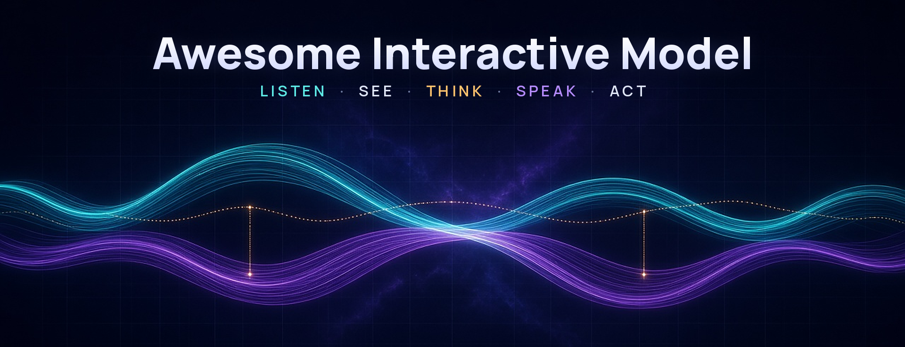
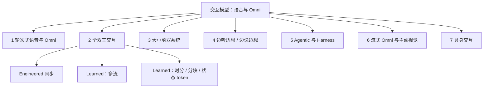

# Awesome Interactive Model

[](https://awesome.re)
[](CONTRIBUTING.md)
[](LICENSE)
[](README.md)

<p align="center">
  
</p>

<p align="center">
一份以「<b>交互如何实现</b>」为中心的语音 / Omni <b>交互模型地图</b>：围绕时机控制、思考与说话的调度、以及模型能影响的范围来组织——<b>不是</b>「级联 → 端到端 → 大小脑」的进化阶梯。
</p>

<p align="center">**收录 584 条**（🔓 开放权重：165，🧩 代码 / 运行时：146，🔒 闭源 API / 产品：92，📄 仅论文 / 未发布：181）。公开资料核验截至 2026-10-06。</p>

---

## 📰 动态与更新

- **2026-10-05** — Amazon **Nova 2.5 Sonic** GA（语音到语音实时）。
- **2026-09-10** — OpenAI **GPT-Live** API GA；**gpt-realtime** / **gpt-realtime-mini** 宣布停用。
- **2026-09** — SeedRealtime、Grok Voice Think Fast、Hibiki-Zero、MiniCPM-o 4.5、PersonaPlex 及大量双工 / 双系统论文。
- **2026-10-06** — 本列表上线（584 条）。长篇综述：[docs/survey_zh.md](docs/survey_zh.md)。

---

## 📑 目录

- 📚 [综述与立场文章](#surveys)
  - [口语与语音大模型综述](#surveys-spoken)
  - [全双工与轮次综述](#surveys-duplex)
  - [Omni、流式与主动智能体综述](#surveys-omni-stream)
  - [立场与观点文章](#positions)
  - [重要博客与发布公告](#blogs)
  - [教程与入门](#tutorials)
  - [相关 Awesome 列表](#related-lists)
- 🎙️ [1. 轮次式语音与 Omni 大模型](#turn-based)
  - [早期语音–语言模型](#early-speech-lm)
  - [端到端口语对话模型](#e2e-speech-dialogue)
  - [带语音生成的 Omni 模型](#omni-generation)
- 🔄 [2. 全双工交互模型](#full-duplex)
  - [2.1 Engineered 同步（控制器 / 级联）](#duplex-engineered)
  - [2.2 Learned 同步：多流 / 双通道](#duplex-multistream)
  - [2.3 Learned 同步：时分复用 / 分块 / 状态 Token](#duplex-tdm)
- 🧠 [3. 大小脑双系统](#dual-system)
  - [3.1 概念与框架](#dual-concepts)
  - [3.2 开放双系统模型](#dual-open)
  - [3.3 快慢级联与投机交接](#dual-cascade)
  - [3.4 闭源双系统产品](#dual-closed)
- 💭 [4. 边听边想 / 边说边想](#think-while)
- 🛠️ [5. Agentic 交互模型与 Harness](#agentic)
  - [5.1 原生工具 / RAG / 动作通道](#agentic-native)
  - [5.2 交互 Harness 与运行时](#agentic-harness)
  - [5.3 语音 Agent 框架与 SDK](#agentic-frameworks)
  - [5.4 交互智能体的记忆](#agentic-memory)
- 👁️ [6. 流式 Omni 与主动视觉交互](#streaming-omni)
  - [6.1 流式 / 双工 Omni 助手](#streaming-omni-assistants)
  - [6.2 When-to-Speak 视频大模型](#when-to-speak)
- 🤖 [7. 具身交互](#embodied)
  - [7.1 全双工具身模型](#embodied-duplex)
  - [7.2 支持插话的双系统 VLA](#embodied-dual-vla)
- 🔬 [8. 横切技术主题](#cross-cutting)
  - [8.1 轮次、Backchannel 与打断](#turn-taking-methods)
  - [8.2 交互对齐与强化学习](#duplex-alignment)
  - [8.3 表达、共情与人设控制](#expressive)
  - [8.4 同声传译（双工 S2ST）](#simul-s2st)
  - [8.5 多方交互](#multiparty)
  - [8.6 低延迟解码与系统](#low-latency)
- 🏢 [产业全景](#industry)
  - [OpenAI](#industry-openai)
  - [Google DeepMind](#industry-google)
  - [阿里 / 通义千问](#industry-alibaba)
  - [字节跳动 / Seed](#industry-bytedance)
  - [其他厂商](#industry-others)
- 📊 [评测基准](#benchmarks)
  - [时机与发言权](#bench-timing)
  - [状态更新与恢复](#bench-state)
  - [多方](#bench-multiparty)
  - [口语内容质量](#bench-content)
  - [副语言、共情与角色扮演](#bench-paraling)
  - [语音 Agent 与工具调用](#bench-agent)
  - [主动性](#bench-proactive)
  - [Omni 与流式视频](#bench-omni)
  - [Arena 与排行榜](#bench-leaderboards)
  - [评测方法论](#bench-method)
- 💾 [数据集](#datasets)
  - [真实对话语料](#data-real)
  - [合成双工与 S2S 数据](#data-synthetic)
  - [数据处理管线](#data-pipelines)
- 🧱 [底层组件（边界区）](#building-blocks)
  - [语音 Tokenizer 与 Codec](#bb-codec)
  - [流式 TTS](#bb-tts)
  - [流式 ASR](#bb-asr)
  - [VAD 与轮次检测](#bb-vad)
  - [回声消除与说话人分离](#bb-aec)
  - [推理服务与传输](#bb-serving)
  - [音频理解（语音→文本）](#bb-audio-understanding)
  - [托管 Voice Agent 平台](#bb-platforms)

---

## 🎯 目标

本仓库是持续更新的中英双语 **Interactive Model 图谱**，覆盖语音与 Omni（音视频）智能体。

此处的 **交互** 指对下列三者的联合控制：

| 维度 | 问题 |
|------|------|
| **内容** | *说什么* / 做什么 |
| **时机** | *何时* 说、听、附和或打断 |
| **任务状态** | 底层任务 *如何推进*（工具、记忆、具身） |

相对相关 Awesome 列表，本仓库多出四点：

1. 系统收录 **大小脑双系统** 与带 **harness** 的 agentic 模型；
2. 每条标注 **开放状态**（🔓 / 🧩 / 🔒 / 📄）；
3. **Benchmark 按交互层** 组织（时机、状态、Agent、主动性等）；
4. **产业全景** 带日期与已核实的停用信息（截至 2026-10-06）。

相关列表与参考：[Awesome-Full-Duplex-SDM](https://github.com/Ruiqi-Yan/Awesome-Full-Duplex-SDM)、[WavChat](https://github.com/jishengpeng/WavChat)、[Speech-Trident](https://github.com/ga642381/speech-trident)、[Awesome-Audio-LLM](https://github.com/AudioLLMs/Awesome-Audio-LLM)、[Awesome-Streaming-Video-Understanding](https://github.com/sotayang/Awesome-Streaming-Video-Understanding)。

> **不是进化阶梯。** 各类别描述的是*组成关系*（时机/同步、思考/说话、效应范围如何安排）。级联、端到端双工、双系统与带 harness 的智能体可以并存、可组合。

---

## 📖 定义与术语辨析

| 术语 | 在本列表中的含义 |
|------|------------------|
| **Streaming（流式）** | 增量输入/输出。 alone ≠ 全双工。 |
| **Realtime（实时）** | 低感知延迟；产品用语——需核对是否原生双工。 |
| **Barge-in（插话/打断）** | 用户可在系统说话中途打断；系统应停止或适应。 |
| **原生全双工** | 单一模型（或紧耦合多流网络）联合建模听+说时间轴。 |
| **系统全双工** | 工程化流水线（VAD / 轮次检测 / ASR–LLM–TTS）*表现*为双工。 |
| **Omni** | 多模态（通常音+视±文）共享交互时间轴。 |
| **Proactive（主动）** | 无显式用户提问时，模型决定是否/何时发言。 |
| **Harness** | 环绕前台模型的运行时：工具、上下文、权限、任务状态、结果回流。 |
| **Thinker–Talker** | 模型内分工：语义主干 vs 语音解码器。**≠** 大小脑双系统。 |
| **大小脑 / 双系统** | 并发的快速前台 + 慢速后台，结果反馈进实时轮次。 |

### 三种常见分工

```text
(A) Thinker–Talker（模型内）
  音频 ──► [Thinker / LLM] ──► [Talker / 语音解码] ──► 音频
  同一模型族；语义 vs 声学模块。不是双系统。

(B) 大小脑（双系统，并发）
  麦 ──► [小脑 / 快速 Talker] ──► 扬声器
            ▲ 结果注入 / 控制
            └── [大脑 / 慢速推理 / Agent / 工具]

(C) 工程级联（系统双工）
  麦 ──► VAD/轮次 ──► ASR ──► LLM ──► TTS ──► 扬声器
           （外部控制器决定发言权）
```

### 设计轴（分类依据）

1. **时机由谁控制？** 工程控制器 vs 学得策略。
2. **思考与说话如何调度？** 先想后说 · 边听/边说边想 · 异步双系统。
3. **模型能影响什么？** 仅语音 · 工具/任务状态（harness） · 物理动作（具身）。
4. **模态：** 纯语音 vs 音视频 Omni。



---

## 📊 评测维度

| 交互层 | 测什么 | 代表 benchmark | 输入设置 |
|--------|--------|----------------|----------|
| 时机与发言权 | 打断、附和、轮次延迟 | Full-Duplex-Bench、Talking Turns、FD-Bench | 真人 / TTS / 流式 |
| 状态更新 | 轮中纠正、恢复 | EchoChain、IHBench | 双工对话 |
| 多方 | 指向、重叠 | Duplex-MPE、MP-Bench | 多说话人 |
| 口语内容 | 指令遵循、知识 | VoiceBench、URO-Bench | 常为 S2T / 半双工 |
| 副语言 | 情感、人设、共情 | SD-Eval、VoxDialogue | 语音 |
| 语音 Agent | 工具、任务、RAG | τ-Voice、VoiceAgentBench | Agent 循环 |
| 主动性 | 无提问时何时说 | ProVoice-Bench、ProactiveVideoQA | 流式音视频 |
| Omni / 视频 | 连续视频 + 语音 | OmniBench、StreamingBench、OVO-Bench | 视频流 |

务必报告 **输入设置**：真人录音 · TTS · 半双工语音转文本 · 真正全双工流式。

### 双系统速览对照

| 系统 | 前台（小脑） | 后台（大脑） | 回流内容 | 运行时开放度 |
|------|--------------|--------------|----------|--------------|
| GPT-Live + Responses | Live 语音前台 | Responses / 工具 / supervisor | 文本 / 工具结果进入实时轮次 | 🔒 API 契约 |
| Gemini Live Extended Thinking | Live 音视频会话 | Extended thinking / 工具 | 摘要进入会话 | 🔒 |
| Realtime-Venus / Gander | 开放双工 Talker | 异步推理 / Agent | Inject / cancel / 任务账本 | 🔓 / 🧩 |
| MoshiRAG / KAME / SALMONN-duo | 双工语音 LM | RAG / 双循环 | 检索或推理上下文 | 📄–🔓 不等 |
| Thinker–Talker（对照） | 不适用——*模型内*语义 vs 声学分工 | — | 不是双系统 | — |

### Harness 能力速览

| 能力 | 原生工具通道 | 外部 Harness | Voice-agent SDK |
|------|--------------|--------------|-----------------|
| 边说边调工具 | 模型发工具 token / 侧信道 | 运行时暂停 / 复用 | 框架适配 |
| 任务状态与权限 | 常为隐式 | 显式账本 / ACL | 应用定义 |
| 结果回流 | 条件化进模型 | 消息类型注入前台 | 回调 / 事件 |
| 可检查性 | 权重 + 论文 | 代码运行时 | SDK 文档 |

---

## 🏷️ 图例

| 图标 | 状态 |
|------|------|
| 🔓 | 开放权重 |
| 🧩 | 仅代码 / 运行时（或权重受限） |
| 🔒 | 闭源 API / 产品 |
| 📄 | 仅论文 / 权重未发布 |
| ⭐️ | 特别有影响力或代表性 |

徽章：     

每节内按 **时间倒序**。同一条目可出现在多个章节。

---

<a id="surveys"></a>
## 📚 综述与立场文章

覆盖口语对话、全双工语音语言模型、Omni 模型、流式视频与交互式智能体的综述、分类与立场文章。

<a id="surveys-spoken"></a>
### 口语与语音大模型综述

- **[2026-05]** **AudioReasoning** - Audio reasoning with large models: a survey. [](https://arxiv.org/abs/2605.21008) 📄
  - _超越纯转写问答的音频推理综述。_
- **[2026-03]** **TiCo Survey** - Spoken dialogue model survey (TiCo / Spoken-Dialogue-Model-Survey). [](https://arxiv.org/abs/2603.22267) [](https://github.com/ga642381/Spoken-Dialogue-Model-Survey) 📄
  - _口语对话模型更新综述，与 Speech-Trident 资源互补。_
- **[2025-04]** **SLM Landscape** - On the landscape of spoken language models: a comprehensive survey. [](https://arxiv.org/abs/2504.08528) 📄
  - _从架构与交互形态梳理口语语言模型全景。_
- **[2025-02]** **LLM-Meets-Speech** - When LLMs meet speech: a survey on integration pathways. [](https://arxiv.org/abs/2502.19548) 📄
  - _综述大模型与语音理解/生成的融合路径。_
- [⭐️] **[2024-11]** **WavChat** - A survey of spoken dialogue models. [](https://arxiv.org/abs/2411.13577) [](https://github.com/jishengpeng/WavChat) 📄
  - _口语对话模型综述里程碑，覆盖级联与端到端、流式/双工、数据与评测。_
- **[2024-10] [ACL 2025]** **SpeechLM Survey** - Recent advances in speech language models: a survey. [](https://arxiv.org/abs/2410.03751) [](https://github.com/dreamtheater123/Awesome-SpeechLM-Survey) 📄
  - _ACL 2025 SpeechLM 综述，聚焦端到端语音输入输出语言模型。_
- **[2024-10]** **SpeechLLM Survey** - A survey on speech large language models. [](https://arxiv.org/abs/2410.18908) 📄
  - _覆盖理解与生成的 SpeechLLM 分类综述。_
- **[2024-02]** **AudioLM-Survey** - A survey on neural speech / audio language models. [](https://arxiv.org/abs/2402.13236) 📄
  - _AudioLM 时代早期综述，可作历史背景。_
- **[2023-08]** **Sparks-LAM** - Sparks of large audio models: a survey and outlook. [](https://arxiv.org/abs/2308.12792) 📄
  - _AudioLM 之后早期的大音频模型综述与展望。_

<a id="surveys-duplex"></a>
### 全双工与轮次综述

- **[2026-09]** **RTVA-Eval** - Evaluating real-time voice agents: methodology and pitfalls. [](https://arxiv.org/abs/2609.30798) 📄
  - _面向实时/全双工语音 Agent 的评测方法论与常见陷阱。_
- **[2026-06] [EMNLP 2026]** **DuplexSurvey** - Speaking while listening: a survey and empirical audit of full-duplex spoken dialogue systems. [](https://arxiv.org/abs/2606.19453) [](https://github.com/MM-Speech/DuplexSurvey) 🧩
  - _EMNLP 2026 全双工综述：架构层级、交互本体与决策状态机，并含实证审计。_
- **[2026-04]** **HumDial-FD** - HumDial full-duplex track and FDBench. [](https://arxiv.org/abs/2604.21406) [](https://huggingface.co/datasets/ASLP-lab/HumDial) 🧩
  - _HumDial 全双工赛道与 FDBench；打断/拒识等指标对齐 Full-Duplex-Bench v1.5。_
- **[2026-01] [ICASSP]** **HumDial** - HumDial: human-recorded dialogue challenge overview. [](https://arxiv.org/abs/2601.05564) [](https://github.com/ASLP-lab/HumDial) 🧩
  - _ICASSP HumDial 挑战赛：基于真人录音的交互对话评测框架。_
- [⭐️] **[2025-09] [ICASSP 2026 (under review)]** **FD-SLM Survey** - From turn-taking to synchronous dialogue: a survey of full-duplex spoken language models. [](https://arxiv.org/abs/2509.14515) [](https://github.com/elpsykongloo/FD-SLMs) 🧩
  - _提出 FD-SLM 的 engineered/learned 同步分类，并维护持续更新仓库。_
- **[2025-01] [IWSDS 2025]** **TurnTaking-Survey** - Turn-taking survey for spoken dialogue systems (IWSDS 2025). 📄
  - _IWSDS 2025 关于口语对话系统轮次机制的综述。_
- **[2021-01] [Computer Speech & Language]** **Skantze Review** - Turn-taking in conversational systems and human-robot interaction: a review. [](https://doi.org/10.1016/j.csl.2020.101178) 📄
  - _Computer Speech & Language 经典轮次综述，覆盖线索、EOT、打断与 HRI。_

<a id="surveys-omni-stream"></a>
### Omni、流式与主动智能体综述

- **[2026-03]** **Streaming-LLM** - From static inference to dynamic interaction: a survey of streaming LLMs. [](https://arxiv.org/abs/2603.04592) [](https://github.com/EIT-NLP/Awesome-Streaming-LLMs) 🧩
  - _将流式大模型分为输出流式、顺序流式与并发流式三类。_
- **[2025-06]** **DATES** - Dialogue and agentic tool-use evaluation survey for speech systems. 📄
  - _连接对话评测与工具调用/Agent 语音场景的综述。公开来源链接待核验。_
- **[2025-05]** **UMM Survey** - Unified multimodal models: a survey. [](https://arxiv.org/abs/2505.02567) 📄
  - _统一多模态模型架构与训练方案综述。_
- **[2025-05]** **LALM-Eval** - Towards holistic evaluation of large audio-language models. [](https://arxiv.org/abs/2505.15957) [](https://github.com/ckyang1124/LALM-Evaluation-Survey) 🧩
  - _面向大型音频语言模型的整体评测综述与框架。_
- **[2025-03]** **Agentic-LLM** - Agentic large language models: a survey. [](https://arxiv.org/abs/2503.23037) 📄
  - _更广的 Agentic LLM 综述，对带工具的语音 Agent 有参考价值。_
- **[2025-02]** **SpeechTokens** - Speech tokenization for generative models: a survey. [](https://arxiv.org/abs/2502.06490) 📄
  - _面向生成式语音大模型的离散语音 token / codec 综述。_
- **[2025-02]** **S1-to-S2** - From System-1 to System-2 speech agents: a survey (verify arXiv). 📄
  - _语音 Agent 中快交互（System-1）与慢推理（System-2）路径综述。_
- **[2025-01]** **Online-Interactors** - Survey of online / interactive multimodal agents. 📄
  - _关注在连续流下决定何时发言的在线交互体综述。_
- **[2024-12]** **Omni-MLLM** - A survey of omni multimodal large language models. [](https://arxiv.org/abs/2412.11694) 📄
  - _覆盖音/视/文任意到任意的 Omni 多模态大模型综述。_
- **[2024-01] [TOIS]** **ProactiveConvAI** - Proactive conversational AI: a survey (TOIS). 📄
  - _TOIS 主动对话综述：何时/说什么由系统发起。_
- **[2023-12]** **VidLLM Survey** - Video-LLMs: a survey of large multimodal models for video understanding. [](https://arxiv.org/abs/2312.17432) 📄
  - _流式/主动交互兴起前的视频大模型基础综述。_

<a id="positions"></a>
### 立场与观点文章

- **[2026-07]** **Model-in-the-Middle** - Model-in-the-middle: interaction harness as first-class design. [](https://arxiv.org/abs/2607.25792) 📄
  - _主张用户与模型之间的运行时/harness 应作为一等设计对象。_
- **[2026-01] [ICML 2026]** **Speech-First** - Speech-first interaction models (ICML 2026 position). 📄
  - _ICML 2026 立场：主张语音原生建模，而非文本级联。_
- **[2025-02]** **Thoughtful-AI** - Towards thoughtful AI interaction: a position paper. [](https://arxiv.org/abs/2502.18676) 📄
  - _主张深思熟虑式交互，而非反射式即时回复的立场文章。_
- **[2025-01]** **TML Interaction Models** - Thinking Machines Lab: interaction models perspective. [](https://thinkingmachines.ai/) 🔒
  - _有影响力的博客，提出超越轮次聊天的 Interaction Models 视角。_
- [⭐️] **[2024-10] [NeurIPS'24 Workshop]** **Talker-Reasoner** - Agents Thinking Fast and Slow: A Talker-Reasoner Architecture. [](https://arxiv.org/abs/2410.08328) [](https://openreview.net/forum?id=xPhcP6rbI4) 📄
  - _经典快 Talker + 慢 Reasoner 双系统对话智能体架构。_
- **[2024-04]** **HC-ProactiveAgents** - Human-centered proactive agents: a position. [](https://arxiv.org/abs/2404.12670) 📄
  - _以人为中心讨论智能体何时应主动发起行为或发言。_

<a id="blogs"></a>
### 重要博客与发布公告

- **[2026-09]** **Gemini 3.8 Live** - Gemini 3.8 Live / Extended Thinking GA notes. [](https://ai.google.dev/gemini-api/docs/models/gemini-3.8-live) 🔒
  - _Gemini 3.8 Live GA：异步工具与 Extended Thinking。_
- **[2026-08]** **TurnBench Blog** - TurnBench: measuring the timing of conversation. [](https://arxiv.org/abs/2608.25218) [](https://turnbench.sesame.com/) [](https://www.sesame.com/blog/turnbench) 🧩
  - _Sesame 介绍 TurnBench 排行榜的博客，评测 EOT/打断时机。_
- **[2026-05]** **GPT-Realtime-2** - GPT Realtime 2 series update. [](https://developers.openai.com/api/docs/models/gpt-realtime-2) 🔒
  - _Realtime 2 代更新，工具与推理更强；提供从 1.x 的迁移路径。_
- [⭐️] **[2026-05]** **GPT-Live** - GPT-Live 1: Native Full-Duplex Voice with Backend Delegation. [](https://openai.com/) [](https://developers.openai.com/api/docs/models/gpt-live-1) 🔒
  - _原生双工语音前台，经 Responses/客户端委派至智能体。_
- **[2026-04]** **Qwen3.5-Omni** - Qwen3.5-Omni Technical Report. [](https://arxiv.org/abs/2604.15804) [](https://www.alibabacloud.com/help/en/model-studio/) 🔒
  - _新一代 Qwen Omni，更强实时音视频交互。_
- [⭐️] **[2026-02]** **PersonaPlex** - PersonaPlex: Controllable Persona and Style for Full-Duplex Speech Dialogue. [](https://arxiv.org/abs/2602.06053) [](https://github.com/NVIDIA/personaplex) [](https://huggingface.co/nvidia/personaplex-7b-v1) 🔓
  - _Moshi 式双通道模型，可控人设与对话风格。_
- **[2026-01]** **Gemini 3.1 Flash Live** - Gemini 3.1 Flash Live announcement. [](https://ai.google.dev/gemini-api/docs/models) 🔒
  - _Gemini Live 谱系中的 Flash 级实时多模态型号。_
- [⭐️] **[2025-12]** **Seeduplex** - Doubao Seeduplex: Native Full-Duplex Speech Interaction Model. [](https://www.volcengine.com/) [](https://research.doubao.com/en/seeduplex) 🔒
  - _字节原生全双工语音模型，支持连续双向对话。_
- [⭐️] **[2025-09]** **Qwen3-Omni** - Qwen3-Omni Technical Report. [](https://arxiv.org/abs/2509.17765) [](https://github.com/QwenLM/Qwen3-Omni) [](https://huggingface.co/Qwen) 🔓
  - _强开放 Omni 模型，支持流式语音与多模态交互。_
- **[2025-09]** **FireRedChat** - FireRedChat: A Pluggable, Full-Duplex Voice Interaction System. [](https://arxiv.org/abs/2509.06502) [](https://fireredteam.github.io/demos/firered_chat/) [](https://github.com/FireRedTeam/FireRedChat) 🧩
  - _级联/半级联双工，含轮次控制、工具与 LiveKit 部署。_
- **[2025-08]** **gpt-realtime** - gpt-realtime GA / model family notes. [](https://developers.openai.com/api/docs/models/gpt-realtime) 🔒
  - _第一代 gpt-realtime GA 说明；接入前务必核对停用表。_
- **[2025-06]** **Doubao Realtime Voice** - Doubao / Volcano realtime voice product notes. [](https://www.volcengine.com/) 🔒
  - _字节豆包实时语音产品线（Seeduplex 研究论文之前）。_
- **[2025-04]** **Nova Sonic** - Amazon Nova Sonic speech-to-speech announcement. [](https://aws.amazon.com/ai/generative-ai/nova/) 🔒
  - _AWS Nova Sonic 实时语音型号族（旧 SKU 需核对停用）。_
- **[2025-04]** **Gemini 2.5 Native Audio** - Gemini 2.5 Flash native audio / Live API notes. [](https://ai.google.dev/gemini-api/docs/live) 🔒
  - _3.x Flash Live 之前的原生音频 Live API 一代。_
- **[2025-03]** **Qwen2.5-Omni** - Qwen2.5-Omni Technical Report. [](https://arxiv.org/abs/2503.20215) [](https://github.com/QwenLM/Qwen2.5-Omni) [](https://huggingface.co/Qwen/Qwen2.5-Omni-7B) [](https://qwenlm.github.io/) 🔓
  - _Omni 模型，Thinker–Talker 流式语音生成。_
- **[2025-02]** **Unmute** - Kyutai Unmute: Low-Latency Modular Speech Interaction Stack. [](https://unmute.sh/) [](https://github.com/kyutai-labs/unmute) [](https://kyutai.org/) 🧩
  - _模块化低延迟语音栈，封装 Moshi 系双工模型。_
- **[2025-02]** **Sesame CSM** - Sesame Conversational Speech Model. [](https://github.com/SesameAILabs/csm) [](https://huggingface.co/sesame/csm-1b) [](https://www.sesame.com/research/crossing_the_uncanny_valley_of_voice) 🔓
  - _开放对话式语音生成（CSM-1B）。_
- [⭐️] **[2025-02]** **Hibiki** - Hibiki: High-Fidelity Simultaneous Speech-To-Speech Translation. [](https://arxiv.org/abs/2502.03382) [](https://github.com/kyutai-labs/hibiki) [](https://kyutai.org/) 🔓
  - _高保真同声传译，基于 Moshi 式双工栈。_
- **[2025-01]** **MiniCPM-o Blog** - MiniCPM-o omni / streaming release notes. [](https://github.com/OpenBMB/MiniCPM-o) 🔓
  - _OpenBMB Omni 发布说明，常用作开源基线。_
- **[2025-01]** **TML Interaction Models** - Thinking Machines Lab: interaction models perspective. [](https://thinkingmachines.ai/) 🔒
  - _有影响力的博客，提出超越轮次聊天的 Interaction Models 视角。_
- **[2024-12]** **Gemini Live API** - Google Gemini Live API developer blog / docs launch. [](https://ai.google.dev/gemini-api/docs/live) 🔒
  - _面向开发者的 Gemini 实时多模态 Live API 说明。_
- **[2024-11]** **LiveKit EOU** - LiveKit end-of-utterance / turn detector blog. [](https://github.com/livekit/agents) [](https://blog.livekit.io/) 🧩
  - _LiveKit Agents 栈中实用的句末/轮次检测指南。_
- **[2024-10]** **Realtime API** - OpenAI Realtime API announcement. [](https://openai.com/index/introducing-the-realtime-api/) [](https://platform.openai.com/docs/guides/realtime) 🔒
  - _推出面向语音 Agent 的低延迟 WebSocket 语音到语音 Realtime API。_
- **[2024-09]** **Advanced Voice Mode** - ChatGPT Advanced Voice Mode announcement. [](https://openai.com/index/chatgpt-can-now-see-hear-and-speak/) 🔒
  - _面向消费者的 Advanced Voice Mode；与 Realtime API 型号不同。_
- [⭐️] **[2024-09] [ICLR'25]** **Moshi** - Moshi: a speech-text foundation model for real-time dialogue. [](https://arxiv.org/abs/2410.00037) [](https://moshi.chat/) [](https://github.com/kyutai-labs/moshi) [](https://huggingface.co/kyutai/moshiko-pytorch-bf16) [](https://kyutai.org/2024/09/17/moshi.html) 🔓
  - _分层 RQ-Transformer 并行用户/系统音频流，原生全双工。_
- **[2024-05]** **Project Astra** - Google Project Astra demo / multimodal agent vision. [](https://deepmind.google/technologies/gemini/project-astra/) 🔒
  - _Google I/O Astra 演示塑造了对常在线多模态 Agent 的预期。_
- **[2024-05]** **GPT-4o** - Hello GPT-4o — omni multimodal announcement. [](https://openai.com/index/hello-gpt-4o/) 🔒
  - _OpenAI GPT-4o 发布博文，推动现代语音/Omni 交互研究。_

<a id="tutorials"></a>
### 教程与入门

- **[2026-09] [Interspeech 2026]** **IS26 SLM Tutorial** - Interspeech 2026 tutorial on speech / duplex LMs. 📄
  - _Interspeech 2026 覆盖双工与交互式语音大模型的教程。_
- **[2026-03]** **RTVoiceAgent Tutorial** - Building real-time voice agents: a tutorial. [](https://arxiv.org/abs/2603.05413) 📄
  - _论文教程：梳理实时语音 Agent 流水线与常见坑。_
- **[2026-01]** **GPT-Live Guide** - OpenAI GPT-Live developer guide. [](https://developers.openai.com/api/docs/guides/live) 🔒
  - _GPT-Live 官方指南：会话、委派与计费拆分。_
- **[2025-11] [EMNLP 2025]** **EMNLP25 SCA** - EMNLP 2025 tutorial on spoken conversational agents. 📄
  - _EMNLP 关于构建与评测口语对话 Agent 的教程。_
- **[2025-01]** **Voice AI Primer** - Practical Voice AI primer for builders. [](https://docs.livekit.io/agents/) 🧩
  - _面向实践者的 Voice AI 入门：VAD、轮次、STT/TTS 与实时栈。_
- **[2024-09] [Interspeech 2024]** **IS24 SLM Tutorial** - Interspeech 2024 tutorial on speech language models. 📄
  - _Interspeech 2024 语音语言模型架构与训练教程。_
- **[2024-01]** **Pipecat Docs** - Pipecat voice-agent builder documentation. [](https://github.com/pipecat-ai/pipecat) [](https://docs.pipecat.ai/) 🧩
  - _组合 VAD/STT/LLM/TTS 流水线的实践文档。_
- **[2024-01]** **LiveKit Agents Guide** - LiveKit Agents documentation and recipes. [](https://github.com/livekit/agents) [](https://docs.livekit.io/agents/) 🧩
  - _面向生产的 LiveKit 语音 Agent 与 EOU 指南。_

<a id="related-lists"></a>
### 相关 Awesome 列表

- **[2026-06]** **DuplexSurvey-repo** - Official repo for the DuplexSurvey EMNLP paper. [](https://github.com/MM-Speech/DuplexSurvey) 🧩
  - _配合 DuplexSurvey 审计收集的模型/数据/基准。_
- **[2026-03]** **Spoken-Dialogue-Model-Survey** - Repo for TiCo / spoken dialogue model survey. [](https://github.com/ga642381/Spoken-Dialogue-Model-Survey) 🧩
  - _与 arXiv 2603.22267 配套的持续更新列表。_
- **[2026-03]** **Awesome-Streaming-LLMs** - Paper list for streaming LLMs/MLLMs. [](https://github.com/EIT-NLP/Awesome-Streaming-LLMs) 🧩
  - _Streaming-LLM 综述配套列表（文本/音频/视频）。_
- **[2025-09]** **FD-SLMs** - Living repository for the FD-SLM survey. [](https://github.com/elpsykongloo/FD-SLMs) 🧩
  - _FD-SLM 综述的 engineered/learned 同步谱系列表。_
- **[2025-01]** **awesome-voice-agents** - Curated voice agent frameworks, VAD, turn detection, STT/TTS. [](https://github.com/yzfly/awesome-voice-agents) 🧩
  - _面向开发者的语音 Agent 框架与组件列表。_
- **[2025-01]** **Awesome-Unified-Multimodal-Models** - Awesome list of unified multimodal / omni models. [](https://github.com/aidc-ai/awesome-unified-multimodal-models) 🧩
  - _统一多模态/Omni 模型论文与发布导航列表。_
- **[2025-01]** **Awesome-Streaming-Video-Understanding** - Curated streaming / online video understanding papers. [](https://github.com/sotayang/Awesome-Streaming-Video-Understanding) 🧩
  - _主动/被动流式视频大模型论文列表。_
- **[2025-01]** **Awesome-Full-Duplex-SDM** - Curated list of full-duplex spoken dialogue models & benchmarks. [](https://github.com/Ruiqi-Yan/Awesome-Full-Duplex-SDM) 🧩
  - _持续维护的全双工口语对话模型、数据与基准列表。_
- **[2024-11]** **WavChat-repo** - Companion repository for the WavChat survey. [](https://github.com/jishengpeng/WavChat) 🧩
  - _WavChat 综述配套的持续更新论文列表。_
- **[2024-10]** **Awesome-SpeechLM-Survey** - GitHub list for the SpeechLM survey (ACL 2025). [](https://github.com/dreamtheater123/Awesome-SpeechLM-Survey) 🧩
  - _端到端 SpeechLM 及相关 LALM 论文列表。_
- **[2024-01]** **Speech-Trident** - Awesome speech/audio LLMs, codecs, and representation learning. [](https://github.com/ga642381/speech-trident) 🧩
  - _三叉戟资源列表：表征、codec 与语音语言模型。_
- **[2024-01]** **Large-Audio-Models** - Curated large audio models paper list. [](https://github.com/liusongxiang/Large-Audio-Models) 🧩
  - _常与 Speech-Trident 交叉引用的大音频模型列表。_
- **[2024-01]** **Awesome-Audio-LLM** - Awesome list of audio LLMs, datasets, and benchmarks. [](https://github.com/BinWang28/audio-ai-hub) 🧩
  - _覆盖论文、数据与评测的音频大模型资源汇集。_

<a id="turn-based"></a>
## 🎙️ 1. 轮次式语音与 Omni 大模型

半双工或请求–响应式语音/Omni 模型：能理解音频（常含视觉）并生成文本和/或语音。流式输出不等于说话时仍在聆听。

<a id="early-speech-lm"></a>
### 早期语音–语言模型

- **[2024-02] [TACL'25]** **SpiritLM** - Spirit LM: Interleaved Spoken and Written Language Model. [](https://arxiv.org/abs/2402.05755) [](https://github.com/facebookresearch/spiritlm) 🔓
  - _Llama-2 上交错语音与文本 token。_
- **[2024-02]** **AnyGPT** - AnyGPT: Unified Multimodal LLM with Discrete Sequence Modeling. [](https://github.com/OpenMOSS/AnyGPT) [](https://huggingface.co/fnlp/AnyGPT-chat) 🔓
  - _离散 any-to-any 多模态生成，含语音。_
- **[2023-09]** **NExT-GPT** - NExT-GPT: Any-to-Any Multimodal LLM. [](https://github.com/NExT-GPT/NExT-GPT) 🔓
  - _模块化 any-to-any 多模态 LLM，连接扩散专家。_
- **[2023-06]** **AudioPaLM** - AudioPaLM: A Large Language Model That Can Speak and Listen. [](https://arxiv.org/abs/2306.12925) [](https://google-research.github.io/seanet/audiopalm/examples/) 🔒
  - _基于 PaLM，统一语音理解、生成与翻译。_
- **[2023-05]** **SpeechGPT** - SpeechGPT: Empowering Large Language Models with Intrinsic Cross-Modal Conversational Abilities. [](https://arxiv.org/abs/2305.11000) [](https://github.com/0nutation/SpeechGPT) 🔓
  - _早期离散语音–语言 LLM，具备跨模态对话能力。_
- [⭐️] **[2022-03]** **dGSLM** - Dual-tower Generative Spoken Language Model for Full-Duplex Dialogue. [](https://arxiv.org/abs/2203.16502) [](https://github.com/facebookresearch/fairseq/tree/main/examples/textless_nlp/dgslm) 🔓
  - _奠基性双流口语对话 LM，支持重叠语音。_

<a id="e2e-speech-dialogue"></a>
### 端到端口语对话模型

- **[2025-08]** **Step-Audio 2 mini** - Step-Audio 2 mini: Compact Speech Understanding and Streaming Generation. 🔓
  - _紧凑 Step-Audio 2 变体，语音理解与流式生成。_
- **[2025-08]** **OSUM-EChat** - OSUM-EChat: Enhancing End-to-End Empathetic Spoken Chatbot. [](https://arxiv.org/abs/2508.09600) 🔓
  - _共情端到端口语聊天机器人，含副语言控制。_
- **[2025-07]** **OpenS2S** - OpenS2S: Fully Open-Source End-to-End Empathetic Speech-to-Speech. [](https://arxiv.org/abs/2507.05177) 🔓
  - _完全开放的共情语音到语音对话栈。_
- **[2025-07]** **MiMo-Audio** - MiMo-Audio: End-to-End Audio Language Models from Xiaomi. [](https://github.com/XiaomiMiMo/MiMo-Audio) [](https://huggingface.co/XiaomiMiMo/MiMo-Audio-7B-Instruct) 🔓
  - _端到端音频 LM，支持上下文音频理解/生成。_
- **[2025-06]** **Fun-Audio-Chat** - Fun-Audio-Chat: End-to-End Speech Chat from FunAudioLLM. [](https://github.com/QwenAudio/Fun-Audio-Chat) [](https://huggingface.co/FunAudioLLM/Fun-Audio-Chat-8B) 🔓
  - _FunAudioLLM / DrVoice 谱系端到端语音聊天模型。_
- **[2025-05]** **VITA-Audio** - VITA-Audio: Fast Interleaved Cross-Modal Token Generation for Efficient S2S. [](https://arxiv.org/abs/2505.03739) [](https://github.com/VITA-MLLM/VITA-Audio) 🔓
  - _交错跨模态 token，加速流式语音应答。_
- **[2025-05]** **Covo-Audio-Chat** - Covo-Audio-Chat: Tencent End-to-End Speech Chat. [](https://github.com/Tencent/Covo-Audio) [](https://huggingface.co/tencent/Covo-Audio-Chat) 🔓
  - _腾讯轮次式/流式端到端语音聊天模型。_
- **[2025-04]** **VocalNet** - VocalNet: Speech LLM with Multi-Token Prediction for Faster Inference. [](https://arxiv.org/abs/2504.04060) 🔓
  - _语音 LLM 用多 token 预测降低语音延迟。_
- **[2025-04]** **LLaMA-Omni2** - LLaMA-Omni2: Family of Streaming Speech Interaction Models. [](https://github.com/ictnlp/LLaMA-Omni2) 🔓
  - _0.5B–32B 流式语音交互模型族。_
- **[2025-04]** **Kimi-Audio** - Kimi-Audio: Audio Foundation Models for Understanding and Generation. [](https://github.com/MoonshotAI/Kimi-Audio) [](https://huggingface.co/moonshotai/Kimi-Audio-7B-Instruct) 🔓
  - _面向语音理解与生成的音频基础模型。_
- **[2025-02]** **Step-Audio** - Step-Audio / Step-Audio-Chat: End-to-End Speech Interaction. 🔓
  - _Step-Audio 2 之前的大型端到端语音聊天模型。_
- **[2025-01]** **LUCY** - LUCY: Linguistic Understanding and Control Yielding Early Stage Empathy. [](https://arxiv.org/abs/2501.16327) 📄
  - _早期共情口语对话，强调语言控制。_
- **[2025-01]** **Baichuan-Audio** - Baichuan-Audio: End-to-End Audio Dialogue Models. [](https://github.com/baichuan-inc) [](https://huggingface.co/baichuan-inc/Baichuan-Audio-Instruct) 🔓
  - _百川端到端音频对话模型。_
- **[2024-10]** **GLM-4-Voice** - GLM-4-Voice: Towards Versatile and Efficient End-to-End Speech Interaction. [](https://github.com/THUDM/GLM-4-Voice) [](https://huggingface.co/THUDM/glm-4-voice-9b) 🔓
  - _端到端口语对话模型，支持流式语音生成。_
- **[2024-09]** **LLaMA-Omni** - LLaMA-Omni: Seamless Speech Interaction with Large Language Models. [](https://github.com/ictnlp/LLaMA-Omni) [](https://huggingface.co/ICTNLP/Llama-3.1-8B-Omni) 🔓
  - _语音指令模型，低延迟流式语音应答。_
- **[2024-08]** **Mini-Omni** - Mini-Omni: Language Models Can Hear, Talk While Thinking in Streaming. 🔓
  - _超小端到端语音 LM，流式边想边说。_

<a id="omni-generation"></a>
### 带语音生成的 Omni 模型

- **[2026-04]** **Qwen3.5-Omni** - Qwen3.5-Omni Technical Report. [](https://arxiv.org/abs/2604.15804) [](https://www.alibabacloud.com/help/en/model-studio/) 🔒
  - _新一代 Qwen Omni，更强实时音视频交互。_
- **[2026-02]** **LongCat-Next** - LongCat-Next: Native Discrete Omni Generation. [](https://github.com/meituan-longcat/LongCat-Next) [](https://huggingface.co/meituan-longcat/LongCat-Next) 🔓
  - _LongCat-Flash-Omni 之后的原生离散 Omni 生成。_
- **[2025-10]** **LongCat-Flash-Omni** - LongCat-Flash-Omni Technical Report. [](https://arxiv.org/abs/2511.00279) [](https://github.com/meituan-longcat/LongCat-Flash-Omni) [](https://huggingface.co/meituan-longcat/LongCat-Flash-Omni) 🔓
  - _大规模 MoE Omni，具备实时语音生成能力。_
- [⭐️] **[2025-09]** **Qwen3-Omni** - Qwen3-Omni Technical Report. [](https://arxiv.org/abs/2509.17765) [](https://github.com/QwenLM/Qwen3-Omni) [](https://huggingface.co/Qwen) 🔓
  - _强开放 Omni 模型，支持流式语音与多模态交互。_
- **[2025-08]** **Ming-flash-omni** - Ming-Flash-Omni: Large MoE Omni Generation Models. 🔓
  - _稀疏 MoE Omni，面向多模态生成与交互。_
- **[2025-07]** **MiMo-Audio** - MiMo-Audio: End-to-End Audio Language Models from Xiaomi. [](https://github.com/XiaomiMiMo/MiMo-Audio) [](https://huggingface.co/XiaomiMiMo/MiMo-Audio-7B-Instruct) 🔓
  - _端到端音频 LM，支持上下文音频理解/生成。_
- **[2025-06]** **Uni-MoE-2.0-Omni** - Uni-MoE 2.0 Omni: Mixture-of-Experts Omnimodal Generation. [](https://github.com/HITsz-TMG/Uni-MoE/tree/master/Uni-MoE-2) [](https://huggingface.co/HIT-TMG/Uni-MoE-2.0-Omni) 🔓
  - _HITsz-TMG 的 MoE Omni 生成模型族。_
- **[2025-06]** **Stream-Omni** - Stream-Omni: Simultaneous Multimodal Interactions with Large Language Models. [](https://arxiv.org/abs/2506.13642) [](https://github.com/ictnlp/Stream-Omni) [](https://huggingface.co/ICTNLP/stream-omni-8b) 🔓
  - _文本中间层 + 流式语音交互解码。_
- **[2025-06]** **InteractiveOmni** - InteractiveOmni: Multi-Turn Multimodal Speech Interaction Models. [](https://github.com/OpenSenseNova/InteractiveOmni) [](https://huggingface.co/sensenova/InteractiveOmni-8B) 🔓
  - _面向多轮多模态语音交互的开放 Omni 模型。_
- **[2025-06]** **Fun-Audio-Chat** - Fun-Audio-Chat: End-to-End Speech Chat from FunAudioLLM. [](https://github.com/QwenAudio/Fun-Audio-Chat) [](https://huggingface.co/FunAudioLLM/Fun-Audio-Chat-8B) 🔓
  - _FunAudioLLM / DrVoice 谱系端到端语音聊天模型。_
- **[2025-05]** **VITA-Audio** - VITA-Audio: Fast Interleaved Cross-Modal Token Generation for Efficient S2S. [](https://arxiv.org/abs/2505.03739) [](https://github.com/VITA-MLLM/VITA-Audio) 🔓
  - _交错跨模态 token，加速流式语音应答。_
- **[2025-05]** **Covo-Audio-Chat** - Covo-Audio-Chat: Tencent End-to-End Speech Chat. [](https://github.com/Tencent/Covo-Audio) [](https://huggingface.co/tencent/Covo-Audio-Chat) 🔓
  - _腾讯轮次式/流式端到端语音聊天模型。_
- **[2025-04]** **LLaMA-Omni2** - LLaMA-Omni2: Family of Streaming Speech Interaction Models. [](https://github.com/ictnlp/LLaMA-Omni2) 🔓
  - _0.5B–32B 流式语音交互模型族。_
- **[2025-04]** **Kimi-Audio** - Kimi-Audio: Audio Foundation Models for Understanding and Generation. [](https://github.com/MoonshotAI/Kimi-Audio) [](https://huggingface.co/moonshotai/Kimi-Audio-7B-Instruct) 🔓
  - _面向语音理解与生成的音频基础模型。_
- **[2025-03]** **Qwen2.5-Omni** - Qwen2.5-Omni Technical Report. [](https://arxiv.org/abs/2503.20215) [](https://github.com/QwenLM/Qwen2.5-Omni) [](https://huggingface.co/Qwen/Qwen2.5-Omni-7B) [](https://qwenlm.github.io/) 🔓
  - _Omni 模型，Thinker–Talker 流式语音生成。_
- **[2025-03]** **Ming-Lite-Omni** - Ming-Lite-Omni / v1.5: Sparse Omni Generation. 🔓
  - _Ming 系列稀疏 Omni 生成模型。_
- **[2025-01]** **VITA / VITA-1.5** - VITA / VITA-1.5. [](https://github.com/VITA-MLLM/VITA) [](https://huggingface.co/VITA-MLLM/VITA-1.5) 🔓
  - _初代外部语音链路与 1.5 原生输出不同；模型监听角色分工也不等同于后台任务 agent。_
- **[2025-01]** **Step-Audio 2 mini / mini-Base / mini-Think** - Step-Audio 2 mini / mini-Base / mini-Think. [](https://github.com/stepfun-ai/Step-Audio2) [](https://huggingface.co/stepfun-ai/Step-Audio-2-mini) 📄
  - _开放 mini 不代表完整旗舰 Step-Audio 2 同尺寸权重已开放；Think 变体输出模式按模型卡选。_
- **[2025-01]** **Step-Audio / Step-Audio-Chat** - Step-Audio / Step-Audio-Chat. [](https://github.com/stepfun-ai/Step-Audio) [](https://huggingface.co/stepfun-ai/Step-Audio-Chat) 🔓
  - _首代仓库已声明停止维护；130B 部署成本与 7B mini 不可类比，各组件仍需分别查许可。_
- **[2025-01]** **MiniCPM-o 2.6** - MiniCPM-o 2.6. [](https://github.com/OpenBMB/MiniCPM-o) [](https://huggingface.co/openbmb/MiniCPM-o-2_6) 🔓
  - _2.6 与 4.5 的原生全双工能力不要混用；许可证也应查当前模型卡而非早期转载。_
- **[2025-01]** **Mini-Omni / Mini-Omni2** - Mini-Omni / Mini-Omni2. [](https://github.com/gpt-omni/mini-omni) 🔓
  - _Mini-Omni2 支持打断不代表与 Moshi 式多流建模完全等价；需看控制机制。_
- **[2025-01]** **Ming-Lite-Omni / v1.5** - Ming-Lite-Omni / v1.5. [](https://github.com/inclusionAI/Ming) [](https://huggingface.co/inclusionAI/Ming-Lite-Omni) 🔓
  - _不同版本生成模态有差异；开放 Omni 生成不自动具备原生对话全双工。_
- **[2025-01]** **Ming-Flash-Omni Preview / 2.0** - Ming-Flash-Omni Preview / 2.0. [](https://github.com/inclusionAI/Ming) [](https://huggingface.co/inclusionAI/Ming-flash-omni-2.0) 🔓
  - _与 Realtime-Venus 是不同模型路线；不能把 Venus 的双工/Harness 功能套到所有 Ming checkpoint。_
- **[2025-01]** **Baichuan-Omni-1.5** - Baichuan-Omni-1.5: Multimodal Omni Models with Speech Generation. 🔓
  - _Omni 多模态模型，支持语音生成与流式输出。_
- **[2025-01]** **Baichuan-Omni / Omni-1.5** - Baichuan-Omni / Omni-1.5. [](https://github.com/baichuan-inc/Baichuan-Omni-1.5) [](https://huggingface.co/baichuan-inc/Baichuan-Omni-1d5) 🔓
  - _早期 Omni 与 1.5 的输出能力、许可证分别看，不能直接继承最新版本功能。_
- **[2025-01]** **Baichuan-Audio** - Baichuan-Audio: End-to-End Audio Dialogue Models. [](https://github.com/baichuan-inc) [](https://huggingface.co/baichuan-inc/Baichuan-Audio-Instruct) 🔓
  - _百川端到端音频对话模型。_
- **[2024-11]** **Freeze-Omni** - Freeze-Omni: A Smart and Low Computational Cost Speech-to-Speech Dialogue Model. [](https://arxiv.org/abs/2411.00774) [](https://github.com/VITA-MLLM/Freeze-Omni) 🔓
  - _冻结文本骨干 + 语音模块与外部双工控制器。_
- **[2024-10]** **GLM-4-Voice** - GLM-4-Voice: Towards Versatile and Efficient End-to-End Speech Interaction. [](https://github.com/THUDM/GLM-4-Voice) [](https://huggingface.co/THUDM/glm-4-voice-9b) 🔓
  - _端到端口语对话模型，支持流式语音生成。_
- **[2024-09]** **MIO** - MIO: A Foundation Model on Multimodal Tokens. [](https://github.com/MIO-Team/MIO) [](https://huggingface.co/m-a-p/MIO-7B-Instruct) 🔓
  - _交错多模态 token 基础模型，含语音。_
- **[2024-09]** **LLaMA-Omni** - LLaMA-Omni: Seamless Speech Interaction with Large Language Models. [](https://github.com/ictnlp/LLaMA-Omni) [](https://huggingface.co/ICTNLP/Llama-3.1-8B-Omni) 🔓
  - _语音指令模型，低延迟流式语音应答。_
- **[2024-09]** **EMOVA** - EMOVA: Empowering Language Models to See, Hear and Speak with Empathy. [](https://arxiv.org/abs/2409.18042) [](https://github.com/emova-ollm/EMOVA) 🔓
  - _表达性 Omni，能看听说并控制情感。_
- **[2024-02] [TACL'25]** **SpiritLM** - Spirit LM: Interleaved Spoken and Written Language Model. [](https://arxiv.org/abs/2402.05755) [](https://github.com/facebookresearch/spiritlm) 🔓
  - _Llama-2 上交错语音与文本 token。_
- **[2024-02]** **AnyGPT** - AnyGPT: Unified Multimodal LLM with Discrete Sequence Modeling. [](https://github.com/OpenMOSS/AnyGPT) [](https://huggingface.co/fnlp/AnyGPT-chat) 🔓
  - _离散 any-to-any 多模态生成，含语音。_
- **[2023-09]** **NExT-GPT** - NExT-GPT: Any-to-Any Multimodal LLM. [](https://github.com/NExT-GPT/NExT-GPT) 🔓
  - _模块化 any-to-any 多模态 LLM，连接扩散专家。_
- **[2023-05]** **SpeechGPT / SpeechGPT-Gen** - SpeechGPT / SpeechGPT-Gen lineage. [](https://arxiv.org/abs/2305.11000) [](https://github.com/0nutation/SpeechGPT) 📄
  - _历史基础路线；不能将后来语音 agent 的功能回填到初版。_

<a id="full-duplex"></a>
## 🔄 2. 全双工交互模型

时间轴支持（或显式协调）同时听说的系统。分类沿用 FD-SLM 综述中的 engineered vs learned 同步谱系——这不是质量排行。

<a id="duplex-engineered"></a>
### 2.1 Engineered 同步（控制器 / 级联）

- **[2026-08]** **LPS-TC** - Enabling Proactive Spoken Turns via a Generalized Style-Aware Turn Controller. [](https://arxiv.org/abs/2608.28630) 📄
  - _风格感知轮次控制器，支持主动发言与立体声数据。_
- **[2026-03]** **DuplexCascade** - DuplexCascade: VAD-free System Duplex with Micro-Turn Control. [](https://arxiv.org/abs/2603.09180) [](https://github.com/sbintuitions/DuplexCascade) 📄
  - _无 VAD 级联双工系统，采用微轮次控制策略。_
- **[2025-12]** **XTalk** - XTalk: A System-Level Full-Duplex Voice Interaction Framework. [](https://arxiv.org/abs/2512.18706) [](https://github.com/xcc-zach/xtalk) 🧩
  - _系统级全双工语音交互，工程化同步层。_
- **[2025-09]** **FireRedChat** - FireRedChat: A Pluggable, Full-Duplex Voice Interaction System. [](https://arxiv.org/abs/2509.06502) [](https://fireredteam.github.io/demos/firered_chat/) [](https://github.com/FireRedTeam/FireRedChat) 🧩
  - _级联/半级联双工，含轮次控制、工具与 LiveKit 部署。_
- **[2025-06]** **NAC Endpointer** - Streaming Endpointer for Spoken Dialogue using Neural Audio Codecs. [](https://arxiv.org/abs/2506.07081) 📄
  - _神经编解码流式端点，减少截断错误。_
- **[2025-06]** **CleanS2S** - CleanS2S: An Open Pipeline for Active Real-Time Speech-to-Speech Agents. [](https://arxiv.org/abs/2506.01268) [](https://github.com/opendilab/CleanS2S) 🧩
  - _开放主动/实时语音对话流水线，含双工控制模块。_
- **[2025-05]** **NeMo SpeechLM2 Duplex** - NeMo SpeechLM2: SALM, DuplexS2S, DuplexSTT and EAR TTS Recipes. [](https://github.com/NVIDIA/NeMo) 🧩
  - _NeMo 双工 S2S/STT 流水线与语音语言智能体配方。_
- **[2025-05]** **EAR-TTS** - EAR TTS Streaming Synthesis for Duplex Pipelines. [](https://github.com/NVIDIA/NeMo) 🧩
  - _NeMo 双工语音流水线中的流式 TTS 组件。_
- **[2025-05]** **DuplexS2S** - NeMo DuplexS2S Recipe for Cascaded Full-Duplex Speech Agents. [](https://github.com/NVIDIA/NeMo) 🧩
  - _NeMo SpeechLM2 双工语音到语音智能体配方。_
- **[2025-03]** **SpeculativeETD** - Speculative End-Turn Detector for Efficient Speech Chatbot Assistants. [](https://arxiv.org/abs/2503.23439) 📄
  - _端侧/云端协同结束轮检测，服务双工流水线。_
- **[2025-02]** **Unmute** - Kyutai Unmute: Low-Latency Modular Speech Interaction Stack. [](https://unmute.sh/) [](https://github.com/kyutai-labs/unmute) [](https://kyutai.org/) 🧩
  - _模块化低延迟语音栈，封装 Moshi 系双工模型。_
- **[2025-02]** **LLM-DM** - LLM-Enhanced Dialogue Management for Full-Duplex Spoken Dialogue Systems. [](https://arxiv.org/abs/2502.14145) 📄
  - _0.5B 对话管理器预测说/听 token，区分有意打断。_
- **[2025-02]** **FlexDuo** - FlexDuo: A Pluggable System for Flexible Full-Duplex Speech Interaction. [](https://arxiv.org/abs/2502.13472) 📄
  - _可插拔双工控制器，与底层对话模型解耦。_
- **[2025-01]** **VITA-1.5** - VITA-1.5: Towards GPT-4o Level Real-Time Vision and Speech Interaction. [](https://arxiv.org/abs/2501.01957) [](https://github.com/VITA-MLLM/VITA) 🔓
  - _升级双模型 Omni 交互，支持流式语音与视觉。_
- **[2025-01]** **VITA / VITA-1.5** - VITA / VITA-1.5. [](https://github.com/VITA-MLLM/VITA) [](https://huggingface.co/VITA-MLLM/VITA-1.5) 🔓
  - _初代外部语音链路与 1.5 原生输出不同；模型监听角色分工也不等同于后台任务 agent。_
- **[2025-01]** **Interrupt Handling** - Interruption Handling for Conversational Robots. [](https://arxiv.org/abs/2501.01568) 📄
  - _面向工程化双工机器人对话的LLM打断分类器。_
- **[2024-11]** **Freeze-Omni** - Freeze-Omni: A Smart and Low Computational Cost Speech-to-Speech Dialogue Model. [](https://arxiv.org/abs/2411.00774) [](https://github.com/VITA-MLLM/Freeze-Omni) 🔓
  - _冻结文本骨干 + 语音模块与外部双工控制器。_
- **[2024-08]** **VITA** - VITA: Towards Open-Source Interactive Omni Assistant. [](https://arxiv.org/abs/2408.05211) [](https://github.com/VITA-MLLM/VITA) 🔓
  - _双模型交互 Omni 助手，控制器介导双工。_
- **[2024-05]** **Neural-FSM** - Neural-FSM full-duplex speech dialogue scheme. [](https://arxiv.org/abs/2405.19487) 📄
  - _论文题名为 A Full-duplex Speech Dialogue Scheme Based on Large Language Models；单列避免遗漏控制器路线。_
- **[2024-05] [NeurIPS'24]** **Neural-FSM** - Full-Duplex Speech Dialogue via Neural Finite-State Machines. [](https://arxiv.org/abs/2405.19487) 📄
  - _神经有限状态机控制器协调级联模块的说/听状态。_
- **[2022-05] [KDD'22]** **Duplex Conversation** - Duplex Conversation: Towards Human-like Interaction in Spoken Dialogue Systems. [](https://arxiv.org/abs/2205.15060) 📄
  - _早期工业双工对话系统，工程化打断与附和。_

<a id="duplex-multistream"></a>
### 2.2 Learned 同步：多流 / 双通道

- **[2026-09]** **VoiceChat** - NemotronLabs VoiceChat: An Open Full-Duplex Spoken Dialogue Model. [](https://arxiv.org/abs/2609.21967) [](https://huggingface.co/nvidia/NVIDIA-NemotronLabs-VoiceChat-11B) 🔓
  - _11B 双通道双工语音模型，另设工具调用输出通道。_
- **[2026-09]** **SteerDuplex** - SteerDuplex: Controllable Moshi-style Full-Duplex Spoken Dialogue. [](https://arxiv.org/abs/2609.12623) [](https://github.com/Utkarsh4430/SteerDuplex) 📄
  - _可控 Moshi 系双工模型，可引导对话行为。_
- [⭐️] **[2026-09]** **Realtime-Venus** - Realtime-Venus: Full-Duplex Interaction with Asynchronous Task Delegation. [](https://arxiv.org/abs/2609.13814) [](https://huggingface.co/inclusionAI) 🔓
  - _基于 MiniCPM-o 的双工前台，双循环异步工具/大脑委派。_
- **[2026-09]** **NVIDIA NemotronLabs VoiceChat** - NemotronLabs VoiceChat: An Open Full-duplex Speech-to-Speech Model with Tool Calling Capabilities. [](https://arxiv.org/abs/2609.21967) [](https://huggingface.co/nvidia/NVIDIA-NemotronLabs-VoiceChat-11B) [](https://build.nvidia.com/nvidia/nemotron-voicechat/modelcard) 🔓
  - _HF 名称为 11B；NIM 页另见 Nemotron 3 VoiceChat 12B，不强行当作同一尺寸/同一 artifact。训练数据描述公开不等于全部数据可下载。_
- **[2026-09]** **MultiTalk** - MultiTalk: Scaling Full-Duplex Speech Models to Long Multi-Party Dialogue. [](https://arxiv.org/abs/2609.36903) 📄
  - _将全双工语音模型扩展到长多方对话。_
- **[2026-08]** **JoyAI-Talker** - JoyAI-Talker: Full-Duplex Speech Interactive Large Model for Empathetic Agents. [](https://arxiv.org/abs/2608.01119) [](https://research.joyai.com/joyai-talker) [](https://github.com/jd-opensource/JoyAI-VL-Interaction) 📄
  - _模块化 Thinker–Talker 全双工语音模型，面向共情智能体。_
- **[2026-07] [ACL'26]** **Lychee-FD** - Lychee-FD: Full-Duplex Spoken Dialogue with Dual-Stream Modeling. [](https://arxiv.org/abs/2607.06540) [](https://github.com/HITsz-TMG/Lychee-FD) [](https://huggingface.co/HIT-TMG/Lychee-FD) 🔓
  - _HITsz-TMG 开放双流全双工口语对话模型。_
- **[2026-06]** **Step-Audio 3 RT** - Step-Audio 3 Realtime: Official Full-Duplex Speech Product. [](https://www.stepfun.com/) 🔒
  - _官方全双工实时语音产品，含双系统服务接口。_
- **[2026-06]** **BayLing-Duplex** - BayLing-Duplex: Native Full-Duplex Spoken Dialogue without External Controllers. [](https://arxiv.org/abs/2606.14528) [](https://github.com/BayLing-Models/BayLing-Duplex) [](https://huggingface.co/BayLing-Models/BayLing-Duplex) 🔓
  - _原生全双工语音模型，无独立 VAD/轮次控制器。_
- [⭐️] **[2026-02]** **PersonaPlex** - PersonaPlex: Controllable Persona and Style for Full-Duplex Speech Dialogue. [](https://arxiv.org/abs/2602.06053) [](https://github.com/NVIDIA/personaplex) [](https://huggingface.co/nvidia/personaplex-7b-v1) 🔓
  - _Moshi 式双通道模型，可控人设与对话风格。_
- **[2026-01] [ACL Findings'26]** **F-Actor** - F-Actor: Controllable Conversational Behaviour in Full-Duplex Spoken Dialogue. [](https://arxiv.org/abs/2601.11329) 🔓
  - _指令可控全双工模型，调节语音与对话行为。_
- [⭐️] **[2025-12]** **Seeduplex** - Doubao Seeduplex: Native Full-Duplex Speech Interaction Model. [](https://www.volcengine.com/) [](https://research.doubao.com/en/seeduplex) 🔒
  - _字节原生全双工语音模型，支持连续双向对话。_
- **[2025-11]** **AV-Dialog** - AV-Dialog: Spoken Dialogue Models with Audio-Visual Input. [](https://arxiv.org/abs/2511.11124) 📄
  - _音视频口语对话，用视觉线索扩展双工聆听。_
- **[2025-10]** **KAME** - KAME: Moshi Front-End with Asynchronous Oracle Reasoning. [](https://arxiv.org/abs/2510.02327) [](https://github.com/SakanaAI/kame) [](https://huggingface.co/SakanaAI/kame) 📄
  - _Moshi 双工前台配对异步 oracle 推理器。_
- **[2025-09]** **Open FD Data** - Open-Source Full-Duplex Conversational Datasets for Native Duplex Training. [](https://arxiv.org/abs/2509.04093) 📄
  - _开放立体声双工语料，用于训练多流双工SLM。_
- **[2025-06] [ICML'25]** **NTPP** - Next Token Pair Prediction: Dual-Channel Spoken Dialogue Generation. [](https://arxiv.org/abs/2506.00975) [](https://github.com/Chaos96/NTPP) [](https://huggingface.co/aigc-x/NTPP-0.5B) 📄
  - _下一对 token 目标联合预测双通道语音 token。_
- **[2025-06]** **MoshiRAG** - MoshiRAG: Full-Duplex Front-End with Retrieval Backend. [](https://github.com/kyutai-labs) [](https://github.com/kyutai-labs/moshi-rag) [](https://huggingface.co/kyutai/moshika-rag-pytorch-bf16) 🧩
  - _Moshi 双工 Talker + 异步检索/推理后端。_
- **[2025-06]** **LLM-jp-Moshi** - LLM-jp-Moshi: Japanese Full-Duplex Spoken Dialogue via Moshi Adaptation. [](https://github.com/llm-jp) [](https://huggingface.co/llm-jp/llm-jp-moshi-v1) 🔓
  - _LLM-jp 社区基于 Moshi 的日语双工对话适配。_
- **[2025-05]** **Voila** - Voila: Voice-Language Foundation Models for Real-Time Autonomous Interaction. [](https://arxiv.org/abs/2505.02707) [](https://github.com/maitrix-org/Voila) 🔓
  - _分层多尺度 Transformer，自主听说延迟约 195ms。_
- **[2025-05]** **SALM-Duplex** - SALM-Duplex: Direct Full-Duplex Modeling with Asymmetric Channels. [](https://arxiv.org/abs/2505.15670) [](https://github.com/NVIDIA/NeMo) [](https://docs.nvidia.com/nemo/speech/nightly/speechlm2/models.html) 🧩
  - _非对称用户/助手通道的直接双工语音语言模型。_
- **[2025-03]** **J-Moshi** - J-Moshi: Japanese Adaptation of Moshi for Full-Duplex Dialogue. [](https://github.com/nu-dialogue/j-moshi) [](https://huggingface.co/nu-dialogue/j-moshi) 🔓
  - _日语 Moshi 系双流全双工口语对话模型。_
- **[2025-02]** **DuplexMamba** - DuplexMamba: State-Space Modeling for Full-Duplex Spoken Dialogue. [](https://arxiv.org/abs/2502.11123) [](https://github.com/khfs/DuplexMamba) [](https://huggingface.co/Xiangyu1/DuplexMamba) 📄
  - _状态空间双工口语对话，高效双流处理。_
- **[2025-01]** **RTS2S-DG** - Real-Time Textless Dialogue Generation with Dual-Stream Speech Models. [](https://arxiv.org/abs/2501.04877) [](https://github.com/mailong25/rts2s-dg) 🧩
  - _无文本实时双流语音对话生成系统。_
- **[2025-01]** **Parrot** - Parrot: Full-Duplex Spoken Dialogue Generation. 📄
  - _全双工口语对话生成研究原型。_
- **[2025-01]** **Hertz-dev** - Hertz-dev: An Open Full-Duplex Audio Foundation Model. [](https://github.com/Standard-Intelligence/hertz-dev) [](https://github.com/Standard-Intelligence/hertz-dev) [](https://huggingface.co/Standard-Intelligence/hertz-dev) 🔓
  - _开放双工音频基础模型，支持连续双向语音。_
- [⭐️] **[2025-01]** **Doubao Seeduplex** - Doubao Seeduplex. [](https://research.doubao.com/en/seeduplex) 🔒
  - _2026-04 官方研究发布。火山端到端语音 API 的存在不能证明其底层就是同一 Seeduplex checkpoint。_
- [⭐️] **[2024-10]** **Moshi / Moshiko / Moshika** - Moshi: a speech-text foundation model for real-time dialogue. [](https://arxiv.org/abs/2410.00037) [](https://github.com/kyutai-labs/moshi) [](https://huggingface.co/kyutai/moshiko-pytorch-bf16) 🔓
  - _模型并不自动提供完整工具代理；论文理论延迟和实际网络会话延迟不是同一指标。_
- **[2024-10]** **IntrinsicVoice** - IntrinsicVoice: Empowering LLMs with Intrinsic Real-time Voice Interaction Abilities. [](https://arxiv.org/abs/2410.08035) [](https://instrinsicvoice.github.io/) 📄
  - _将实时语音交互能力注入 LLM 解码时间轴。_
- **[2024-09]** **Moshiko** - Moshiko: Kyutai Moshi Male-Voice Full-Duplex Checkpoint. [](https://arxiv.org/abs/2410.00037) [](https://huggingface.co/kyutai/moshiko-pytorch-bf16) 🔓
  - _官方 Moshi 男声双流双工权重发布。_
- **[2024-09]** **Moshika** - Moshika: Kyutai Moshi Female-Voice Full-Duplex Checkpoint. [](https://arxiv.org/abs/2410.00037) [](https://huggingface.co/kyutai/moshika-pytorch-bf16) 🔓
  - _官方 Moshi 女声双流双工权重发布。_
- [⭐️] **[2024-09] [ICLR'25]** **Moshi** - Moshi: a speech-text foundation model for real-time dialogue. [](https://arxiv.org/abs/2410.00037) [](https://moshi.chat/) [](https://github.com/kyutai-labs/moshi) [](https://huggingface.co/kyutai/moshiko-pytorch-bf16) [](https://kyutai.org/2024/09/17/moshi.html) 🔓
  - _分层 RQ-Transformer 并行用户/系统音频流，原生全双工。_
- [⭐️] **[2022-03]** **dGSLM** - Dual-tower Generative Spoken Language Model for Full-Duplex Dialogue. [](https://arxiv.org/abs/2203.16502) [](https://github.com/facebookresearch/fairseq/tree/main/examples/textless_nlp/dgslm) 🔓
  - _奠基性双流口语对话 LM，支持重叠语音。_

<a id="duplex-tdm"></a>
### 2.3 Learned 同步：时分复用 / 分块 / 状态 Token

- **[2026-09]** **SteerDuplex** - SteerDuplex: Controllable Moshi-style Full-Duplex Spoken Dialogue. [](https://arxiv.org/abs/2609.12623) [](https://github.com/Utkarsh4430/SteerDuplex) 📄
  - _可控 Moshi 系双工模型，可引导对话行为。_
- **[2026-09]** **AdaptDuplex** - AdaptDuplex: From Static to Adaptive Full-Duplex Spoken Dialogue. [](https://arxiv.org/abs/2609.29217) 📄
  - _Qwen3-Omni 上行为token与自适应窗口(SFT+GRPO)。_
- **[2026-08]** **JoyAI-Talker** - JoyAI-Talker: Full-Duplex Speech Interactive Large Model for Empathetic Agents. [](https://arxiv.org/abs/2608.01119) [](https://research.joyai.com/joyai-talker) [](https://github.com/jd-opensource/JoyAI-VL-Interaction) 📄
  - _模块化 Thinker–Talker 全双工语音模型，面向共情智能体。_
- **[2026-06]** **DuplexOmni** - DuplexOmni: Real-Time Listening, Seeing, Thinking, and Speaking. [](https://arxiv.org/abs/2606.09186) [](https://github.com/MuyeHuang/DuplexOmni) [](https://huggingface.co/MuyeHuang/DuplexOmni) 🔓
  - _双工 Omni 交互，可插拔 System-2 推理后端。_
- **[2026-05]** **DuplexSLA** - DuplexSLA: Chunk-Level Joint Full-Duplex Speech-Language Agents. [](https://arxiv.org/abs/2605.20755) [](https://github.com/hyzhang24/DuplexSLA) 📄
  - _160ms 块级联合双工，含原生工具/动作通道。_
- [⭐️] **[2026-04]** **MiniCPM-o 4.5** - MiniCPM-o 4.5: Towards Real-Time Full-Duplex Omni-Modal Interaction. [](https://arxiv.org/abs/2604.27393) [](https://github.com/OpenBMB/MiniCPM-o) [](https://huggingface.co/openbmb/MiniCPM-o-4_5) 🔓
  - _9B Omni 模型，端侧时分复用音视频与输出流。_
- **[2025-09]** **Llama-Mimi** - Llama-Mimi: Speech LMs with Interleaved Semantic and Acoustic Tokens. [](https://arxiv.org/abs/2509.14882) [](https://github.com/llm-jp/llama-mimi) 🔓
  - _Llama 解码扁平 Mimi token 的双工语音。_
- **[2025-09]** **FLM-Audio / FLM-Ego** - FLM-Audio / FLM-Ego (RoboEgo lineage). [](https://arxiv.org/abs/2509.02521) [](https://github.com/cofe-ai/flm-audio) 📄
  - _README 的研究用途及声音授权声明不能被代码许可证覆盖；商用需联系作者，不能标记为无限制商用。_
- **[2025-09]** **FLM-Audio** - FLM-Audio: Full-Duplex Speech with Intrinsic Monologue. [](https://arxiv.org/abs/2509.02521) 🔓
  - _原生双工语音模型，以内在独白辅助规划。_
- **[2025-08]** **TurnGuide** - TurnGuide: Enhancing Meaningful Full Duplex Spoken Interaction via Turn-level Guidance. [](https://arxiv.org/abs/2508.07375) 📄
  - _基于 GLM-4-Voice，400ms 分块交错与轮次文本引导。_
- **[2025-06]** **Dual-Resolution Duplex** - Parallel Speech-Text Dual-Resolution Modeling for Duplex Streams. [](https://arxiv.org/abs/2506.09349) 📄
  - _双分辨率语音文本对齐，支撑并行双工流。_
- **[2025-06]** **Covo-Audio-Chat-FD** - Covo-Audio-Chat Full-Duplex Variant. [](https://github.com/Tencent/Covo-Audio) 📄
  - _Covo-Audio-Chat 论文中的全双工变体。_
- **[2025-05] [NeurIPS'25]** **SALMONN-omni** - SALMONN-omni: A Standalone Speech LLM without Codec for Full-Duplex Dialogue. [](https://arxiv.org/abs/2505.17060) [](https://github.com/bytedance/SALMONN) 📄
  - _无 codec 语音 LLM，面向原生全双工对话研究。_
- **[2025-05]** **SALM-Duplex** - SALM-Duplex: Direct Full-Duplex Modeling with Asymmetric Channels. [](https://arxiv.org/abs/2505.15670) [](https://github.com/NVIDIA/NeMo) [](https://docs.nvidia.com/nemo/speech/nightly/speechlm2/models.html) 🧩
  - _非对称用户/助手通道的直接双工语音语言模型。_
- **[2025-02]** **DuplexMamba** - DuplexMamba: State-Space Modeling for Full-Duplex Spoken Dialogue. [](https://arxiv.org/abs/2502.11123) [](https://github.com/khfs/DuplexMamba) [](https://huggingface.co/Xiangyu1/DuplexMamba) 📄
  - _状态空间双工口语对话，高效双流处理。_
- **[2025-01]** **Real-Time Textless Dialogue Generation / RTS2S-DG** - Real-Time Textless Dialogue Generation. [](https://arxiv.org/abs/2501.04877) [](https://github.com/mailong25/rts2s-dg) 📄
  - _有研究代码不等于公开完成助手对齐的 checkpoint。_
- **[2025-01]** **Parrot（Full-Duplex Spoken Dialogue）** - Parrot（Full-Duplex Spoken Dialogue）. [](https://openreview.net/pdf?id=Ttndg2Jl5F) 📄
  - _这里指早期 Parrot 双通道论文；相关正式发布 NTPP 另列 B16，避免把历史论文状态当成后续发布状态。_
- **[2025-01]** **NExT-OMNI** - NExT-OMNI. [](https://openreview.net/pdf?id=odatOcBi61) 📄
  - _本次未找到可可靠确认的完整官方仓库/权重；保留论文而不猜测 GitHub 地址。_
- **[2025-01]** **MinMo** - MinMo: A Multimodal Large Language Model for Seamless Voice Interaction. [](https://arxiv.org/abs/2501.06282) [](https://qwenaudio.github.io/minmo/) 📄
  - _多模态语音 LLM，探索全双工语音交互机制。_
- **[2025-01]** **Duplex Model（MiniCPM-Duplex）** - Duplex Model（MiniCPM-Duplex）. [](https://github.com/thunlp/duplex-model) [](https://huggingface.co/xinrongzhang2022/MiniCPM-duplex) 📄
  - _不直接等同于自带音频编解码器的完整 S2S 模型。_
- **[2024-10] [ACL'25]** **OmniFlatten** - OmniFlatten: An End-to-end GPT Model for Seamless Voice Conversation. [](https://arxiv.org/abs/2410.17799) [](https://omniflatten.github.io/) 📄
  - _将语音对话展平为单序列，实现双工 GPT 建模。_
- **[2024-10]** **Mini-Omni2** - Mini-Omni2: Towards Open-source GPT-4o Mini with Vision, Speech and Duplex. [](https://arxiv.org/abs/2410.11190) [](https://github.com/gpt-omni/mini-omni2) 🔓
  - _小型端到端 Omni，含打断感知双工机制。_
- **[2024-10]** **IntrinsicVoice** - IntrinsicVoice: Empowering LLMs with Intrinsic Real-time Voice Interaction Abilities. [](https://arxiv.org/abs/2410.08035) [](https://instrinsicvoice.github.io/) 📄
  - _将实时语音交互能力注入 LLM 解码时间轴。_
- **[2024-09] [EMNLP'24]** **SyncLLM** - Beyond Turn-Based Interfaces: Synchronous LLMs as Full-Duplex Dialogue Agents. [](https://arxiv.org/abs/2409.15594) [](https://syncllm.cs.washington.edu/) 📄
  - _同步时间轴 token 联合协调听说。_
- **[2024-09] [EMNLP'24]** **MiniCPM-Duplex** - Beyond the Turn-Based Game: Enabling Real-Time Conversations with Duplex Models. [](https://arxiv.org/abs/2409.11727) 📄
  - _并行解码与通道切换实现双工语言建模。_
- **[2024-09]** **MiniCPM-Duo / DUO** - Enabling Real-Time Conversations with Minimal Training Costs. [](https://arxiv.org/abs/2409.11727) [](https://aclanthology.org/2025.ccl-1.85/) 📄
  - _与 MiniCPM-Duplex 和 MiniCPM-o 是不同工作；文本通道模型不是完整声学 S2S 模型。_
- **[2024-08]** **LSLM / Listening-while-Speaking Language Model** - Language Model Can Listen While Speaking. [](https://arxiv.org/abs/2408.02622) [](https://ziyang.tech/LSLM/) 📄
  - _研究概念较早，不代表已提供生产级服务。_
- **[2024-08]** **LSLM** - LSLM: Listening-while-Speaking Language Model. [](https://arxiv.org/abs/2408.02622) 📄
  - _交错听/说状态，生成语音时仍可聆听。_
- **[2023-06]** **AudioPaLM** - AudioPaLM: A Large Language Model That Can Speak and Listen. [](https://arxiv.org/abs/2306.12925) [](https://google-research.github.io/seanet/audiopalm/examples/) 🔒
  - _基于 PaLM，统一语音理解、生成与翻译。_
- [⭐️] **[2022-03]** **dGSLM** - Dual-tower Generative Spoken Language Model for Full-Duplex Dialogue. [](https://arxiv.org/abs/2203.16502) [](https://github.com/facebookresearch/fairseq/tree/main/examples/textless_nlp/dgslm) 🔓
  - _奠基性双流口语对话 LM，支持重叠语音。_

<a id="dual-system"></a>
## 🧠 3. 大小脑双系统

快速前台交互（小脑 / System 1 / Talker）与较慢的后台推理或智能体（大脑 / System 2）并发运行，结果回流到实时对话。区别于 Thinker–Talker（同一模型内语义 vs 声学模块）。

<a id="dual-concepts"></a>
### 3.1 概念与框架

- **[2025-10]** **Moshi Oracle Pattern** - Moshi Front-End with Pluggable Oracle/Reasoner Backends. 📄
  - _KAME/MoshiRAG 概念：双工Talker加Oracle。_
- **[2025-02] [ACL'25]** **DPT-Agent** - Leveraging Dual Process Theory in Language Agent Framework for Real-time Human-AI Collaboration. [](https://arxiv.org/abs/2502.11882) 📄
  - _双过程理论智能体，System-1/2 路径支持实时协作。_
- [⭐️] **[2024-10] [NeurIPS'24 Workshop]** **Talker-Reasoner** - Agents Thinking Fast and Slow: A Talker-Reasoner Architecture. [](https://arxiv.org/abs/2410.08328) [](https://openreview.net/forum?id=xPhcP6rbI4) 📄
  - _经典快 Talker + 慢 Reasoner 双系统对话智能体架构。_
- **[2024-10]** **Async Tool Dual** - Asynchronous Tool Usage as Dual-System Runtime Primitive. [](https://arxiv.org/abs/2410.21620) 📄
  - _非阻塞工具视为 Talker 旁的 System-2。_
- **[2023-01]** **SOFAI** - SOFAI: A Dual-Process Cognitive Architecture for AI Systems. [](https://research.ibm.com/) 📄
  - _认知双过程架构，启发快/慢 AI 系统设计。_

<a id="dual-open"></a>
### 3.2 开放双系统模型

- **[2026-09]** **SALMONN-duo** - SALMONN-duo: Adaptive Dual-System Coordination for Full-Duplex Voice Agents. [](https://arxiv.org/abs/2609.34247) 📄
  - _双工前台与慢推理智能体的自适应协同。_
- [⭐️] **[2026-09]** **Realtime-Venus-Audio / Omni** - Realtime-Venus: A full-duplex interaction system with asynchronous delegation. [](https://arxiv.org/abs/2609.13814) [](https://github.com/inclusionAI/Realtime-Venus) [](https://huggingface.co/inclusionAI/Realtime-Venus) 🔓
  - _源码发布重点是 Omni 集成与可复用 Harness；麦克风演示也用 Omni。不是一个 checkpoint 通过开关变成两种模型。_
- [⭐️] **[2026-09]** **Realtime-Venus** - Realtime-Venus: Full-Duplex Interaction with Asynchronous Task Delegation. [](https://arxiv.org/abs/2609.13814) [](https://huggingface.co/inclusionAI) 🔓
  - _基于 MiniCPM-o 的双工前台，双循环异步工具/大脑委派。_
- **[2026-09]** **NVIDIA FB Tools** - Frontend–Backend Cascaded Voice Agents with Asynchronous Tools. [](https://arxiv.org/abs/2609.19334) 📄
  - _级联语音前台与文本后台，异步工具编排。_
- [⭐️] **[2026-09]** **Gander / Omni-Interaction-Agent** - Multimodal Duplex Interaction Agent. [](https://arxiv.org/abs/2609.08977) [](https://github.com/Omni-Interaction-Gander/Omni-Interaction-Agent) [](https://huggingface.co/Gander-Omni/Gander) 🔓
  - _截至检索日 README 仍注明数据集 coming soon；训练组件和冻结基座需按下载清单组合，不能称为全量数据完全开放。_
- [⭐️] **[2026-09]** **Gander** - Gander / Omni-Interaction-Agent: Native Duplex with Asynchronous Brain. [](https://arxiv.org/abs/2609.08977) 🔓
  - _原生双工前台 + 异步 Brain 智能体编排运行时。_
- **[2026-06]** **JoyAI-VL-Interaction** - JoyAI-VL-Interaction: Proactive Interaction with Background Delegation. [](https://github.com/jd-opensource/JoyAI-VL-Interaction) [](https://huggingface.co/jdopensource/JoyAI-VL-Interaction) 🔓
  - _主动视觉交互模型，支持后台任务委派。_
- **[2026-06]** **DuplexOmni** - DuplexOmni: Real-Time Listening, Seeing, Thinking, and Speaking. [](https://arxiv.org/abs/2606.09186) [](https://github.com/MuyeHuang/DuplexOmni) [](https://huggingface.co/MuyeHuang/DuplexOmni) 🔓
  - _双工 Omni 交互，可插拔 System-2 推理后端。_
- **[2025-10]** **Step-Audio R1.1** - Step-Audio R1.1 as Mind-Paced Dual-Brain Spoken Reasoner. [](https://arxiv.org/abs/2510.09592) 🔓
  - _Mind-Paced Speaking 双脑口语推理产品。_
- **[2025-10]** **Mind-Paced Speaking** - Mind-Paced Speaking: A Dual-Brain Approach to Real-Time Reasoning in Spoken LMs. [](https://arxiv.org/abs/2510.09592) [](https://huggingface.co/stepfun-ai) 🔓
  - _双脑节奏：慢推理引导实时口语应答（Step-Audio R1.1）。_
- **[2025-10]** **KAME** - KAME: Moshi Front-End with Asynchronous Oracle Reasoning. [](https://arxiv.org/abs/2510.02327) [](https://github.com/SakanaAI/kame) [](https://huggingface.co/SakanaAI/kame) 📄
  - _Moshi 双工前台配对异步 oracle 推理器。_
- **[2025-06]** **MoshiRAG** - MoshiRAG: Full-Duplex Front-End with Retrieval Backend. [](https://github.com/kyutai-labs) [](https://github.com/kyutai-labs/moshi-rag) [](https://huggingface.co/kyutai/moshika-rag-pytorch-bf16) 🧩
  - _Moshi 双工 Talker + 异步检索/推理后端。_
- **[2025-06]** **Cartesia BG Reason** - Cartesia Line Background Reasoning Dual-System Pattern. [](https://github.com/cartesia-ai/line) 🧩
  - _打断后仍保持后台推理的语音SDK模式。_

<a id="dual-cascade"></a>
### 3.3 快慢级联与投机交接

- **[2026-06]** **Endpoint Anticipation** - Endpoint Anticipation for Low-Latency Spoken Dialogue. [](https://arxiv.org/abs/2606.13450) 📄
  - _提前预测轮次结束，静音前启动后台生成。_
- **[2026-03]** **VoiceAgentRAG** - VoiceAgentRAG: Dual-Agent Architectures for RAG Latency in Real-Time Voice. [](https://arxiv.org/abs/2603.02206) 📄
  - _Talker 继续说话，RAG 智能体检索并注入答案。_
- **[2026-03]** **RelayS2S** - RelayS2S: A Dual-Path Speculative Generation for Real-Time Dialogue. [](https://arxiv.org/abs/2603.23346) [](https://github.com/mailong25/relays2s) 🧩
  - _快草稿路径 + 慢精炼路径，投机式实时对话。_
- **[2026-02]** **DDTSR** - Discourse-Aware Dual-Track Streaming Response for Low-Latency Spoken Dialogue. [](https://arxiv.org/abs/2602.23266) 📄
  - _小模型先发衔接语，慢轨完成推理。_
- **[2026-01]** **LTS-VoiceAgent** - LTS-VoiceAgent: Listen-Think-Speak Streaming Voice Interaction. [](https://arxiv.org/abs/2601.19952) 📄
  - _语义触发与增量推理贯穿听–想–说阶段。_
- **[2025-11]** **ConvFill** - Thinking While Speaking: Inference-Time Knowledge Transfer for Conversational Voice Agents. [](https://arxiv.org/abs/2511.07397) 📄
  - _利用说话时段做后台推理并注入实时回复。_
- **[2025-10] [ASRU'25]** **AsyncVoice Agent** - AsyncVoice Agent: Real-Time Explanation for LLM Planning and Reasoning. [](https://arxiv.org/abs/2510.16156) 📄
  - _在慢规划/推理后端上叠加流式解释语音轨。_
- **[2025-09]** **FireRed Dual View** - FireRedChat Dialogue Manager as Dual-System Harness View. [](https://arxiv.org/abs/2509.06502) 🧩
  - _级联双工控制加对话管理工具后端。_
- **[2025-08]** **Speech Fillers Dual** - Using Conversational Fillers while Backend Reasoning Completes. 📄
  - _前台发填充语，后台慢推理完成。_
- **[2025-06]** **PredGen** - PredGen: Input-Time Speculation for Real-Time Speech Interaction. [](https://arxiv.org/abs/2506.15556) 🧩
  - _用户说话期间投机计算，隐藏端到端延迟。_
- **[2025-06]** **Deepgram LTS** - Deepgram Voice Agent Listen–Think–Speak Pipeline. [](https://developers.deepgram.com/) 🔒
  - _托管听想说级联，外部LLM做思考。_
- **[2024-06]** **LiveMind** - LiveMind: Low-latency Large Language Models with Simultaneous Inference. [](https://arxiv.org/abs/2406.14319) [](https://github.com/ChuangtaoChen-TUM/LiveMind) 🧩
  - _流式输入期间同时推理，降低响应延迟。_

<a id="dual-closed"></a>
### 3.4 闭源双系统产品

- **[2026-09]** **Qwen-Audio 3.1** - Qwen-Audio 3.1 Realtime Plus: Duplex Speech with Dual-System Services. [](https://arxiv.org/abs/2609.25176) 🔒
  - _实时双工语音 API，配后台推理/工具服务。_
- [⭐️] **[2026-09]** **Gemini 3.8 Live Extended Thinking** - Gemini 3.8 Live with Extended Thinking. [](https://ai.google.dev/gemini-api/docs/live-api/thinking) 🔒
  - _后台 Extended Thinking 期间仍保持交互。_
- **[2026-08]** **Interaction-Small** - Thinking Machines Lab Interaction-Small Preview. [](https://thinkingmachines.ai/news/introducing-inkling/) [](https://thinkingmachines.ai/blog/interaction-models/) 🔒
  - _连续交互与后台智能体的研究预览。_
- **[2026-06]** **Step-Audio 3 RT** - Step-Audio 3 Realtime: Official Full-Duplex Speech Product. [](https://www.stepfun.com/) 🔒
  - _官方全双工实时语音产品，含双系统服务接口。_
- **[2026-06]** **Grok Voice Think Fast** - Grok Voice Agent with Fast Thinking Modes. [](https://x.ai/) 🔒
  - _实时语音智能体，可配置快/慢思考路径。_
- [⭐️] **[2026-05]** **GPT-Live** - GPT-Live 1: Native Full-Duplex Voice with Backend Delegation. [](https://openai.com/) [](https://developers.openai.com/api/docs/models/gpt-live-1) 🔒
  - _原生双工语音前台，经 Responses/客户端委派至智能体。_
- **[2026-04]** **Nova 2 Sonic** - Amazon Nova 2 Sonic: Bidirectional Speech with Async Tools. [](https://docs.aws.amazon.com/nova/) 🔒
  - _双向语音流，支持 Bedrock 异步工具调用。_
- **[2026-03]** **Gemini Live ET** - Gemini Live with Extended Thinking and Async Tools. [](https://ai.google.dev/gemini-api/docs/live) 🔒
  - _Live 双向音频，支持扩展思考与非阻塞工具。_
- [⭐️] **[2026-01]** **gpt-live-1** - OpenAI GPT-Live 1 front-end voice model. [](https://developers.openai.com/api/docs/models/gpt-live-1) 🔒
  - _实时前台，支持 Responses/客户端委派；音频/文本，不含图像/视频。_

<a id="think-while"></a>
## 💭 4. 边听边想 / 边说边想

在同一模型时间轴上，利用聆听或说话时段做因果推理的方法——不必等完整用户轮次，也不必依赖独立后台。

- **[2026-09]** **Think-Aloud SLM** - Spoken Language Models that Think Aloud. [](https://arxiv.org/abs/2609.26488) 📄
  - _异步双流设计，外显中间推理过程。_
- **[2026-07] [ACL Findings'26]** **Dual-Reasoner** - Dual-Reasoner: Bridging Interleaved Atomicity and Streaming Latency via Thinking-while-Talking. [](https://aclanthology.org/) 📄
  - _边说边想，平衡交错推理原子与流式延迟。_
- **[2026-06]** **ProactiveLLM** - ProactiveLLM: Learning Active Interaction for Streaming LMs. [](https://arxiv.org/abs/2606.00523) 📄
  - _流式学习信息充分性，决定何时思考/行动/说话。_
- **[2026-05]** **Wait-Think-Answer** - Learning When to Think While Listening in Large Audio-Language Models. [](https://arxiv.org/abs/2605.27190) 📄
  - _可学习控制器决定聆听时何时思考（Qwen2.5-Omni）。_
- **[2026-03]** **FLAIR** - FLAIR: Implicit Think-while-Listening in Full-Duplex Speech Models. [](https://arxiv.org/abs/2603.17837) 📄
  - _在单一全双工语音时间轴内隐式边听边想。_
- **[2025-10] [ICLR'26]** **Think-while-Listening** - Can Speech LLMs Think while Listening?. [](https://arxiv.org/abs/2510.07497) 📄
  - _聆听阶段加入文本思维链再作口语回答。_
- **[2025-10] [ACL'26]** **SHANKS** - SHANKS: Simultaneous Hearing and Thinking for Spoken Language Models. [](https://arxiv.org/abs/2510.06917) [](https://d223302.github.io/SHANKS/) 📄
  - _边听边想，支持及时打断与句中应答。_
- **[2025-10] [COLM'25]** **ORISE** - ORISE: Reinforcement Learning Enhanced Full-Duplex Spoken Dialogue LMs. [](https://openreview.net/forum?id=QbLbXz8Idp) 📄
  - _在线强化学习改善双工对话行为（无公开 arXiv）。_
- **[2025-10] [ICLR'26]** **CoT-while-listening** - Can Speech LLMs Think while Listening? (CoT-while-listening formulation). [](https://arxiv.org/abs/2510.07497) 📄
  - _形式化聆听期思维链（与 Think-while-Listening 同脉络）。_
- **[2025-10] [SIGDIAL'26]** **CT-SDLM** - Chronological Thinking in Full-Duplex Spoken Dialogue Language Models. [](https://arxiv.org/abs/2510.05150) 📄
  - _全双工聆听时使用显式时序思考 token。_
- **[2025-10]** **CT-Duplex / CT-SDLM** - Chronological Thinking in Full-Duplex Spoken Dialogue Language Models. [](https://arxiv.org/abs/2510.05150) 📄
  - _论文版本使用 CT-Duplex / CT-SDLM 名称；与延长回答前的普通 CoT 不是相同时间调度。_
- **[2025-08]** **Mini-Omni-Reasoner** - Mini-Omni-Reasoner: Token-Level Thinking-in-Speaking in Large Speech Models. [](https://arxiv.org/abs/2508.15827) [](https://github.com/xzf-thu/Mini-Omni-Reasoner) 🧩
  - _生成时交错静默思考 token 与口语 token。_
- **[2025-07] [ICLR'26]** **STITCH** - STITCH: Simultaneous Thinking and Talking with Chunked Reasoning for Spoken LMs. [](https://arxiv.org/abs/2507.15375) [](https://d223302.github.io/STITCH/) 📄
  - _交错推理与语音块，提升准确率且不增延迟。_

<a id="agentic"></a>
## 🛠️ 5. Agentic 交互模型与 Harness

在对话持续进行时调用工具、检索知识或执行长任务的交互系统。Harness 是组织上下文、工具、任务状态、权限与结果投递的运行时——位于前台模型之外（或环绕其周围）。

<a id="agentic-native"></a>
### 5.1 原生工具 / RAG / 动作通道

- **[2026-09]** **VoiceChat** - NemotronLabs VoiceChat: An Open Full-Duplex Spoken Dialogue Model. [](https://arxiv.org/abs/2609.21967) [](https://huggingface.co/nvidia/NVIDIA-NemotronLabs-VoiceChat-11B) 🔓
  - _11B 双通道双工语音模型，另设工具调用输出通道。_
- **[2026-07]** **AnovaX** - AnovaX: Local Multi-Agent Voice Assistant with LLM Planning. [](https://arxiv.org/abs/2607.15367) 📄
  - _本地多智能体语音助手，含类型化执行器与自适应恢复。_
- **[2026-05]** **DuplexSLA** - DuplexSLA: Chunk-Level Joint Full-Duplex Speech-Language Agents. [](https://arxiv.org/abs/2605.20755) [](https://github.com/hyzhang24/DuplexSLA) 📄
  - _160ms 块级联合双工，含原生工具/动作通道。_
- **[2026-04] [ACL'26]** **VoxMind** - VoxMind: An End-to-End Agentic Spoken Dialogue System. [](https://arxiv.org/abs/2604.15710) [](https://github.com/MM-Speech/VoxMind) [](https://huggingface.co/leungtianle/VoxMind) 🔓
  - _端到端智能体口语对话，含规划与工具执行。_
- **[2025-10]** **Stream RAG** - Stream RAG: Instant Spoken Dialogue with Streaming Tool Usage. [](https://arxiv.org/abs/2510.02044) 📄
  - _语音过程中流式工具/RAG，低延迟返回答案。_
- **[2025-07]** **Voxtral** - Voxtral: Open Speech Understanding Models with Function Calling. [](https://mistral.ai/news/voxtral) [](https://huggingface.co/mistralai) 🔓
  - _语音理解模型，暴露原生函数调用接口。_
- **[2025-07]** **Step-Audio 2** - Step-Audio 2: Native Tool-Calling End-to-End Speech Agent. [](https://arxiv.org/abs/2507.16632) 🔓
  - _端到端语音模型，对话中原生工具调用通道。_
- **[2025-06]** **UITron-Speech** - UITron-Speech: Automated GUI Agents Based on Speech Instructions. [](https://arxiv.org/abs/2506.11127) 🔓
  - _语音指令 GUI 智能体，对话同时操作屏幕。_
- **[2025-06]** **AURA** - AURA: Agent for Understanding, Reasoning, and Automated Tool Use in Voice Tasks. [](https://arxiv.org/abs/2506.23049) [](https://github.com/Sentientia/Aura) 🧩
  - _语音驱动智能体框架，支持推理与自动工具使用。_
- **[2025-03]** **WebNav** - WebNav: An Intelligent Agent for Voice-Controlled Web Navigation. [](https://arxiv.org/abs/2503.13843) 📄
  - _语音控制网页智能体，含规划与执行角色。_
- **[2025-02] [ACL'25]** **WavRAG** - WavRAG: Audio-Integrated Retrieval Augmented Generation for Spoken Dialogue. [](https://arxiv.org/abs/2502.14727) 📄
  - _面向口语对话智能体的音频融合检索增强。_
- **[2024-12]** **AsyncLM** - Asynchronous LLM Function Calling. [](https://arxiv.org/abs/2412.07017) 📄
  - _非阻塞函数调用，结果返回时用中断 token 注入。_
- **[2023-04]** **AudioGPT** - AudioGPT: Understanding and Generating Speech, Music, Sound and Talking Head. [](https://arxiv.org/abs/2304.12995) [](https://github.com/AIGC-Audio/AudioGPT) 🧩
  - _早期 LLM 编排音频工具智能体，连接 ASR/TTS/音乐工具。_

<a id="agentic-harness"></a>
### 5.2 交互 Harness 与运行时

- [⭐️] **[2026-09]** **qwen-audio-agent** - qwen-audio-agent v2: Front-End Dialogue with Persistent Background Tasks. [](https://arxiv.org/abs/2609.25195) [](https://github.com/QwenAudio/qwen-audio-agent) 🧩
  - _语音前台旁持续后台任务的 Harness。_
- **[2026-09]** **Venus Harness** - Realtime-Venus Harness: Dual-Loop Task Execution and Speech Delivery. 🧩
  - _组织 Venus 任务循环、权限与语音投递的运行时。_
- **[2026-09]** **Gander Runtime** - Gander Agent Orchestration Runtime. 🧩
  - _Gander 的任务状态机、权限、上下文与投递运行时。_
- [⭐️] **[2026-08]** **Qwen-Live-Harness** - Qwen-Live-Harness: Realtime Perception, Watch, and Task Delegation. [](https://github.com/QwenLM/Qwen-Live-Harness) 🧩
  - _实时感知 + 主动监看 + 任务委派运行时。_
- **[2026-07]** **Qwen-MM-Plugins** - Qwen-MM-Plugins: Multimodal Tools for Existing Agent Harnesses. [](https://github.com/QwenLM/Qwen-MM-Plugins) 🧩
  - _为现有智能体 Harness 增添多模态工具插件包。_
- **[2026-03]** **DuplexCascade** - DuplexCascade: VAD-free System Duplex with Micro-Turn Control. [](https://arxiv.org/abs/2603.09180) [](https://github.com/sbintuitions/DuplexCascade) 📄
  - _无 VAD 级联双工系统，采用微轮次控制策略。_
- **[2026-02]** **Aiden** - Aiden Foreground/Background Voice Agents. [](https://aidenai.io/docs/agent/foreground-background-agents/) 🔒
  - _实时前台语音智能体 + 后台任务循环 API。_
- **[2026-01]** **Cicero** - Cicero: Self-Hosted Voice Client for Coding Agent Harnesses. [](https://github.com/5uck1ess/cicero) 🧩
  - _本地语音客户端，对接 Claude Code/Codex/Gemini/ACP。_
- **[2025-12]** **gamechat** - gamechat: Voice Supervisor for Coding Agents. [](https://github.com/zdql/gamechat) 🧩
  - _实时语音前台将命名任务委派给 Claude Code/Codex。_
- **[2025-12]** **XTalk** - XTalk: A System-Level Full-Duplex Voice Interaction Framework. [](https://arxiv.org/abs/2512.18706) [](https://github.com/xcc-zach/xtalk) 🧩
  - _系统级全双工语音交互，工程化同步层。_
- **[2025-10]** **VoiceMode** - VoiceMode: MCP Voice Tools for Coding Agents. [](https://voicemode.dev) [](https://github.com/mbailey/voicemode) 🧩
  - _MCP 服务/插件，为编程智能体添加语音对话工具。_
- **[2025-09]** **Strands BidiAgent** - AWS Strands BidiAgent for Bidirectional Voice Agents. [](https://strandsagents.com/) 🧩
  - _Strands 双向流、打断与并发工具支持。_
- **[2025-09]** **Letta Voice** - Letta Stateful Voice Agents with Sleep-Time Memory Compute. [](https://github.com/letta-ai/letta-voice) 🧩
  - _语音智能体，含睡眠期后台记忆/计算循环。_
- **[2025-09]** **FireRedChat** - FireRedChat: A Pluggable, Full-Duplex Voice Interaction System. [](https://arxiv.org/abs/2509.06502) [](https://fireredteam.github.io/demos/firered_chat/) [](https://github.com/FireRedTeam/FireRedChat) 🧩
  - _级联/半级联双工，含轮次控制、工具与 LiveKit 部署。_
- **[2025-06]** **CleanS2S** - CleanS2S: An Open Pipeline for Active Real-Time Speech-to-Speech Agents. [](https://arxiv.org/abs/2506.01268) [](https://github.com/opendilab/CleanS2S) 🧩
  - _开放主动/实时语音对话流水线，含双工控制模块。_
- **[2025-06]** **Cartesia Line** - Cartesia Line SDK for Background Reasoning Voice Agents. [](https://github.com/cartesia-ai/line) [](https://docs.cartesia.ai/line/sdk/overview) 🔒
  - _SDK：后台工具在语音打断后仍可继续。_
- **[2025-05]** **GenAI Processors** - Google GenAI Processors for Live Async Function Calling. [](https://github.com/google-gemini/genai-processors) [](https://google-gemini.github.io/genai-processors/) 🧩
  - _组合 Live API 流与异步函数调用的开放库。_
- **[2025-04]** **OpenAI Chat-Supervisor** - OpenAI Realtime Agents: Chat-Supervisor Pattern. [](https://github.com/openai/openai-realtime-agents) 🧩
  - _实时模型负责交谈，文本 Supervisor 跑工具/工作流。_
- **[2025-03]** **OpenAvatarChat** - OpenAvatarChat: Real-Time Digital Human Interaction System. [](https://github.com/HumanAIGC-Engineering/OpenAvatarChat) 🧩
  - _开放实时数字人对话交互系统。_
- **[2025-01]** **vLLM-Omni** - vLLM serving extensions for omni / multimodal models. [](https://github.com/vllm-project/vllm) 🧩
  - _面向 Omni 权重的高吞吐推理服务路径。_
- **[2025-01]** **TEN Framework / TEN Agent** - TEN Framework / TEN Agent. [](https://github.com/TEN-framework/ten-framework) 📄
  - _不能仅依据 Apache badge 忽略根目录或子组件附加条件。_
- **[2025-01]** **SGLang-Omni** - SGLang serving for omni / speech models. [](https://github.com/sgl-project/sglang) 🧩
  - _用于快速 Omni/语音服务的 SGLang 运行时。_
- **[2025-01]** **Realtime-Venus Harness** - Realtime-Venus Harness. [](https://github.com/inclusionAI/Realtime-Venus) 🧩
  - _本行是 B01 的 runtime 视图，不额外计作一个基础模型。_
- **[2025-01]** **OpenAI Agents SDK** - OpenAI Agents SDK / Voice agents architecture. [](https://developers.openai.com/api/docs/guides/voice-agents) 🔒
  - _SDK 或示例架构开放，不意味着 GPT 模型开放；具体后端执行和业务状态仍由应用负责。_
- **[2025-01]** **Open-LLM-VTuber** - Open-LLM-VTuber. [](https://github.com/Open-LLM-VTuber/Open-LLM-VTuber) 🧩
  - _适合产品壳层研究，不是新的 speech foundation model。_
- **[2025-01]** **NeMo Speech / SpeechLM2 Duplex** - NeMo Speech / SpeechLM2 Duplex. [](https://github.com/NVIDIA-NeMo/Speech) [](https://docs.nvidia.com/nemo/speech/nightly/speechlm2/models.html) 📄
  - _框架的 SALM 为音频输入文本输出；DuplexS2S 才添加语音生成，不能只看 SALM 名称判断能力。_
- **[2025-01]** **Kyutai Unmute** - Unmute open voice assistant stack. [](https://github.com/kyutai-labs/unmute) 🔓
  - _基于 Kyutai 组件的可组合开源语音助手。_
- **[2025-01]** **Hugging Face speech-to-speech** - Hugging Face speech-to-speech. [](https://github.com/huggingface/speech-to-speech) 🧩
  - _名称 speech-to-speech 描述系统输入输出，不证明端到端单模型。_
- **[2025-01]** **Google ADK Live / Streaming** - Google ADK Live / Streaming. [](https://github.com/google/adk-docs) [](https://adk.dev/live/) 🧩
  - _ADK Session 的持久化与 Live API 的临时会话、网络连接是不同层。_
- **[2025-01]** **Gander Agent Orchestration Runtime** - Gander Agent Orchestration Runtime. [](https://github.com/Omni-Interaction-Gander/Omni-Interaction-Agent) 🧩
  - _本行是 B02 的系统层；数据开放状态与代码开放状态独立。_
- **[2025-01]** **FastRTC** - FastRTC: Interactive Audio/Video Transport for Agents. [](https://github.com/gradio-app/fastrtc) 🧩
  - _语音智能体的交互音视频传输与回调层。_
- **[2024-10]** **Async-Tool FSM** - Asynchronous Tool Usage for Real-Time Agents. [](https://arxiv.org/abs/2410.21620) 📄
  - _实时智能体非阻塞工具的事件驱动状态机运行时。_
- **[2024-06]** **LiveKit Agents** - LiveKit Agents: Realtime Voice Agent Framework. [](https://github.com/livekit/agents) [](https://docs.livekit.io/agents/) 🧩
  - _实时音视频智能体框架，含 Job、工具与 RTC。_
- **[2024-03]** **Pipecat** - Pipecat: Composable Realtime Voice & Multimodal Agent Framework. [](https://github.com/pipecat-ai/pipecat) [](https://docs.pipecat.ai/) 🧩
  - _可组合实时语音与多模态智能体流水线框架。_

<a id="agentic-frameworks"></a>
### 5.3 语音 Agent 框架与 SDK

- **[2025-12]** **XTalk** - XTalk: A System-Level Full-Duplex Voice Interaction Framework. [](https://arxiv.org/abs/2512.18706) [](https://github.com/xcc-zach/xtalk) 🧩
  - _系统级全双工语音交互，工程化同步层。_
- **[2025-09]** **Strands BidiAgent** - AWS Strands BidiAgent for Bidirectional Voice Agents. [](https://strandsagents.com/) 🧩
  - _Strands 双向流、打断与并发工具支持。_
- **[2025-09]** **FireRedChat** - FireRedChat: A Pluggable, Full-Duplex Voice Interaction System. [](https://arxiv.org/abs/2509.06502) [](https://fireredteam.github.io/demos/firered_chat/) [](https://github.com/FireRedTeam/FireRedChat) 🧩
  - _级联/半级联双工，含轮次控制、工具与 LiveKit 部署。_
- **[2025-06]** **CleanS2S** - CleanS2S: An Open Pipeline for Active Real-Time Speech-to-Speech Agents. [](https://arxiv.org/abs/2506.01268) [](https://github.com/opendilab/CleanS2S) 🧩
  - _开放主动/实时语音对话流水线，含双工控制模块。_
- **[2025-05]** **Google ADK Live** - Google ADK Live / Streaming Agent Runtime. [](https://google.github.io/adk-docs/) 🧩
  - _Google ADK 中的双向流式智能体运行时。_
- **[2025-03]** **OpenAvatarChat** - OpenAvatarChat: Real-Time Digital Human Interaction System. [](https://github.com/HumanAIGC-Engineering/OpenAvatarChat) 🧩
  - _开放实时数字人对话交互系统。_
- **[2025-03]** **OpenAI Agents SDK Voice** - OpenAI Agents SDK Voice Workflows. [](https://openai.github.io/openai-agents-python/) 🧩
  - _Agents SDK 语音会话、交接与工具模式。_
- **[2025-02]** **Unmute** - Kyutai Unmute: Low-Latency Modular Speech Interaction Stack. [](https://unmute.sh/) [](https://github.com/kyutai-labs/unmute) [](https://kyutai.org/) 🧩
  - _模块化低延迟语音栈，封装 Moshi 系双工模型。_
- **[2025-01]** **TEN Framework / TEN Agent** - TEN Framework / TEN Agent. [](https://github.com/TEN-framework/ten-framework) 📄
  - _不能仅依据 Apache badge 忽略根目录或子组件附加条件。_
- **[2025-01]** **OpenAI Agents SDK** - OpenAI Agents SDK / Voice agents architecture. [](https://developers.openai.com/api/docs/guides/voice-agents) 🔒
  - _SDK 或示例架构开放，不意味着 GPT 模型开放；具体后端执行和业务状态仍由应用负责。_
- **[2025-01]** **Open-LLM-VTuber** - Open-LLM-VTuber. [](https://github.com/Open-LLM-VTuber/Open-LLM-VTuber) 🧩
  - _适合产品壳层研究，不是新的 speech foundation model。_
- **[2025-01]** **Kyutai Unmute** - Unmute open voice assistant stack. [](https://github.com/kyutai-labs/unmute) 🔓
  - _基于 Kyutai 组件的可组合开源语音助手。_
- **[2025-01]** **Google ADK Live / Streaming** - Google ADK Live / Streaming. [](https://github.com/google/adk-docs) [](https://adk.dev/live/) 🧩
  - _ADK Session 的持久化与 Live API 的临时会话、网络连接是不同层。_
- **[2025-01]** **FastRTC** - FastRTC: Interactive Audio/Video Transport for Agents. [](https://github.com/gradio-app/fastrtc) 🧩
  - _语音智能体的交互音视频传输与回调层。_
- **[2024-10]** **HF speech-to-speech** - Hugging Face speech-to-speech Realtime Pipeline. [](https://github.com/huggingface/speech-to-speech) 🧩
  - _社区模块化实时语音到语音流水线模板。_
- **[2024-08]** **TEN** - TEN Framework / TEN Agent: Realtime Multimodal Agents. [](https://github.com/TEN-framework/TEN-Agent) 🧩
  - _可组合实时多模态智能体框架与参考智能体。_
- **[2024-06]** **LiveKit Agents** - LiveKit Agents: Realtime Voice Agent Framework. [](https://github.com/livekit/agents) [](https://docs.livekit.io/agents/) 🧩
  - _实时音视频智能体框架，含 Job、工具与 RTC。_
- **[2024-03]** **Pipecat** - Pipecat: Composable Realtime Voice & Multimodal Agent Framework. [](https://github.com/pipecat-ai/pipecat) [](https://docs.pipecat.ai/) 🧩
  - _可组合实时语音与多模态智能体流水线框架。_

<a id="agentic-memory"></a>
### 5.4 交互智能体的记忆

- **[2026-08]** **VoiceMem** - VoiceMem: Streaming Dual-Brain Memory for Real-Time Interaction. [](https://arxiv.org/abs/2608.26005) 📄
  - _在双工语音时延内的流式事实/情感记忆库。_
- **[2025-09]** **EgoMem** - EgoMem: Lifelong Memory Agent for Full-duplex Omnimodal Models. [](https://arxiv.org/abs/2509.11914) 📄
  - _双工对话旁异步身份识别、个性化与记忆更新。_

<a id="streaming-omni"></a>
## 👁️ 6. 流式 Omni 与主动视觉交互

处理连续视频、决定何时发言、并可生成语音的音视频助手。包含主动式 when-to-speak 视频大模型。

<a id="streaming-omni-assistants"></a>
### 6.1 流式 / 双工 Omni 助手

- [⭐️] **[2026-09]** **Realtime-Venus** - Realtime-Venus: Full-Duplex Interaction with Asynchronous Task Delegation. [](https://arxiv.org/abs/2609.13814) [](https://huggingface.co/inclusionAI) 🔓
  - _基于 MiniCPM-o 的双工前台，双循环异步工具/大脑委派。_
- [⭐️] **[2026-09]** **Gander** - Gander / Omni-Interaction-Agent: Native Duplex with Asynchronous Brain. [](https://arxiv.org/abs/2609.08977) 🔓
  - _原生双工前台 + 异步 Brain 智能体编排运行时。_
- **[2026-06]** **Wan-Streamer** - Wan-Streamer v0.1: End-to-end Real-time Interactive Omni Streaming. [](https://arxiv.org/abs/2606.25041) 📄
  - _端到端实时交互 Omni 流式原型。_
- **[2026-06]** **JoyAI-VL-Interaction** - JoyAI-VL-Interaction: Proactive Interaction with Background Delegation. [](https://github.com/jd-opensource/JoyAI-VL-Interaction) [](https://huggingface.co/jdopensource/JoyAI-VL-Interaction) 🔓
  - _主动视觉交互模型，支持后台任务委派。_
- **[2026-06]** **DuplexOmni** - DuplexOmni: Real-Time Listening, Seeing, Thinking, and Speaking. [](https://arxiv.org/abs/2606.09186) [](https://github.com/MuyeHuang/DuplexOmni) [](https://huggingface.co/MuyeHuang/DuplexOmni) 🔓
  - _双工 Omni 交互，可插拔 System-2 推理后端。_
- **[2026-04]** **Qwen3.5-Omni** - Qwen3.5-Omni Technical Report. [](https://arxiv.org/abs/2604.15804) [](https://www.alibabacloud.com/help/en/model-studio/) 🔒
  - _新一代 Qwen Omni，更强实时音视频交互。_
- [⭐️] **[2026-04]** **MiniCPM-o 4.5** - MiniCPM-o 4.5: Towards Real-Time Full-Duplex Omni-Modal Interaction. [](https://arxiv.org/abs/2604.27393) [](https://github.com/OpenBMB/MiniCPM-o) [](https://huggingface.co/openbmb/MiniCPM-o-4_5) 🔓
  - _9B Omni 模型，端侧时分复用音视频与输出流。_
- **[2026-01]** **ROMA** - ROMA: Real-time Omni-Multimodal Assistant with Interactive Streaming Understanding. [](https://arxiv.org/abs/2601.10323) [](https://github.com/Eureka-Maggie/ROMA) 📄
  - _模型理解连续事件与原生音频波形生成是两回事；输出模态按部署链路确认。_
- **[2025-10]** **video-SALMONN S** - video-SALMONN S: Memory-Enhanced Streaming Audio-Visual LLM. [](https://arxiv.org/abs/2510.11129) 📄
  - _记忆增强流式音视频 LLM，处理连续视频。_
- **[2025-10]** **LongCat-Flash-Omni** - LongCat-Flash-Omni Technical Report. [](https://arxiv.org/abs/2511.00279) [](https://github.com/meituan-longcat/LongCat-Flash-Omni) [](https://huggingface.co/meituan-longcat/LongCat-Flash-Omni) 🔓
  - _大规模 MoE Omni，具备实时语音生成能力。_
- **[2025-09]** **X-Streamer** - X-Streamer: Unified Human World Modeling with Audio-Visual Streams. [](https://arxiv.org/abs/2509.21574) 📄
  - _统一音视频流世界模型，服务交互智能体。_
- [⭐️] **[2025-09]** **Qwen3-Omni** - Qwen3-Omni Technical Report. [](https://arxiv.org/abs/2509.17765) [](https://github.com/QwenLM/Qwen3-Omni) [](https://huggingface.co/Qwen) 🔓
  - _强开放 Omni 模型，支持流式语音与多模态交互。_
- **[2025-08]** **Ming-flash-omni** - Ming-Flash-Omni: Large MoE Omni Generation Models. 🔓
  - _稀疏 MoE Omni，面向多模态生成与交互。_
- **[2025-06]** **Stream-Omni** - Stream-Omni: Simultaneous Multimodal Interactions with Large Language Models. [](https://arxiv.org/abs/2506.13642) [](https://github.com/ictnlp/Stream-Omni) [](https://huggingface.co/ICTNLP/stream-omni-8b) 🔓
  - _文本中间层 + 流式语音交互解码。_
- **[2025-06]** **InteractiveOmni** - InteractiveOmni: Multi-Turn Multimodal Speech Interaction Models. [](https://github.com/OpenSenseNova/InteractiveOmni) [](https://huggingface.co/sensenova/InteractiveOmni-8B) 🔓
  - _面向多轮多模态语音交互的开放 Omni 模型。_
- **[2025-03]** **Qwen2.5-Omni** - Qwen2.5-Omni Technical Report. [](https://arxiv.org/abs/2503.20215) [](https://github.com/QwenLM/Qwen2.5-Omni) [](https://huggingface.co/Qwen/Qwen2.5-Omni-7B) [](https://qwenlm.github.io/) 🔓
  - _Omni 模型，Thinker–Talker 流式语音生成。_
- **[2025-03]** **MoshiVis** - MoshiVis: Teaching Speech Models to Converse about Vision. [](https://arxiv.org/abs/2503.15633) 🔓
  - _视觉条件 Moshi，支持关于视觉场景的双工语音。_
- **[2025-01]** **VITA-1.5** - VITA-1.5: Towards GPT-4o Level Real-Time Vision and Speech Interaction. [](https://arxiv.org/abs/2501.01957) [](https://github.com/VITA-MLLM/VITA) 🔓
  - _升级双模型 Omni 交互，支持流式语音与视觉。_
- **[2025-01]** **OpenOmni** - OpenOmni: Advancing Open-Source Omnimodal Large Language Models. [](https://arxiv.org/abs/2501.04561) 🔓
  - _开放 Omni LLM 栈，服务交互式语音–视觉助手。_
- **[2024-12]** **Lyra** - Lyra: An Efficient and Speech-Centric Omnimodal Framework. [](https://arxiv.org/abs/2412.09501) 🔓
  - _以语音为中心的高效交互 Omni 框架。_
- **[2024-12]** **IXC2.5-OL** - InternLM-XComposer2.5-OmniLive: Comprehensive Multimodal Live Assistant. [](https://arxiv.org/abs/2412.09596) 🔓
  - _面向流式多模态感知与应答的 OmniLive 助手。_

<a id="when-to-speak"></a>
### 6.2 When-to-Speak 视频大模型

- **[2026-06]** **JoyAI-VL-Interaction** - JoyAI-VL-Interaction: Proactive Interaction with Background Delegation. [](https://github.com/jd-opensource/JoyAI-VL-Interaction) [](https://huggingface.co/jdopensource/JoyAI-VL-Interaction) 🔓
  - _主动视觉交互模型，支持后台任务委派。_
- **[2026-03]** **Proact-VL** - Proact-VL: A Proactive VideoLLM for Real-Time AI Companions. [](https://arxiv.org/abs/2603.03447) 📄
  - _面向实时陪伴介入的主动 VideoLLM。_
- **[2026-01]** **ROMA** - ROMA: Real-time Omni-Multimodal Assistant with Interactive Streaming Understanding. [](https://arxiv.org/abs/2601.10323) [](https://github.com/Eureka-Maggie/ROMA) 📄
  - _模型理解连续事件与原生音频波形生成是两回事；输出模态按部署链路确认。_
- **[2025-12]** **Streamo** - Streamo: Streaming Video Instruction Tuning. [](https://arxiv.org/abs/2512.21334) 📄
  - _流式视频交互模型的指令微调配方。_
- **[2025-12]** **MMDuet2** - MMDuet2: Enhancing Proactive Interaction of Video LLMs. [](https://arxiv.org/abs/2512.06810) 📄
  - _增强视频 LLM 的主动 when-to-speak 行为。_
- **[2025-11]** **LiveStar** - LiveStar: Live Streaming Assistant for Real-World Videos. [](https://arxiv.org/abs/2511.05299) 📄
  - _直播助手，在真实场景决定解说时机。_
- **[2025-10]** **StreamingVLM** - StreamingVLM: Real-Time Understanding for Infinite Video Streams. [](https://arxiv.org/abs/2510.09608) 📄
  - _面向无限流视频理解的实时 VLM。_
- **[2025-08]** **StreamAgent** - StreamAgent: Towards Anticipatory Agents for Streaming Video. [](https://arxiv.org/abs/2508.01875) 📄
  - _面向视频流发言/行动的预期式智能体策略。_
- **[2025-06]** **ProAssist** - Proactive Assistant Dialogue Generation from Streaming Video. [](https://arxiv.org/abs/2506.05904) 📄
  - _从连续视频生成主动助手对话。_
- **[2025-05]** **StreamBridge** - StreamBridge: Turning Offline Video LLMs into Streaming Assistants. [](https://arxiv.org/abs/2505.05467) 📄
  - _将离线视频 LLM 适配为流式 when-to-speak 助手。_
- **[2025-04]** **TimeChat-Online** - TimeChat-Online: Efficient Online Video Understanding. [](https://arxiv.org/abs/2504.17343) 📄
  - _高效在线视频理解，稀疏视觉 token。_
- **[2025-04]** **LiveCC** - LiveCC: Learning Video LLM with Streaming Speech Transcription. [](https://arxiv.org/abs/2504.16030) 📄
  - _流式语音转写监督，用于实时视频解说。_
- **[2025-03]** **ViSpeak** - ViSpeak: Visual Instruction Feedback in Streaming Video. [](https://arxiv.org/abs/2503.12769) 📄
  - _视觉指令反馈，决定流中何时/说什么。_
- **[2025-03]** **StreamMind** - StreamMind: Unlocking Full Frame Rate Streaming Video Dialogue. [](https://arxiv.org/abs/2503.06220) 📄
  - _全帧率流式视频对话与主动回应。_
- **[2025-03]** **ReKV** - Streaming Video Question-Answering with In-context Knowledge Retrieval. [](https://arxiv.org/abs/2503.00540) 📄
  - _流式视频问答，上下文检索引导回答时机。_
- **[2025-03]** **LION-FS** - LION-FS: Fast & Slow Video-Language Thinker as Online Assistant. [](https://arxiv.org/abs/2503.03663) 📄
  - _快/慢视频语言思考器，服务在线助手时机。_
- **[2025-03]** **AssistPDA** - AssistPDA: An Online Video Surveillance Assistant. [](https://arxiv.org/abs/2503.21904) 📄
  - _在线监控助手，在检测到事件时发言。_
- **[2025-02]** **EgoSpeak** - EgoSpeak: Learning When to Speak for Egocentric Conversational Assistants. [](https://arxiv.org/abs/2502.14892) 📄
  - _学习第一人称可穿戴助手的发言时机。_
- **[2025-01]** **VideoChat-Online** - Online Video Understanding: OVBench and VideoChat-Online. [](https://arxiv.org/abs/2501.00584) 📄
  - _在线视频聊天模型与 OVBench 流式交互评测。_
- **[2025-01]** **Dispider** - Dispider: Enabling Video LLMs with Active Real-Time Interaction. [](https://arxiv.org/abs/2501.03218) 📄
  - _流式视频 LLM 的主动实时交互控制器。_
- **[2024-12]** **StreamChat** - StreamChat: Chatting with Streaming Video. [](https://arxiv.org/abs/2412.08646) 📄
  - _流式视频聊天接口，含回应时机控制。_
- **[2024-11]** **MMDuet** - VideoLLM Knows When to Speak: Enhancing Time-Sensitive Interaction. [](https://arxiv.org/abs/2411.17991) 📄
  - _训练 VideoLLM 在时间敏感交互中何时发言。_
- [⭐️] **[2024-06]** **VideoLLM-online** - VideoLLM-online: Online Video Large Language Model. [](https://arxiv.org/abs/2406.11816) 📄
  - _在线视频 LLM，在连续流上决定何时回应。_
- **[2024-06]** **Flash-VStream** - Flash-VStream: Memory-Based Real-Time Understanding for Long Video Streams. [](https://arxiv.org/abs/2406.08085) 📄
  - _基于记忆的实时理解，支持及时流式回复。_

<a id="embodied"></a>
## 🤖 7. 具身交互

在连续感知流下边说边做的机器人与具身智能体，包括全双工语音+动作，以及可接受任务中语言纠正的双系统 VLA。

<a id="embodied-duplex"></a>
### 7.1 全双工具身模型

- **[2026-09]** **MIRA** - MIRA: Real-Time Full-Duplex Human-Robot Interaction. [](https://arxiv.org/abs/2609.24547) 📄
  - _实时全双工人机语音与行为交互。_
- **[2026-03]** **StreamingClaw** - StreamingClaw Technical Report. [](https://arxiv.org/abs/2603.22120) 📄
  - _面向连续交互的流式具身智能体技术报告。_
- **[2026-03]** **HEAR** - HEAR: Towards the Vision-Sound-Language-Action Paradigm. [](https://arxiv.org/abs/2603.16086) 📄
  - _视觉–声音–语言–动作范式，服务双工具身智能体。_
- **[2025-10]** **VITA-E** - VITA-E: Embodied Dual-Model Active/Listening Interaction. [](https://arxiv.org/abs/2510.21817) [](https://github.com/Tencent/VITA/tree/VITA-E) [](https://huggingface.co/VITA-MLLM/VITA-E) 📄
  - _Active/Listening 双模型，模型作机器人控制器。_
- **[2025-10]** **RoboOmni** - RoboOmni: Proactive Robot Manipulation in Omni-modal Streams. [](https://arxiv.org/abs/2510.23763) 📄
  - _连续 Omni 流下的主动机器人操作。_
- **[2025-10]** **ELLSA** - ELLSA: Native Multimodal Full-Duplex Speech and Action. [](https://github.com/bytedance/SALMONN/tree/ELLSA) [](https://huggingface.co/tsinghua-ee/ELLSA) 📄
  - _原生多模态全双工，耦合语音与动作。_
- **[2025-06]** **RoboEgo** - RoboEgo System Card: Omnimodal Model with Native Ego Interaction. [](https://arxiv.org/abs/2506.01934) 📄
  - _Omni 第一人称机器人模型，原生语音–动作交互环。_

<a id="embodied-dual-vla"></a>
### 7.2 支持插话的双系统 VLA

- **[2025-10]** **Gemini Robotics** - Gemini Robotics 1.5: Embodied Reasoning with Orchestrator + Action Model. [](https://arxiv.org/abs/2510.03342) 🔒
  - _编排器负责规划/工具，思考动作模型执行技能。_
- **[2025-06]** **SwitchVLA** - SwitchVLA: Execution-Aware Task Switching for Vision-Language-Action. [](https://arxiv.org/abs/2506.03574) 📄
  - _执行感知切换，支持任务中语言插话。_
- **[2025-06] [NeurIPS'25]** **Fast-in-Slow** - Fast-in-Slow: Unifying Fast Manipulation within Slow Reasoning. [](https://arxiv.org/abs/2506.01953) [](https://fast-in-slow.github.io) 📄
  - _快 System-1 执行器嵌入慢 System-2 末层。_
- **[2025-05]** **RoboOS** - RoboOS: Hierarchical Embodied Framework with Brain–Cerebellum Design. [](https://arxiv.org/abs/2505.03673) [](https://github.com/FlagOpen/RoboOS) 🧩
  - _显式大小脑层级，支持跨本体协作。_
- **[2025-05]** **OneTwoVLA** - OneTwoVLA: Unified VLA with Adaptive Reasoning. [](https://arxiv.org/abs/2505.11917) 📄
  - _统一 VLA 内自适应推理/动作切换。_
- **[2025-03]** **GR00T N1** - GR00T N1: An Open Foundation Model for Generalist Humanoid Robots. [](https://arxiv.org/abs/2503.14734) [](https://github.com/NVIDIA/Isaac-GR00T) 🔓
  - _10Hz视觉语言慢系统+120Hz扩散快系统。_
- **[2025-02]** **VLAS** - VLAS: Vision-Language-Action Model with Speech Instructions. [](https://arxiv.org/abs/2502.13508) 📄
  - _以语音指令为条件的 VLA，服务交互机器人控制。_
- [⭐️] **[2025-02] [ICML'25]** **Hi Robot** - Hi Robot: Open-Ended Instruction Following with Hierarchical VLAs. [](https://arxiv.org/abs/2502.19417) [](https://www.pi.website/research/hirobot) 📄
  - _System-2 VLM 处理实时插话，System-1 π0 执行动作。_
- **[2025-02]** **Helix** - Helix: A Vision-Language-Action Model for Generalist Humanoid Control. [](https://www.figure.ai/news/helix) 🔒
  - _7B System-2 潜变量更新 + 200Hz System-1 人形控制。_
- **[2024-10]** **RoboDual** - Towards Synergistic Dual-System Robotic Manipulation. [](https://arxiv.org/abs/2410.08001) [](https://github.com/OpenDriveLab/RoboDual) 🔓
  - _慢通才 + 快专才双系统操作策略。_
- **[2024-03] [RSS'24]** **YAY Robot** - Yell At Your Robot: Improving On-the-Fly from Language Corrections. [](https://arxiv.org/abs/2403.12910) [](https://yay-robot.github.io/) [](https://github.com/yay-robot/yay_robot) 🧩
  - _任务中口语纠正实时覆盖高层策略。_

<a id="cross-cutting"></a>
## 🔬 8. 横切技术主题

跨模型家族的方法：轮次控制、双工行为的 RL 对齐、表达控制、同声传译、多方交互与低延迟解码。

<a id="turn-taking-methods"></a>
### 8.1 轮次、Backchannel 与打断

- **[2026-09]** **BC-Head** - Controlling Backchannels in Streamable Full-duplex Models. [](https://arxiv.org/abs/2609.29418) 📄
  - _流式双工模型中可控 backchannel 的专用头。_
- **[2026-08]** **X2-Turn** - X2-Turn: Fine-Grained Turn Control Model. [](https://arxiv.org/abs/2608.10878) [](https://github.com/X-Square-Robot/X2-Turn) [](https://huggingface.co/x-square-robot/X2-Turn-4B-0812) 🔓
  - _面向交互智能体的细粒度轮次控制模型。_
- **[2026-03]** **SoulX-Duplug** - SoulX-Duplug: Semantic VAD / Duplex Control Plugin. [](https://arxiv.org/abs/2603.14877) [](https://github.com/Soul-AILab/SoulX-Duplug) 🔓
  - _面向级联语音系统的语义 VAD 双工控制插件。_
- **[2026-03]** **DualTurn** - DualTurn: Learning Turn-Taking from Dual-Channel Generative Pretraining. [](https://arxiv.org/abs/2603.08216) 📄
  - _双通道生成式预训练，优于经典 VAP 设置。_
- **[2025-09]** **EasyTurn** - EasyTurn: Acoustic + Semantic Four-State Turn Control. [](https://arxiv.org/abs/2509.23938) [](https://github.com/ASLP-lab/Easy-Turn) 🔓
  - _声学–语义四状态控制器，决策说/听。_
- **[2025-08]** **TurnSense** - TurnSense / TurnSense 1.1: Turn and Interruption Control. 🔓
  - _面向生产语音智能体的轮次/打断控制模型。_
- **[2025-06]** **Smart Turn v3** - Pipecat Smart Turn v3: Semantic End-of-Turn Detection. [](https://github.com/pipecat-ai/smart-turn) [](https://huggingface.co/pipecat-ai/smart-turn-v3) 🔓
  - _微型 Whisper 语义 VAD（约 12ms），用于流水线双工控制。_
- **[2025-01]** **TurnSense / TurnSense 1.1** - TurnSense / TurnSense 1.1. [](https://github.com/Bairong-Xdynamics/TurnSense) [](https://huggingface.co/brgroup/TurnSense) 📄
  - _同名项目较多，本表仅指 Bairong-Xdynamics/TurnSense。_
- **[2025-01]** **TEN Turn Detection** - TEN Turn Detection Module. [](https://github.com/TEN-framework) 🧩
  - _TEN 实时智能体框架中的轮次检测组件。_
- **[2025-01]** **Deepgram Flux** - Deepgram Flux endpointing / turn features. [](https://developers.deepgram.com/) 🔒
  - _Deepgram 实时 API 中的托管端点检测能力。_
- **[2024-09]** **LiveKit Turn Detector** - LiveKit Turn Detector: Semantic Turn-Taking Model. [](https://github.com/livekit/agents) [](https://docs.livekit.io/agents/) 🔓
  - _LiveKit 语音智能体的语义轮次检测插件。_
- **[2024-01]** **VAP-Realtime** - Real-time Continuous Turn-taking Prediction Using Voice Activity Projection. [](https://arxiv.org/abs/2401.04868) 🧩
  - _实时连续 VAP，用于现场轮次决策。_
- **[2023-05] [Interspeech'23]** **Semantic VAD** - Semantic VAD: Low-Latency Voice Activity Detection for Speech Agents. [](https://arxiv.org/abs/2305.12450) 📄
  - _面向对话智能体的低延迟语义语音活动检测。_
- [⭐️] **[2022-05]** **VAP** - Voice Activity Projection: Self-supervised Learning of Turn-taking. [](https://arxiv.org/abs/2205.09812) [](https://github.com/ErikEkstedt/VAP) 🔓
  - _自监督未来语音活动投影，用于轮次预测。_
- **[2020-10]** **TurnGPT** - TurnGPT: a Transformer-based Language Model for Predicting Turn-Taking. [](https://arxiv.org/abs/2010.10874) 🧩
  - _经典 Transformer LM，预测即将发生的轮次事件。_

<a id="duplex-alignment"></a>
### 8.2 交互对齐与强化学习

- **[2026-06]** **Multi-Faceted RL** - Multi-Faceted Interactivity Alignment in Full-Duplex Speech Models. [](https://arxiv.org/abs/2606.11167) 📄
  - _按交互轴分解奖励的 GRPO，对齐双工语音模型。_
- **[2026-04]** **WavAlign** - WavAlign: Enhancing Intelligence and Expressiveness in Spoken Dialogue. [](https://arxiv.org/abs/2604.14932) 📄
  - _对齐方法提升口语对话模型智能与表达力。_
- **[2026-04]** **DualAxisRM** - Dual-Axis Generative Reward Model for Semantic and Turn-taking Quality. [](https://arxiv.org/abs/2604.14920) 📄
  - _生成式奖励模型，联合打分语义与轮次质量。_
- **[2026-04]** **ASPIRin** - ASPIRin: Action Space Projection for Interactivity-Optimized Duplex Models. [](https://arxiv.org/abs/2604.10065) 📄
  - _投影说/静音动作空间，优化双工交互性。_
- **[2025-10] [COLM'25]** **ORISE** - ORISE: Reinforcement Learning Enhanced Full-Duplex Spoken Dialogue LMs. [](https://openreview.net/forum?id=QbLbXz8Idp) 📄
  - _在线强化学习改善双工对话行为（无公开 arXiv）。_
- **[2025-06]** **Moshi-Align** - Aligning Spoken Dialogue Models from User Interactions. [](https://arxiv.org/abs/2506.21463) 📄
  - _基于时机偏好对的 DPO，对齐双工口语模型。_
- **[2025-05]** **WavReward** - WavReward: Spoken Dialogue Models with Generalist Reward Evaluation. [](https://arxiv.org/abs/2505.09558) 📄
  - _通用奖励评估，用于训练口语对话模型。_

<a id="expressive"></a>
### 8.3 表达、共情与人设控制

- [⭐️] **[2026-02]** **PersonaPlex** - PersonaPlex: Controllable Persona and Style for Full-Duplex Speech Dialogue. [](https://arxiv.org/abs/2602.06053) [](https://github.com/NVIDIA/personaplex) [](https://huggingface.co/nvidia/personaplex-7b-v1) 🔓
  - _Moshi 式双通道模型，可控人设与对话风格。_
- **[2025-08]** **OSUM-EChat** - OSUM-EChat: Enhancing End-to-End Empathetic Spoken Chatbot. [](https://arxiv.org/abs/2508.09600) 🔓
  - _共情端到端口语聊天机器人，含副语言控制。_
- **[2025-07]** **OpenS2S** - OpenS2S: Fully Open-Source End-to-End Empathetic Speech-to-Speech. [](https://arxiv.org/abs/2507.05177) 🔓
  - _完全开放的共情语音到语音对话栈。_
- **[2025-01]** **LUCY** - LUCY: Linguistic Understanding and Control Yielding Early Stage Empathy. [](https://arxiv.org/abs/2501.16327) 📄
  - _早期共情口语对话，强调语言控制。_
- **[2024-09]** **EMOVA** - EMOVA: Empowering Language Models to See, Hear and Speak with Empathy. [](https://arxiv.org/abs/2409.18042) [](https://github.com/emova-ollm/EMOVA) 🔓
  - _表达性 Omni，能看听说并控制情感。_

<a id="simul-s2st"></a>
### 8.4 同声传译（双工 S2ST）

- **[2026-09]** **FAST-CAP** - All In Good Time: Causality-Aware Framework for LLM-Based Simultaneous Translation. [](https://arxiv.org/abs/2609.30416) 📄
  - _因果感知 LLM 框架，用于同声语音翻译。_
- **[2026-02]** **Hibiki-Zero** - Hibiki-Zero: Simultaneous S2ST Without Aligned Data. [](https://arxiv.org/abs/2602.11072) 🔓
  - _无需对齐平行语音数据的同声传译。_
- **[2025-07]** **StreamUni** - StreamUni: Achieving Streaming Speech Translation with a Unified Model. [](https://arxiv.org/abs/2507.07803) 📄
  - _统一模型覆盖多方向流式语音翻译。_
- **[2025-07]** **Seed LiveInterpret 2.0** - Seed LiveInterpret 2.0: End-to-end Simultaneous Speech-to-speech Translation. [](https://arxiv.org/abs/2507.17527) 🔒
  - _字节 Seed 端到端同声传译产品/模型。_
- **[2025-04]** **SimulS2S-LLM** - SimulS2S-LLM: Unlocking Simultaneous Inference of Speech LLMs for S2ST. [](https://arxiv.org/abs/2504.15509) 📄
  - _将语音 LLM 适配为同声语音到语音推理。_
- **[2025-03]** **InfiniSST** - InfiniSST: Simultaneous Translation of Unbounded Speech. [](https://arxiv.org/abs/2503.02969) 📄
  - _面向无界/长语音流的同声翻译。_
- [⭐️] **[2025-02]** **Hibiki** - Hibiki: High-Fidelity Simultaneous Speech-To-Speech Translation. [](https://arxiv.org/abs/2502.03382) [](https://github.com/kyutai-labs/hibiki) [](https://kyutai.org/) 🔓
  - _高保真同声传译，基于 Moshi 式双工栈。_
- **[2024-07]** **CLASI** - Towards Achieving Human Parity on End-to-end Simultaneous Speech Translation. [](https://arxiv.org/abs/2407.21646) 📄
  - _端到端同声传译，目标逼近人类水平。_
- **[2024-06]** **StreamSpeech** - StreamSpeech: Simultaneous Speech-to-Speech Translation with Multi-task Learning. [](https://arxiv.org/abs/2406.03049) 🧩
  - _多任务同声传译，含流式策略学习。_
- **[2023-12]** **SeamlessStreaming** - Seamless: Multilingual Expressive and Streaming Speech Translation. [](https://arxiv.org/abs/2312.05187) 🔓
  - _多语表达性流式语音翻译基础模型。_

<a id="multiparty"></a>
### 8.5 多方交互

- **[2026-09]** **MultiTalk** - MultiTalk: Scaling Full-Duplex Speech Models to Long Multi-Party Dialogue. [](https://arxiv.org/abs/2609.36903) 📄
  - _将全双工语音模型扩展到长多方对话。_
- **[2025-07]** **Triadic VAP** - Triadic Multi-party Voice Activity Projection for Turn-taking. [](https://arxiv.org/abs/2507.07518) 📄
  - _将 VAP 扩展到三方/多方轮次预测。_
- **[2025-05]** **DualTalk** - DualTalk: Dual-Speaker Interaction for 3D Talking Head Conversations. [](https://arxiv.org/abs/2505.18096) 📄
  - _双说话人头像交互，建模重叠对话行为。_

<a id="low-latency"></a>
### 8.6 低延迟解码与系统

- **[2025-09]** **Kyutai DSM** - Streaming Sequence-to-Sequence Learning with Delayed Streams Modeling. [](https://arxiv.org/abs/2509.08753) 🔓
  - _延迟流建模，服务低延迟流式序列转换。_
- **[2025-06]** **Stream-Omni** - Stream-Omni: Simultaneous Multimodal Interactions with Large Language Models. [](https://arxiv.org/abs/2506.13642) [](https://github.com/ictnlp/Stream-Omni) [](https://huggingface.co/ICTNLP/stream-omni-8b) 🔓
  - _文本中间层 + 流式语音交互解码。_
- **[2025-06]** **PredGen** - PredGen: Input-Time Speculation for Real-Time Speech Interaction. [](https://arxiv.org/abs/2506.15556) 🧩
  - _用户说话期间投机计算，隐藏端到端延迟。_
- **[2025-05]** **VITA-Audio** - VITA-Audio: Fast Interleaved Cross-Modal Token Generation for Efficient S2S. [](https://arxiv.org/abs/2505.03739) [](https://github.com/VITA-MLLM/VITA-Audio) 🔓
  - _交错跨模态 token，加速流式语音应答。_
- **[2025-04]** **VocalNet** - VocalNet: Speech LLM with Multi-Token Prediction for Faster Inference. [](https://arxiv.org/abs/2504.04060) 🔓
  - _语音 LLM 用多 token 预测降低语音延迟。_

<a id="industry"></a>
## 🏢 产业全景

按厂商整理的闭源 API、产品演示与开放权重发布（截至 2026-10-06）。已核实的停用信息会单独标注。

<a id="industry-openai"></a>
### OpenAI

- **[2026-05]** **GPT-Realtime-2** - GPT Realtime 2 series update. [](https://developers.openai.com/api/docs/models/gpt-realtime-2) 🔒
  - _Realtime 2 代更新，工具与推理更强；提供从 1.x 的迁移路径。_
- **[2026-05]** **gpt-realtime-2.1** - OpenAI GPT Realtime 2.1 / 2.1 mini. [](https://developers.openai.com/api/docs/models/gpt-realtime-2.1) 🔒
  - _Realtime 会话，可配推理与工具；架构不等于 GPT-Live。_
- **[2026-02]** **GPT Audio 1.5** - OpenAI GPT Audio 1.5 family. [](https://developers.openai.com/api/docs/models/gpt-audio-1.5) 🔒
  - _Chat Completions 音频问答/生成——不是全双工 Live/Realtime。_
- **[2026-01]** **gpt-live-1-mini** - OpenAI GPT-Live 1 mini. [](https://developers.openai.com/api/docs/models/gpt-live-1) 🔒
  - _更小/更便宜的 Live 档；需核对与完整版模态和委派能力是否一致。_
- [⭐️] **[2026-01]** **gpt-live-1** - OpenAI GPT-Live 1 front-end voice model. [](https://developers.openai.com/api/docs/models/gpt-live-1) 🔒
  - _实时前台，支持 Responses/客户端委派；音频/文本，不含图像/视频。_
- **[2025-08]** **gpt-realtime** - gpt-realtime GA / model family notes. [](https://developers.openai.com/api/docs/models/gpt-realtime) 🔒
  - _第一代 gpt-realtime GA 说明；接入前务必核对停用表。_
- **[2025-01]** **gpt-realtime** - gpt-realtime / gpt-realtime-mini and GPT-4o Realtime preview lineage (deprecated path). [](https://developers.openai.com/api/docs/models/gpt-realtime) 🔒
  - _原始 GA 家族有 2027-01-20 停用安排；较早的 realtime-preview 已于 2026-05 停用。应逐个核对快照，不能把家族全部写成仍可用。_
- **[2025-01]** **GPT-Realtime-Translate** - OpenAI realtime speech translation SKU. [](https://developers.openai.com/api/docs/) 🔒
  - _面向实时翻译的端点；不是通用双工闲聊模型。_
- [⭐️] **[2025-01]** **GPT Realtime 2.1 / 2.1 mini** - GPT Realtime 2.1 / 2.1 mini. [](https://developers.openai.com/api/docs/models/gpt-realtime-2.1) 🔒
  - _应分别测试端点检测、语义打断和并发工具；不能仅由 WebSocket 双向通信推断与 GPT-Live 相同的原生双工架构。_
- **[2025-01]** **GPT Realtime 2 / 1.5** - GPT Realtime 2 / 1.5. [](https://developers.openai.com/api/docs/models/gpt-realtime-2) 🔒
  - _2 于 2026-05、1.5 于 2026-02 进入官方更新记录；新接入先检查 2.1 系列及迁移表。_
- **[2025-01]** **GPT Audio 1.5** - GPT Audio 1.5 / GPT Audio family. [](https://developers.openai.com/api/docs/models/gpt-audio-1.5) 🔒
  - _不要把支持音频输入输出的 Chat Completions 与全双工 Realtime/Live 混为一类。_

<a id="industry-google"></a>
### Google DeepMind

- **[2026-09]** **Gemini 3.8 Live** - Gemini 3.8 Live / Extended Thinking GA notes. [](https://ai.google.dev/gemini-api/docs/models/gemini-3.8-live) 🔒
  - _Gemini 3.8 Live GA：异步工具与 Extended Thinking。_
- [⭐️] **[2026-09]** **Gemini 3.8 Live Extended Thinking** - Gemini 3.8 Live with Extended Thinking. [](https://ai.google.dev/gemini-api/docs/live-api/thinking) 🔒
  - _后台 Extended Thinking 期间仍保持交互。_
- **[2026-01]** **Gemini 3.1 Flash Live** - Gemini 3.1 Flash Live announcement. [](https://ai.google.dev/gemini-api/docs/models) 🔒
  - _Gemini Live 谱系中的 Flash 级实时多模态型号。_
- **[2026-01]** **Gemini 3.5 Live Translate** - Gemini Live speech translation SKU. [](https://ai.google.dev/gemini-api/docs/) 🔒
  - _面向实时翻译的 Gemini SKU；与通用 Live 闲聊分开。_
- **[2025-04]** **Gemini 2.5 Flash Native Audio** - Gemini 2.5 Flash native audio Live preview lineage. [](https://ai.google.dev/gemini-api/docs/live) 🔒
  - _原生音频预览代；部分 live-preview 端点已退役。_
- **[2025-01]** **Gemini 3.1 Flash Live / 2.5 Flash Native Audio** - Gemini 3.1 Flash Live / 2.5 Flash Native Audio. [](https://ai.google.dev/gemini-api/docs/deprecations) 🔒
  - _部分旧 2.0/2.5 live-preview 端点已停用；3.1 与 native-audio-preview 需按精确 ID 查停用表，不能只看 Gemini 版本号。_

<a id="industry-alibaba"></a>
### 阿里 / 通义千问

- **[2026-09]** **Qwen3.8-Omni-Flash-Realtime / Flash** - Qwen3.8-Omni: Towards Native Omni-Modal Agents. [](https://arxiv.org/abs/2609.25611) [](https://github.com/QwenLM/Qwen-Live-Harness) [](https://docs.modelstudio.console.alibabacloud.com/en/model-studio/omni) 🧩
  - _普通 qwen3.8-omni-flash 的 Chat/Responses 接口输出文本，不能因 Omni 名称推断带语音输出；未核实同名权重公开。_
- [⭐️] **[2026-09]** **Qwen-Audio 3.1 Realtime Plus** - Qwen-Audio 3.1 Realtime Plus (Think/Act/Speak). [](https://arxiv.org/abs/2609.25176) [](https://qwenaudio.github.io/qwen-audio-3.1-realtime/) [](https://www.alibabacloud.com/help/en/model-studio/qwen-audio-realtime-model-access) 🔒
  - _闭源实时 API；不是开源 Qwen3-Omni-30B 的小版本。_
- **[2026-01]** **Qwen3.8-Omni-Flash-Realtime** - Qwen3.8 Omni Flash Realtime API. [](https://www.alibabacloud.com/help/en/model-studio/) 🔒
  - _Qwen3.8 线的 Flash 实时 Omni API。_
- **[2026-01]** **Qwen3.5-Omni-Plus-Realtime** - Qwen3.5 Omni Plus Realtime API. [](https://github.com/QwenAudio/qwen-audio-agent) [](https://www.alibabacloud.com/help/en/model-studio/) 🔒
  - _Plus 档实时 Omni API；与开源 Omni 权重不是同一交付物。_
- **[2026-01]** **Qwen-Audio 3.0** - Qwen-Audio 3.0 Realtime Plus / Flash. [](https://www.alibabacloud.com/help/en/model-studio/) 🔒
  - _前代实时音频系列，支持函数调用与搜索。_
- [⭐️] **[2025-09]** **Qwen3-Omni** - Qwen3-Omni Technical Report. [](https://arxiv.org/abs/2509.17765) [](https://github.com/QwenLM/Qwen3-Omni) [](https://huggingface.co/Qwen) 🔓
  - _强开放 Omni 模型，支持流式语音与多模态交互。_
- **[2025-01]** **qwen3-livetranslate** - Qwen3 live speech translation model/API. [](https://www.alibabacloud.com/help/en/model-studio/) 🔒
  - _实时翻译型号；不是通用双工助手。_
- **[2025-01]** **Qwen3-Omni-Flash / Realtime；Qwen-Omni-Turbo API** - Qwen3-Omni-Flash / Realtime；Qwen-Omni-Turbo API. [](https://www.alibabacloud.com/help/en/model-studio/qwen-omni) 🔓
  - _云端模型 ID 与公开 30B-A3B checkpoint 不能假定一一对应；Turbo/旧版本维护状态参见模型目录。_
- **[2025-01]** **Qwen-Audio 3.0 Realtime Plus / Flash** - Qwen-Audio 3.0 Realtime Plus / Flash. [](https://www.alibabacloud.com/help/en/model-studio/qwen-audio-realtime-model-access) 🔒
  - _与 3.1 并列于接入文档；Plus/Flash、地域与传输协议的可用性应分别确认。_

<a id="industry-bytedance"></a>
### 字节跳动 / Seed

- **[2026-08]** **SeedRealtime 2026-08** - Seed Realtime voice update (2026-08). 🔒
  - _2026-08 Seed 实时语音更新；SKU 以火山控制台为准。_
- [⭐️] **[2025-12]** **Seeduplex** - Doubao Seeduplex: Native Full-Duplex Speech Interaction Model. [](https://www.volcengine.com/) [](https://research.doubao.com/en/seeduplex) 🔒
  - _字节原生全双工语音模型，支持连续双向对话。_
- **[2025-07]** **Seed LiveInterpret 2.0** - Seed LiveInterpret 2.0: End-to-end Simultaneous Speech-to-speech Translation. [](https://arxiv.org/abs/2507.17527) 🔒
  - _字节 Seed 端到端同声传译产品/模型。_
- **[2025-01]** **Seed Realtime Voice 2025** - Seed realtime voice model (2025). 🔒
  - _2025 官方实时语音谱系，早于 Seeduplex 研究发布。_
- **[2025-01]** **Seed / Doubao Realtime Voice（2025）** - Seed / Doubao Realtime Voice（2025）. [](https://seed.bytedance.com/en/realtime_voice) 🔒
  - _单独保留以解释旧论文基线；发布页宣称的模型延迟不能当成今天 API 的端到端延迟。_
- **[2025-01]** **Doubao end-to-end realtime speech model** - Doubao end-to-end realtime speech model / O2.0. [](https://docs.volcengine.com/docs/real_time_communication/Accessend-to-endreal-timespeechlargemodel?lang=zh) 🔒
  - _混合编排不自动拥有任务账本、持久记忆和后台工作恢复；不要直接称为完整 agent harness。_
- [⭐️] **[2025-01]** **Doubao Seeduplex** - Doubao Seeduplex. [](https://research.doubao.com/en/seeduplex) 🔒
  - _2026-04 官方研究发布。火山端到端语音 API 的存在不能证明其底层就是同一 Seeduplex checkpoint。_
- **[2025-01]** **Doubao O2.0** - Doubao O2.0 omni / voice product line. [](https://www.volcengine.com/) 🔒
  - _豆包 Omni/语音产品命名；以控制台当前 ID 为准。_

<a id="industry-others"></a>
### 其他厂商

- **[2026-09]** **VoiceChat** - NemotronLabs VoiceChat: An Open Full-Duplex Spoken Dialogue Model. [](https://arxiv.org/abs/2609.21967) [](https://huggingface.co/nvidia/NVIDIA-NemotronLabs-VoiceChat-11B) 🔓
  - _11B 双通道双工语音模型，另设工具调用输出通道。_
- **[2026-08]** **JoyAI-Talker** - JoyAI-Talker: Full-Duplex Speech Interactive Large Model for Empathetic Agents. [](https://arxiv.org/abs/2608.01119) [](https://research.joyai.com/joyai-talker) [](https://github.com/jd-opensource/JoyAI-VL-Interaction) 📄
  - _模块化 Thinker–Talker 全双工语音模型，面向共情智能体。_
- **[2026-08]** **Interaction-Small** - Thinking Machines Lab Interaction-Small Preview. [](https://thinkingmachines.ai/news/introducing-inkling/) [](https://thinkingmachines.ai/blog/interaction-models/) 🔒
  - _连续交互与后台智能体的研究预览。_
- **[2026-06]** **Grok Voice Think Fast** - Grok Voice Agent with Fast Thinking Modes. [](https://x.ai/) 🔒
  - _实时语音智能体，可配置快/慢思考路径。_
- **[2026-04]** **Nova 2 Sonic** - Amazon Nova 2 Sonic: Bidirectional Speech with Async Tools. [](https://docs.aws.amazon.com/nova/) 🔒
  - _双向语音流，支持 Bedrock 异步工具调用。_
- [⭐️] **[2026-04]** **MiniCPM-o 4.5** - MiniCPM-o 4.5: Towards Real-Time Full-Duplex Omni-Modal Interaction. [](https://arxiv.org/abs/2604.27393) [](https://github.com/OpenBMB/MiniCPM-o) [](https://huggingface.co/openbmb/MiniCPM-o-4_5) 🔓
  - _9B Omni 模型，端侧时分复用音视频与输出流。_
- [⭐️] **[2026-02]** **PersonaPlex** - PersonaPlex: Controllable Persona and Style for Full-Duplex Speech Dialogue. [](https://arxiv.org/abs/2602.06053) [](https://github.com/NVIDIA/personaplex) [](https://huggingface.co/nvidia/personaplex-7b-v1) 🔓
  - _Moshi 式双通道模型，可控人设与对话风格。_
- **[2026-01]** **Nova 2.5 Sonic** - Amazon Nova 2.5 Sonic. [](https://aws.amazon.com/ai/generative-ai/nova/) 🔒
  - _2.5 Sonic 档；区域与功能以 AWS 文档为准。_
- **[2025-06]** **Cartesia Line** - Cartesia Line SDK for Background Reasoning Voice Agents. [](https://github.com/cartesia-ai/line) [](https://docs.cartesia.ai/line/sdk/overview) 🔒
  - _SDK：后台工具在语音打断后仍可继续。_
- **[2025-04]** **Nova Sonic** - Amazon Nova Sonic speech-to-speech announcement. [](https://aws.amazon.com/ai/generative-ai/nova/) 🔒
  - _AWS Nova Sonic 实时语音型号族（旧 SKU 需核对停用）。_
- **[2025-02]** **Sesame Maya / Miles** - Sesame conversational voice personas Maya and Miles. [](https://www.sesame.com/) 🔒
  - _展示 Sesame 对话语音技术的产品人设。_
- **[2025-01]** **iFlytek SparkOS** - iFlytek SparkOS voice agent OS / runtime. 🔒
  - _科大讯飞星火方向的语音 OS / Agent 运行时。_
- **[2025-01]** **iFLYTEK Hyper-human interaction** - iFLYTEK Hyper-human interaction / SparkOS interactive API. [](https://www.xfyun.cn/solutions/sparkos_interactive) [](https://www.xfyun.cn/doc/spark/sparkos_interactive.html) 🔒
  - _接口默认全双工是服务行为证据，不足以推断内部是单一原生双工基础模型；数字人视频输出也不是通用视频生成。_
- **[2025-01]** **Voxtral Realtime** - Mistral Voxtral realtime ASR / audio understanding. [](https://docs.mistral.ai/) 🔒
  - _可用作 ASR 前端的实时音频理解 API。_
- **[2025-01]** **TalkingMachines** - Character.AI TalkingMachines voice stack. 🔒
  - _Character.AI 对话语音 / TalkingMachines 产品线。_
- **[2025-01]** **TML Interaction-Small** - Thinking Machines Lab Interaction-Small model. 🔒
  - _TML 材料中提及的小型 Interaction Model。_
- **[2025-01]** **Step-Audio 3 Realtime** - StepFun Step-Audio 3 realtime speech model. [](https://platform.stepfun.com/) [](https://github.com/stepfun-ai/Step-Audio) [](https://static.stepfun.com/blog/stepaudio3/realtime/) 🔒
  - _阶跃星辰实时音频模型线。_
- **[2025-01]** **Sesame Maya** - Sesame Maya / Miles voice assistants. [](https://www.sesame.com/research/crossing_the_uncanny_valley_of_voice) [](https://github.com/sesameailabs/csm) 🔒
  - _没有把演示产品列成可自部署模型，也未核实面向所有开发者的通用 Maya/Miles API。_
- **[2025-01]** **SenseNova 5o / V6 Omni** - SenseTime SenseNova omni realtime models. 🔒
  - _商汤 SenseNova Omni/实时产品线（5o / V6 命名）。_
- **[2025-01]** **SenseNova 5o** - SenseNova 5o / SenseTime realtime audio-video model. [](https://www.sensetime.com/cn/news/51169319) [](https://sensenova5o_doc.sensetime.com/introduction/intro.html) 🔒
  - _2025 年官方公告确认商用 API；旧接口文档域名本次不可解析，当前接入状态待复核。与 InteractiveOmni 分开。_
- **[2025-01]** **LFM2.5-Audio** - Liquid LFM2.5-Audio model. [](https://www.liquid.ai/) 🔓
  - _Liquid Foundation Models 音频变体。_
- **[2025-01]** **Kyutai Unmute** - Unmute open voice assistant stack. [](https://github.com/kyutai-labs/unmute) 🔓
  - _基于 Kyutai 组件的可组合开源语音助手。_
- **[2025-01]** **Kyutai Hibiki** - Hibiki simultaneous speech translation. [](https://github.com/kyutai-labs/hibiki) 🔓
  - _Kyutai 流式/同声传译模型。_
- **[2025-01]** **Hume EVI 3 / EVI 4-mini** - Hume EVI 3 / EVI 4-mini. [](https://dev.hume.ai/docs/speech-to-speech-evi/configuration/evi-version) 🔒
  - _EVI 1/2 已退出支持；EVI 不是单纯 Octave TTS。不同 EVI 版本支持语言和配置有差异。_
- **[2025-01]** **Hume EVI 3 / 4-mini** - Hume Empathic Voice Interface 3 and 4-mini. [](https://dev.hume.ai/) 🔒
  - _强调表达/情绪交互的共情语音 API。_
- **[2025-01]** **Grok Voice Agent / grok-voice-latest** - Grok Voice Agent / grok-voice-latest. [](https://docs.x.ai/developers/model-capabilities/audio/voice) 🔒
  - _latest 是可变别名；未找到对应开放语音权重，不可套用 Grok 文本模型历史开放状态。_
- **[2025-01]** **GLM-Realtime** - Zhipu GLM-Realtime audiovisual API. [](https://open.bigmodel.cn/dev/api/rtav/GLM-Realtime) 🔒
  - _闭源实时音视频 API；与开源 GLM-4-Voice 权重不同。_
- **[2025-01]** **ElevenAgents** - ElevenLabs conversational / agent platform. [](https://elevenlabs.io/docs) 🔒
  - _ElevenLabs 对话式语音 Agent 平台。_
- **[2025-01]** **ERNIE 5.0** - Baidu ERNIE 5.0 multimodal / voice capabilities. 🔒
  - _文心 5.0 通过千帆提供的多模态/语音能力。_
- **[2025-01]** **Deepgram Voice Agent** - Deepgram Voice Agent API. [](https://developers.deepgram.com/) 🔒
  - _以 STT 为中心的托管实时语音 Agent。_
- **[2025-01]** **Baidu end-to-end speech-language model Pro** - Baidu end-to-end speech-language model Pro / Lite. [](https://ai.baidu.com/tech/speech/chatbot) [](https://ai.baidu.com/ai-doc/SPEECH/nmcytnwei) 🔒
  - _按官方语音文档归类；不把千帆通用文本模型或单独语音识别服务算作同一模型。_
- **[2025-01]** **Baidu Speech LLM** - Baidu Qianfan / speech LLM realtime offerings. 🔒
  - _百度云语音大模型/实时语音产品。_
- **[2025-01]** **Baichuan-Audio** - Baichuan-Audio: End-to-End Audio Dialogue Models. [](https://github.com/baichuan-inc) [](https://huggingface.co/baichuan-inc/Baichuan-Audio-Instruct) 🔓
  - _百川端到端音频对话模型。_
- **[2025-01]** **Apple Live Translation / Siri AI** - Apple Live Translation and Siri AI voice features. 🔒
  - _端侧/系统集成的实时翻译与 Siri AI 语音。_
- **[2025-01]** **Amazon Nova 2 Sonic / Nova Sonic** - Amazon Nova 2 Sonic / Nova Sonic. [](https://docs.aws.amazon.com/en_en/bedrock/latest/userguide/model-card-amazon-nova-2-sonic.html) 🔒
  - _Nova 2 Sonic ID 为 amazon.nova-2-sonic-v1:0；2025-12 发布，2026 年有原位更新，复现实验还需记录调用日期。_
- **[2024-10]** **GLM-4-Voice** - GLM-4-Voice: Towards Versatile and Efficient End-to-End Speech Interaction. [](https://github.com/THUDM/GLM-4-Voice) [](https://huggingface.co/THUDM/glm-4-voice-9b) 🔓
  - _端到端口语对话模型，支持流式语音生成。_
- **[2024-09]** **Kyutai Moshi** - Moshi / Moshiko / Moshika full-duplex models. [](https://arxiv.org/abs/2410.00037) [](https://github.com/kyutai-labs/moshi) [](https://huggingface.co/kyutai/moshiko-pytorch-bf16) 🔓
  - _开放全双工基线：多音频流 + 内部独白。_
- **[2024-01]** **Ultravox** - Ultravox speech-aware LLM (understanding). [](https://github.com/fixie-ai/ultravox) [](https://huggingface.co/fixieai) [](https://docs.ultravox.ai/) 🔓
  - _语音→文本 LLM，常外接 TTS。_
- **[2024-01]** **Meta AI Voice** - Meta AI voice / conversational speech features. 🔒
  - _Meta AI 助手在多应用/设备上的语音体验。_
- **[2024-01]** **Claude Voice Mode** - Anthropic Claude voice mode. [](https://www.anthropic.com/) 🔒
  - _Claude 应用语音模式；级联 vs 原生双工细节未完全公开。_

<a id="benchmarks"></a>
## 📊 评测基准

按交互层组织的评测基准。务必核对评测使用真人录音、TTS、半双工 S2T，还是真正的全双工流式设置。

<a id="bench-timing"></a>
### 时机与发言权

- **[2026-09]** **TACT** - TACT timing and conversational turn benchmark. [](https://arxiv.org/abs/2609.27372) 📄
  - _关注时机的对话轮次评测套件。_
- **[2026-09]** **DuplexAct-Bench** - Benchmark for duplex action / interaction decisions. [](https://arxiv.org/abs/2609.39446) 📄
  - _在双工听说下评测动作级交互决策。_
- **[2026-08]** **TurnBench** - Measuring conversational turn-taking timing on dual-channel speech. [](https://arxiv.org/abs/2608.25218) [](https://turnbench.sesame.com/) [](https://www.sesame.com/blog/turnbench) 🧩
  - _30 小时双通道 EOT/打断基准，含公开排行榜。_
- **[2026-04]** **HumDial-FDBench** - HumDial full-duplex benchmark track. [](https://arxiv.org/abs/2604.21406) 🧩
  - _真人录音的打断/拒识赛道，指标对齐 FDB 风格。_
- **[2025-11]** **MTR-DuplexBench** - Multi-round conversation evaluation for duplex systems. [](https://arxiv.org/abs/2511.10262) 🔓
  - _多轮全双工场景；数据多在 Hugging Face 发布。_
- **[2025-10]** **Full-Duplex-Bench v2** - Multi-turn duplex evaluation with an automated examiner. [](https://arxiv.org/abs/2510.07838) [](https://github.com/DanielLin94144/Full-Duplex-Bench) 🧩
  - _实时 WebRTC/WebSocket 编排，AI 考官对考生的多轮评测。_
- **[2025-09]** **Game-Time** - Game-Time duplex timing / interaction benchmark. [](https://arxiv.org/abs/2509.26388) 📄
  - _游戏化交互设定下的双工时机评测。_
- **[2025-09]** **FLEXI** - FLEXI duplex / flexible turn-taking benchmark. [](https://arxiv.org/abs/2509.22243) 📄
  - _面向语音 Agent 的灵活交互时机基准。_
- **[2025-09]** **Easy Turn testset** - Held-out turn-state test set for Easy Turn. [](https://arxiv.org/abs/2509.23938) [](https://github.com/ASLP-lab/Easy-Turn) [](https://huggingface.co/ASLP-lab/Easy-Turn) 🔓
  - _四类轮次状态：完整/未完/附和/等待。_
- **[2025-07]** **Full-Duplex-Bench v1.5** - Evaluating overlap handling for full-duplex speech models. [](https://arxiv.org/abs/2507.23159) [](https://github.com/DanielLin94144/Full-Duplex-Bench) 🧩
  - _增加重叠处理指标（停说/响应时延、RESPOND/RESUME）。_
- **[2025-07]** **FD-Bench** - A full-duplex benchmarking pipeline for spoken dialogue systems. [](https://arxiv.org/abs/2507.19040) 🧩
  - _端到端全双工评测流水线，附数据链接。_
- **[2025-03]** **Talking Turns** - Benchmarking audio foundation models on turn-taking dynamics. [](https://arxiv.org/abs/2503.01174) 📄
  - _面向音频基础模型的轮次动态评测。_
- [⭐️] **[2025-03]** **Full-Duplex-Bench v1** - Benchmarking turn-taking capabilities of full-duplex spoken dialogue models. [](https://arxiv.org/abs/2503.04721) [](https://github.com/DanielLin94144/Full-Duplex-Bench) 🧩
  - _全双工评测里程碑：停顿、附和、接话与打断。_
- **[2025-01]** **DSB-IFEval** - Duplex / spoken instruction-following evaluation set. 📄
  - _双工或口语交互设定下的指令遵循检查。_

<a id="bench-state"></a>
### 状态更新与恢复

- **[2026-06]** **IHBench** - Interactive history / state tracking benchmark. [](https://arxiv.org/abs/2606.19595) 📄
  - _评测打断与修复后的状态追踪与恢复。_
- **[2026-04]** **EchoChain** - State update and recovery under conversational revisions. [](https://arxiv.org/abs/2604.16456) 📄
  - _用户中途修订时检验信念/状态一致性。_

<a id="bench-multiparty"></a>
### 多方

- **[2026-09]** **MP-Bench** - Multi-party spoken interaction benchmark. [](https://arxiv.org/abs/2609.13076) 📄
  - _评测多方轮次分配与共同接地。_
- **[2026-09]** **Duplex-MPE** - Multi-party evaluation for duplex spoken systems. [](https://arxiv.org/abs/2609.31948) 📄
  - _多方双工场景：称呼对象、插话与旁谈。_

<a id="bench-content"></a>
### 口语内容质量

- **[2025-12]** **Audio MultiChallenge** - Multi-challenge audio LLM evaluation suite. [](https://arxiv.org/abs/2512.14865) 🧩
  - _聚合多样音频挑战以做整体打分。_
- **[2025-08]** **MTalk-Bench** - Multi-turn talking / spoken dialogue benchmark. [](https://arxiv.org/abs/2508.18240) 🧩
  - _多轮口语对话质量评测。_
- **[2025-07]** **C3** - C3 spoken / conversational competence benchmark. [](https://arxiv.org/abs/2507.22968) 📄
  - _面向会话能力的口语评测。_
- **[2025-06]** **WildSpeech-Bench** - In-the-wild speech interaction benchmark. [](https://arxiv.org/abs/2506.21875) 🧩
  - _强调噪声、口音与真实语音条件。_
- **[2025-06]** **MMSU** - Massive multi-task spoken understanding benchmark. [](https://arxiv.org/abs/2506.04779) 🧩
  - _大规模多任务口语理解评测集。_
- **[2025-05]** **VocalBench** - Vocal / spoken LLM capability benchmark. [](https://arxiv.org/abs/2505.15727) 🧩
  - _较广的口语交互能力评测。_
- **[2025-05]** **Spoken-MQA** - Spoken multi-hop / multi-choice QA benchmark. [](https://arxiv.org/abs/2505.15000) 🧩
  - _强调多跳或多选推理的口语问答。_
- **[2025-05]** **Speech-IFEval** - Speech instruction-following evaluation. [](https://arxiv.org/abs/2505.19037) 🧩
  - _在语音模态上评测 IFEval 风格约束遵循。_
- **[2025-03]** **S2S-Arena** - Speech-to-speech arena-style evaluation. [](https://arxiv.org/abs/2503.05085) 🧩
  - _语音到语音的成对偏好 / Arena 协议。_
- **[2025-02]** **URO-Bench** - Under-explored reasoning opportunities for spoken LMs. [](https://arxiv.org/abs/2502.17810) 🧩
  - _超越简单问答的口语推理/内容评测。_
- **[2025-02]** **Talk Arena** - Human preference arena for talking / voice models. [](https://arxiv.org/abs/2502.15919) [](https://huggingface.co/spaces) 🧩
  - _对话语音模型的 Arena 排行榜。_
- **[2025-01]** **VoxEval** - Evaluation suite for voice / speech LLMs. [](https://arxiv.org/abs/2501.04962) 🧩
  - _语音大模型通用理解任务评测。_
- **[2025-01] [ICLR 2025]** **VoxDialogue** - Can spoken dialogue systems understand information beyond words?. [](https://voxdialogue.github.io/) [](https://github.com/Exgc/VoxDialogue) 🧩
  - _ICLR 2025：多轮口语中 12 类超越文本的声学属性。_
- **[2024-12]** **ADU-Bench** - Audio dialogue understanding benchmark. [](https://arxiv.org/abs/2412.05167) 🧩
  - _多样技能上的音频对话理解评测。_
- [⭐️] **[2024-10]** **VoiceBench** - Benchmarking LLM-based voice assistants. [](https://arxiv.org/abs/2410.17196) [](https://github.com/MatthewCYM/VoiceBench) 🧩
  - _语音助手内容能力里程碑基准，覆盖多技能与声音条件。_
- **[2024-06]** **SD-Eval** - Spoken dialogue evaluation benchmark. [](https://arxiv.org/abs/2406.13340) 🧩
  - _口语对话评测，覆盖风格、情感与内容维度。_
- **[2024-01]** **Big Bench Audio** - Audio extension of BIG-bench style tasks. [](https://github.com/google/BIG-bench) 🧩
  - _面向 LALM 的音频版 BIG-bench 风格任务集。_

<a id="bench-paraling"></a>
### 副语言、共情与角色扮演

- **[2025-11]** **ParaS2SBench** - Paralinguistic speech-to-speech benchmark. [](https://arxiv.org/abs/2511.08723) 🧩
  - _评测语音到语音生成中的副语言控制。_
- **[2025-10]** **EchoMind** - Empathetic / mind-reading style speech benchmark. [](https://arxiv.org/abs/2510.22758) 🧩
  - _测试语音中的情绪理解与共情回复。_
- **[2025-09]** **VoxRole** - Voice role-playing benchmark. [](https://arxiv.org/abs/2509.03940) 🧩
  - _语音 Agent 的角色一致性与风格控制。_
- **[2025-09]** **VStyle** - Voice style control benchmark. [](https://arxiv.org/abs/2509.09716) 🧩
  - _评测可控说话风格/人设属性。_
- **[2025-08]** **SpeechRole** - Speech role-play / persona adherence benchmark. [](https://arxiv.org/abs/2508.02013) 🧩
  - _衡量口语角色扮演中的人设保持。_
- **[2025-08]** **EMO-Reasoning** - Emotion reasoning benchmark for audio LMs. [](https://arxiv.org/abs/2508.17623) 🧩
  - _要求对情绪做推理，而非仅分类。_
- **[2025-01]** **StepEval-Audio-Paralinguistic** - StepFun audio paralinguistic evaluation track. [](https://github.com/stepfun-ai) 🧩
  - _StepEval-Audio 系列中的副语言评测轨。_
- **[2025-01]** **EChat-eval** - Emotional chat evaluation for speech models. [](https://github.com/ASLP-lab/OSUM) 🧩
  - _与 EChat 类情感对话数据配套的评测划分。_

<a id="bench-agent"></a>
### 语音 Agent 与工具调用

- **[2026-09]** **τ-Elicitation** - Elicitation / information-gathering voice agent bench. [](https://arxiv.org/abs/2609.13602) 🧩
  - _测试语音交互下 Agent 是否会追问缺失槽位。_
- **[2026-08]** **SFC-Bench** - Speech function-calling benchmark. [](https://arxiv.org/abs/2608.05126) 🧩
  - _语音输入下的函数调用准确率评测。_
- **[2026-07]** **VAmoS** - Voice agent multi-step orchestration suite. [](https://arxiv.org/abs/2607.27453) 🧩
  - _语音中的多步编排与策略遵循。_
- **[2026-05]** **ToolVoice** - Tool use benchmark for voice agents. [](https://arxiv.org/abs/2605.15104) 🧩
  - _面向实时语音 Agent 的工具使用指标。_
- **[2026-05]** **EVA-Bench** - Evaluation of voice agents with tools / actions. [](https://arxiv.org/abs/2605.13841) 🧩
  - _强调工具正确性的语音 Agent 评测。_
- **[2026-04]** **FDB-v3** - Full-Duplex-Bench-v3: tool use under real-world disfluency. [](https://arxiv.org/abs/2604.04847) [](https://daniellin94144.github.io/FDB-v3-demo/) [](https://github.com/DanielLin94144/Full-Duplex-Bench) 🧩
  - _真人录音不流利现象下的多步工具调用评测。_
- **[2026-04]** **Audio2Tool** - Speech-to-tool invocation benchmark. [](https://arxiv.org/abs/2604.22821) 🧩
  - _将口语请求映射为结构化工具调用。_
- [⭐️] **[2026-03]** **τ-Voice** - Benchmarking full-duplex voice agents on real-world domains. [](https://arxiv.org/abs/2603.13686) 🧩
  - _里程碑：落地任务 + 双工 + 真实音频；扩展自 τ²-bench。_
- **[2025-10]** **VoiceAgentBench** - Are voice assistants ready for agentic tasks?. [](https://arxiv.org/abs/2510.07978) [](https://github.com/ola-krutrim/VoiceAgentBench) [](https://huggingface.co/datasets/krutrim-ai-labs/VoiceAgentBench) 🔓
  - _大规模语音 Agent 工具调用基准（HF 数据 + 评测代码）。_
- **[2025-01]** **StepEval-Audio-Toolcall** - StepFun audio tool-calling evaluation. 🧩
  - _Step 音频模型的工具调用评测轨。_
- **[2025-01]** **MFCL-Audio** - Multi-turn function calling for audio agents. 🧩
  - _音频场景下的多轮函数调用。_
- **[2025-01]** **AudioCRAG** - Audio retrieval-augmented generation benchmark. 🧩
  - _音频接地 Agent 的 RAG 正确性/忠实度评测。_

<a id="bench-proactive"></a>
### 主动性

- **[2026-09]** **ProactiveBench** - General proactive agent benchmark. [](https://arxiv.org/abs/2609.12658) 🧩
  - _更广的主动决策基准，含语音/视频 Agent。_
- **[2026-05]** **OmniPro** - Omni proactive interaction benchmark. [](https://arxiv.org/abs/2605.18577) 🧩
  - _Omni（音视频）流式场景下的主动性评测。_
- **[2026-04]** **ProVoice-Bench** - Proactive voice agent benchmark. [](https://arxiv.org/abs/2604.15037) 🧩
  - _语音 Agent 的何时发言/主动发起评测。_
- **[2025-07]** **ProactiveVideoQA** - Proactive video question answering benchmark. [](https://arxiv.org/abs/2507.09313) 🧩
  - _需要适时主动回复的视频问答。_

<a id="bench-omni"></a>
### Omni 与流式视频

- **[2026-05]** **VideoFDB** - Video full-duplex benchmark (nonverbal dynamics). [](https://arxiv.org/abs/2605.30256) [](https://huggingface.co/datasets/nvidia/video-full-duplex-benchmark) 📄
  - _NVIDIA 视频全双工基准；数据集许可需申请。_
- **[2026-05]** **OmniInteract** - Omni interactive AV agent benchmark. [](https://arxiv.org/abs/2605.26485) 🧩
  - _连续音视频流下的交互式 Omni Agent 评测。_
- **[2025-10]** **OmniVideoBench** - Omni video understanding / interaction bench. [](https://arxiv.org/abs/2510.10689) 🧩
  - _以视频为中心、含交互维度的 Omni 评测。_
- **[2025-05]** **RTV-Bench** - Real-time video interaction benchmark. [](https://arxiv.org/abs/2505.02064) 🧩
  - _实时视频助手的时机与内容评测。_
- **[2025-05]** **Daily-Omni** - Daily-life omni interaction benchmark. [](https://arxiv.org/abs/2505.17862) 🧩
  - _面向日常场景的音视频助手评测。_
- **[2025-03] [CVPR 2025]** **OmniMMI** - Multi-modal interaction benchmark in streaming video contexts. [](https://arxiv.org/abs/2503.22952) [](https://omnimmi.github.io/) 🧩
  - _CVPR 2025：状态接地、规划、告警与轮次。_
- **[2025-02]** **WorldSense** - World-centric omni / video understanding benchmark. [](https://arxiv.org/abs/2502.04326) 🧩
  - _面向世界知识与感知的多模态评测。_
- **[2025-02] [ICLR 2025]** **SVBench** - Streaming video benchmark with temporal multi-turn dialogues. [](https://arxiv.org/abs/2502.10810) 🧩
  - _ICLR 2025 流式视频多轮对话（StreamingChat）。_
- **[2025-01]** **OVO-Bench** - Online video omnibench / streaming eval. [](https://arxiv.org/abs/2501.05510) 🧩
  - _带时间约束的在线视频理解评测。_
- **[2024-12]** **AV-Odyssey** - Audio-visual odyssey benchmark. [](https://arxiv.org/abs/2412.02611) 🧩
  - _高难度音视频推理评测集。_
- **[2024-11]** **StreamingBench** - Evaluating streaming video understanding. [](https://arxiv.org/abs/2411.03628) 🧩
  - _因果流式视频理解基准。_
- **[2024-09]** **OmniBench** - Towards the holistic evaluation of omni-language models. [](https://arxiv.org/abs/2409.15272) 🧩
  - _早期 Omni 模型整体评测套件。_

<a id="bench-leaderboards"></a>
### Arena 与排行榜

- **[2026-08]** **TurnBench LB** - TurnBench public leaderboard. [](https://turnbench.sesame.com/) 🧩
  - _turnbench.sesame.com 上的 EOT/INT 召回–误报–时延榜。_
- **[2026-08]** **TurnBench** - Measuring conversational turn-taking timing on dual-channel speech. [](https://arxiv.org/abs/2608.25218) [](https://turnbench.sesame.com/) [](https://www.sesame.com/blog/turnbench) 🧩
  - _30 小时双通道 EOT/打断基准，含公开排行榜。_
- **[2026-01]** **HumDial LB** - HumDial challenge leaderboard. [](https://huggingface.co/spaces) 🧩
  - _HumDial 各赛道挑战赛排行榜。_
- **[2025-12]** **Scale AudioMC** - Scale AI Audio MultiChallenge leaderboard. [](https://scale.com/) 🔒
  - _与 Audio MultiChallenge 相关的托管排行榜。_
- **[2025-06]** **AA Speech Agent Arena** - Artificial Analysis speech agent arena. [](https://artificialanalysis.ai/) 🔒
  - _Artificial Analysis 的语音 Agent Arena 排名。_
- **[2025-03]** **S2S-Arena** - Speech-to-speech arena-style evaluation. [](https://arxiv.org/abs/2503.05085) 🧩
  - _语音到语音的成对偏好 / Arena 协议。_
- **[2025-02]** **Talk Arena LB** - Talk Arena public leaderboard. [](https://arxiv.org/abs/2502.15919) 🧩
  - _对话语音模型的公开偏好排行榜。_
- **[2025-02]** **Talk Arena** - Human preference arena for talking / voice models. [](https://arxiv.org/abs/2502.15919) [](https://huggingface.co/spaces) 🧩
  - _对话语音模型的 Arena 排行榜。_
- **[2025-01]** **AA S2S Index** - Artificial Analysis speech-to-speech index / leaderboard. [](https://artificialanalysis.ai/) 🔒
  - _商业 S2S 指数；方法学可能与学术基准不同。_
- **[2024-01]** **AudioBench LB** - AudioBench / audio LLM leaderboard hubs. [](https://huggingface.co/spaces) 🧩
  - _音频大模型综合排行榜入口。_

<a id="bench-method"></a>
### 评测方法论

- **[2026-09]** **RTVA-Eval** - Evaluating real-time voice agents: methodology and pitfalls. [](https://arxiv.org/abs/2609.30798) 📄
  - _面向实时/全双工语音 Agent 的评测方法论与常见陷阱。_

<a id="datasets"></a>
## 💾 数据集

交互语音的训练与评测语料：真实双通道对话、合成双工数据、S2S 指令集与预处理管线。

<a id="data-real"></a>
### 真实对话语料

- **[2025-09]** **Easy Turn trainset** - 1145-hour turn-state training set for Easy Turn. [](https://arxiv.org/abs/2509.23938) [](https://github.com/ASLP-lab/Easy-Turn) [](https://huggingface.co/ASLP-lab/Easy-Turn) 🔓
  - _大规模轮次训练数据（完整/未完/附和/等待）。_
- **[2025-06]** **Seamless Interaction** - Seamless Interaction multimodal conversational dataset. [](https://arxiv.org/abs/2506.22554) [](https://huggingface.co/datasets/facebook/seamless-interaction) 🔓
  - _Meta Seamless 线的大规模多模态人类交互数据。_
- **[2025-01]** **otoSpeech-FD** - otoSpeech full-duplex conversational corpus. 🔓
  - _面向全双工的真实会话语音资源。_
- **[2025-01]** **WildTurn** - In-the-wild turn-taking conversational data. 🔓
  - _用于稳健 EOT 模型的野外会话轮次数据。_
- **[2024-01]** **J-CHAT** - Japanese conversational chat corpus. 🔓
  - _日语会话资源，用于口语对话研究。_
- **[2023-01]** **Expresso** - Expresso expressive speech corpus. [](https://huggingface.co/datasets/facebook/expresso) 🔓
  - _面向副语言/TTS 的表现力语音语料。_
- **[2023-01]** **CANDOR** - CANDOR naturalistic conversation corpus. [](https://betterup-data-requests.herokuapp.com/) 🔓
  - _自然双人视听对话；Full-Duplex-Bench 子集有使用。_
- **[2022-01]** **DailyTalk** - DailyTalk multi-turn spoken dialogue dataset. [](https://github.com/keonlee9420/DailyTalk) 🔓
  - _带标注的多轮日常口语对话。_
- **[2021-01]** **MagicData-RAMC** - MagicData RAMC conversational Mandarin corpus. [](https://www.magicdatatech.com/) 🔓
  - _中文双工研究常用的普通话会话语料。_
- **[2005-01]** **AMI** - AMI Meeting Corpus. [](https://groups.inf.ed.ac.uk/ami/corpus/) 🔓
  - _带标注的多方会议音视频语料。_
- **[2004-01]** **Fisher** - Fisher English telephone conversation corpus. [](https://catalog.ldc.upenn.edu/) 🔓
  - _经典双通道电话对话（LDC）；需许可。_
- **[1992-01]** **Switchboard** - Switchboard telephone speech corpus. [](https://catalog.ldc.upenn.edu/) 🔓
  - _基础电话会话语料；LDC 许可。_

<a id="data-synthetic"></a>
### 合成双工与 S2S 数据

- **[2025-10]** **UltraVoice** - UltraVoice large-scale synthetic voice interaction data. [](https://arxiv.org/abs/2510.22588) 🔓
  - _面向助手/双工训练的大规模合成语音语料。_
- **[2025-01]** **InteractSpeech** - Synthetic interactive / duplex speech dataset. 🔓
  - _用于双工训练的合成交互语音。_
- **[2025-01]** **EChat-200K** - 200K emotional chat speech samples. [](https://github.com/ASLP-lab/OSUM) 🔓
  - _OSUM-EChat 线使用的情感口语聊天数据。_
- **[2024-01]** **VoiceAssistant-400K** - 400K voice assistant interaction samples. 🔓
  - _助手风格的合成口语交互数据。_
- **[2024-01]** **InstructS2S-200K** - 200K speech-to-speech instruction pairs. 🔓
  - _大规模合成语音到语音指令微调数据。_
- **[2024-01]** **Emilia** - Emilia large-scale multilingual speech generation corpus. [](https://github.com/open-mmlab/Amphion) [](https://huggingface.co/datasets/amphion/Emilia-Dataset) 🔓
  - _大规模野外语音语料，广泛用于 TTS/SLM 训练。_
- **[2024-01]** **Behavior-SD** - Synthetic spoken dialogue with behavior labels. 🔓
  - _带交互行为标签的合成对话。_

<a id="data-pipelines"></a>
### 数据处理管线

- **[2026-03]** **Sommelier** - Scalable open multi-turn audio preprocessing for full-duplex SLMs. [](https://arxiv.org/abs/2603.25750) 🧩
  - _从开放来源整理多轮双工音频的预处理管线。_
- **[2024-04]** **CoVoMix** - Mixing of human conversations for duplex-style training. [](https://arxiv.org/abs/2404.06690) 🧩
  - _通过会话混合构造重叠/类双工音频的管线。_

<a id="building-blocks"></a>
## 🧱 底层组件（边界区）

交互系统依赖的组件——本身不是完整交互模型。便于导航；不做穷尽收录。

<a id="bb-codec"></a>
### 语音 Tokenizer 与 Codec

- **[2025-01]** **Qwen3-TTS-Tokenizer** - Qwen3 TTS speech tokenizer. [](https://github.com/QwenLM) 🔓
  - _Qwen3-TTS 使用的语音 tokenizer。_
- **[2025-01]** **BiCodec** - BiCodec dual-stream speech tokenizer. 🔓
  - _面向语音生成的双流 codec 设计。_
- **[2024-10]** **GLM-4-Voice tokenizer** - Tokenizer stack from GLM-4-Voice. [](https://github.com/THUDM/GLM-4-Voice) 🔓
  - _随 GLM-4-Voice 发布的语音 tokenizer。_
- [⭐️] **[2024-09]** **Mimi** - Kyutai Mimi neural audio codec for Moshi. [](https://arxiv.org/abs/2410.00037) [](https://github.com/kyutai-labs/moshi) [](https://huggingface.co/kyutai/mimi) 🔓
  - _Moshi 全双工模型使用的里程碑式流式 codec。_
- **[2024-02]** **Codec-SUPERB** - SUPERB-style evaluation for neural codecs. [](https://arxiv.org/abs/2402.13071) [](https://github.com/voidful/Codec-SUPERB) 🧩
  - _比较语音 codec/tokenizer 的评测套件。_
- **[2024-01]** **X-Codec2** - X-Codec2 speech codec. [](https://huggingface.co/HKUSTAudio/xcodec2) 🔓
  - _改进的 X-Codec 族 tokenizer，用于 SLM。_
- **[2024-01]** **WavTokenizer** - Acoustic codec / tokenizer for speech LMs. [](https://github.com/jishengpeng/WavTokenizer) 🔓
  - _面向生成式语音模型的紧凑 wav tokenizer。_
- **[2024-01]** **SNAC** - Multi-scale neural audio codec. [](https://github.com/hubertsiuzdak/snac) 🔓
  - _多分辨率 codec，常见于开源 TTS/SLM 栈。_
- **[2024-01]** **DASB** - Discrete audio / speech benchmark for tokenizers. 🧩
  - _离散音频表征的评测框架。_
- **[2024-01]** **CosyVoice S3** - CosyVoice S3 speech tokenizer / codec. [](https://github.com/FunAudioLLM/CosyVoice) 🔓
  - _CosyVoice TTS 谱系中的 tokenizer 组件。_
- **[2023-01]** **SpeechTokenizer** - Unified speech tokenizer with semantic+acoustic tokens. [](https://arxiv.org/abs/2308.16692) [](https://github.com/ZhangXInFD/SpeechTokenizer) 🔓
  - _监督语义 token + 声学残差 tokenization。_
- **[2023-01]** **DAC** - Descript Audio Codec. [](https://github.com/descriptinc/descript-audio-codec) 🔓
  - _Descript 高质量神经音频 codec。_
- **[2022-10]** **EnCodec** - Meta EnCodec neural audio codec. [](https://arxiv.org/abs/2210.13438) [](https://github.com/facebookresearch/encodec) 🔓
  - _广泛使用的 RVQ 音频 codec 基线。_

<a id="bb-tts"></a>
### 流式 TTS

- **[2025-02]** **Sesame CSM** - Sesame Conversational Speech Model. [](https://github.com/SesameAILabs/csm) [](https://huggingface.co/sesame/csm-1b) [](https://www.sesame.com/research/crossing_the_uncanny_valley_of_voice) 🔓
  - _开放对话式语音生成（CSM-1B）。_
- **[2025-01]** **Voxtral / Voxtral Realtime + Voxtral TTS** - Voxtral / Voxtral Realtime + Voxtral TTS. [](https://docs.mistral.ai/studio/audio/overview) 🔓
  - _Voxtral Realtime 中的 Realtime 指实时转写，不能单独列成 S2S 原生全双工模型。_
- **[2025-01]** **VibeVoice-Realtime** - VibeVoice realtime TTS. 🔓
  - _面向实时的 VibeVoice 合成。_
- **[2025-01]** **Spark-TTS** - Spark-TTS efficient speech synthesis. [](https://github.com/SparkAudio/Spark-TTS) 🔓
  - _面向高效高质量合成的开源 TTS。_
- **[2025-01]** **Qwen3-TTS** - Qwen3 text-to-speech models. [](https://github.com/QwenLM) 🔓
  - _通义 TTS 线，支持流式/可控语音。_
- **[2025-01]** **Orpheus** - Orpheus TTS / speech LM. [](https://huggingface.co/canopylabs) 🔓
  - _Hugging Face 上的开源 Orpheus TTS。_
- **[2025-01]** **Kyutai TTS** - Kyutai streaming TTS models. [](https://github.com/kyutai-labs) 🔓
  - _Kyutai 流式 TTS 组件。_
- **[2025-01]** **FireRedTTS-2** - FireRedTeam TTS 2. [](https://github.com/FireRedTeam/FireRedTTS) 🔓
  - _FireRedChat 全双工栈中的 TTS 组件。_
- **[2025-01]** **CSM** - CSM. [](https://github.com/sesameailabs/csm) [](https://huggingface.co/sesame/csm-1b) 🔓
  - _不是完整 Maya/Miles 智能、语音理解、轮次管理和工具系统的全部权重。_
- **[2024-01]** **Ultravox** - Ultravox speech-aware LLM (understanding). [](https://github.com/fixie-ai/ultravox) [](https://huggingface.co/fixieai) [](https://docs.ultravox.ai/) 🔓
  - _语音→文本 LLM，常外接 TTS。_
- **[2024-01]** **F5-TTS** - F5-TTS flow-matching TTS. [](https://github.com/SWivid/F5-TTS) 🔓
  - _流行的开源非自回归 TTS 基线。_
- **[2024-01]** **CosyVoice 2/3** - FunAudioLLM CosyVoice 2 and 3 streaming TTS. [](https://github.com/FunAudioLLM/CosyVoice) 🔓
  - _强力开源流式/零样本 TTS 谱系。_

<a id="bb-asr"></a>
### 流式 ASR

- **[2025-01]** **Voxtral Realtime** - Mistral Voxtral realtime ASR / audio understanding. [](https://docs.mistral.ai/) 🔒
  - _可用作 ASR 前端的实时音频理解 API。_
- **[2025-01]** **Qwen3-ASR** - Qwen3 automatic speech recognition. [](https://github.com/QwenLM) 🔓
  - _通义多语种语音识别模型。_
- **[2025-01]** **Nemotron Speech Streaming** - NVIDIA Nemotron streaming speech recognition. [](https://github.com/NVIDIA/NeMo) 🔓
  - _面向 Agent 的 NVIDIA 流式 ASR/语音模型。_
- **[2025-01]** **Moonshine v2** - Useful Sensors Moonshine v2 efficient ASR. [](https://github.com/usefulsensors/moonshine) 🔓
  - _面向端侧的开源 ASR。_
- **[2025-01]** **Kyutai STT** - Kyutai streaming speech-to-text. [](https://github.com/kyutai-labs) 🔓
  - _Kyutai 流式语音识别模型。_
- **[2025-01]** **FireRedASR** - FireRedTeam ASR models. [](https://github.com/FireRedTeam) 🔓
  - _随 FireRedChat 栈发布的 ASR 组件。_
- **[2024-01]** **SenseVoice** - FunAudioLLM SenseVoice ASR. [](https://github.com/FunAudioLLM/SenseVoice) 🔓
  - _多语种 ASR，含情感/事件标签。_
- **[2022-09]** **Whisper** - OpenAI Whisper ASR family. [](https://arxiv.org/abs/2212.04356) [](https://github.com/openai/whisper) 🔓
  - _无处不在的开源 ASR；流式需分块/VAD 封装。_
- **[2022-01]** **Paraformer** - FunASR Paraformer non-autoregressive ASR. [](https://github.com/modelscope/FunASR) 🔓
  - _中文栈常用的工业级非自回归 ASR。_

<a id="bb-vad"></a>
### VAD 与轮次检测

- **[2026-08]** **X2-Turn** - X2-Turn: Fine-Grained Turn Control Model. [](https://arxiv.org/abs/2608.10878) [](https://github.com/X-Square-Robot/X2-Turn) [](https://huggingface.co/x-square-robot/X2-Turn-4B-0812) 🔓
  - _面向交互智能体的细粒度轮次控制模型。_
- **[2026-03]** **SoulX-Duplug** - SoulX-Duplug: Semantic VAD / Duplex Control Plugin. [](https://arxiv.org/abs/2603.14877) [](https://github.com/Soul-AILab/SoulX-Duplug) 🔓
  - _面向级联语音系统的语义 VAD 双工控制插件。_
- **[2025-09]** **EasyTurn** - EasyTurn: Acoustic + Semantic Four-State Turn Control. [](https://arxiv.org/abs/2509.23938) [](https://github.com/ASLP-lab/Easy-Turn) 🔓
  - _声学–语义四状态控制器，决策说/听。_
- **[2025-06]** **Smart Turn v3** - Pipecat Smart Turn v3: Semantic End-of-Turn Detection. [](https://github.com/pipecat-ai/smart-turn) [](https://huggingface.co/pipecat-ai/smart-turn-v3) 🔓
  - _微型 Whisper 语义 VAD（约 12ms），用于流水线双工控制。_
- **[2025-01]** **TurnSense / TurnSense 1.1** - TurnSense / TurnSense 1.1. [](https://github.com/Bairong-Xdynamics/TurnSense) [](https://huggingface.co/brgroup/TurnSense) 📄
  - _同名项目较多，本表仅指 Bairong-Xdynamics/TurnSense。_
- **[2025-01]** **Parakeet-Realtime-EOU** - NVIDIA Parakeet realtime end-of-utterance. [](https://github.com/NVIDIA/NeMo) 🔓
  - _NeMo / Parakeet 线的实时句末检测模型。_
- **[2025-01]** **Deepgram Flux** - Deepgram Flux endpointing / turn features. [](https://developers.deepgram.com/) 🔒
  - _Deepgram 实时 API 中的托管端点检测能力。_
- **[2024-09]** **LiveKit Turn Detector** - LiveKit Turn Detector: Semantic Turn-Taking Model. [](https://github.com/livekit/agents) [](https://docs.livekit.io/agents/) 🔓
  - _LiveKit 语音智能体的语义轮次检测插件。_
- **[2024-01]** **TEN VAD** - TEN Framework voice activity detection. [](https://github.com/TEN-framework/ten-vad) 🔓
  - _TEN 对话框架中的 VAD 模块。_
- [⭐️] **[2022-05]** **VAP** - Voice Activity Projection: Self-supervised Learning of Turn-taking. [](https://arxiv.org/abs/2205.09812) [](https://github.com/ErikEkstedt/VAP) 🔓
  - _自监督未来语音活动投影，用于轮次预测。_
- **[2021-01]** **Silero VAD** - Silero Voice Activity Detection. [](https://github.com/snakers4/silero-vad) 🔓
  - _许多语音 Agent 流水线的默认轻量 VAD。_

<a id="bb-aec"></a>
### 回声消除与说话人分离

- **[2025-09]** **FireRedChat pVAD** - FireRedChat personalized / duplex VAD. [](https://github.com/FireRedTeam/FireRedChat) 🔓
  - _面向自托管全双工语音栈的 pVAD 组件。_
- **[2024-01]** **WeSep** - Speaker separation toolkit. [](https://github.com/wenet-e2e/wesep) 🔓
  - _开源说话人分离，可用于双工 ASR 前处理。_
- **[2024-01]** **Streaming Sortformer** - Streaming Sortformer diarization / separation. [](https://github.com/NVIDIA/NeMo) 🔓
  - _多方客户端的流式日志化/分离。_
- **[2011-01]** **WebRTC APM** - WebRTC Audio Processing Module (AEC/NS/AGC). [](https://webrtc.googlesource.com/src) 🧩
  - _语音客户端的工业标准 AEC/NS 组件。_

<a id="bb-serving"></a>
### 推理服务与传输

- **[2025-01]** **vLLM-Omni** - vLLM serving extensions for omni / multimodal models. [](https://github.com/vllm-project/vllm) 🧩
  - _面向 Omni 权重的高吞吐推理服务路径。_
- **[2025-01]** **SGLang-Omni** - SGLang serving for omni / speech models. [](https://github.com/sgl-project/sglang) 🧩
  - _用于快速 Omni/语音服务的 SGLang 运行时。_
- **[2025-01]** **NeMo Voice Agent** - NVIDIA NeMo voice agent recipes / runtime. [](https://github.com/NVIDIA/NeMo) 🧩
  - _NeMo 语音 Agent 组件与配方。_
- **[2025-01]** **NeMo Speech / SpeechLM2 Duplex** - NeMo Speech / SpeechLM2 Duplex. [](https://github.com/NVIDIA-NeMo/Speech) [](https://docs.nvidia.com/nemo/speech/nightly/speechlm2/models.html) 📄
  - _框架的 SALM 为音频输入文本输出；DuplexS2S 才添加语音生成，不能只看 SALM 名称判断能力。_
- **[2025-01]** **FastRTC** - FastRTC: Interactive Audio/Video Transport for Agents. [](https://github.com/gradio-app/fastrtc) 🧩
  - _语音智能体的交互音视频传输与回调层。_
- **[2024-09]** **moshi-server** - Kyutai Moshi realtime server. [](https://github.com/kyutai-labs/moshi) 🧩
  - _官方 Moshi 全双工会话服务端。_
- **[2024-03]** **Pipecat** - Pipecat: Composable Realtime Voice & Multimodal Agent Framework. [](https://github.com/pipecat-ai/pipecat) [](https://docs.pipecat.ai/) 🧩
  - _可组合实时语音与多模态智能体流水线框架。_
- **[2024-01]** **TEN Framework** - TEN conversational AI framework. [](https://github.com/TEN-framework/ten-framework) 🧩
  - _面向实时多模态语音 Agent 的开源框架。_
- **[2023-01]** **LiveKit** - LiveKit realtime transport and Agents framework. [](https://github.com/livekit/agents) [](https://docs.livekit.io/agents/) 🧩
  - _面向生产语音应用的 WebRTC 传输 + Agents SDK。_

<a id="bb-audio-understanding"></a>
### 音频理解（语音→文本）

- **[2025-01]** **Step-Audio R1 / R1.1** - Step-Audio R1 / R1.1. [](https://github.com/stepfun-ai/Step-Audio-R1) [](https://huggingface.co/stepfun-ai/Step-Audio-R1.1) 🔓
  - _R1.1 pipeline 为 audio-text-to-text；不是原生语音输出或双工对话模型。_
- **[2025-01]** **Step-Audio R1** - StepFun Step-Audio R1 reasoning audio model. [](https://github.com/stepfun-ai/Step-Audio-R1) 🔓
  - _Step-Audio 系列中的音频推理/理解模型。_
- **[2025-01]** **SLAM-LLM** - SLAM-LLM / SLAM-Omni research framework. [](https://github.com/X-LANCE/SLAM-LLM) 🧩
  - _是多个 recipe 的集合，不能统一标记为一个已完成全双工 checkpoint。_
- **[2025-01]** **SALMONN** - SALMONN / video-SALMONN lineage. [](https://github.com/bytedance/SALMONN) [](https://huggingface.co/tsinghua-ee/SALMONN-7B) 📄
  - _开放 SALMONN 模型不能证明 SALMONN-omni 独立语音生成权重开放。_
- **[2025-01]** **Qwen-Audio / Qwen2-Audio** - Qwen-Audio / Qwen2-Audio. [](https://github.com/QwenLM/Qwen-Audio) 🔓
  - _无原生语音输出；不能与 Qwen-Audio 3.1 Realtime 的闭源 S2S 服务混为同款。_
- **[2025-01]** **Phi-4 Multimodal Instruct** - Phi-4 Multimodal Instruct. [](https://huggingface.co/microsoft/Phi-4-multimodal-instruct) 🔓
  - _不要与 Azure Voice Live 的 phi4-mm-realtime 服务选项视为相同完整会话 artifact。_
- **[2025-01]** **Phi-4 Multimodal** - Microsoft Phi-4 Multimodal. [](https://huggingface.co/microsoft) 🔓
  - _含音频理解的小尺寸多模态模型。_
- **[2025-01]** **Ola** - Ola omni / audio understanding model. [](https://github.com/Ola-Omni/Ola) [](https://huggingface.co/THUdyh/Ola-7b) 🔓
  - _开源 Omni 风格理解模型，用于音视频栈。_
- **[2025-01]** **Megrez-Omni** - Megrez Omni audio-visual understanding. 🔓
  - _Megrez 线的 Omni 理解模型。_
- **[2025-01]** **Megrez-3B-Omni** - Megrez-3B-Omni. [](https://github.com/infinigence/Infini-Megrez-Omni) 🔓
  - _不属于完整 S2S 语音生成模型。_
- **[2025-01]** **Ichigo** - Ichigo. [](https://github.com/homebrewltd/ichigo) 📄
  - _输出为文本的能力需要另配 TTS 才能形成语音闭环。_
- **[2025-01]** **Audio Flamingo 3** - NVIDIA Audio Flamingo 3. [](https://huggingface.co/nvidia) 🔓
  - _NVIDIA 音频理解 LALM。_
- **[2025-01]** **Audio Flamingo 1 / 2 / 3，AF3 Chat** - Audio Flamingo 1 / 2 / 3，AF3 Chat. [](https://github.com/NVIDIA/audio-flamingo) 📄
  - _基础 AF3 的理解权重与附加 TTS 的完整系统应分层判断。_
- **[2024-01]** **Ultravox** - Ultravox speech-aware LLM (understanding). [](https://github.com/fixie-ai/ultravox) [](https://huggingface.co/fixieai) [](https://docs.ultravox.ai/) 🔓
  - _语音→文本 LLM，常外接 TTS。_
- **[2024-01]** **Qwen2-Audio** - Qwen2-Audio large audio language model. [](https://arxiv.org/abs/2407.10759) [](https://github.com/QwenLM/Qwen2-Audio) 🔓
  - _强力开源音频→文本 LALM 基线。_
- **[2023-10]** **SALMONN** - SALMONN speech audio language model. [](https://arxiv.org/abs/2310.13289) [](https://github.com/bytedance/SALMONN) 🔓
  - _早期有影响力的开源音频大模型（字节）。_

<a id="bb-platforms"></a>
### 托管 Voice Agent 平台

- **[2025-06]** **Cartesia Line** - Cartesia Line SDK for Background Reasoning Voice Agents. [](https://github.com/cartesia-ai/line) [](https://docs.cartesia.ai/line/sdk/overview) 🔒
  - _SDK：后台工具在语音打断后仍可继续。_
- **[2025-01]** **Volcengine RTC AI realtime interaction** - Volcengine RTC AI realtime interaction / E2E speech access. [](https://docs.volcengine.com/docs/real_time_communication/Accessend-to-endreal-timespeechlargemodel?lang=zh) 📄
  - _与 A14 是服务层和模型服务层两个视图，统计时不视为两个独立基础模型。_
- **[2025-01]** **Tencent Cloud TRTC Conversational AI** - Tencent Cloud TRTC Conversational AI. [](https://trtc.io/document/conversational-ai-overview?product=conversationalai) 📄
  - _与腾讯开放 Covo-Audio 或 VITA-E 不属于同一模型 artifact。_
- **[2025-01]** **Retell AI** - Retell AI. [](https://docs.retellai.com/) 📄
  - _把平台的延迟/打断能力归为服务指标，不能推断每个底层模型架构。_
- **[2025-01]** **ElevenLabs ElevenAgents** - ElevenLabs ElevenAgents. [](https://elevenlabs.io/docs/eleven-agents/overview) 📄
  - _ElevenLabs TTS 模型与 ElevenAgents 完整平台是不同对象。_
- **[2025-01]** **ElevenAgents** - ElevenLabs conversational / agent platform. [](https://elevenlabs.io/docs) 🔒
  - _ElevenLabs 对话式语音 Agent 平台。_
- **[2025-01]** **Deepgram Voice Agent API** - Deepgram Voice Agent API. [](https://developers.deepgram.com/docs/voice-agent-llm-models) 🔒
  - _Deepgram 的识别模型、Voice Agent 服务和外接文本模型必须分层记账。_
- **[2025-01]** **Deepgram Voice Agent** - Deepgram Voice Agent API. [](https://developers.deepgram.com/) 🔒
  - _以 STT 为中心的托管实时语音 Agent。_
- **[2025-01]** **Azure Voice Live** - Microsoft Azure Voice Live API. [](https://learn.microsoft.com/azure/ai-services/) 🔒
  - _Azure 托管的实时 Voice Live Agent API。_
- **[2025-01]** **Agora Conversational AI / Voice Agent** - Agora Conversational AI / Voice Agent. [](https://docs.agora.io/en/ai) 📄
  - _可以接原生 S2S 或级联模型，平台本身不等于固定底座。_
- **[2024-01]** **Volcano RTC AI** - ByteDance Volcano Engine RTC AI. [](https://www.volcengine.com/) 🔒
  - _火山 RTC AI，用于实时对话体验。_
- **[2024-01]** **Twilio ConversationRelay** - Twilio ConversationRelay voice AI connector. [](https://www.twilio.com/docs) 🔒
  - _Twilio 电话中继接入 LLM/语音流水线。_
- **[2024-01]** **Tencent TRTC AI** - Tencent TRTC conversational AI. [](https://cloud.tencent.com/document/product/647) 🔒
  - _腾讯实时通信 AI Agent 能力。_
- **[2024-01]** **Agora Conversational AI** - Agora conversational AI / RTC agent toolkit. [](https://docs.agora.io/) 🔒
  - _基于 RTC 的对话式 AI 构建块。_
- **[2023-01]** **Vapi** - Vapi hosted voice agent platform. [](https://docs.vapi.ai/) 🔒
  - _为电话/网页编排 STT/LLM/TTS 或 realtime 供应商。_
- **[2023-01]** **Retell** - Retell AI phone voice agents. [](https://docs.retellai.com/) 🔒
  - _以电话为中心的语音 Agent 平台，支持工具调用。_


---

## ✍️ 引用

若本列表对你有帮助，请引用：

```bibtex
@misc{awesome_interactive_model_2026,
  title        = {Awesome Interactive Model: A Curated List of Voice and Omni Interactive Models},
  author       = {Shengbo Cai},
  year         = {2026},
  howpublished = {\url{https://github.com/Syclus123/Awesome-Interactive-Model}},
  note         = {Accessed: 2026-10-06}
}
```

---

## 🤝 贡献

见 [CONTRIBUTING.md](CONTRIBUTING.md)。欢迎 PR——尤其是带可核验链接与开放状态的双系统 / harness / benchmark 新条目。

修改 YAML 后重建 README：

```bash
python3 scripts/build_readme.py
python3 scripts/verify_arxiv.py
python3 scripts/check_links.py
```

---

## ⭐ Star History

[](https://star-history.com/#Syclus123/Awesome-Interactive-Model&Date)

---

<p align="center">
献给交互语音与 Omni 社区 · <a href="README.md">English</a>
</p>
