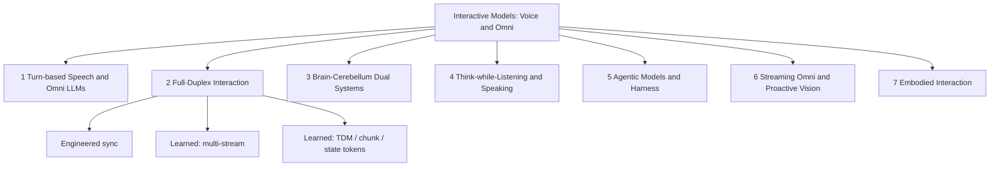

# Awesome Interactive Model

[](https://awesome.re)
[](CONTRIBUTING.md)
[](LICENSE)
[](README_zh.md)

<p align="center">
  
</p>

<p align="center">
A curated map of <b>voice / Omni interactive models</b> organized by <b>how interaction is realized</b>—timing, think/speak scheduling, and effect scope—not by a cascade→E2E→dual-system “evolution ladder”.
</p>

<p align="center">{{AUTO_STATS}}</p>

---

## 📰 News & Updates

- **2026-10-19** 🎉 **Our work, Jarvis**, gives coordination a brain of its own through a dedicated harness that keeps realtime dialogue and background reasoning in sync for full-duplex Audio/Omni agents. [Paper](https://arxiv.org/abs/2610.23804v1) · [Code](https://github.com/JensenYX/Jarvis) · [Demo](https://amphionteam.github.io/Jarvis-Demo/)
- **2026-10-15/16** — OpenAI **GPT-Live-1.1** rolls out with new voices; API adds native **Decisions** delegation and **prompt-to-voice**.
- **2026-10-14** — xAI **Grok Voice 3.0** (`grok-voice-latest` now routes here; 2.0 deprecated).
- **2026-10** — Research wave: RUBATO, D2, DiffuPlex / Diffuplex, SteerablePlex, DuplexAgent-RSI, DuplexAct, VoxTurn, Tyger, ELLSA 2, PERSIST, and more.
- **2026-10-06** — Sesame agentic voice assistants with updated CSM; Hume announces EVI/TTS API sunset (access ends 2026-11-13).
- **2026-10-05** — Amazon **Nova 2.5 Sonic** GA (speech-to-speech realtime).
- **2026-09-10** — OpenAI **GPT-Live** API GA; **gpt-realtime** / **gpt-realtime-mini** announced for deprecation.
- **2026-09** — SeedRealtime, Grok Voice Think Fast, Hibiki-Zero, MiniCPM-o 4.5, PersonaPlex, and many duplex / dual-system papers.

---

## 📑 Contents

{{AUTO_TOC}}

---

## 🎯 Aim

This repository is a bilingual, continuously updated **atlas of Interactive Models** for speech and omni (audio–vision) agents. The list launched on 2026-10-06. A concise report on the taxonomy and open problems: [docs/survey.md](docs/survey.md).

**Interaction** here means the joint control of:

| Axis | Question |
|------|----------|
| **Content** | *What* to say / act |
| **Timing** | *When* to speak, listen, backchannel, or interrupt |
| **Task state** | *How* the underlying task progresses (tools, memory, embodiment) |

We distinguish this list from related awesome repos by:

1. Explicit coverage of **brain–cerebellum dual systems** and **agentic harness** runtimes.
2. An **openness status** on every entry (🔓 / 🧩 / 🔒 / 📄).
3. **Benchmarks grouped by interaction layer** (timing, state, agents, proactivity, …).
4. An **Industry Landscape** with dates and verified deprecations (as of 2026-10-19).

Related lists and references: [Awesome-Full-Duplex-SDM](https://github.com/Ruiqi-Yan/Awesome-Full-Duplex-SDM), [WavChat](https://github.com/jishengpeng/WavChat), [Speech-Trident](https://github.com/ga642381/speech-trident), [Awesome-Audio-LLM](https://github.com/AudioLLMs/Awesome-Audio-LLM), [Awesome-Streaming-Video-Understanding](https://github.com/sotayang/Awesome-Streaming-Video-Understanding).

> **Not an evolution ladder.** Categories describe *compositional roles* (how timing/sync, think/speak, and effects are arranged). Cascades, end-to-end duplex, dual systems, and harnessed agents can coexist and compose.

---

## 📖 Definitions & Terminology

| Term | Meaning in this list |
|------|----------------------|
| **Streaming** | Incremental I/O (tokens/audio frames). Alone ≠ full duplex. |
| **Realtime** | Low perceived latency; product term—check whether duplex is native. |
| **Barge-in** | User can interrupt the system mid-utterance; system should stop or adapt. |
| **Native full-duplex** | One model (or tightly coupled multi-stream net) jointly models listen+speak timelines. |
| **System full-duplex** | Engineered pipeline (VAD / turn detector / ASR–LLM–TTS) that *behaves* duplex. |
| **Omni** | Multimodal (typically audio+vision±text) with shared interaction timeline. |
| **Proactive** | Model decides *whether/when* to speak without an explicit user query. |
| **Harness** | Runtime around the front-end model: tools, context, permissions, task state, result injection. |
| **Thinker–Talker** | Intra-model split: semantic backbone vs speech decoder. **≠** dual-system. |
| **Brain–Cerebellum / Dual-system** | Concurrent fast front-end + slow back-end with result feedback into the live turn. |

### Three common divisions of labour

```text
(A) Thinker–Talker (intra-model)
  Audio ──► [Thinker / LLM] ──► [Talker / speech decoder] ──► Audio
  Same model family; semantic vs acoustic modules. Not dual-system.

(B) Brain–Cerebellum (dual-system, concurrent)
  Mic ──► [Cerebellum / fast Talker] ──► Speaker
              ▲ result inject / control
              └── [Brain / slow Reasoner / Agent / Tools]

(C) Engineered cascade (system duplex)
  Mic ──► VAD/Turn ──► ASR ──► LLM ──► TTS ──► Speaker
           (external controller decides floor)
```

### Design axes (how we classify)

1. **Who controls timing?** Engineered controller vs learned policy.
2. **How are thinking and speaking scheduled?** Think-then-speak · think-while-listen/speak · async dual-system.
3. **What can the model affect?** Speech only · tools/task state (harness) · physical actions (embodied).
4. **Modality:** speech-only vs audio–visual Omni.



---

## 📊 Evaluation Dimensions

| Interaction layer | What is measured | Example benchmarks | Input setting |
|-------------------|------------------|--------------------|---------------|
| Timing & floor | Barge-in, backchannel, turn latency | Full-Duplex-Bench, Talking Turns, FD-Bench | Real / TTS / streaming |
| State update | Mid-turn correction, recovery | EchoChain, IHBench | Duplex dialogue |
| Multi-party | Addressee, overlap | Duplex-MPE, MP-Bench | Multi-speaker |
| Spoken content | Instruction following, knowledge | VoiceBench, URO-Bench | Often S2T / half-duplex |
| Paralinguistics | Emotion, persona, empathy | SD-Eval, VoxDialogue | Speech |
| Voice agents | Tools, tasks, RAG | τ-Voice, VoiceAgentBench | Agent loops |
| Proactivity | When-to-speak without query | ProVoice-Bench, ProactiveVideoQA | Streaming A/V |
| Omni / video | Continuous video + speech | OmniBench, StreamingBench, OVO-Bench | Video streams |

Always report the **input setting**: real human audio · TTS · half-duplex speech-to-text · true full-duplex streaming.

### Dual-system quick contrast

| System | Front-end (cerebellum) | Back-end (brain) | What flows back | Runtime openness |
|--------|------------------------|------------------|-----------------|------------------|
| GPT-Live + Responses | Live speech front-end | Responses / tools / supervisor | Text / tool results into live turn | 🔒 API contracts |
| Gemini Live Extended Thinking | Live A/V session | Extended thinking / tools | Summaries into session | 🔒 |
| Realtime-Venus / Gander | Open duplex talker | Async reasoner / agent | Inject / cancel / task ledger | 🔓 / 🧩 |
| MoshiRAG / KAME / SALMONN-duo | Duplex speech LM | RAG / dual loop | Retrieved or reasoned context | 📄–🔓 varies |
| Thinker–Talker (contrast) | N/A — *intra-model* semantic vs acoustic split | — | Not dual-system | — |

### Harness capability sketch

| Capability | Native tool channel | External harness | Voice-agent SDK |
|------------|--------------------|------------------|-----------------|
| Tools while speaking | Model emits tool tokens / side channel | Runtime pauses / multiplexes | Framework adapters |
| Task state & permissions | Often implicit | Explicit ledger / ACL | App-defined |
| Result injection | Model-conditioned | Message types into front-end | Callbacks / events |
| Open inspectability | Weights + paper | Code runtime | SDK docs |

---

## 🏷️ Legend

| Icon | Status |
|------|--------|
| 🔓 | Open weights |
| 🧩 | Code / runtime only (or limited weights) |
| 🔒 | Closed API / product |
| 📄 | Paper only / weights not yet released |
| ⭐️ | Especially influential or representative |

Badges:      

Entries are sorted **newest first** within each section. The same entry may appear in multiple sections.

---

{{AUTO_SECTIONS}}

---

## ✍️ Citation

If you find this list useful, please cite:

```bibtex
@misc{awesome_interactive_model_2026,
  title        = {Awesome Interactive Model: A Curated List of Voice and Omni Interactive Models},
  author       = {Shengbo Cai},
  year         = {2026},
  howpublished = {\url{https://github.com/Syclus123/Awesome-Interactive-Model}},
  note         = {Accessed: 2026-10-19}
}
```

---

## 🤝 Contributing

See [CONTRIBUTING.md](CONTRIBUTING.md). PRs welcome—especially new dual-system / harness / benchmark entries with verified links and openness status.

Rebuild READMEs after editing YAML:

```bash
python3 scripts/build_readme.py
python3 scripts/verify_arxiv.py
python3 scripts/check_links.py
```

---

## ⭐ Star History

[](https://star-history.com/#Syclus123/Awesome-Interactive-Model&Date)

---

<p align="center">
Made with ❤️ for the interactive speech & omni community · <a href="README_zh.md">中文版</a>
</p>
