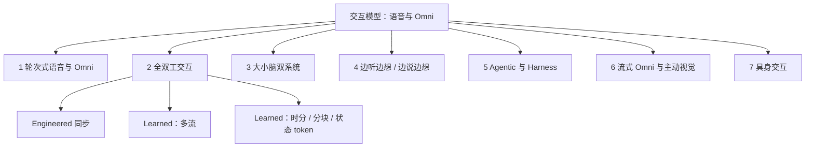

# Awesome Interactive Model

[](https://awesome.re)
[](CONTRIBUTING.md)
[](LICENSE)
[](README.md)

<p align="center">
  
</p>

<p align="center">
一份以「<b>交互如何实现</b>」为中心的语音 / Omni <b>交互模型地图</b>：围绕时机控制、思考与说话的调度、以及模型能影响的范围来组织——<b>不是</b>「级联 → 端到端 → 大小脑」的进化阶梯。
</p>

<p align="center">{{AUTO_STATS}}</p>

---

## 📰 动态与更新

- **2026-10-19** 🎉 **我们的工作 Jarvis**：让协调拥有自己的“大脑”，以专属 Harness 协同实时对话与后台推理，打造全双工 Audio/Omni 智能体。[论文](https://arxiv.org/abs/2610.23804v1) · [代码](https://github.com/JensenYX/Jarvis) · [Demo](https://amphionteam.github.io/Jarvis-Demo/)
- **2026-10-15/16** — OpenAI **GPT-Live-1.1** 上线新音色；API 增加原生 **Decisions** 委派与 **prompt-to-voice**。
- **2026-10-14** — xAI **Grok Voice 3.0**（`grok-voice-latest` 现指向该版；2.0 弃用）。
- **2026-10** — 研究浪潮：RUBATO、D2、DiffuPlex / Diffuplex、SteerablePlex、DuplexAgent-RSI、DuplexAct、VoxTurn、Tyger、ELLSA 2、PERSIST 等。
- **2026-10-06** — Sesame 智能体语音助手与更新版 CSM；Hume 宣布 EVI/TTS API 停服（访问截止 2026-11-13）。
- **2026-10-05** — Amazon **Nova 2.5 Sonic** GA（语音到语音实时）。
- **2026-09-10** — OpenAI **GPT-Live** API GA；**gpt-realtime** / **gpt-realtime-mini** 宣布停用。
- **2026-09** — SeedRealtime、Grok Voice Think Fast、Hibiki-Zero、MiniCPM-o 4.5、PersonaPlex 及大量双工 / 双系统论文。

---

## 📑 目录

{{AUTO_TOC}}

---

## 🎯 目标

本仓库是持续更新的中英双语 **Interactive Model 图谱**，覆盖语音与 Omni（音视频）智能体。本列表于 2026-10-06 上线。分类与开放问题的精炼报告：[docs/survey_zh.md](docs/survey_zh.md)。

此处的 **交互** 指对下列三者的联合控制：

| 维度 | 问题 |
|------|------|
| **内容** | *说什么* / 做什么 |
| **时机** | *何时* 说、听、附和或打断 |
| **任务状态** | 底层任务 *如何推进*（工具、记忆、具身） |

相对相关 Awesome 列表，本仓库多出四点：

1. 系统收录 **大小脑双系统** 与带 **harness** 的 agentic 模型；
2. 每条标注 **开放状态**（🔓 / 🧩 / 🔒 / 📄）；
3. **Benchmark 按交互层** 组织（时机、状态、Agent、主动性等）；
4. **产业全景** 带日期与已核实的停用信息（截至 2026-10-19）。

相关列表与参考：[Awesome-Full-Duplex-SDM](https://github.com/Ruiqi-Yan/Awesome-Full-Duplex-SDM)、[WavChat](https://github.com/jishengpeng/WavChat)、[Speech-Trident](https://github.com/ga642381/speech-trident)、[Awesome-Audio-LLM](https://github.com/AudioLLMs/Awesome-Audio-LLM)、[Awesome-Streaming-Video-Understanding](https://github.com/sotayang/Awesome-Streaming-Video-Understanding)。

> **不是进化阶梯。** 各类别描述的是*组成关系*（时机/同步、思考/说话、效应范围如何安排）。级联、端到端双工、双系统与带 harness 的智能体可以并存、可组合。

---

## 📖 定义与术语辨析

| 术语 | 在本列表中的含义 |
|------|------------------|
| **Streaming（流式）** | 增量输入/输出。 alone ≠ 全双工。 |
| **Realtime（实时）** | 低感知延迟；产品用语——需核对是否原生双工。 |
| **Barge-in（插话/打断）** | 用户可在系统说话中途打断；系统应停止或适应。 |
| **原生全双工** | 单一模型（或紧耦合多流网络）联合建模听+说时间轴。 |
| **系统全双工** | 工程化流水线（VAD / 轮次检测 / ASR–LLM–TTS）*表现*为双工。 |
| **Omni** | 多模态（通常音+视±文）共享交互时间轴。 |
| **Proactive（主动）** | 无显式用户提问时，模型决定是否/何时发言。 |
| **Harness** | 环绕前台模型的运行时：工具、上下文、权限、任务状态、结果回流。 |
| **Thinker–Talker** | 模型内分工：语义主干 vs 语音解码器。**≠** 大小脑双系统。 |
| **大小脑 / 双系统** | 并发的快速前台 + 慢速后台，结果反馈进实时轮次。 |

### 三种常见分工

```text
(A) Thinker–Talker（模型内）
  音频 ──► [Thinker / LLM] ──► [Talker / 语音解码] ──► 音频
  同一模型族；语义 vs 声学模块。不是双系统。

(B) 大小脑（双系统，并发）
  麦 ──► [小脑 / 快速 Talker] ──► 扬声器
            ▲ 结果注入 / 控制
            └── [大脑 / 慢速推理 / Agent / 工具]

(C) 工程级联（系统双工）
  麦 ──► VAD/轮次 ──► ASR ──► LLM ──► TTS ──► 扬声器
           （外部控制器决定发言权）
```

### 设计轴（分类依据）

1. **时机由谁控制？** 工程控制器 vs 学得策略。
2. **思考与说话如何调度？** 先想后说 · 边听/边说边想 · 异步双系统。
3. **模型能影响什么？** 仅语音 · 工具/任务状态（harness） · 物理动作（具身）。
4. **模态：** 纯语音 vs 音视频 Omni。



---

## 📊 评测维度

| 交互层 | 测什么 | 代表 benchmark | 输入设置 |
|--------|--------|----------------|----------|
| 时机与发言权 | 打断、附和、轮次延迟 | Full-Duplex-Bench、Talking Turns、FD-Bench | 真人 / TTS / 流式 |
| 状态更新 | 轮中纠正、恢复 | EchoChain、IHBench | 双工对话 |
| 多方 | 指向、重叠 | Duplex-MPE、MP-Bench | 多说话人 |
| 口语内容 | 指令遵循、知识 | VoiceBench、URO-Bench | 常为 S2T / 半双工 |
| 副语言 | 情感、人设、共情 | SD-Eval、VoxDialogue | 语音 |
| 语音 Agent | 工具、任务、RAG | τ-Voice、VoiceAgentBench | Agent 循环 |
| 主动性 | 无提问时何时说 | ProVoice-Bench、ProactiveVideoQA | 流式音视频 |
| Omni / 视频 | 连续视频 + 语音 | OmniBench、StreamingBench、OVO-Bench | 视频流 |

务必报告 **输入设置**：真人录音 · TTS · 半双工语音转文本 · 真正全双工流式。

### 双系统速览对照

| 系统 | 前台（小脑） | 后台（大脑） | 回流内容 | 运行时开放度 |
|------|--------------|--------------|----------|--------------|
| GPT-Live + Responses | Live 语音前台 | Responses / 工具 / supervisor | 文本 / 工具结果进入实时轮次 | 🔒 API 契约 |
| Gemini Live Extended Thinking | Live 音视频会话 | Extended thinking / 工具 | 摘要进入会话 | 🔒 |
| Realtime-Venus / Gander | 开放双工 Talker | 异步推理 / Agent | Inject / cancel / 任务账本 | 🔓 / 🧩 |
| MoshiRAG / KAME / SALMONN-duo | 双工语音 LM | RAG / 双循环 | 检索或推理上下文 | 📄–🔓 不等 |
| Thinker–Talker（对照） | 不适用——*模型内*语义 vs 声学分工 | — | 不是双系统 | — |

### Harness 能力速览

| 能力 | 原生工具通道 | 外部 Harness | Voice-agent SDK |
|------|--------------|--------------|-----------------|
| 边说边调工具 | 模型发工具 token / 侧信道 | 运行时暂停 / 复用 | 框架适配 |
| 任务状态与权限 | 常为隐式 | 显式账本 / ACL | 应用定义 |
| 结果回流 | 条件化进模型 | 消息类型注入前台 | 回调 / 事件 |
| 可检查性 | 权重 + 论文 | 代码运行时 | SDK 文档 |

---

## 🏷️ 图例

| 图标 | 状态 |
|------|------|
| 🔓 | 开放权重 |
| 🧩 | 仅代码 / 运行时（或权重受限） |
| 🔒 | 闭源 API / 产品 |
| 📄 | 仅论文 / 权重未发布 |
| ⭐️ | 特别有影响力或代表性 |

徽章：     

每节内按 **时间倒序**。同一条目可出现在多个章节。

---

{{AUTO_SECTIONS}}

---

## ✍️ 引用

若本列表对你有帮助，请引用：

```bibtex
@misc{awesome_interactive_model_2026,
  title        = {Awesome Interactive Model: A Curated List of Voice and Omni Interactive Models},
  author       = {Shengbo Cai},
  year         = {2026},
  howpublished = {\url{https://github.com/Syclus123/Awesome-Interactive-Model}},
  note         = {Accessed: 2026-10-19}
}
```

---

## 🤝 贡献

见 [CONTRIBUTING.md](CONTRIBUTING.md)。欢迎 PR——尤其是带可核验链接与开放状态的双系统 / harness / benchmark 新条目。

修改 YAML 后重建 README：

```bash
python3 scripts/build_readme.py
python3 scripts/verify_arxiv.py
python3 scripts/check_links.py
```

---

## ⭐ Star History

[](https://star-history.com/#Syclus123/Awesome-Interactive-Model&Date)

---

<p align="center">
献给交互语音与 Omni 社区 · <a href="README.md">English</a>
</p>
